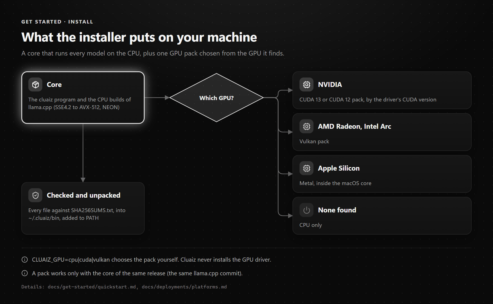

# cluaiz: CI/CD & RELEASE ARCHITECTURE

This document is the entry point for the CI/CD pipeline. The full job list, file names and smoke test are in [docs/deployments/cicd.md](../../docs/deployments/cicd.md); hardware and OS coverage is in [docs/deployments/platforms.md](../../docs/deployments/platforms.md).

---

## 1. CORE + GPU DRIVERS

A release is one **core** per platform plus optional **GPU drivers**, the layout llama.cpp itself ships:

| Part | Contents | Built by |
|:---|:---|:---|
| **Core** | `cluaiz` CLI + API + engine, llama.cpp with every CPU variant (`GGML_CPU_ALL_VARIANTS`), ONNX Runtime for CPU (and DirectML on Windows). Links no GPU runtime, so it starts on any machine. | `release.yml` → `core` |
| **GGUF drivers** | One ggml backend library (`ggml-cuda` for CUDA 12 and 13, `ggml-vulkan`) from the same pinned fork commit, loaded by the core at start (`GGML_BACKEND_DL`), plus the redistributable CUDA runtime (`cudart`, `cuBLAS`). | `cluaize-llama-driver.yml` |
| **ONNX drivers** | ONNX Runtime's CUDA provider for CUDA 12 and 13, from Microsoft's release of the version the core links. cuDNN is downloaded by the engine on first use. | `cluaize-onnx-driver.yml` |

The display driver of the GPU itself is never shipped: it comes from NVIDIA, AMD or Intel.

---

## 2. ONE RELEASE PAGE: `release.yml`

- **Only by hand**: pushes and pull requests never start a build.
- **Run workflow** (manual, a version that equals `[workspace.package] version` in `Cargo.toml`; a first job checks it) builds the core for every platform, runs the smoke test (no GPU, fresh home, pull + answer), calls `cluaize-llama-driver.yml` and `cluaize-onnx-driver.yml` and publishes everything on one GitHub release `v<version>` with `SHA256SUMS.txt`. Each driver workflow can also be run alone to build its drivers without a release.
- **Partial success**: experimental platforms (Linux ARM64, macOS) and drivers may fail without blocking the release; a missing driver is simply absent from `SHA256SUMS.txt`, and the installers then keep that machine on the CPU.

The installers (`install.sh`, `install.ps1`) read `SHA256SUMS.txt` from the release, download only the files for the machine, and refuse any file whose checksum does not match.

On Windows, each smoke-test Engine command runs through `run_clean_windows.ps1`: only the package folder and Windows system DLL locations are available, without developer tools on PATH. This catches runtime libraries accidentally supplied by the build runner. Cluaiz downloads models through Rust/rustls; its native llama.cpp build disables the separate OpenSSL-based HTTPS helper.

The older split workflows (`cluaize-cmd`, `-engine`, `-kernel-*`, `publish-registry`) and their registry scripts were removed: they built package names that no longer exist and never produced a release.

---

## 3. RELEASE NOTES

The release page text comes from `.github/release-notes.md` (install commands and which file each machine needs). Release Drafter was removed: it ran on every push but builds its changelog only from pull requests, which this repository does not use.

---

## 4. Decisions and why

| Decision | Why | Alternative not taken |
|---|---|---|
| File names and matrix structure stay fixed once released | the installers find packs by name (for example `cluaiz-0.1.0-linux-x64-llama-cuda12.tar.gz`) | rename freely |
| Each GPU driver builds in its own job; the release job collects what built | a failing driver must not block the core release | one job for everything |
| `rust-tests.yml` runs only the crates that build without native backends | minutes instead of a llama.cpp build per push; still catches most logic changes | every crate on every push |
| CEP tests run with one test thread | the event bus is shared by the process, so parallel tests could see each other's events (the flaky events test) | a bus per test |
| Release notes from `.github/release-notes.md`, Release Drafter removed | Release Drafter builds its changelog from pull requests, which this repository does not use | Release Drafter |

## 5. What runs where (2026-11-21)

| Workflow | Runs |
|---|---|
| `release.yml` | the core and pack builds, `test/workflows/test_clean_windows_runtime.py`, `.github/scripts/smoke_test.sh` with a small model |
| `cluaize-llama-driver.yml`, `cluaize-onnx-driver.yml` | the GPU driver packs |
| `installer-smoke.yml` | `install.sh` on a GitHub macOS runner, started by hand (`workflow_dispatch`, a release version as input) |
| `docs-check.yml` | `docs/tools/check_docs.py` (registry, links, anchors) |
| `rust-tests.yml` | `cargo test` for the crates that build without llama.cpp or ONNX Runtime (core, hardware, models, plan, context, CEP, security, media, automation) and the CEP file-method contracts; on every push to `main` and pull request. Added 2026-11-21; the same commands passed on the developer machine that day, the workflow itself has not run on GitHub yet |

## 6. Pending

| Item | Why it matters | Needs |
|---|---|---|
| `rust-tests.yml` leaves out llama, onnx, runtime, api and cmd | their tests build llama.cpp; they run only on developer machines and cloud runs | a CPU-only llama.cpp build job with a cache |
| `test/workflows/` installer tests fail against the current installers and are not in any workflow | they protect nothing today | see `test/workflows/README.md` |
