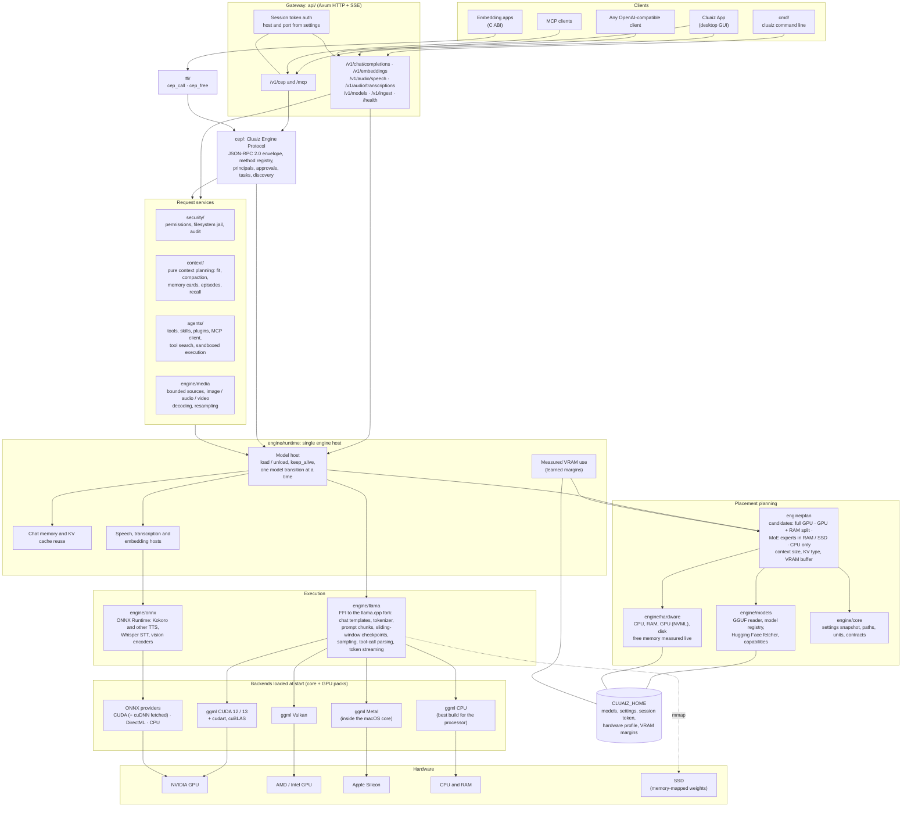
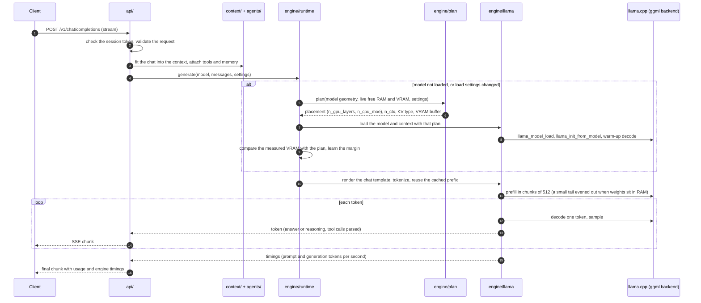

<p align="center">
  <picture>
    <source media="" srcset="assets/cluaiz-cog.webp">
    
  </picture>
</p>

<h3 align="center">
A local AI engine in Rust: chat, vision, speech and embeddings on your own hardware, with the placement on GPU, RAM and CPU decided for you</h3>

</br>
<p align="center">
  
  
  
  
</p>

<p align="center">
  <a href="https://cluaiz.com/docs"><b>Documentation</b></a> &nbsp;|&nbsp;
  <a href="https://cluaiz.com"><b>Website</b></a> &nbsp;|&nbsp;
  <a href="https://discord.gg/mab8kBURz"><b>Discord</b></a> &nbsp;|&nbsp;
  <a href="https://reddit.com/u/cluaiz"><b>Reddit</b></a> &nbsp;|&nbsp;
  <a href="https://linkedin.com/company/cluaiz"><b>LinkedIn</b></a>
</p>

> [!WARNING]
> **Pre-release.** v0.1.0 is the first public build. Expect breaking changes in settings, APIs and file layout
> until the stable release.

## About Cluaiz

Cluaiz is one engine process that runs local models and serves them to apps, scripts and agents:

- **GGUF models** through a fork of [llama.cpp](https://github.com/ggml-org/llama.cpp) linked into the engine:
  chat, vision, audio input, embeddings.
- **ONNX models** through ONNX Runtime: text-to-speech (Kokoro and others), speech-to-text (Whisper), embeddings
  and vision encoders.
- **A placement planner** that measures the free GPU memory and RAM on every load and chooses where the model
  runs, how large the context is and which KV cache type fits. You can override any of it.
- **MoE models larger than the GPU, and larger than free RAM:** attention stays on the GPU, the experts sit in
  RAM, and whatever does not fit RAM is read from the SSD when it is used.
- **APIs** that existing clients already speak (OpenAI-compatible and Ollama-style routes), plus CEP, one
  JSON-RPC 2.0 protocol for everything engine-specific, over HTTP, MCP or a C library.
- **Tools for agents:** skills, plugins and MCP servers, with permission levels, approvals and an audit log.

On the same model file, placement and settings, Cluaiz generates as fast as llama.cpp's own `llama-bench`, and
reads prompts up to 2x faster when a model is split across GPU and RAM (see [Benchmarks](#benchmarks)).

> [!TIP]
> **A 26B model on a 4 GB laptop GPU.** Gemma 4 26B A4B (MoE, 13.3 GB file) on an RTX 3050 Laptop with 4 GB
> VRAM: **16–18 tokens/s** with about 8 GB of free RAM, and still **7.4 tokens/s** with only about 3 GB free,
> when more of the experts are read from the SSD. The planner picks this placement by itself (`n_cpu_moe`); no flags
> needed. Dense models that do not fit RAM + VRAM are refused with the reason instead of crawling from the disk.
> [Details](test/engine_regression/RESULTS.md#gemma-4-26b-a4b-moe-1327-gb-file-4-gb-gpu).

## Quick Start

**1. Install** (downloads the release for your system and the GPU pack for your GPU, and checks every file
against the release's checksums):

```powershell
# Windows
powershell -c "irm https://cluaiz.com/install.ps1 | iex"
```

```bash
# Linux and macOS
curl -fsSL https://cluaiz.com/install.sh | bash
```

**2. Chat with a model** (an installed model, a registry name or a Hugging Face repository; it is downloaded on
first use):

```bash
cluaiz run unsloth/Qwen3-4B-GGUF
cluaiz run unsloth/Qwen3-4B-GGUF "Explain a KV cache in two sentences."
```

**3. See what the planner chooses** on this machine before loading:

```bash
cluaiz show unsloth/Qwen3-4B-GGUF
```

**4. Serve it to other apps** and call the OpenAI-compatible API:

```bash
cluaiz serve
```

```bash
curl http://127.0.0.1:8000/v1/chat/completions \
  -H "Authorization: Bearer $(cat ~/.cluaiz/session.token)" \
  -H "Content-Type: application/json" \
  -d '{"model": "qwen3-4b-gguf-Q4_K_M", "messages": [{"role": "user", "content": "Hello"}]}'
```

`cluaiz list` shows the installed model IDs; `cluaiz token show` shows the API token. The port and host come
from `permission.json` (`cluaiz permission port <n>`).

## Features

### Models and formats

| | GGUF (llama.cpp) | ONNX (ONNX Runtime) | API |
| :--- | :--- | :--- | :--- |
| Text chat, tool calls, thinking models | Supported | Not available | [Chat](docs/api/inference/chat_completions.md) |
| Images, audio, video frames, documents in chat | With a compatible vision / audio projector (Gemma 4 E4B tested) | Not available | [Chat](docs/api/inference/chat_completions.md) |
| Text-to-speech | Experimental | Kokoro and other supported families | [Speech](docs/api/inference/audio_speech.md) |
| Speech-to-text | Not available | Whisper | [Transcriptions](docs/api/inference/audio_transcriptions.md) |
| Text embeddings | Supported (BGE, EmbeddingGemma-2 tested) | Supported (BGE tested) | [Embeddings](docs/api/inference/embeddings.md) |
| Image embeddings | Not available | CLIP-style vision models (FashionCLIP tested, 512-dim vectors) | [Embeddings](docs/api/inference/embeddings.md), [Ingest](docs/api/inference/ingest.md) |
| Document and image ingest | Vision models write text from pages and images; text embeddings for chunks | Text embeddings for chunks; CLIP-style vision models for image and page vectors | [Ingest](docs/api/inference/ingest.md) |

Families and the models tested with each are listed in [`RELEASE.md`](RELEASE.md).

### Documents and ingest

`POST /v1/ingest` and `cluaiz ingest <file>` turn documents and images into text, chunks or vectors. A model is
optional: without one the engine extracts the text itself.

| Input | Native extraction (no model) |
| :--- | :--- |
| Text, Markdown, source code, CSV | Text and chunks |
| Digital PDF | The embedded page text |
| Scanned PDF and images | OCR (PDFium renders the pages, Tesseract reads them) |
| DOCX, legacy DOC | Main-body text and tables |

| Model chosen | Result |
| :--- | :--- |
| None | Text, chunks and extraction metadata |
| A text embedding model (GGUF or ONNX) | Chunk vectors, optionally with the text |
| An ONNX vision (CLIP-style) model, e.g. FashionCLIP | Image or page vectors for similarity search (not text) |
| A GGUF vision model | Text the model writes from the page or image, following an instruction |

Not included yet: XLSX / PPTX parsing and a persistent vector index. Details:
[`docs/api/inference/ingest.md`](docs/api/inference/ingest.md).

### Placement and memory

- Candidates on every load: **full GPU**, **GPU + RAM split**, **MoE experts in RAM** (or read from the SSD when
  they do not fit RAM), **CPU only**. The plan picks the context size and the KV cache type (F16, then Q8_0) and
  keeps a VRAM buffer free.
- The plan is checked against llama.cpp's own dry run, and the VRAM a load really takes is remembered per model,
  so the next plan is closer.
- A model that fits nowhere is refused with the amount missing, instead of thrashing the disk.
- `cluaiz show <model>` prints every candidate with its memory numbers; the server log prints the same plan on
  each load.
- Every value can be set by hand with llama.cpp's flag names (`-ngl`, `-c`, `-ctk`, `-fa`, `-ncmoe`, ...) or in
  a request's `llama` object; a user setting is passed to llama.cpp as it is.

### Speed

- Prompt cache reuse: the shared beginning of a chat stays in the KV cache, and shared chunks after it are
  moved instead of recomputed (llama-server's `--cache-reuse`).
- Prompt chunks shaped for split models: a short last chunk is evened out with the one before it, so layers in
  RAM do not compute it on the CPU.
- Chat templates parsed once per model: about 0.1 s to the first token on a warm prompt.
- The CPU backend picks the best build for the processor at start (SSE4.2 to AVX-512, NEON on ARM).

### APIs

| Route | Purpose |
| :--- | :--- |
| `POST /v1/chat/completions`, `POST /api/chat` | Chat, streaming or not, with tools, images, audio and documents |
| `POST /v1/embeddings` | Text and image embeddings |
| `POST /v1/audio/speech`, `POST /v1/audio/transcriptions` | Text-to-speech, speech-to-text |
| `POST /v1/ingest` | Document to text or vectors |
| `GET /v1/models`, `GET /api/tags`, `POST /api/pull` | Installed models, downloads |
| `POST /v1/cep`, `POST /mcp`, `cluaiz mcp-server` | CEP methods: system, settings, models, files, tools, chat memory, approvals, tasks |
| `cep_call` / `cep_free` (C ABI) | The same CEP messages for apps that embed the engine |

Reference: [`docs/api/README.md`](docs/api/README.md) and [`docs/api/cep/README.md`](docs/api/cep/README.md).

### Tools, agents and security

- **Skills, plugins and MCP servers** installed from the [cluaiz-tools](https://github.com/cluaiz/cluaiz-tools)
  registry (`cluaiz skill install`, `cluaiz plugin install`, `cluaiz mcp install`). Plugins run as separate
  processes.
- **Chat memory:** earlier messages that no longer fit the prompt are recalled when the new message needs them
  ([details](docs/api/inference/chat_completions.md)).
- **Execution policy:** `full_access` or `sandboxed` (default) per engine and per tool; actions outside the
  workspace ask for approval; destructive commands (disk wipes, `rm -rf /`) and credential paths are blocked.
- **API tokens** for every route (`cluaiz token`), and an **audit log** of every write, exec and admin call
  (parameters kept only as a hash).

### Command line

| Command | Purpose |
| :--- | :--- |
| `cluaiz run <model> ["prompt"]` | Chat in the terminal, or answer one prompt |
| `cluaiz pull`, `list`, `rm`, `show` | Download, list, remove, inspect models (with the plan) |
| `cluaiz serve`, `ps` | Start the API server; show the loaded model |
| `cluaiz bench <model>` | Prompt and generation speed (llama-bench) |
| `cluaiz status`, `calibrate` | The hardware the planner sees; re-scan after a hardware change |
| `cluaiz config`, `permission`, `token` | Settings (`settings.json`), permissions (`permission.json`), API tokens |
| `cluaiz skill`, `plugin`, `mcp` | Install and manage tools |
| `cluaiz ingest <file>` | Ingest a document |

Every command and flag: `cluaiz --help` and `cluaiz <command> --help`.

## Supported Hardware

What release v0.1.0 ships (core + GPU packs, chosen by the installer) and where it has run. Details:
[`docs/deployments/platforms.md`](docs/deployments/platforms.md).

| Hardware | Backend | Release package | Tested on |
| :--- | :--- | :--- | :--- |
| **NVIDIA GPU**, Windows | CUDA 12 / CUDA 13 | `win-x64` core + `llama-cuda12` / `llama-cuda13` | ✅ RTX 3050 Laptop 4 GB, Windows 11 (CUDA 13) |
| **NVIDIA GPU**, Linux | CUDA 12 / CUDA 13 | `linux-x64` core + `llama-cuda12` / `llama-cuda13` | ✅ Tesla T4 16 GB, Ubuntu 24.04 (CUDA 12 pack, driver 580) |
| **AMD Radeon / Intel Arc**, Windows and Linux | Vulkan | core + `llama-vulkan` | 🧪 Built, not yet run on this hardware |
| **Apple Silicon** (M1 or newer) | Metal (inside the core) | `mac-arm64` core | ⚠️ M5, 16 GB: installs and chats at llama.cpp's speed for the same settings, but auto placement does not use the Metal GPU yet ([run](test/mac/runs/2026-10-28-m5-air-16gb/SUMMARY.md)) |
| **x86-64 CPU** (SSE4.2 to AVX-512) | CPU, best build picked at start | any core | ✅ Ryzen 7 7435HS (Windows), Xeon 2.3 GHz (Ubuntu) |
| **ARM64 Linux** | CPU (NEON and newer) | `linux-arm64` core | 🧪 Built, not yet run on hardware |

ROCm/HIP, OpenVINO, SYCL and CANN builds are not part of the release yet.

## Benchmarks

Every number comes from [`test/engine_regression/run.py`](test/engine_regression/run.py): the same model file,
placement and settings on Cluaiz (through its chat API) and on llama.cpp's `llama-bench` built from the same
llama.cpp commit. Higher is better.

| | Cluaiz vs llama.cpp |
| :--- | :--- |
| Generation | Equal in every test (within the normal run-to-run noise) |
| Prompt, model fully on the GPU | Equal (after the prompt fixes on `main`) |
| Prompt, model split across GPU and RAM | Cluaiz 1.4x to 2.2x faster on the laptop, up to 1.6x on the T4 |
| Prompt, CPU only | Equal |

<details>
<summary><b>All benchmark tables</b></summary>

### Laptop: RTX 3050 4 GB, Windows 11 (2026-10-12)

*Empirical regression test data measured on **AMD Ryzen 7 7435HS (8C/16T), 24 GB RAM, NVIDIA GeForce RTX 3050 A Laptop (4 GB VRAM), Windows 11, CUDA 13.2**:*

#### Generation speed (Tokens / Second)

| Model (Quantization) | Mode | Placement | Cluaiz | Upstream llama.cpp | Delta |
| :--- | :--- | :--- | :---: | :---: | :---: |
| **Bonsai 4B (Q1_0)** | auto / gpu | Full GPU | **111.0 t/s** | 106.3 t/s | +4% |
| | split | 18 of 36 blocks on GPU | **27.6 t/s** | 28.2 t/s | -2% |
| **Bonsai 8B** | auto / gpu | Full GPU | **72.7 t/s** | 71.9 t/s | +1% |
| | split | 18 of 36 blocks on GPU | **17.7 t/s** | 18.1 t/s | -2% |
| **Llama 3.2 3B (Q4_K_M)** | auto / gpu | Full GPU | **51.9 t/s** | 51.8 t/s | same |
| | split | 14 of 28 blocks on GPU | **23.4 t/s** | 24.9 t/s | -6% |
| **Qwen3 4B (Q4_K_M)** | auto / gpu | Full GPU | **39.3 t/s** | 38.7 t/s | +2% |
| | split | 18 of 36 blocks on GPU | **15.9 t/s** | 14.9 t/s | +7% |
| **Gemma 4 E4B (Q4_K_M)** | gpu | Full GPU | **32.3 t/s** | 32.0 t/s | +1% |
| | split | 21 of 42 blocks on GPU | **14.5 t/s** | 14.6 t/s | same |
| **Gemma 4 26B MoE (13.3 GB)** | auto (split) | Attention GPU + RAM/SSD Experts | **16.0 - 18.0 t/s** | ~4.4 t/s or OOM (user-reported) | Runs on 4 GB VRAM |

#### Prompt processing speed (~530 tokens prompt)

| Model | Full GPU (Cluaiz vs llama.cpp) | Split GPU + RAM (Cluaiz vs llama.cpp) | Split Speedup |
| :--- | :---: | :---: | :---: |
| **Llama 3.2 3B** | 2578 vs 2446 t/s | **1111 vs 810 t/s** | **1.4x faster** |
| **Qwen3 4B** | 1863 vs 1744 t/s | **810 vs 529 t/s** | **1.5x faster** |
| **Gemma 4 E4B** | 1666 vs 1605 t/s | **705 vs 452 t/s** | **1.6x faster** |
| **Bonsai 8B** | 1352 vs 1334 t/s | **769 vs 385 t/s** | **2.0x faster** |
| **Bonsai 4B** | 2270 vs 2129 t/s | **1186 vs 692 t/s** | **1.7x faster** |
| **Bonsai 27B** | 47 vs 30 t/s (shared mem) | **230 vs 110 t/s** | **2.1x faster** |

> [!NOTE]
> **Why Split Prompt is 1.4x–2.2x Faster**: Upstream llama.cpp chunks prompts into fixed 512-token batches (leaving trailing tokens under 32 to run on CPU). Cluaiz balances chunk sizes evenly (e.g. 265 + 265), keeping all prompt chunks on the accelerated path.
> 
> **Time To First Token (TTFT)**: **0.09s - 0.10s** (warm prompt with persistent template caching, down from 0.31s).
> 
> **Complete Reproducible Benchmark**: Full test tables, methodology, and reproduction scripts (`python test/engine_regression/run.py`) are documented in [`test/engine_regression/RESULTS.md`](test/engine_regression/RESULTS.md).
>

### Cloud: Tesla T4 16 GB, Ubuntu 24.04 (2026-10-28)

*Same test (`test/engine_regression/run.py`) on **Google Cloud `n1-standard-8`: Intel Xeon 2.3 GHz (4C/8T), 29 GB RAM,
NVIDIA Tesla T4 (16 GB VRAM), Ubuntu 24.04, driver 580**. Cluaiz is release v0.1.0 installed with `install.sh`
(CUDA 12 pack); llama.cpp is `llama-bench` built on the same machine from the same llama.cpp commit and given the
placement Cluaiz chose.*

#### Generation speed (Tokens / Second)

| Model (Quantization) | Mode | Placement | Cluaiz | Upstream llama.cpp | Delta |
| :--- | :--- | :--- | :---: | :---: | :---: |
| **Qwen3 4B (Q4_K_M)** | auto / gpu | Full GPU | **65.5 t/s** | 62.3 t/s | +5% |
| | split | 18 of 36 blocks on GPU | **14.5 t/s** | 13.9 t/s | +4% |
| | cpu | CPU only | **7.7 t/s** | 7.9 t/s | same |
| **Gemma 3 12B (Q4_K_M)** | auto / gpu | Full GPU | **17.0 t/s** | 15.7 t/s | +8% |
| | split | 24 of 48 blocks on GPU | **5.5 t/s** | 5.4 t/s | same |
| | cpu | CPU only | **3.1 t/s** | 3.1 t/s | same |
| **Mistral Small 3.2 24B (Q4_K_M, 13.3 GB)** | auto / gpu | Full GPU | **8.0 t/s** | 8.2 t/s | same |
| | split | 20 of 40 blocks on GPU | **3.1 t/s** | 3.1 t/s | same |
| **Gemma 4 31B (Q4_K_M, 17.1 GB)** | auto | 41 of 60 blocks on GPU (planner) | **3.2 t/s** | 3.1 t/s | same |
| | split | 30 of 60 blocks on GPU | **2.3 t/s** | 2.3 t/s | same |
| | cpu | CPU only | **1.3 t/s** | 1.3 t/s | same |
| **Gemma 4 31B (Q8_0, 30.4 GB)** | auto | 23 of 60 blocks on GPU (planner) | **1.3 t/s** | 1.3 t/s | same |

#### Prompt processing speed (~535 tokens prompt)

Measured with the prompt fixes on `main` (commits `6120d017`, `4228752a`; not in release v0.1.0). Before them the
T4 showed llama.cpp 7–22% ahead in the cases marked below.

| Model | Full GPU (Cluaiz vs llama.cpp) | Split GPU + RAM (Cluaiz vs llama.cpp) | Split Speedup |
| :--- | :---: | :---: | :---: |
| **Qwen3 4B** | 1935 vs 1978 t/s (v0.1.0: 1758 vs 1882) | **593 vs 393 t/s** | **1.5x faster** |
| **Gemma 3 12B** | 690 vs 725 t/s (v0.1.0: 572 vs 649) | **228 vs 141 t/s** | **1.6x faster** |
| **Mistral Small 3.2 24B** | 372 vs 385 t/s (v0.1.0: 315 vs 340) | 154 vs 153 t/s (1085 tokens) | same |
| **Gemma 4 31B Q4** (planner split, 41/60) | — | **116 vs 117 t/s** (v0.1.0: 96 vs 117) | same |
| **Gemma 4 31B Q8** (planner split, 23/60) | — | **50 vs 51 t/s** (v0.1.0: 45 vs 51) | same |

CPU only, llama.cpp also without a GPU (`-dev none`): Qwen3 4B 27 vs 29, Gemma 3 12B 10 vs 10, Mistral 24B 5 vs 5,
Gemma 4 31B 4 vs 4 t/s.

#### Less RAM, and a model bigger than RAM + VRAM (same VM with 15 GB RAM)

| Model | What happened | Cluaiz | llama.cpp |
| :--- | :--- | :---: | :---: |
| **Gemma 4 31B Q4** (17.1 GB) | Planner: 41 of 60 blocks on GPU | **2.3 t/s** gen, 112 t/s prompt | 2.3 t/s gen, 112 t/s prompt |
| **Gemma 4 31B Q8** (30.4 GB, dense) | Planner refuses: the closest split is 8 GB short of RAM, with a clear message | not loaded (by design) | — |
| | Forced by the user setting `n_gpu_layers 20`: weights read from the disk on every token | 0.008–0.014 t/s gen, 1.5–3.0 t/s prompt | not measured (test ended) |

> [!NOTE]
> **Reading the T4 numbers**: generation equals llama.cpp in every test (-3% to +8%; the T4's clock moves a few
> percent between runs). Prompt processing equals llama.cpp on full GPU after the two fixes and stays up to 1.6x
> faster when a model is split across GPU and RAM. A dense model larger than RAM + VRAM is refused by the planner
> instead of thrashing the disk; streaming from the SSD is used for MoE experts (Gemma 4 26B above).
>
> **Full Report**: methodology, every setting, the exact llama-bench commands and all logs are in
> [`test/cloud/runs/2026-10-28-run5-linux-t4-regression/RESULTS.md`](test/cloud/runs/2026-10-28-run5-linux-t4-regression/RESULTS.md).

</details>

## Architecture

### Technical Specification

- **Purpose:** One local engine process that serves chat, embeddings, speech and transcription through
  OpenAI-compatible routes and its own JSON-RPC protocol (CEP), and decides by itself where each model runs
  (GPU, GPU + RAM, CPU) from live hardware measurements.
- **Backends:** `llama.cpp` (cluaiz fork, linked into the engine) for GGUF models; ONNX Runtime for speech and
  vision models.
- **Platforms:** Windows x64 (MSVC), Linux x64 / ARM64 (glibc 2.38+), macOS Apple Silicon.
- **Delivery:** a CPU core plus optional GPU packs (CUDA 12, CUDA 13, Vulkan); the engine loads the GPU backend
  libraries it finds next to its executable at start.

### Architectural Flow



### One Chat Request, Step by Step



<details>
<summary><b>Workspace crates and recovery rules</b></summary>

### Workspace Crates

| Crate | Path | Responsibility |
| :--- | :--- | :--- |
| `cmd` | [`cmd/`](cmd/) | The `cluaiz` executable: `run`, `serve`, `pull`, `show`, `bench` and the other commands. |
| `cluaiz-api` | [`api/`](api/) | HTTP and SSE gateway: OpenAI-compatible routes, `/v1/cep`, `/mcp`, auth, boot. |
| `cluaiz-cep` | [`cep/`](cep/) | Cluaiz Engine Protocol: JSON-RPC 2.0 envelope, method registry, approvals, tasks, discovery. |
| `cluaiz-ffi` | [`ffi/`](ffi/) | The engine as a C library: `cep_call` / `cep_free`, the same messages as `POST /v1/cep`. |
| `cluaiz-context` | [`context/`](context/) | Pure context planning (no I/O): fitting, compaction policy, memory cards, episodes, recall. |
| `cluaiz-agents` | [`agents/`](agents/) | Tools, skills, plugins, MCP client, tool search, sandboxed execution. |
| `cluaiz-security` | [`security/`](security/) | Permission schema, filesystem jail, audit log. |
| `cluaiz-runtime` | [`engine/runtime/`](engine/runtime/) | The single model host: load / unload, chat sessions, speech and embedding hosts, VRAM use. |
| `cluaiz-plan` | [`engine/plan/`](engine/plan/) | Placement planner: GPU / split / MoE / CPU candidates, context size, KV type, buffers, learned margins. |
| `cluaiz-hw` | [`engine/hardware/`](engine/hardware/) | Hardware discovery: CPU, RAM, GPU (NVML), disks; free memory measured live. |
| `cluaiz-models` | [`engine/models/`](engine/models/) | GGUF reader, model registry, Hugging Face fetcher, capabilities and taxonomy. |
| `cluaiz-core` | [`engine/core/`](engine/core/) | Settings snapshot, environment paths, units, shared contracts. |
| `cluaiz-media` | [`engine/media/`](engine/media/) | Bounded media sources and decoding: images, audio (resampling), video, documents. |
| `llama-engine` | [`engine/llama/`](engine/llama/) | Safe wrapper over the llama.cpp fork (`engine/llama/llama.cpp`): load, prefill, sampling, streaming, multimodal projection. |
| `onnx-engine` | [`engine/onnx/`](engine/onnx/) | ONNX Runtime models: text-to-speech, Whisper speech-to-text, vision; CUDA / DirectML / CPU providers. |

### Failure & Recovery Logic

| Situation | What the engine does |
| :--- | :--- |
| The model does not fit any placement | The planner refuses before loading and says how much is missing (free memory, lower the context, or a smaller quantization). |
| The planner's estimate is off | llama.cpp's own dry run corrects the estimate once per model; after a load, the measured VRAM is kept as a learned margin for the next plan. |
| llama.cpp cannot allocate the planned GPU layers | The load is retried with fewer GPU layers, then on the CPU if the model fits the free RAM; the response reports the fallback. |
| A load would page the model from the disk without end | A CPU load larger than the free RAM is refused instead of thrashing the SSD (MoE experts are the exception the planner chooses on purpose). |
| The user sets placement or memory values | They are passed to llama.cpp as they are; the planner only reports its estimate. |
| A GPU pack or driver is missing | ggml skips that backend and the model runs on the CPU. |

</details>

## Documentation

| Topic | Page |
| :--- | :--- |
| Command line | `cluaiz --help`, `cluaiz <command> --help` |
| HTTP API | [`docs/api/README.md`](docs/api/README.md) |
| CEP (engine protocol) | [`docs/api/cep/README.md`](docs/api/cep/README.md) |
| Model families and formats | [`RELEASE.md`](RELEASE.md) |
| Platforms and GPU packs | [`docs/deployments/platforms.md`](docs/deployments/platforms.md) |
| Release workflow | [`docs/deployments/cicd.md`](docs/deployments/cicd.md) |
| Security and auth | [`docs/architecture/security-and-auth-architecture.md`](docs/architecture/security-and-auth-architecture.md) |
| Engine crates | [`engine/README.md`](engine/README.md) |

## Ecosystem

| Repository | What it is |
| :--- | :--- |
| [cluaiz-app](https://github.com/cluaiz/cluaiz-app) | The desktop app. It talks to a running `cluaiz serve` over HTTP and CEP, so the model is loaded once. |
| [cluaiz-tools](https://github.com/cluaiz/cluaiz-tools) | The registry of skills, plugins and MCP servers that `cluaiz skill / plugin / mcp install` reads. |

## Troubleshooting

| Symptom | Cause and fix |
| :--- | :--- |
| A laptop generates at about half its usual speed | On battery, Windows limits the GPU's power. Plug in the charger. |
| A model forced fully onto a small GPU is very slow on Windows | What does not fit spills into shared GPU memory (system RAM over PCIe). Leave placement on auto, or use fewer GPU layers. |
| Speeds or limits look wrong after a driver update or other change | The deep hardware scan is cached; a change in total RAM, CPU threads or NVIDIA GPUs re-runs it by itself at the next start. For anything else, run `cluaiz calibrate`. |
| The first answer on a Tesla T4 or RTX 20 takes a minute | The GPU pack has no ready-made code for that GPU and the driver compiles it once; later answers are at full speed. |
| "Does not fit" when loading a model | The plan needs more free memory than there is. Close other apps, lower the context, or use a smaller quantization (the message says how much is missing). |

## Windows SmartScreen

The release executables are not signed with a commercial certificate yet, so Windows may show "Windows
protected your PC". Choose **More info**, then **Run anyway**.

## License

Cluaiz is released under the **Apache License 2.0**. See [LICENSE](LICENSE).
