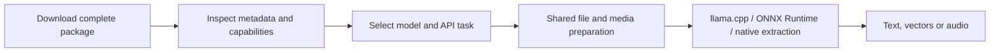

# Cluaiz Engine — Model Support

Updated: October 22, 2026

Cluaiz runs local models through **llama.cpp for GGUF** and **ONNX Runtime for ONNX**. It provides APIs for chat, speech, embeddings and document processing.

## Release highlights

- **Multimodal chat:** send text, images, documents, audio or video to a model that supports the relevant input.
- **Document-to-text or document-to-vector:** use native extraction, select an embedding model, or select a compatible vision model for visual interpretation.
- **Speech APIs:** synthesize speech with supported ONNX families or experimental GGUF speech models; transcribe recordings with compatible ONNX STT packages.
- **EmbeddingGemma-2:** GGUF text embedding support includes its projected 768-dimensional output.
- **Visual PDFs:** compatible GGUF vision models can receive rendered page images, including content that embedded PDF text alone cannot describe.
- **Model discovery:** installed model IDs, voices and language capabilities are available through the API.

## Support at a glance

| Capability | GGUF | ONNX |
|:---|:---|:---|
| Text chat | Supported | Not available |
| Image understanding and image-to-text | Supported with a compatible vision projector | Generative vision models not available |
| Audio understanding in chat | Supported by compatible audio-capable models | Use the speech-to-text API |
| Video understanding | Sampled frames through compatible vision models | Not available as a dedicated pipeline |
| Text-to-speech | Experimental | Supported families listed below |
| Speech-to-text | Not available on the transcription API | Whisper; Moonshine adapter available |
| Text embeddings | Supported | Supported |
| Image embeddings | Not available | Compatible CLIP-style graphs |
| Document extraction and OCR | Native processing; no AI model required | Native processing; no AI model required |
| Image/video generation | Not available | Not available |

**Supported** means an execution path is available for compatible packages. **Experimental** means a path is available for evaluation but still has integration, quality or performance limitations. **Adapter available** means family-specific code exists and complete-package acceptance is pending.

Support depends on the architecture, export and complete package—not just its file extension. The family tables identify where selected models have been tested.

## GGUF model families

GGUF models run through Cluaiz's pinned llama.cpp backend. Multimodal models also need their **matching `mmproj` projector**.

| Family | Capability | Status |
|:---|:---|:---|
| Llama 3.2, Qwen3, Bonsai | Text generation | Selected models tested |
| Gemma 4 E4B | Chat, image understanding, audio input and sampled video frames | Selected package tested |
| BGE | Text embeddings | Selected package tested |
| EmbeddingGemma-2 | Text embeddings | Selected Q8_0 package tested; 768-dimensional output |
| Qwen3-TTS Base | Speech generation with optional reference audio | Experimental; selected package tested |
| Pocket TTS | Speech generation | Native backend available; Cluaiz package testing pending |

The bundled backend also lists vision families such as Gemma 3, Qwen-VL, SmolVLM, Pixtral and InternVL. Their availability in llama.cpp does not mean every package has been tested through Cluaiz. See the [backend model reference](engine/llama/llama.cpp/docs/multimodal.md).

A vision backbone without its matching projector cannot read images. Model size, quantization, context length and available memory also affect whether it can load.

The same chat API handles text and supported media. Images reach the model as pixels; audio requires an audio-capable projector. Video is prepared as ordered, timestamped frames, with audio handled separately when requested. A text-only model receives extracted document text rather than gaining vision capability automatically.

## ONNX speech families

### Text-to-speech

| Family | Status | Package requirements |
|:---|:---|:---|
| Piper / compatible VITS | Supported; selected Piper packages tested | Model, configuration and matching phoneme assets |
| Kokoro | Supported; selected English/Hindi voices tested | Model, tokenizer/configuration and voice styles |
| Audio8 | Experimental; audio generation tested | Slow AR, Fast AR, codec decoder, external weights, tokenizer and runtime manifest |
| Supertonic | Experimental; pipeline unfinished | Compatible text encoder, duration predictor, vector estimator and vocoder |
| Matcha | Experimental; integration and package validation incomplete | Acoustic flow model and vocoder |
| CosyVoice | Experimental; integration and package validation incomplete | Compatible speech/flow models and vocoder |
| Chatterbox | Experimental; integration and package validation incomplete | Semantic generator and audio codec |
| OmniVoice | Experimental; integration and package validation incomplete | Compatible graph, external weights and generation configuration |

Experimental ONNX families are excluded from automatic TTS selection. Explicit selection does not remove their limitations. **Qwen3-TTS ONNX is not supported by a dedicated adapter; its current speech path uses GGUF.**

Voice and language controls depend on the selected package. Kokoro uses preset voice styles; Piper usually has one embedded speaker; Qwen3-TTS Base can use reference audio. The inspected Qwen Base package supports ten languages, excluding Hindi. Separate unconditioned speech requests may produce different voices.

Discover voices and languages independently: one default speaker can support several languages. Audio8 uses automatic language selection and package-local encoded reference profiles; it does not accept an arbitrary speaker name or forced language. For generated voices, a complete narration in one request can preserve context better than independent sentence requests.

Autoregressive models such as Audio8 and Qwen3-TTS can generate more slowly than playback, causing pauses during streaming. Audio output alone does not establish naturalness or consistent speaker identity.

### Speech-to-text

| Family | Status | Package requirements |
|:---|:---|:---|
| Whisper | Supported; selected large-v3-turbo export tested | Compatible encoder/decoder graphs, tokenizer and preprocessing configuration |
| Moonshine | Adapter available; complete-package testing pending | Compatible waveform encoder/decoder export and tokenizer |

Other ONNX STT architectures need their own compatible adapter. Diarization, word timestamps and bidirectional live transcription are not available on the current transcription API.

Recordings longer than the model's input window are processed in ordered windows. Streaming returns incremental transcription output through SSE. Language selection follows the installed package; audio understanding through a GGUF chat model remains a separate capability from this transcription endpoint.

## Embeddings and vision

| Model type | Output | Current support |
|:---|:---|:---|
| GGUF text embedding models | Text vectors | Compatible native sequence pooling; BGE and EmbeddingGemma-2 tested |
| ONNX text embedding models | Text vectors | Compatible tokenizer, graph and pooling; selected BGE export tested |
| ONNX CLIP-style image models | Image vectors | Compatible image processor/graph; FashionCLIP tested |
| GGUF vision language models | Descriptions, answers or recognized text | Compatible backbone/projector; Gemma 4 E4B tested |

**Image embeddings are not image-to-text.** FashionCLIP returns vectors for similarity/search. It does not transcribe a document or generate a caption.

Text embeddings support a single string or a batch. Results are normalized float vectors: the tested BGE packages return 1024 dimensions, EmbeddingGemma-2 returns 768, and FashionCLIP image embeddings return 512. Other packages may have different widths. Keep embeddings from different models in separate indexes, even when their dimensions match.

GGUF embeddings use the model's supported mean, CLS or last-token pooling. ONNX exports need a compatible vector output or explicit supported pooling configuration. The API rejects oversized sequences instead of silently truncating them. Vector storage and retrieval can be handled by an application or external vector database.

ONNX image processing currently accepts compatible batch-one F32 RGB graphs with declared preprocessing. General ONNX VLM/OCR generation pipelines such as Florence-2, TrOCR and Donut are not implemented. GGUF image/audio/video embeddings are also not available.

## Documents and ingest

`POST /v1/ingest` supports native extraction or an optional selected model.

| Input | Native processing |
|:---|:---|
| Text, Markdown, source code and CSV | Read text and create chunks |
| Digital PDF | Extract embedded page text |
| Scanned PDF and images | Native OCR using packaged PDFium/Tesseract providers |
| DOCX | Extract supported main-body text and tables |
| Legacy DOC | Extract supported document text |

### Choose the output you need

| Selection | What the engine does | Result |
|:---|:---|:---|
| No model / native extraction | Reads document text and uses native OCR where needed | Text, chunks and extraction metadata |
| ONNX or GGUF text embedding model | Extracts text, then embeds the chunks | Text vectors, with optional extracted text |
| ONNX image embedding model | Reads image pixels or renders PDF pages | Image/page vectors |
| Compatible GGUF vision model | Reads image or PDF page pixels and follows the extraction instruction | Model-generated text |

For example, a scanned invoice can be read with native OCR, embedded for search, or interpreted by a vision model. These modes share the same source handling but return different outputs. Generative ingest supports a custom instruction and output-token limit; native-first mode can process extracted text when visual input is unnecessary.

Native extraction does not require an AI model. OCR reads characters; vision models can interpret visual content. Neither promises complete layout reconstruction or perfect recognition. Responses include warnings and omissions where applicable.

Digital PDF text uses `pdf-extract`; PDFium renders pages and Tesseract performs native OCR. DOCX tables are extracted as text, not a full spreadsheet schema. Text/code files are read as content—they are not executed.

Audio/video use the speech or chat APIs. General XLSX/PPTX parsing, DOCX embedded-image reasoning and persistent vector-index storage are not included.

## Model packages and shared processing

GGUF and ONNX describe model formats. A **family** describes how a model computes and which preparation/decoding steps it needs. For example, Piper can use a single acoustic graph, while Audio8 needs multiple generators and a codec. A CLIP graph returns vectors; a vision language model generates text.

Shared media components handle file sources, image/audio/video decoding, document extraction and PDF rendering. Task-specific backends then perform inference. Chat attachments and ingest reuse that preparation rather than requiring separate document readers for each model format.

## How models are loaded

The installer groups model weights with required companion files. Runtime validation checks the actual package before execution. A folder category or Hugging Face task label alone does not prove compatibility.

| Package | Typical companions |
|:---|:---|
| GGUF text model | Complete weights/shards and tokenizer/template metadata |
| GGUF vision/audio model | Matching modality-specific `mmproj` projector |
| ONNX embeddings | Tokenizer or image processor, configuration and pooling metadata where required |
| ONNX speech | Family-specific encoder/decoder or synthesis graphs, tokenizer/phonemes, voice assets and referenced external weights |

Install with `cluaiz pull <org>/<repo>`, review the selected bundle, then use its installed ID in requests. Multi-file packages must include their required companions; downloading one graph is not enough for a multistage model.

GGUF supports CPU and GPU placement according to model/settings and available resources. Speech plans the backbone separately from its codec/projector. ONNX acceleration depends on execution-provider and operator support; some operations may run on CPU.

CPU/GPU split places eligible GGUF layers across RAM and VRAM. It helps models run within available resources, but speed still depends on the model and workload. A GPU-resident codec does not mean the speech backbone is also on GPU.

Quantization support depends on the native kernels or ONNX export/provider combination. Download size is not peak RAM/VRAM usage. Placement is chosen when loading; freeing GPU memory later does not automatically move an already loaded CPU model.

## APIs

| Endpoint | Purpose |
|:---|:---|
| [`POST /v1/chat/completions`](docs/api/inference/chat_completions.md) | Text and compatible multimodal chat |
| [`POST /v1/audio/speech`](docs/api/inference/audio_speech.md) | Text-to-speech |
| [`POST /v1/audio/transcriptions`](docs/api/inference/audio_transcriptions.md) | ONNX speech-to-text |
| [`POST /v1/embeddings`](docs/api/inference/embeddings.md) | Text or supported image vectors |
| `GET /v1/models` | Installed models (OpenAI format) |
| [`POST /v1/ingest`](docs/api/inference/ingest.md) | Direct document/image extraction, optional selected-model text or vectors; final JSON response |
| [`POST /v1/cep`](docs/api/cep/README.md) | Engine controls as CEP methods: `audio.run`, `audio.voices`, `audio.languages`, `models.list`, … |

Use the exact installed model ID in the request.

Requests use Bearer authentication. Media can be supplied through actual data URIs, authorized engine-local paths or permitted HTTP(S) sources. Size limits and resource admission apply before expensive processing. Streaming and retention controls are documented per endpoint; they are not identical across all tasks.

The APIs provide **OpenAI-style compatibility with documented extensions**. Speech returns JSON/Base64 WAV or SSE; transcription accepts JSON rather than multipart uploads. Check each endpoint's payload examples before using an SDK.

## Validation and limitations

Recorded acceptance covers selected Windows packages for chat/media input, speech, document extraction and embeddings. It does not certify every model export, language, platform or device. See [acceptance tests](test/media_regression/README.md) and [historical benchmarks](test/engine_regression/RESULTS.md) for scope and reproduction.

Not currently included: general ONNX generative chat/vision, image/video generation, GGUF transcription through the STT endpoint, and a built-in persistent RAG index.

