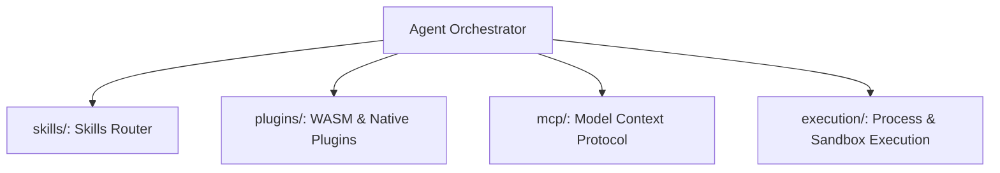

# 🤖 Cluaiz Agents Subsystem (`agents/`)

Orchestration layer for Skills, Plugins, MCP (Model Context Protocol), and Tool executions.

## 📐 Architecture

## 📦 Components

| Module | Responsibility |
|---|---|
| [`skills/`](src/skills/) | Semantic and regex-based routing of local developer skills. |
| [`plugins/`](src/plugins/) | Dynamic plugin loading and sandboxed execution. |
| [`mcp/`](src/mcp/) | Standard Model Context Protocol client implementation. |
| [`execution/`](src/execution/) | Safe process invocation and sandboxing. |
