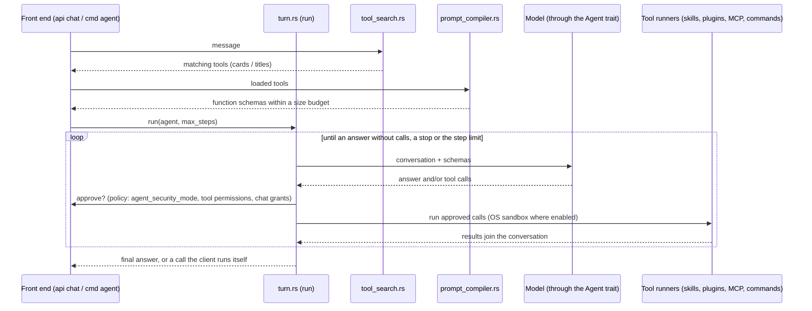

# Component: `agents/` (crate `cluaiz-agents`)

## Technical specification

- **Purpose:** everything around tools and the agent loop that does not run a model: the installed
  tools (skills, plugins, MCP servers) and their registry, install plans and permissions, matching a
  message to tools, the function schemas the model sees, one agent turn for every front end, command
  execution with approval policy and OS confinement, chat memory and notes, and a project's agent
  files (`AGENTS.md`, `.agents/`).
- **Platform support:** Windows, Linux, macOS. OS confinement per platform: see
  [`src/execution/README.md`](src/execution/README.md).
- **Used by:** `api` (26 files import it), `cmd` (12), `automation` (2), counted 2026-11-21.
- **Dependencies:** `cluaiz-core`, `cluaiz-models`, `cluaiz-context`, `cluaiz-security`; `wasmtime` 36
  (WASM plugins, with fuel and a memory limit, `src/plugins/wasm.rs`). It does not depend on `api`,
  `cmd` or any inference backend: the model is reached through the `Agent` trait that the caller
  implements (`src/turn.rs`).

## Architectural flow: one agent turn

An answer the loop cannot use (a call it cannot read, or only thinking) is not run: the model is told
what was wrong and answers again, at most `MOST_CORRECTIONS` (2) times in a row (`src/turn.rs:129`).

## Modules

Module-by-module detail (files, rules, numbers): [`src/README.md`](src/README.md). Folders with their
own README:

| Folder | README |
|---|---|
| `src/execution/` | approval policy, terminal runner, OS sandbox (bubblewrap, sandbox-exec, AppContainer) |
| `src/installer/` | install plans, downloads, dependency and permission handling |
| `src/mcp/` | MCP client: long-lived servers, timeouts, idle stop, crash backoff |
| `src/memory/` | chat event store and notes |
| `src/plugins/` | plugin manifest, WASM and native plugin execution |
| `src/registry/` | `tools_registry.json` |

`lifecycle/`, `skills/`, `telemetry/` and `workspace/` are covered in `src/README.md`.

## Tested

| Run | Result (2026-11-21, Windows 11) |
|---|---|
| `cargo test -p cluaiz-agents` (unit tests in `src/`) | 161 passed, 1 ignored |
| `tests/mcp_reference_server.rs` | 1 ignored (needs the MCP reference server installed) |
| `tests/os_sandbox_real.rs` | 1 ignored on purpose; run by hand on a real machine: Windows run 27, Linux run 28 (8 of 8 checks), see `test/cloud/runs/` |

Live checks through the Engine: tool routing and tool-call format in
[`test/context-runtime/`](../test/context-runtime/README.md) (results from October 2026, not rerun since).

## Decisions and why

| Decision | Why | Alternative not taken |
|---|---|---|
| The turn loop talks to the model only through the `Agent` trait | the API chat and the terminal agent share one loop; neither the crate nor its tests need a model backend | a loop per front end |
| An unusable answer gets a correction, at most twice | small models sometimes write a call inside their thinking or a call that does not parse; one note usually fixes it, and a cap stops a loop | run nothing and fail; or retry without limit |
| Loaded tools unload after `IDLE_TURNS` (3) unused answers unless the manifest sets `default_turns` | tool schemas take context on every request (`src/lifecycle/session_map.rs:32`) | keep every tool loaded |
| Project instructions share one 8,000-character budget, nearest files first | `AGENTS.md` files from several folder levels must not crowd out the conversation (`src/workspace/instructions.rs:13`) | include every file in full |

## Pending

| Item | Why it matters | Needs |
|---|---|---|
| No README in `lifecycle/`, `skills/`, `telemetry/`, `workspace/` | covered only by rows in `src/README.md` | own READMEs if those rows grow |
| macOS confinement never run on a Mac | see `src/execution/README.md` | a real-Mac run |
