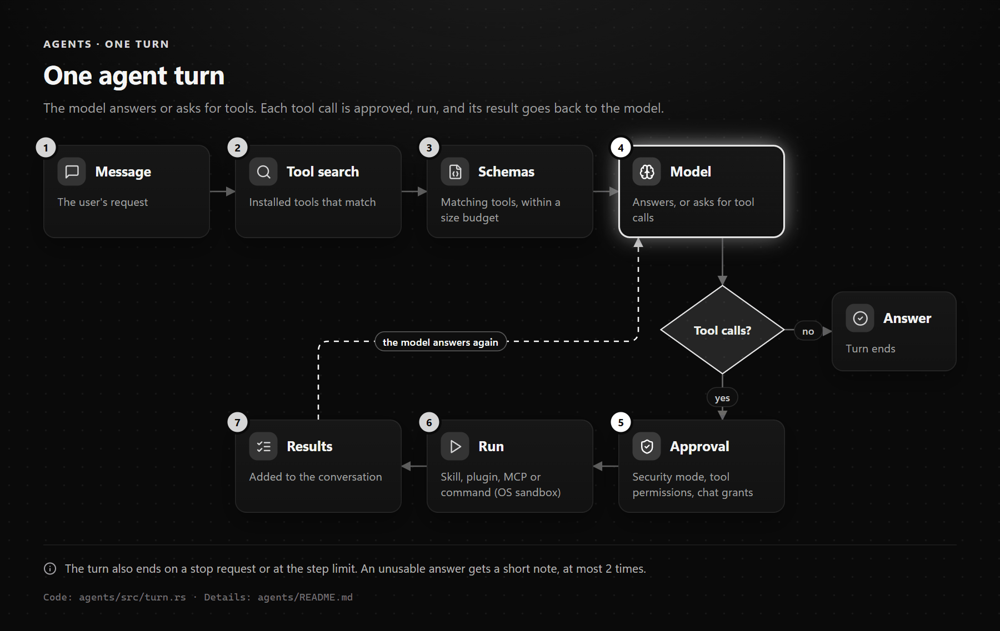

<!-- name: agents
description: The cluaiz-agents crate: installed tools and their registry, permissions, tool matching, one agent turn for every front end, command execution, chat memory and project agent files. -->

# Tools and agent loop (`agents/`, crate `cluaiz-agents`)

Everything around tools and the agent loop that does not run a model: the installed tools (skills, plugins,
MCP servers) and their registry, install plans and permissions, matching a message to tools, the function
schemas the model sees, one agent turn for every front end, command execution with approval policy and OS
confinement, chat memory and notes, and a project's agent files (`AGENTS.md`, `.agents/`).

## At a glance

- **Platform support:** Windows, Linux, macOS. OS confinement per platform: see
  [`src/execution/README.md`](src/execution/README.md).
- **Used by:** `api` (26 files import it), `cmd` (12), `automation` (2), counted 2026-11-21.
- **Dependencies:** `cluaiz-core`, `cluaiz-models`, `cluaiz-context`, `cluaiz-security`; `wasmtime` 36
  (WASM plugins, with fuel and a memory limit, `src/plugins/wasm.rs`). It does not depend on `api`,
  `cmd` or any inference backend: the model is reached through the `Agent` trait that the caller
  implements (`src/turn.rs`).

## How it works: one agent turn

An answer the loop cannot use (a call it cannot read, or only thinking) is not run: the model is told
what was wrong and answers again, at most `MOST_CORRECTIONS` (2) times in a row (`src/turn.rs`). A call
that repeats an earlier one with the same arguments is not run again (the earlier result comes back,
marked as a repeat); the third identical call ends the tool steps (see Decisions).

## Modules

Module-by-module detail (files, rules, numbers): [`src/README.md`](src/README.md). Folders with their
own README:

| Folder | README |
|---|---|
| `src/execution/` | approval policy, terminal runner, OS sandbox (bubblewrap, sandbox-exec, AppContainer) |
| `src/installer/` | install plans, downloads, dependency and permission handling |
| `src/mcp/` | MCP client: long-lived servers, timeouts, idle stop, crash backoff |
| `src/memory/` | chat event store and notes |
| `src/plugins/` | plugin manifest, WASM and native plugin execution |
| `src/registry/` | `tools_registry.json` |

`lifecycle/`, `skills/`, `telemetry/` and `workspace/` are covered in `src/README.md`.

## Tested

| Run | Result (2026-11-21, Windows 11) |
|---|---|
| `cargo test -p cluaiz-agents` (unit tests in `src/`) | 161 passed, 1 ignored |
| `tests/mcp_reference_server.rs` | 1 ignored (needs the MCP reference server installed) |
| `tests/os_sandbox_real.rs` | 1 ignored on purpose; run by hand on a real machine: Windows run 27, Linux run 28 (8 of 8 checks), see `test/cloud/runs/` |

Live checks through the Engine: tool routing and tool-call format in
[`test/context-runtime/`](../test/context-runtime/README.md) (results from October 2026, not rerun since).

## Decisions
| Decision | Why | Alternative not taken |
|---|---|---|
| The turn loop talks to the model only through the `Agent` trait | the API chat and the terminal agent share one loop; neither the crate nor its tests need a model backend | a loop per front end |
| An unusable answer gets a correction, at most twice | small models sometimes write a call inside their thinking or a call that does not parse; one note usually fixes it, and a cap stops a loop | run nothing and fail; or retry without limit |
| Loaded tools unload after `IDLE_TURNS` (3) unused answers unless the manifest sets `default_turns` | tool schemas take context on every request (`src/lifecycle/session_map.rs:32`) | keep every tool loaded |
| The Cluaiz home and its default workspace are their own project root (`agent_folders` in `src/workspace/mod.rs`, using `EnvironmentManager::is_unchosen_workspace`) | nobody chose them as a project; in runs 52 and 53 the test home sat inside the workspace checkout, so every chat with no project open got that checkout's `AGENTS.md` and `.agents/` (about 3,700 tokens): the 0.8B model described Cluaiz instead of answering "The capital of France is". Run 57: the same home outside the checkout gave 881 prompt tokens and Paris. A folder the user opens inside the same checkout still reads it (unit test `a_home_inside_a_repository_keeps_that_repository_out_of_its_default_workspace`; `cargo test -p cluaiz-agents --lib workspace::` 15 passed on 2026-11-24, run 57) | change `project_folders` itself, which the terminal agent also uses for its project root; or tell testers to keep homes outside repositories, which leaves a home folder kept in git (dotfiles) with the same problem |
| A repeated tool call (same name, same arguments as canonical JSON: key order and whitespace do not count) is not run again: the second one gets the earlier result back with `agent.call_repeated`, the third ends the tool steps (`REPEAT_REUSE_AT` 2, `REPEAT_STOP_AT` 3 in `src/turn.rs`), and the front end may ask for a final answer without tools. Counts start again after every call the turn had not seen before | run 77 (Llama 3.2 1B, Engine context tools plus five client tools): `read_item` repeated on 29 of 40 prompts, 414 continuation steps; the Paris-weather prompt alternated `celsius` and `fahrenheit` payloads for 99 steps (26.04 s). Llama 3.2 3B: 11 loop prompts, 248 steps. The old guard counted only back-to-back identical calls (warn at 3, stop at 4), so an alternation never got past 2; replaying run 77's logged calls, the old rule stops 0 of the requests, the new one ends Llama 1B's three 100-call requests after 7, 14 and 17 calls and Llama 3B's 62-, 100- and 20-call requests after 22, 23 and 14 (the replay assumes the model makes the same calls; it does not see the repeat note there). OpenAI Agents SDK (`max_turns`, `MaxTurnsExceeded`) and LangGraph (`recursion_limit`, `GraphRecursionError`) cap total steps only; neither documents a repeat check (read 2026-11-26) | count every identical call in the whole turn without a reset (stops the same requests after 4, 9 and 10 calls, but a coding agent's read, edit, read again would get a stale read back and its third read of a file would end the turn); or only lower `max_steps` (also cuts long turns of distinct calls) |
| Project instructions share one 8,000-character budget, nearest files first | `AGENTS.md` files from several folder levels must not crowd out the conversation (`src/workspace/instructions.rs:13`) | include every file in full |

## Pending

| Item | Why it matters | Needs |
|---|---|---|
| No README in `lifecycle/`, `skills/`, `telemetry/`, `workspace/` | covered only by rows in `src/README.md` | own READMEs if those rows grow |
| macOS confinement never run on a Mac | see `src/execution/README.md` | a real-Mac run |
| Repeat guard (reuse on the 2nd identical call, stop on the 3rd) has no live proof yet | only unit tests (`turn::tests`) and a replay of run 77's logged calls; with client `tools` in the request the turn still ends without a final answer (`ApiTurn::prepare_final_answer`), as before | rerun run 77's B setup with Llama 3.2 1B and 3B: loop prompts, steps and the Paris request |
