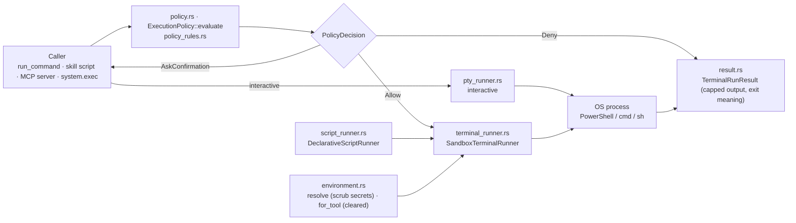

# Component: `agents/src/execution/`

## Technical Specification

- **Purpose:** Running programs on the host for the agent and for tools: the safety check of a
  command line before it runs (`ExecutionPolicy`), the process itself with timeout, cancel, output
  limits and killing the whole process tree (`SandboxTerminalRunner`), an interactive terminal for
  commands that ask questions (`pty_runner.rs`), a skill's script in its declared language
  (`DeclarativeScriptRunner`), and the environment each program gets (`EnvironmentResolver`).
  The terminal agent's `run_command`, the API chat's command tool, skills' scripts, MCP servers
  and `system.exec` run through here.
- **Platform Support:** Windows (PowerShell, `cmd.exe` when the line starts with it, ConPTY,
  `taskkill /T`), Linux and macOS (`sh -c`, a pty, `kill -9 -<pgid>`).
- **Reusability Level:** Internal execution backend of `cluaiz-agents`, used by `cmd` and `api`.
- **Note on the name:** "Sandbox" means checked and limited, not isolated: a command runs with
  the user's rights. Only WebAssembly plugins are closed in (`plugins/`).

## Architectural Flow

## API Contract (Interface)

- **`policy.rs`:** `ExecutionPolicy::evaluate(command, cwd, SecurityMode) -> PolicyDecision`
  (`Allow`, `AskConfirmation { reason, command }`, `Deny { reason }`); `chains(command)`.
- **`policy_rules.rs`:** `HARD_DENIED_PATTERNS`, `SENSITIVE_SYSTEM_PATHS`,
  `READ_ONLY_COMMAND_PREFIXES` (Windows, Linux, macOS).
- **`terminal_runner.rs`:** `SandboxTerminalRunner::{validate_command, execute, execute_direct,
  execute_advanced, execute_with_env, execute_streaming}`, `StdinMode`, `CancelHandle`.
- **`pty_runner.rs`:** `execute_interactive`.
- **`script_runner.rs`:** `ExecutionManifest`, `LanguageConfig`,
  `DeclarativeScriptRunner::{execute, execute_with_tool_dir, resolve_language_config}`.
- **`environment.rs`:** `EnvironmentResolver::{resolve, for_tool}`, `ResolvedEnvironment`.
- **`result.rs`:** `TerminalRunResult`, `truncate_output`, `explain_exit_code`,
  `DEFAULT_MAX_STDOUT_BYTES` (50 KiB), `DEFAULT_MAX_STDERR_BYTES` (20 KiB).
- **Export Type:** Public Rust API of `cluaiz-agents`.
- **Dependencies:** `tokio` (process, time, watch), `portable-pty` (ConPTY / pty),
  `cluaiz_agents::registry::SecurityMode`.

## Deep File Breakdown

- `policy.rs`:
  - **Logic:** In order: (1) a hard-denied destructive pattern anywhere in the line → `Deny`, in
    every mode; (2) a working folder that does not exist → `Deny`; (3) by `SecurityMode`:
    - `Inherit`: a sensitive system or credential path → `Deny`; a recursive delete
      (`rm -rf`, `rmdir /s`, `rd /s`, `Remove-Item -Recurse`) → `AskConfirmation`; else `Allow`.
    - `RequireApproval`: a read-only start (`ls`, `git status`, …) that does not chain → `Allow`;
      anything else → `AskConfirmation`.
    - `AlwaysAllow` → `Allow` (the hard denials still applied in step 1).
  - **Why:** `chains` catches `;`, `|`, `&`, redirects, backticks, `$(` and new lines: a
    read-only start says nothing about the rest of the line.
- `policy_rules.rs`: the three lists, as data.
- `terminal_runner.rs`:
  - **Logic:** Picks the shell (PowerShell `-NoProfile -NonInteractive`, or `cmd.exe /c` when the
    line starts with `cmd`, `sh -c` elsewhere), starts the process with the resolved environment,
    reads stdout and stderr line by line on their own threads (non-UTF-8 console bytes become
    replacement characters), optionally streams each line to a callback.
  - **Flow:** Ends on exit, on timeout (180 s by default) or on cancel; then `kill_tree` ends the
    command and everything it started (`taskkill /PID /T /F`, `kill -9 -<pgid>`). Output that a
    background child keeps open is read for at most 2 s more (`OUTPUT_GRACE`).
  - **Why:** Killing only the shell leaves its children running; tokio's child pipes ended the
    whole program on Windows, so pipes are read on plain threads.
- `pty_runner.rs`: a command in a real terminal (ConPTY / pty) whose keyboard is the user's, for
  installers and prompts that ask questions. Only for a command the user typed or one the model
  marks as interactive.
- `script_runner.rs`: runs a skill's script from its `package.json` `execution` block: the
  language's command template and file extension, a scratch folder, in the tool's folder.
- `environment.rs`:
  - **Logic:** `resolve` inherits the host environment, drops secrets when asked (names like
    `OPENAI_API_KEY`, `AWS_SECRET_ACCESS_KEY`, `GITHUB_TOKEN`, or containing `API_KEY`,
    `SECRET`, `TOKEN`, `PASSWORD`) and puts a virtualenv first on `PATH`. `for_tool` starts from
    an empty environment: only the system basics a program needs plus the tool's own values (see
    [docs/engine/tools.md](../../../docs/engine/tools.md)).
- `result.rs`: the run's result with stdout capped at 50 KiB and stderr at 20 KiB: the first and
  the last half are kept, the middle is cut, on character boundaries; and a sentence for
  well-known exit codes and for a cancel.

## Failure & Recovery Logic

- **Destructive command:** denied before anything runs, in every mode, also with `--yes`.
- **Needs confirmation without a person to ask** (piped stdin, no approval channel): the caller
  refuses it.
- **Timeout or cancel:** the whole process tree is killed; the result says it was cancelled or
  timed out, with the output so far.
- **Background child holding the pipe:** the answer returns after the 2 s grace instead of
  waiting for it.
- **Huge output:** capped; the start and the end are kept, the middle is cut.
- **Missing working folder:** denied with the path.
