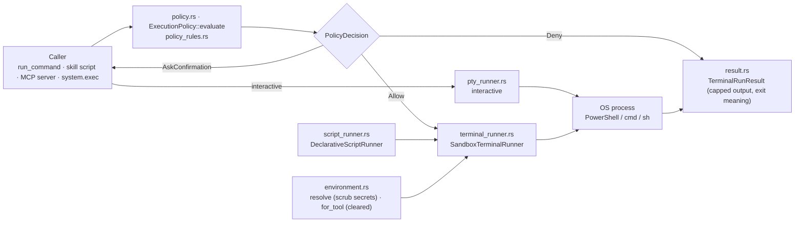

# Component: `agents/src/execution/`

## Technical Specification

- **Purpose:** Running programs on the host for the agent and for tools: the safety check of a
  command line before it runs (`ExecutionPolicy`), the process itself with timeout, cancel, output
  limits and killing the whole process tree (`SandboxTerminalRunner`), an interactive terminal for
  commands that ask questions (`pty_runner.rs`), a skill's script in its declared language
  (`DeclarativeScriptRunner`), and the environment each program gets (`EnvironmentResolver`).
  The terminal agent's `run_command`, the API chat's command tool, skills' scripts, MCP servers
  and `system.exec` run through here.
- **Platform Support:** Windows (PowerShell, `cmd.exe` when the line starts with it, ConPTY,
  `taskkill /T`), Linux and macOS (`sh -c`, a pty, `kill -9 -<pgid>`).
- **Reusability Level:** Internal execution backend of `cluaiz-agents`, used by `cmd` and `api`.
- **Note on the name:** "Sandbox" means checked and limited, not isolated: a command runs with
  the user's rights. Only WebAssembly plugins are closed in (`plugins/`).

## Architectural Flow

## API Contract (Interface)

- **`policy.rs`:** `ExecutionPolicy::evaluate(command, cwd, SecurityMode) -> PolicyDecision`
  (`Allow`, `AskConfirmation { reason, command }`, `Deny { reason }`); `chains(command)`.
- **`policy_rules.rs`:** `HARD_DENIED_PATTERNS`, `SENSITIVE_SYSTEM_PATHS`,
  `READ_ONLY_COMMAND_PREFIXES` (Windows, Linux, macOS).
- **`terminal_runner.rs`:** `SandboxTerminalRunner::{validate_command, execute, execute_direct,
  execute_advanced, execute_with_env, execute_streaming}`, `StdinMode`, `CancelHandle`.
- **`pty_runner.rs`:** `execute_interactive`.
- **`script_runner.rs`:** `ExecutionManifest`, `LanguageConfig`,
  `DeclarativeScriptRunner::{execute, execute_with_tool_dir, resolve_language_config}`.
- **`environment.rs`:** `EnvironmentResolver::{resolve, for_tool}`, `ResolvedEnvironment`.
- **`result.rs`:** `TerminalRunResult`, `truncate_output`, `explain_exit_code`,
  `DEFAULT_MAX_STDOUT_BYTES` (50 KiB), `DEFAULT_MAX_STDERR_BYTES` (20 KiB).
- **Export Type:** Public Rust API of `cluaiz-agents`.
- **Dependencies:** `tokio` (process, time, watch), `portable-pty` (ConPTY / pty),
  `cluaiz_agents::registry::SecurityMode`.

## Deep File Breakdown

- `policy.rs`:
  - **Logic:** In order: (1) a hard-denied destructive pattern anywhere in the line → `Deny`, in
    every mode; (2) a working folder that does not exist → `Deny`; (3) by `SecurityMode`:
    - `Inherit`: a sensitive system or credential path → `Deny`; a recursive delete
      (`rm -rf`, `rmdir /s`, `rd /s`, `Remove-Item -Recurse`) → `AskConfirmation`; else `Allow`.
    - `RequireApproval`: a read-only start (`ls`, `git status`, …) that does not chain → `Allow`;
      anything else → `AskConfirmation`.
    - `AlwaysAllow` → `Allow` (the hard denials still applied in step 1).
  - **Why:** `chains` catches `;`, `|`, `&`, redirects, backticks, `$(` and new lines: a
    read-only start says nothing about the rest of the line.
- `policy_rules.rs`: the three lists, as data.
- `terminal_runner.rs`:
  - **Logic:** Picks the shell (PowerShell `-NoProfile -NonInteractive`, or `cmd.exe /c` when the
    line starts with `cmd`, `sh -c` elsewhere), starts the process with the resolved environment,
    reads stdout and stderr line by line on their own threads (non-UTF-8 console bytes become
    replacement characters), optionally streams each line to a callback.
  - **Flow:** Ends on exit, on timeout (180 s by default) or on cancel; then `kill_tree` ends the
    command and everything it started (`taskkill /PID /T /F`, `kill -9 -<pgid>`). Output that a
    background child keeps open is read for at most 2 s more (`OUTPUT_GRACE`).
  - **Why:** Killing only the shell leaves its children running; tokio's child pipes ended the
    whole program on Windows, so pipes are read on plain threads.
- `pty_runner.rs`: a command in a real terminal (ConPTY / pty) whose keyboard is the user's, for
  installers and prompts that ask questions. Only for a command the user typed or one the model
  marks as interactive.
- `script_runner.rs`: runs a skill's script from its `package.json` `execution` block: the
  language's command template and file extension, a scratch folder, in the tool's folder.
- `environment.rs`:
  - **Logic:** `resolve` inherits the host environment, drops secrets when asked (names like
    `OPENAI_API_KEY`, `AWS_SECRET_ACCESS_KEY`, `GITHUB_TOKEN`, or containing `API_KEY`,
    `SECRET`, `TOKEN`, `PASSWORD`) and puts a virtualenv first on `PATH`. `for_tool` starts from
    an empty environment: only the system basics a program needs plus the tool's own values (see
    [docs/engine/tools.md](../../../docs/engine/tools.md)).
- `os_sandbox.rs`: `confine` / `confine_here` turn a program and its arguments into the confined
  ones for this platform; `SandboxPolicy::for_agent` / `for_tool` say what a process may touch;
  `current_mode` reads `os_sandbox` (or `CLUAIZ_OS_SANDBOX`); `status_line` for `/permissions`. See the
  section "OS sandbox" below.
- `os_sandbox/appcontainer.rs`: the Windows backend: helper arguments, the helper's own parsing, ACL
  grants and the `CreateProcessW` spawn inside the AppContainer.
- `result.rs`: the run's result with stdout capped at 50 KiB and stderr at 20 KiB: the first and
  the last half are kept, the middle is cut, on character boundaries; and a sentence for
  well-known exit codes and for a cancel.

## Failure & Recovery Logic

- **Destructive command:** denied before anything runs, in every mode, also with `--yes`.
- **Needs confirmation without a person to ask** (piped stdin, no approval channel): the caller
  refuses it.
- **Timeout or cancel:** the whole process tree is killed; the result says it was cancelled or
  timed out, with the output so far.
- **Background child holding the pipe:** the answer returns after the 2 s grace instead of
  waiting for it.
- **Huge output:** capped; the start and the end are kept, the middle is cut.
- **Missing working folder:** denied with the path.

## OS sandbox (`os_sandbox.rs`, 2026-11-20)

Every process this crate starts for an agent or a tool goes through `os_sandbox::confine_here`: agent
commands (`terminal_runner.rs` direct and shell, `pty_runner.rs`), MCP servers (`mcp/client.rs`) and native
plugins (`plugins/executor.rs`). Plan and reasons: `.agent/plans/security/os-sandbox.md`.

| Platform | Backend | What a confined process gets |
|---|---|---|
| Linux | bubblewrap at `/usr/bin/bwrap` or `/bin/bwrap` (never through `PATH`), used only when a probe run with the same namespace flags succeeds (WSL1, containers and kernels without unprivileged user namespaces count as no backend) | whole filesystem read-only; fresh `/proc`, `/dev`, `/tmp`; agent: `$HOME` and the Cluaiz home hidden, the toolchains on `PATH` under `$HOME` back read-only (`~/.cargo` with `~/.rustup`, `~/.nvm`, `~/.pyenv`, `~/.local/bin`, ...); tool: `$HOME` secret folders (`.ssh`, `.gnupg`, `.aws`, `.config/gh`, `.docker`), cargo's credential files and the Cluaiz home hidden, its package folder read-only; a secret inside any root that comes back is hidden again after it; the workspace writable (secret folders masked again when the workspace is `$HOME`); own PID namespace; no network unless allowed |
| macOS | `/usr/bin/sandbox-exec` with a generated profile | the same rules as a Seatbelt profile |
| Windows | AppContainer (`os_sandbox/appcontainer.rs`), one container per workspace | only what an ACL grants the container: the workspace (full access) and the read roots; Windows and Program Files stay readable (Windows grants them to all app containers); the user's home is not readable; no network unless allowed, and never `localhost` |

How the Windows backend starts a command: an AppContainer is a token attribute passed to `CreateProcessW`,
and `std`, `tokio` and `portable-pty` commands cannot pass it. So `confine` returns this binary with
`--cluaiz-os-sandbox-exec <policy> -- <command>`; `cmd/src/main.rs` calls `run_helper_if_requested` first,
which grants the ACLs, starts the command in the container with its own std handles (the caller's pipes or
terminal pass through), waits, and exits with the command's code (126 when the setup itself fails). The
helper sits in a kill-on-close job, so killing it on a timeout also ends the command. Jan does the same
(`competitor-repos/jan@da44e32`, `tauri-plugin-agent-tools/src/tools/appcontainer.rs`); Codex's
restricted-token backend with sandbox users and firewall rules was not taken, because our policy is a few
roots and one network switch. Only a binary that called `run_helper_if_requested` gets this backend, so a
test binary never re-runs itself.

Decisions: an ACE is written only when the folder does not already have it, because applying an
inheritable ACE walks the whole tree (seconds on a project with `target/`); a workspace that is the home
folder or above it is not confined (auto runs it unconfined with the warning, required refuses), because
granting it would rewrite the ACL of every file in the profile; secret folders inside a granted root get a
deny ACE.

Mode: `os_sandbox` in permission.json (`cluaiz permission os-sandbox <mode>`, CEP `config.set` section
`engine`), or `CLUAIZ_OS_SANDBOX` for one run; read on every command. A value that is not one of the three
counts as `required`, so a typo never turns confinement down. `auto` (default: confine when a backend exists, else run and warn once),
`required` (refuse without a backend), `off`. Network: agent commands keep it until the execution policy has a
network permission; a tool loses it only when its declared `network` permission is off (`tool_network`).
`/permissions` and `/strict` in the terminal agent print the state (`status_line`).

On Windows, auto mode does not confine: in run 27 Node.js (its installer's folder does not grant app
containers access) and a Python installed under AppData did not start inside a container, so confining by
default would break common agent commands. `os_sandbox = required` confines. Inside a container
PowerShell's progress bar cannot read the console; `$ProgressPreference='SilentlyContinue'` avoids it.

Tested: argument and profile unit tests (`cargo test -p cluaiz-agents --lib os_sandbox`, 17 pass). Windows
on a real machine: `test/cloud/runs/2026-11-20-run27-windows-os-sandbox/` (home, `.ssh`, `.cluaiz` and
Documents denied, workspace writable, network only when allowed, exit codes pass through). Linux on a real
machine: `test/cloud/runs/2026-11-21-run28-linux-os-sandbox/` (Ubuntu 24.04: 8 / 8 checks after the AppArmor
profile; stock 24.04 blocks bubblewrap and the probe falls back). Not tested yet: macOS.

## Pending

| Item | Why it is open |
|---|---|
| A real run on macOS | Linux done in run 28; the same test runs on a Mac: `cargo test -p cluaiz-agents --test os_sandbox_real -- --ignored --nocapture` |
| Ubuntu 23.10+ blocks bubblewrap by default (AppArmor) | Run 28: the probe falls back to unconfined; the user needs the AppArmor profile in run 28's SUMMARY. A notice that names it, or an installer step, is not built |
| Agent commands keep the network | No network permission for agent commands yet; cutting it would break `npm install` and `cargo build` |
| Windows: agent and MCP through `required` end to end | Run 27 called the helper directly; the agent and MCP paths are covered by unit tests only |
| Toolchain read roots measured on Linux and macOS (does `cargo build`, `npm test`, `python` run confined?) | Derived from `PATH` (`toolchain_roots`), unit-tested only; read-only, so a download into `~/.cargo/registry` or `~/.npm` fails |
| Windows: per-user toolchains (Python under AppData) in `required` mode | Not given back: a read root on Windows is an ACL grant on the user's own folders |
