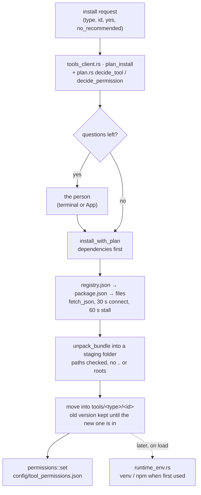

# Component: `agents/src/installer/`

## Technical Specification

- **Purpose:** Installing tools (skills, plugins, MCP servers) from the Cluaiz Tools registry:
  the plan before anything is downloaded (the tool, its dependencies and the permissions each
  asks for, decided by the user's agent mode), fetching and unpacking packages safely, putting
  them in place with a way back, recording the permission answers, removing tools and clearing
  their caches, and preparing a tool's runtime (a Python virtual environment, npm packages).
  `cluaiz <type> install|remove|cache`, CEP `tools.install` / `tools.remove` /
  `tools.clear_cache` and the agent use it.
- **Platform Support:** Windows, Linux, macOS. A plugin's native binary is `.dll`, `.so` or
  `.dylib` by OS; WebAssembly plugins are `.wasm` everywhere.
- **Reusability Level:** Internal to `cluaiz-agents`.
- **Rules it implements:** cluaiz-tools
  [package spec](https://github.com/cluaiz/cluaiz-tools/blob/main/docs/package-spec.md)
  (Dependencies, Permissions); the Engine side is in
  [docs/engine/tools.md](../../../docs/engine/tools.md).

## Architectural Flow

## API Contract (Interface)

- **`plan.rs`:** `Need` (`Required`, `Recommended`, `Optional`; absent = required), `Choice`
  (`Install`, `Ask`, `Suggest`, `Installed`), `PermissionChoice` (`On`, `Off`, `Ask`),
  `mode_of`, `decide_tool`, `decide_permission`, `PlannedTool`, `PlannedPermission`,
  `InstallPlan` (`resolve`, `describe`, `has_questions`), `Approved` (`all`, `from_json`),
  `Resolved`, `dependencies(manifest)`, `plan_permissions`.
- **`tools_client.rs`:** `ToolsInstaller::{install_component, plan_install, install_with_plan,
  remove_component, is_installed, is_valid_component_id, list_installed_components,
  list_component_cache, …}`, `CacheClearReport`.
- **`runtime_env.rs`:** `RuntimeEnvironmentManager::{venvs_dir, tool_venv_dir, detect_runtime,
  is_environment_ready, provision_environment}`, `RuntimeType` (`Python`, `Node`, `Native`,
  `PureSkill`), `EnvironmentStatus`.
- **Export Type:** Public Rust API of `cluaiz-agents`.
- **Dependencies:** `reqwest`, `zip`, `serde_json`, `tokio`, `crate::permissions`,
  `crate::registry`; `uv` or `python` / `python3` and `npm` on the machine for runtimes.

## Deep File Breakdown

- `plan.rs`:
  - **Logic:** The decisions, as tables:
    - A dependency: `optional` is only suggested; in `full_access` everything else is installed;
      in `sandboxed` a `required` one is installed unless it asks for a sensitive permission;
      the rest is asked.
    - A permission: a sensitive one is always asked; in `strict` every one is asked; otherwise
      its default applies without asking.
    - Any mode name other than `full_access` / `strict` counts as `sandboxed`.
  - **Flow:** `InstallPlan::resolve(&Approved)` turns the plan and the answers into what to
    install; a required dependency that is not approved makes it fail before any download.
- `tools_client.rs`:
  - **Logic:** `plan_install` reads the tool's `package.json` from the registry, walks its `dependencies` (dependencies first) and plans each.
    `install_with_plan` installs what was allowed, then records the permission answers
    (`permissions::set`) and returns lines for the person: installed, permissions, skipped,
    suggested. `install_component` is the no-questions form: every question counts as no, and a
    required dependency that would need asking stops it with a hint to use `--yes`.
  - **Flow (one package):** `fetch_json` (says whether the server was unreachable, refused or
    sent something that is not JSON) → the files the version lists, each path checked to be
    inside the package (no root, no drive, no `..`) → `unpack_bundle` into a staging folder
    (the native binary named `<id>.dll|.so|.dylib|.wasm`) → the staged folder replaces
    `tools/<type>/<id>`; an existing version is moved aside first and restored if the new one
    cannot be put in place.
  - **Registry URL (`registry_url`):** `manifest_url` under `web.tools` (or `tools`; `hub` is
    the old name) in the Cluaiz config folder's `package.json`, else the official
    `https://raw.githubusercontent.com/cluaiz/cluaiz-tools/main/registry.json`. Only the config
    folder counts: a `package.json` in the folder a command runs in never chooses where tools
    come from. The install banner prints the URL in use.
  - **Remove:** deletes the tool's folder and forgets its permission choices
    (`permissions::forget`).
  - **Cache:** each tool's `.cache` folder; clearing with `all` removes every cached file,
    otherwise only temporary ones (`temp_*`, `*.tmp`). The installed tool is never removed.
  - **Why:** `is_valid_component_id` allows one plain folder name only, so an id can never point
    at its category folder or outside it.
- `runtime_env.rs`:
  - **Logic:** `detect_runtime`: `requirements.txt` / `pyproject.toml` / `setup.py` → Python;
    `package.json` → Node; a `.dll/.so/.dylib/.wasm/.exe` → Native; otherwise a pure skill.
    Python tools get their own virtual environment in `~/.cluaiz/venvs/<tool id>/` (`uv venv`,
    else `python -m venv`); Node tools get their npm packages in their own folder, only when the
    manifest lists npm packages (Cluaiz's own `dependencies` objects are not npm's).
  - **Flow:** Prepared when a tool is first loaded (`lib.rs`), not during the install.
  - **Why:** Packages stay out of the user's own Python and Node.

## Failure & Recovery Logic

- **Registry unreachable / refused / not JSON:** the error says which; nothing is installed.
- **Download stalls:** abandoned after 60 s without bytes; connect waits up to 30 s.
- **A file path that leaves the package:** refused before unpacking.
- **New version cannot be put in place:** the old version is restored.
- **A dependency fails:** the tool stays installed and the dependency is named in the result.
- **Required dependency not approved:** the install stops before any download.
- **No `uv` or `python`:** the tool's environment is not ready; loading it reports why.
