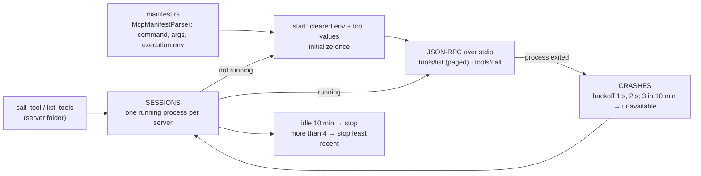

# Component: `agents/src/mcp/`

## Technical Specification

- **Purpose:** The Engine as an MCP **client**: it starts installed MCP servers (stdio), keeps
  each one running as one long-lived process, lists its tools and calls them. (The Engine as an
  MCP **server** is `api/src/cep/mcp.rs` and `cluaiz mcp-server`.)
- **Platform Support:** Windows (a job object ends the server and everything it started),
  Linux, macOS.
- **Reusability Level:** Internal to `cluaiz-agents`; used by `ToolsEngine`, tool search (tool
  lists) and the API chat.

## Architectural Flow

## API Contract (Interface)

- **`client.rs`:** `McpClient::{list_tools, call_tool, get_cached_tools, clear_tool_cache,
  stop_server, is_unavailable}`; `Job` (Windows job object, a no-op elsewhere).
- **`manifest.rs`:** `McpManifest`, `McpDiscovery`, `McpActivation`, `McpExecution`,
  `McpManifestParser::parse_file`.
- **Export Type:** Rust, inside `cluaiz-agents`.
- **Dependencies:** `tokio` (process, timers), `serde_json`, `crate::execution::environment`
  (`for_tool`), `crate::tool_env`; `windows-sys` for the job object.

## Deep File Breakdown

- `manifest.rs`: reads the server's `package.json`: how to start it (`command`, `args`), its
  fixed `execution.env`, discovery and activation fields.
- `client.rs`:
  - **Start:** the process starts from a cleared environment (system basics, the server's
    `execution.env`, the values named in its `env`), is initialized once, then serves any number
    of requests on the same connection.
  - **Timeouts:** a request waits 60 s; the first call of a new process waits up to 180 s,
    since a first start can include a package download (`npx -y`, `uvx`).
  - **Running servers:** a server with no request for 10 minutes is stopped and started again on
    its next call; at most 4 run at once, and starting one more stops the least recently used.
  - **Tool lists:** `tools/list` is read page by page (at most 50 pages) and cached per server;
    `clear_tool_cache` drops the cache.
  - **Windows:** ending the launcher (`npx.cmd`, `uvx`) would leave the real server running and
    holding handles it inherited (such as a listening port); the job object ends all of them
    when the server stops and when the Engine exits.
  - **Why:** Reusing one process per server keeps calls fast; the limits keep idle servers from
    holding memory.

## Failure & Recovery Logic

- **Server exits on its own (a crash):** recorded; it is started again after 1 s, then 2 s; after
  3 crashes within 10 minutes it is not started until the window passes, and
  `is_unavailable` is true (the tool is offered as unavailable).
- **Request timeout:** the call fails with a timeout error; the process keeps running.
- **Start timeout:** the start fails after 180 s; the error names the server.
- **Server not allowed a permission:** asked before each call (`registry/types.rs`); the MCP
  server itself is not closed in.
