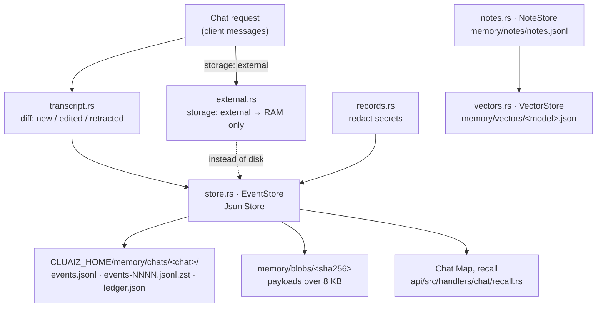

# Component: `agents/src/memory/`

## Technical Specification

- **Purpose:** Chat memory on disk, with no database: each chat's **event log** (what was said
  and done, in order, append-only JSON lines), from which the Chat Map (cards, index, recall) is
  built; **durable notes** (facts and preferences that outlive a chat); **embeddings** of notes
  and project facts made once and kept; and **execution records** with secrets taken out. The API
  chat (`api/src/handlers/chat/`), the CEP `memory.*` and `notes.*` methods and the terminal agent
  read and write through this folder.
- **Platform Support:** Windows, Linux, macOS (plain files, `zstd` for closed segments).
- **Reusability Level:** Internal library of `cluaiz-agents`, public to the API and the CLI.

## Architectural Flow

## API Contract (Interface)

- **`mod.rs`:** `memory_root()` (`<CLUAIZ_HOME>/memory`), `chat_stem(chat_id)` (safe folder
  name of a chat), re-exports.
- **`events.rs`:** `Event` (`v`, `id`, `chat`, `seq`, `ts`, `kind` + the kind's fields),
  `NewEvent`, `EVENT_VERSION` (1). Kinds: `message`, `message.edited`, `message.retracted`,
  `tool_call`, `tool_result`, `approval`, `context_edit` (load, unload, compaction).
- **`store.rs`:** trait `EventStore` (the backend contract), `JsonlStore` (built-in), `ReadLog`,
  `DeleteReport`, `SEGMENT_BYTES` (8 MiB), `BLOB_BYTES` (8 KiB).
- **`external.rs`:** `MemStore`, `register_external`, `forget_external`, `is_external`,
  `mem_store`, `store_for(chat)` (the store a chat uses).
- **`transcript.rs`:** `ClientMessage`, `Logged`, `message_key`, `transcript`, `diff`,
  `Change`, `changes`, `change_events`.
- **`notes.rs`:** `Note`, `Extra`, `NoteStore` (`replace`, …), `KINDS` (`preference`, `fact`,
  `person`, `instruction`, `other`), `FACT_PREFIX`, `normalize_id`, `word_overlap`,
  `same_subject`, `similar`, `SIMILAR_WORDS` (1/3).
- **`vectors.rs`:** `VectorStore`, `model_key`, `text_hash`, `cosine`, `forget_model`.
- **`records.rs`:** `REDACTED`, `call_json`, `files_touched`, `redact`, `redact_call`.
- **Export Type:** Public Rust API of `cluaiz-agents`.
- **Dependencies:** `serde_json`, `zstd`, `sha2`, `chrono`, `cluaiz_core` (home folder).

## Deep File Breakdown

- `store.rs`:
  - **Logic:** `JsonlStore` writes one JSON line per event to the chat's current segment; at
    8 MiB the segment is closed and compressed with zstd (`events-0001.jsonl.zst`, …). A payload
    over 8 KiB (a long tool output) goes to a content-addressed blob and the event keeps its
    hash.
  - **Flow:** Every append is written and flushed when it happens; `sync`, at the end of a turn,
    asks the OS to put it on disk.
  - **Why:** Append-only plain files survive crashes and are readable by any tool; a line cut
    short by a crash is skipped and reported, the rest of the chat stays readable.
- `events.rs`: the event shapes and the version number (bump it when a kind changes shape).
- `transcript.rs`:
  - **Logic:** The visible transcript from the events, and the events a request adds. Client
    messages are matched by position and key (the client's message `id`, else a hash of role and
    text): new → `message`, changed → `message.edited` (supersedes the old), no longer sent →
    `message.retracted`.
  - **Why:** Clients resend the whole conversation; nothing is deleted, so edits are history.
- `external.rs`:
  - **Logic:** `storage: "external"`: the App keeps the chat, the Engine keeps it in RAM only
    (no event log, ledger or saved KV on disk). The App gets the events with each answer and
    sends the chat back with `POST /v1/chat/{id}/import` after a restart.
- `notes.rs`:
  - **Logic:** `<CLUAIZ_HOME>/memory/notes/notes.jsonl` holds the current notes only; a change
    rewrites the file. A note is `proposed` (the model's `remember`, waiting for the user),
    `confirmed` or `active`; scope is one chat, a workspace, or every chat.
  - **Flow:** A newer note replaces an older one only when the model or the user names the older
    one (`NoteStore::replace`); `similar` finds notes that may be about the same subject (word
    overlap ≥ 1/3) so they can be shown first. With `history_days`, replaced or forgotten notes
    stay as `superseded` / `invalidated` for that many days, never shown to the model.
  - **Why:** Nothing is replaced by guessing.
- `vectors.rs`:
  - **Logic:** One file per embedding model (`memory/vectors/<model>.json`), read into RAM on
    first use; a vector is keyed by note id (or `fact:<path>`) and the hash of the text it was
    made from. A note is embedded when new or changed, never again per message.
  - **Flow:** `model_key` includes the model file's size, so a new file of the same model gets
    its own vectors; `forget_model` deletes them when the model is removed.
- `records.rs`:
  - **Logic:** What a tool call touched (`files_touched`) and the call with secrets replaced by
    `[redacted]` before it is logged.

## Failure & Recovery Logic

- **Crash mid-write:** the cut line is skipped and reported on the next read
  (`ReadLog`); later events are kept.
- **Disk full / write error:** the append fails and the error goes up to the caller; the chat
  answer is not lost, only its log line.
- **Corrupt notes file:** the notes that parse are read; a change rewrites the file whole.
- **Embedding model removed or changed:** its vector file is dropped; notes fall back to word
  matching (`api/src/handlers/chat/semantic.rs`).
- **Temporary chats (`temporary_chat`):** nothing is logged.
- **Deleting a chat (`memory.delete`):** its log, segments, ledger and everything derived from it
  go; `DeleteReport` says what was removed.
