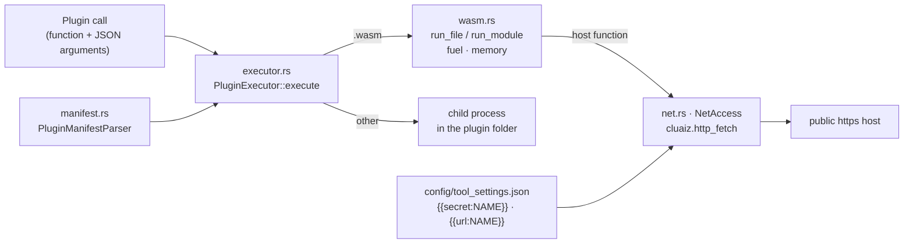

# Component: `agents/src/plugins/`

## Technical Specification

- **Purpose:** Running a plugin's function. A WebAssembly plugin (`.wasm`) runs inside the
  Engine, closed in: its own memory, an instruction budget, no files, no programs, and the network
  only through one checked door (`cluaiz.http_fetch`). Any other plugin runs as a normal child
  process with the user's rights. This folder also owns the settings a tool names in `env`
  (API keys, addresses) as the user sees them, and the secret filling for plugin requests.
- **Platform Support:** Windows, Linux, macOS (`wasmtime`).
- **Reusability Level:** Internal to `cluaiz-agents`; called by `ToolsEngine` in `lib.rs`, the
  agent and the API chat. Also the `code` step of Automation uses `wasm::run_module`.
- **Related:** [docs/engine/tools.md](../../../docs/engine/tools.md) (permissions, settings,
  environment).

## Architectural Flow

## API Contract (Interface)

- **`executor.rs`:** `PluginExecutor::execute(plugin_dir, payload) -> Vec<u8>`.
- **`manifest.rs`:** `PluginManifest`, `PluginDiscovery`, `PluginActivation`, `PluginLimits`,
  `PluginExecution`, `PluginManifestParser::parse_file`.
- **`wasm.rs`:** `run_file(path, payload, max_memory_mb, NetAccess)`,
  `run_module(wasm, payload, &Budget, NetAccess)`, `Budget { function, memory_bytes, fuel }`,
  `ModuleError` (`Limit` when out of fuel or memory, …).
- **`net.rs`:** `NetAccess::{none, for_plugin, for_hosts, fetch}`, `UserSetting`,
  `user_settings`, `save_user_setting`, `save_setting`, `settings_set`.
- **Plugin ABI (WebAssembly):** the module exports `memory`, `allocate(len) -> ptr` and the
  function (`execute_cel(ptr, len) -> u64` by default); the result is `(ptr << 32) | len` of its
  JSON answer.
- **Export Type:** Rust, inside `cluaiz-agents`.
- **Dependencies:** `wasmtime`, `reqwest`, `serde_json`, `crate::permissions`, `crate::tool_env`.

## Deep File Breakdown

- `executor.rs`: picks the runner. `.wasm` → `wasm::run_file` with the plugin's network access;
  anything else → a child process in the plugin's folder whose stdout is the answer. A call to a
  function the plugin does not list fails and names its functions (`lib.rs`).
- `manifest.rs`: the plugin's `package.json` fields (discovery, activation, limits, execution).
- `wasm.rs`:
  - **Logic:** Compiles and instantiates the module with fuel metering on. Default budget:
    2,000,000,000 instructions of fuel and at most 256 MiB of memory (a manifest may ask for less
    memory, never more). Host functions (module `cluaiz`): `now_utc_ms`, `utc_offset_minutes`, `os_platform` and `http_fetch`; nothing else.
  - **Why:** An endless loop or a memory grab stops with `ModuleError::Limit` instead of hanging
    or exhausting the Engine.
- `net.rs`:
  - **Logic:** `http_fetch` takes a JSON request and answers `{status, final_url, content_type,
    body, truncated}` or `{code, error}`. Allowed only when the plugin declares `network`:
    `full` reaches any public host, `strict` only its `hosts`. Only `https`, only public
    addresses; every redirect is checked again.
  - **Limits per call:** 16 requests, 5 MiB per body, 20 s per request, 10 s to connect, 60 s for
    the whole call.
  - **Secrets:** the plugin writes `{{secret:NAME}}` in a header and the Engine fills it from the
    tool's settings, for a name in the manifest's `env`; the plugin never sees the value.
    `{{url:NAME}}` at the start of a URL is an address the user chose (their own SearXNG), which
    alone may be local.
  - **Settings:** `user_settings` lists the names a tool's `env` declares with `info`,
    `required`, `secret`, `set`, `in_system` (never the value); `save_user_setting` writes
    `config/tool_settings.json` (`{ "<tool id>": { "NAME": "value" } }`).

## Failure & Recovery Logic

- **`network` not declared:** `{code: "no_permission"}`.
- **`network` switched off by the user:** `{code: "permission_off"}` with the command to turn it
  on.
- **Host not allowed, http, local or private address:** `{code: "blocked"}`.
- **Too many requests:** `{code: "limit"}` after 16.
- **Bad request JSON:** `{code: "bad_request"}`.
- **Out of fuel or memory:** `ModuleError::Limit` with the budget it passed.
- **Native plugin fails:** its non-zero exit and stderr come back as the error; it is not closed
  in, so its permissions are asked about before each call instead (`registry/types.rs`).
