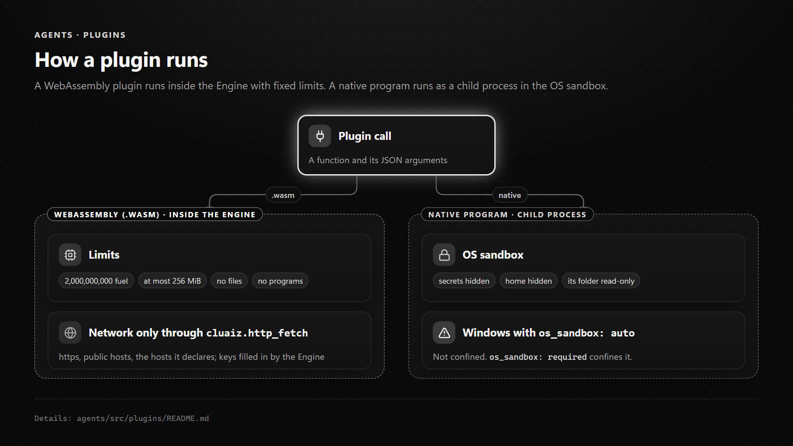

<!-- name: agents/src/plugins
description: Running a plugin's function: WebAssembly plugins sandboxed inside the Engine, other plugins as child processes in the OS sandbox. -->

# Running plugins (`agents/src/plugins/`)

Running a plugin's function. A WebAssembly plugin (`.wasm`) runs inside the Engine, closed in: its own memory,
an instruction budget, no files, no programs, and the network only through one checked door
(`cluaiz.http_fetch`). Any other plugin runs as a child process through the OS sandbox
(`execution::os_sandbox::confine_here`, `SandboxPolicy::for_tool`: secret folders and the Cluaiz home hidden,
its own folder read-only, network as its permission says); where no sandbox applies (Windows in `auto`,
`os_sandbox = off`) it has the user's rights. This folder also owns the settings a tool names in `env` (API
keys, addresses) as the user sees them, and the secret filling for plugin requests.

## At a glance

- **Platform Support:** Windows, Linux, macOS (`wasmtime`).
- **Reusability Level:** Internal to `cluaiz-agents`; called by `ToolsEngine` in `lib.rs`, the
  agent and the API chat. Also the `code` step of Automation uses `wasm::run_module`.
- **Related:** [docs/engine/tools.md](../../../docs/engine/tools.md) (permissions, settings,
  environment).

## How it works

## Interface
- **`executor.rs`:** `PluginExecutor::execute(plugin_dir, payload) -> Vec<u8>`.
- **`manifest.rs`:** `PluginManifest`, `PluginDiscovery`, `PluginActivation`, `PluginLimits`,
  `PluginExecution`, `PluginManifestParser::parse_file`.
- **`wasm.rs`:** `run_file(path, payload, max_memory_mb, NetAccess)`,
  `run_module(wasm, payload, &Budget, NetAccess)`, `Budget { function, memory_bytes, fuel }`,
  `ModuleError` (`Limit` when out of fuel or memory, …).
- **`net.rs`:** `NetAccess::{none, for_plugin, for_hosts, fetch}`, `UserSetting`,
  `user_settings`, `save_user_setting`, `save_setting`, `settings_set`.
- **Plugin ABI (WebAssembly):** the module exports `memory`, `allocate(len) -> ptr` and the
  function (`execute_cel(ptr, len) -> u64` by default); the result is `(ptr << 32) | len` of its
  JSON answer.
- **Export Type:** Rust, inside `cluaiz-agents`.
- **Dependencies:** `wasmtime`, `reqwest`, `serde_json`, `crate::permissions`, `crate::tool_env`.

## Files
- `executor.rs`: picks the runner. `.wasm` → `wasm::run_file` with the plugin's network access;
  anything else → a child process in the plugin's folder whose stdout is the answer. A call to a
  function the plugin does not list fails and names its functions (`lib.rs`).
- `manifest.rs`: the plugin's `package.json` fields (discovery, activation, limits, execution).
- `wasm.rs`:
  - **Logic:** Compiles and instantiates the module with fuel metering on. Default budget:
    2,000,000,000 instructions of fuel and at most 256 MiB of memory (a manifest may ask for less
    memory, never more). Host functions (module `cluaiz`): `now_utc_ms`, `utc_offset_minutes`, `os_platform` and `http_fetch`; nothing else.
  - **Why:** An endless loop or a memory grab stops with `ModuleError::Limit` instead of hanging
    or exhausting the Engine.
- `net.rs`:
  - **Logic:** `http_fetch` takes a JSON request and answers `{status, final_url, content_type,
    body, truncated}` or `{code, error}`. Allowed only when the plugin declares `network`:
    `full` reaches any public host, `strict` only its `hosts`. Only `https`, only public
    addresses; every redirect is checked again.
  - **Limits per call:** 16 requests, 5 MiB per body, 20 s per request, 10 s to connect, 60 s for
    the whole call.
  - **Secrets:** the plugin writes `{{secret:NAME}}` in a header and the Engine fills it from the
    tool's settings, for a name in the manifest's `env`; the plugin never sees the value.
    `{{url:NAME}}` at the start of a URL is an address the user chose (their own SearXNG), which
    alone may be local.
  - **Settings:** `user_settings` lists the names a tool's `env` declares with `info`,
    `required`, `secret`, `set`, `in_system` (never the value); `save_user_setting` writes
    `config/tool_settings.json` (`{ "<tool id>": { "NAME": "value" } }`).

## Failure and recovery
- **`network` not declared:** `{code: "no_permission"}`.
- **`network` switched off by the user:** `{code: "permission_off"}` with the command to turn it
  on.
- **Host not allowed, http, local or private address:** `{code: "blocked"}`.
- **Too many requests:** `{code: "limit"}` after 16.
- **Bad request JSON:** `{code: "bad_request"}`.
- **Out of fuel or memory:** `ModuleError::Limit` with the budget it passed.
- **Native plugin fails:** its non-zero exit and stderr come back as the error; it is not closed
  in, so its permissions are asked about before each call instead (`registry/types.rs`).

## Decisions
| Decision | Why | Alternative not taken |
|---|---|---|
| WASM plugins get the network only through `cluaiz.http_fetch` | one checked door enforces https, public addresses, host lists and limits for every plugin; a WASI socket would bypass them | WASI networking |
| Fuel (2,000,000,000) and memory (256 MiB) limits on every WASM call | an endless loop or memory grab stops with `ModuleError::Limit` instead of hanging the Engine (tests below) | trust the plugin |
| Secrets filled by the Engine from `{{secret:NAME}}` | the plugin never sees the key, and a key goes only to a host the plugin may reach | pass keys in the environment or the payload |
| Native plugins run through the OS sandbox | a native program has the user's rights otherwise; the sandbox hides secrets and the home (`executor.rs:60-65`) | no confinement |

## Tested

22 unit tests in this folder, part of `cargo test -p cluaiz-agents` (161 passed on 2026-11-21):

| Area | Tests |
|---|---|
| Network permission and addresses (`net.rs`) | `a_plugin_without_the_permission_cannot_call`, `local_and_private_addresses_are_refused`, `a_nat64_address_counts_as_the_address_inside_it`, `plain_http_and_other_schemes_are_refused`, `a_url_with_a_password_is_refused`, `the_address_the_user_chose_may_be_local`, `a_redirect_cannot_leave_the_chosen_address_for_another_local_one`, `the_users_choice_switches_the_network`, `a_flow_module_reaches_only_its_hosts` |
| Secrets and settings | `a_key_goes_only_where_the_plugin_may_reach`, `a_secret_that_is_not_set_is_reported_without_a_request`, `a_tool_is_asked_only_for_the_settings_its_manifest_names`, `a_saved_setting_reaches_only_its_own_plugin` |
| Limits | `requests_per_call_are_limited`, `a_large_answer_is_cut_at_the_limit`, `a_loop_that_never_ends_is_stopped`, `a_plugin_cannot_take_more_memory_than_allowed`, `a_module_runs_its_named_function_within_its_budget` |
| ABI and host functions (`wasm.rs`) | `a_plugin_answers_through_its_memory`, `an_answer_outside_its_memory_is_an_error`, `a_plugin_reaches_http_fetch_and_is_refused_without_the_permission`, `the_time_needs_no_permission` |

Real plugins (`math`, `time`, `text`, `web-search`) are exercised by `test/cpu/cpu_test.ps1`, which has no
recorded run (see `test/cpu/README.md`).

## Pending

| Item | Why it matters | Needs |
|---|---|---|
| Native plugins on Windows in `auto` run unconfined | AppContainer is not used in `auto` on Windows (Node.js and per-user Python cannot start in it) | see `../execution/README.md` |
| A recorded run with the published plugins | the unit tests use test modules, not the registry's plugins | the CPU test run, or a run folder |
