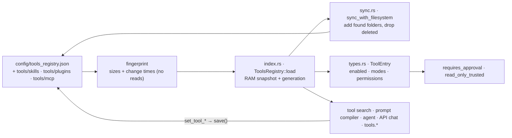

# Component: `agents/src/registry/`

## Technical Specification

- **Purpose:** The list of installed tools (skills, plugins, MCP servers) and each one's
  switches: `~/.cluaiz/config/tools_registry.json` (or `<CLUAIZ_HOME>/config/`), kept in RAM,
  brought in line with the tool folders on disk, and the rule that decides whether a call of a
  tool needs the user's approval. Tool search, the prompt compiler, the agent, the API chat, the
  installer and the CEP `tools.*` methods all read it.
- **Platform Support:** Windows, Linux, macOS (JSON file and folder scan).
- **Reusability Level:** Single source of truth for installed tools inside `cluaiz-agents`.

## Architectural Flow

## API Contract (Interface)

- **`index.rs`:** `ToolsRegistry` (`installed_tools: id → ToolEntry`), `registry_path()`,
  `generation()` (changes whenever the RAM snapshot is replaced), `load()`, `save()`,
  `get_tool`, `list_tools`, `set_tool_enabled`, `set_tool_execution_mode`,
  `set_tool_security_mode`, `set_tool_trust_annotations`, `set_tool_default_turns`.
- **`sync.rs`:** `ToolsRegistry::sync_with_filesystem`.
- **`types.rs`:** `ToolEntry` (`id`, `name`, `category`, `version`, `description`, `local_dir`,
  `binary_path`, `enabled`, `execution_mode`, `security_mode`, `trust_annotations`,
  capabilities and permissions, default turns, load strategy…), `ToolCategory` (`Skill`,
  `Plugin`, `Mcp`), `ExecutionMode` (`auto`, `manual`, `confirm_destructive`), `SecurityMode`
  (`inherit`, `require_approval`, `always_allow`), `LoadStrategy` (`Eager`, `Lazy`).
  Methods: `is_wasm_plugin`, `permissions_off`, `requires_approval(mode)`,
  `read_only_trusted(mode, annotations)`, `effective_capabilities`.
- **Export Type:** Public Rust API of `cluaiz-agents`.
- **Dependencies:** `serde`, `serde_json`, `serde_yaml` (legacy migration), `cluaiz_core`
  (home folder), `crate::permissions`.

## Deep File Breakdown

- `index.rs`:
  - **Logic:** `load()` returns the RAM snapshot; at most every 2 s (`RECHECK`) it compares a
    fingerprint of the registry file and every tool's manifest files (sizes and change times,
    nothing read) with the disk, and reloads only when it changed. Changes through the Engine
    (`save`, the `set_tool_*` setters) replace the snapshot at once and bump `generation()`;
    caches built from the registry (the tool search catalog) rebuild when it moves.
  - **Flow:** The first read takes `tools_registry.json`; when there is none, it migrates the
    legacy YAML, else builds the registry from the tool folders; then it syncs with the folders.
  - **Why:** A chat turn looks tools up many times; reading and parsing the folders each time
    was too slow. Manual edits on disk are still seen within a few seconds.
- `sync.rs`:
  - **Logic:** Scans `tools/skills`, `tools/plugins` and `tools/mcp`, adds a folder that is not
    in the registry (reading its manifest) and removes entries whose folder is gone.
- `types.rs`:
  - **Logic:** `requires_approval(master_mode)`, the approval rule:
    1. A permission the user switched off, on a tool that is not a WebAssembly plugin → always
       asked (the Engine cannot close such a tool in; a WebAssembly plugin is refused the access
       instead).
    2. `full_access`: asked only when the tool is set to `require_approval`.
    3. `strict`: asked unless the tool is set to `always_allow`.
    4. `sandboxed` (any other value): the tool's own `always_allow` / `require_approval` first;
       then an MCP server is asked (privilege boundary); `manual` or `confirm_destructive`
       execution is asked; a tool that declares no capabilities is asked; otherwise asked when a
       capability looks like exec, write, net, shell, cmd or terminal.
  - **`read_only_trusted`:** an MCP call may skip that approval only when the user trusts this
    server's annotations, the tool is on `inherit`, the mode is not `strict`, the function is
    marked `readOnlyHint` and not `destructiveHint`, and no permission of the tool is off.

## Failure & Recovery Logic

- **Registry file missing:** built from the tool folders.
- **Legacy YAML registry:** migrated to JSON on first read.
- **Tool folder deleted by hand:** its entry is removed on the next sync.
- **Tool folder added by hand:** registered on the next sync, from its manifest.
- **Unreadable registry JSON:** the file is kept as `tools_registry.json.broken-<unix seconds>`
  (never overwritten) and the registry is built again from the tool folders; the legacy YAML is
  not read then (its migration allowed every plugin without asking). Each tool's own settings
  (modes, trust, turns) start from their defaults; the log warns, and `cluaiz <type> list` says
  where the old file was kept (`ToolsRegistry::recovered_from`).
- **Crash while saving:** `save` writes a temporary file and renames it, so the registry file is
  never left half written.
- **Unknown mode strings:** `from_raw` gives `None`; the caller refuses the value.
