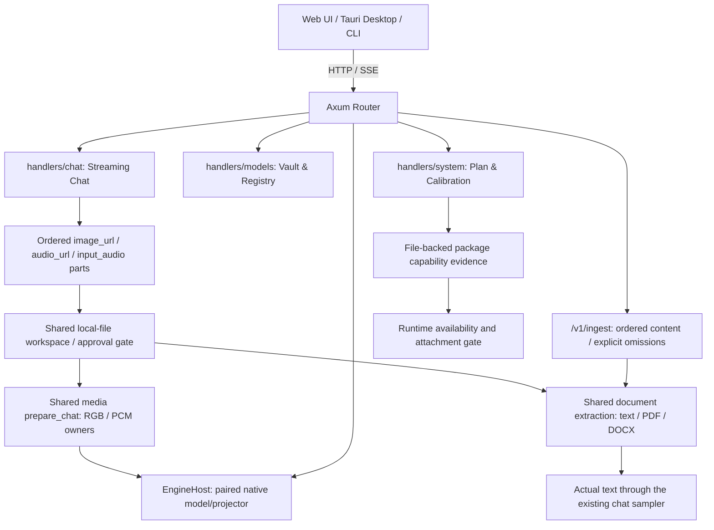
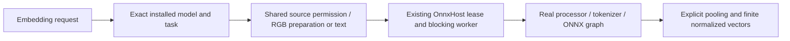
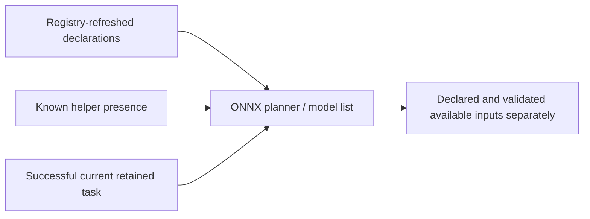

# 🌐 Cluaiz API Gateway (`api/`)

Direct Axum HTTP and Server-Sent Events (SSE) server for Cluaiz.

## Chat planner reference

`POST /v1/system/plan` accepts a registered `model`, optional `model_path`, and transient `n_ctx`, `batch_tokens`, `ram_buffer_gb`, `vram_buffer_gb` overrides. `n_ctx`: `0` selects Auto, `-1` selects the native maximum, and positive values request a context capped by the model's native limit. Batch tokens must be positive and buffers finite/nonnegative. Invalid values return HTTP400; unknown fields (including removed synthetic `weights_gb`/`total_layers`) return HTTP422. A plan request never persists settings or loads model weights.

```json
{"model":"<registered-chat-id>","n_ctx":8192,"batch_tokens":128}
```

| Response field | Meaning |
|---|---|
| `model_info.context_window` | Native **total** context capacity from the selected GGUF. |
| `model_info.inputs` | Only positively declared native modalities: `type`, `available:true`, and decoder `formats` for media. Text is `{"type":"text","available":true}`. Here availability means the model declares the input capability, independent of loaded-session state. Unsupported/unknown types and `support`/`reason` fields are omitted. |
| `model_info.attachment_processing` | Optional engine preparation routes. Video has `input:video`, `output:image`, `processing:sampled_frames` and decoder `formats`. Omitted when no image declaration or loadable video decoder exists. This is separate from native model inputs. |
| `active_user_settings` | Relevant **saved** controls under their settings-file names. Null/Auto stays null/Auto; it is not replaced by a planner decision. Saved `custom_context_window:0` means Max, whereas the request's `n_ctx:0` means Auto. |
| `request_overrides` | Only explicitly supplied overrides; omitted for a plain model-only request. |
| `execution_plan` | Chosen context, batch/micro-batch, KV type, placement, layer split, mmap, budgets, disk streaming and decision reasons. |
| `hardware_info` | CPU identity/cores/threads and live RAM/VRAM with the buffers used by this plan. |
| `candidates` | Existing placement alternatives and their memory/feasibility calculations. |

Prompt tokens and generated tokens share the chosen total context. The planner has no prompt and therefore does not invent a separate `max_output_context`. Chat responses omit `supported_attachments`, `package_capabilities`, overlapping input lists, local asset paths and unused performance placeholders.

Inputs describe the selected model package's positive declarations, independently of which model/projector is currently loaded. `available:true` denotes that positive capability declaration; it is not a loaded/readiness or successful-inference claim. The planner does not label unloaded media as false or claim a loaded pairing has been tested. The subsequent chat request still validates the actual model/projector, assets and supported encoders, and returns a real error if execution cannot proceed. Consumers can offer the declared input types; a video preparation route additionally requires an image-capable model. An `attachment_processing` route means the engine can prepare timestamped image frames; it does not assert native MP4 input. Decoder descriptors retain all supplied extension aliases (for example jpg/jpeg), deduplicating identical extensions only. A particular file still requires valid supported tracks/codecs. Clients send `text`, `image_url`, `input_audio`/`audio_url`, and `video_url` parts through the existing chat API described below.

The Chat path reads only the selected registry entry and reuses bounded immutable GGUF headers while their canonical path/size/mtime match. It recalculates placement from current settings and live memory on every request. Package/config/projector metadata is refreshed; planning does not inspect the loaded session's readiness. ONNX model-plan response fields keep their existing separate contract.

## Live reasoning control

`POST /v1/chat/skip-reasoning` uses the same engine URL, Bearer authentication and `Content-Type: application/json` as chat. Send `{"stream_id":"<id from the running chat SSE>"}` after `/v1/chat/completions` with `stream:true` has started. A sample ID is not an active request.

HTTP200 returns `{"status":"skip_requested","stream_id":"<same id>","message":"Native reasoning exit requested; the same stream continues with the answer."}`. This acknowledges the signal, not completion. Continue reading the original SSE: native generation forces its actual template reasoning-end sequence, the parser changes phase on that sequence, and `choices[].delta.content` carries the answer. The final `engine.thinking.ended_by` report identifies an accepted native `skip`; `[DONE]` finishes the stream. The model may still explain its answer after reasoning ends.

Unknown/completed IDs return HTTP404 `stream_not_found`; streams without enabled native reasoning control return HTTP409 `reasoning_unavailable`; unavailable registry locking returns HTTP503 `stream_control_unavailable`. Authentication failures return HTTP401. Repeated requests for an active eligible stream are idempotent signal requests. Skip is request-scoped and observed between native operations; it is not a hard real-time interrupt. `/v1/chat/cancel` remains separate.

## Attachment client examples

For live attachment stages on chat SSE, add `return_progress:true` and handle named `cluaiz.progress` events separately from answer deltas. Read the exact fields, attachment indices, limits and terminal ordering in the [chat processing reference](../docs/api/inference/chat_completions.md#attachment-processing-events). The default contract and ONNX task SSE remain separate.

Use the App's configured engine URL and session/API Bearer token. These JSON requests go to that URL, with `Content-Type: application/json`, `Authorization: Bearer <token>` and `x-caller: user`. `agent` requests follow the stricter file approval policy. Do not hardcode a port or model ID. Chat, ingest, audio and embedding routes use a bounded inline-JSON ceiling of `4 * ceil(media.limits.max_input_bytes / 3) + 2 MiB`, allowing base64 expansion plus the ordinary JSON/text envelope. It refreshes from current settings on each request. Larger requests return HTTP413 with `error.type:request_too_large`; decoded-media, context and live-memory checks still apply separately. Other JSON routes retain Axum's default ceiling. Multipart upload/file-ID storage is not provided by these routes.

The daemon and CLI resolve `session.token` through the same `EnvironmentManager` selected home (default `~/.cluaiz`, or the configured `CLUAIZ_HOME` / portable home). Separate test/embedded homes keep separate token files. An already running daemon retains its in-memory token until restarted; rebuilding source does not update that process.

| App action | HTTP route | Required model/task |
|---|---|---|
| Image or audio chat | `POST /v1/chat/completions` | Selected compatible GGUF and projector |
| Sampled-video chat | Same chat route, `video_url` | Packaged decoder plus selected image-capable GGUF/projector; soundtrack also requires audio support |
| Extracted-document chat | Same chat route, `file_url` | Selected text-capable GGUF; no projector required for text-only requests |
| Speech recognition | `POST /v1/audio/transcriptions` | Selected supported ONNX STT package |
| Speech generation | `POST /v1/audio/speech` | Selected supported ONNX TTS package |
| Text/image vectors | `POST /v1/embeddings` | Selected supported ONNX embedding graph |
| Document content preview | `POST /v1/ingest` or `/v1/ingest/file` | No model required for native text extraction |

Image chat (`image_url.url` can also be an authorized path or HTTP URL):

```json
{"model":"<selected-chat-id>","stream":true,"messages":[{"role":"user","content":[{"type":"text","text":"Describe this image"},{"type":"image_url","image_url":{"url":"data:image/png;base64,<actual-file-bytes>"}}]}]}
```

Audio chat uses the same envelope with `{ "type":"input_audio", "input_audio": { "format":"wav", "data":"<actual-base64>" } }`, or `{ "type":"audio_url", "audio_url": { "url":"<actual-source>" } }`.

Video chat uses the same route and ordered content array:

```json
{"model":"<selected-chat-id>","stream":true,"messages":[{"role":"user","content":[{"type":"text","text":"Describe what changes over this clip"},{"type":"video_url","video_url":{"url":"<authorized-path-http-or-data-source>","include_audio":false}}]}]}
```

`include_audio` defaults to `false`. Shared media decodes sampled RGB frames, supplies actual timestamps relative to the first decoded frame and sends those through the selected model's existing image/projector path. It does not send an MP4 file directly into model tensors. `include_audio:true` appends the full shared-decoded audio track and requires that selected model's audio encoder; missing/unsupported audio fails explicitly. No synchronized audiovisual-model or general ONNX generative-video route is promised. The sampling/duration/frame/packet/deadline policy is `settings.media.video`; limits and context overflow return errors rather than silently dropping the clip tail. See [native provider ownership and package](../engine/media/providers/ffmpeg/README.md).

Transcription (JSON, not multipart):

```json
{"model":"<selected-stt-id>","input_source":{"type":"audio","data":"data:audio/wav;base64,<actual-file-bytes>"},"stream":false}
```

Speech generation (default voice/speed):

```json
{"model":"<selected-tts-id>","input":"Text to speak"}
```

Read transcription from `output.text`; play TTS `output.audio_data` as the returned WAV data URI. They do not return raw audio bytes. For task SSE use `/v1/audio/execute` with `task`, `input_source` and `stream:true`, and handle its `chunk`/`done`/`error` events. These differ from chat SSE `choices[].delta` and `[DONE]`.

Text vectors and image vectors:

```json
{"model":"<selected-text-embedding-id>","input":["First text","Second text"],"encoding_format":"float"}
```

```json
{"model":"<selected-image-embedding-id>","input":[{"type":"image","source":"data:image/png;base64,<actual-file-bytes>"}],"encoding_format":"float"}
```

Vectors are at `data[].embedding`. A combined image/text graph can accept auxiliary `{type:"text",text:"..."}`; this does not make it a vision chat/OCR model. No automatic switch from failed GGUF chat to an ONNX graph is performed.

Native extraction preview:

```json
{"source":"data:application/pdf;base64,<actual-file-bytes>","output_controls":{"return_text":true},"chunking_strategy":{"type":"semantic","max_chunk_size":512,"overlap":0}}
```

Direct document chat:

```json
{"model":"<selected-chat-id>","stream":true,"messages":[{"role":"user","content":[{"type":"file_url","file_url":{"url":"data:application/pdf;base64,<actual-file-bytes>"}},{"type":"text","text":"Summarize this document"}]}]}
```

Use `GET /v1/models` and `POST /v1/system/plan` with `{"model":"<selected-id>"}` to select a model/task. Distinguish declared `inputs` from loaded `available_inputs`: an unverified lazy session does not mean a declared input must be disabled forever. Missing required helpers/encoder or an unsupported modality must show its actual reason. `supported_attachments` describes wired file processing, not a native PDF input capability.

Handle JSON/SSE `error` even on a streaming HTTP200, HTTP401, HTTP403 with approval details, HTTP413 and decode/runtime failures. Retain the original attachment for retries/history; do not replace it with a filename in the model prompt. Native scanned-page OCR and video require their packaged provider assets. Model/backend quality and App end-to-end behavior require separate acceptance.

ONNX requests with missing known processor/tokenizer/pooling/external-data files return HTTP400 `invalid_model` with the required filenames before fetching/decoding attachment sources or loading a native session. Planner declarations remain separate from readiness and report the same missing-file inventory. A rejected incomplete package does not replace the current valid ONNX resident. Runtime does not guess another model's processor or automatically fetch helpers; explicit installation/completion uses the caller's selected repository.

## Executed main-executable acceptance — 2026-10-15

The opt-in `artifact_acceptance` target starts an actual newly linked CLI executable in a fresh home on an ephemeral loopback port, stages the complete package through the existing builder, and sends authenticated HTTP/SSE requests. It does not substitute an in-process test router. Fixture setup and the reproducible environment contract are in [`test/media_regression/README.md`](../test/media_regression/README.md).

```text
cargo test -p cluaiz-api --test artifact_acceptance --release --no-default-features --offline -- --ignored --nocapture

FINAL EXECUTABLE: isolated daemon owns its token; user token unchanged; unauthenticated request -> 401
FINAL EXECUTABLE INGEST: text PDF -> actual code 741923
FINAL EXECUTABLE INGEST: scanned PDF -> actual code 741923
FINAL EXECUTABLE INGEST: DOCX -> actual body/table text
FINAL EXECUTABLE NEGATIVE: corrupt PDF -> 400; unauthorized agent path -> 403; oversized JSON -> 413
FINAL EXECUTABLE IMAGE JSON: "Red"
FINAL EXECUTABLE AUDIO SSE: "i had that curiosity beside me at this moment"
FINAL EXECUTABLE VIDEO JSON: "Red, Blue"
FINAL EXECUTABLE SCANNED DOCUMENT SSE: "741923"; chat model released
FINAL EXECUTABLE ONNX TTS: 24064 real samples at 22050 Hz
FINAL EXECUTABLE ONNX STT: "I had that curiosity beside me at this moment."
FINAL EXECUTABLE ONNX TEXT: 384 finite normalized dimensions
FINAL EXECUTABLE ONNX IMAGE: 512 finite normalized dimensions
FINAL EXECUTABLE MISSING HELPERS: HTTP400 with required filenames before source decoding/native load
FINAL EXECUTABLE: test-owned daemon terminated; user session-token bytes unchanged
test real_final_executable_attachments_and_onnx_apis ... ok
test result: ok. 1 passed; 0 failed; 0 ignored; 0 measured; 0 filtered out; finished in 146.46s
```

This Windows x86_64 CPU run selected Gemma4 E4B/projector, Piper, Whisper, the prepared MiniLM package and the installed FashionCLIP directory after adding its missing genuine processor config. The existing helper-completion owner fetched that config from the explicitly confirmed `patrickjohncyh/fashion-clip` repository; primary weights were not downloaded or changed. Test settings use two threads, context4096, a 1GiB host reserve and explicit small media/workspace ceilings; production preflight guards stay active. The duration covers the whole test, not request latency. An independent incomplete graph package returned HTTP400 `invalid_model` with required filenames. The authenticated router fixture additionally checked that rejecting it preserves the previous valid resident and that planner readiness agrees with helper presence. These results do not establish completeness of every installed/downloaded model.

The harness terminates only its own daemon; this is not a graceful-shutdown proof. App integration/history/rendering, GPU inference, other-target model execution, a clean-machine installer and hosted release workflow remain separate acceptance. The release package workflow is locally checked but has not been dispatched by this test.

## Executed sampled-video acceptance — 2026-10-15

`cargo test -p cluaiz-api --test video_contract real_video_api_json_sse_and_planner_reach_selected_vision_model --release --no-default-features --offline -- --ignored --nocapture`, with an isolated home, actual staged decoder and external read-only Gemma 4 E4B Q4_K_M/projector, returned:

```text
REAL VIDEO API: stream=false; selected native model answered "Red, Blue"; red before blue
REAL VIDEO API: stream=true; selected native model answered "Red, Blue"; red before blue
REAL VIDEO PLANNER: loadable package + selected vision pairing advertise mp4; intrinsic input remains image; corrupt source returns error
test real_video_api_json_sse_and_planner_reach_selected_vision_model ... ok
```

This Windows CPU run used two threads, context 4096, a 16 MiB decoded ceiling, 512 MiB projector workspace estimate and explicit 1 GiB host reserve in test-only settings. The complete test took 84.34 s; this is not a general request latency claim. An earlier run with larger defaults was refused by the live RAM preflight; guards were preserved. Shared-media acceptance separately exercised actual CFR/VFR timestamps, RGB rows, AAC-to-PCM, silent/corrupt/over-limit inputs, cancellation and concurrent decoder calls. Windows/Linux native ABI and lazy-package tests are separate from Windows model execution. No App UI, arbitrary video codec/model, audiovisual synchronization or other-target installer acceptance is established.

## Native document API contract

`/v1/ingest` accepts `source` as a locator or ordered array. It uses the same source authorization and extraction service as chat and CLI. Extraction supports UTF-8 text/code (optional BOM), BOM-marked UTF-16LE/BE, legacy Word DOC text, PDF page text and DOCX main-body XML. A packaged Tesseract/PDFium provider adds image OCR and scanned/mixed PDF text automatically, without a GGUF/ONNX model. `namespace`, explicit model/embedding output, model-vision options, non-semantic chunking and nonzero overlap return explicit unsupported-option errors. Generate vectors separately through `/v1/embeddings` using returned chunks.

`processed_sources[]` includes `source`, `status` (`ingested`, `partial`, `error`), MIME, byte chunk size, chunk count, chunks and ordered `parts[]` (`page`, `method`, real `text`, `omissions`, `warnings`, optional `ocr_confidence`). OCR methods are `native_ocr`, `pdf_ocr`, or `pdf_text_and_ocr`; confidence is Tesseract's mean score (0–100), not a correctness guarantee. `return_text:false` removes chunks and part text but keeps recognition/provenance metadata. Overall `success` requires every source to be ingested; mixed/omitted content is `partial`. All source failures return HTTP400 and overall `error`. Filesystem denials return HTTP403 with the existing approval details. Per-file error/partial results must remain visible even when a batch uses HTTP200.

PDF empty pages and image/form resources are attempted through packaged native OCR. Missing native assets, empty recognition or provider failures retain page omissions and actual warnings. Direct `file_url` chat uses the same extraction (including an image file used as an OCR document); `image_url` still sends real pixels to a selected vision model. DOCX headers/footers and embedded visuals remain omissions. Legacy DOC supplies recovered body/subdocument text without rendering graphics or evaluating fields/macros; incomplete text and parser recovery warnings are reported as omissions. Direct chat refuses still-partial extraction. OCR recognizes text, not image/diagram meaning. Password handling and full layout reconstruction remain unavailable. Source/output/ZIP text and raster workspace limits are checked; parser/native internal allocations, stack exhaustion and process isolation are not certified.

Text/code attachment extensions are not repeated in each Chat planner response. An available `text` input uses the shared extraction route; image/audio inputs retain their separate model capability checks. A filename suffix does not prove textual contents. Ordinary text must be UTF-8 or BOM-marked UTF-16; source-code text is passed to the model, not executed. This does not add Office spreadsheets/slides or typed ONNX chat attachment dispatch.

Installers/embedded launchers must place the verified native package at `EnvironmentManager::engine_dir()/media` under the selected Cluaiz home. See [provider ownership, package and shutdown contract](../engine/media/src/documents/README.md). Runtime performs no native asset/model download. A source-only build without that package retains text extraction and explicit OCR-unavailable results.

## Executed document acceptance — 2026-10-14

`cargo test -p cluaiz-media --release --offline` returned 21 passing unit tests and 3 passing document tests. Fixtures contain actual PDF objects and OOXML ZIP/XML, including content/order, Unicode/table/entity parsing, corrupt inputs, expansion limits, mixed-page omissions and request-source cleanup.

`cargo test -p cluaiz-api --release --no-default-features --test document_contract real_router_pdf_attachment_reaches_text_only_llama --offline -- --ignored --nocapture`, with an isolated home and externally supplied read-only Llama3.2 3B Q4_K_M, produced:

```text
REAL DOCUMENT CHAT: selected text-only GGUF answered code 741923; stream=false; no projector in package
REAL DOCUMENT CHAT: selected text-only GGUF answered code 826417; stream=true; no projector in package
REAL DOCUMENT CHAT: partial extraction rejected; planner advertises PDF as extracted text, not native PDF model input
test real_router_pdf_attachment_reaches_text_only_llama ... ok
```

The regular document HTTP fixture passed with token/permission rejection, real PDF/DOCX content, generic UTF-8 code files, partial-page results and invalid options. The actual ONNX embedding fixture also executed `/v1/ingest` -> extracted PDF/DOCX chunks -> `/v1/embeddings`, returning 384 finite normalized dimensions with the selected MiniLM graph; its existing image checks returned 512 dimensions. These tests use authenticated loopback HTTP on Windows CPU. They do not establish App UI acceptance, all-model compatibility, scanned OCR, video, other platforms, large-document context fitting or a parser/process memory bound.

## 📐 Architecture

### Executed native OCR acceptance — 2026-10-15

The Windows x86_64 CPU fixture package contains verified PDFium, Tesseract 5.2.0/Leptonica, English/Hindi traineddata and upstream license notices. It was staged with `cargo run -p cluaiz-builder --bin cluaiz-builder --release --offline -- media-assets --source <package> --output <new-directory>`; output: `Native media package staged: 28 verified files`.

`cargo test -p cluaiz-media --release --offline -- --include-ignored --nocapture`, with `CLUAIZ_NATIVE_MEDIA_TEST_PACKAGE` and `CLUAIZ_OCR_HINDI_IMAGE`, passed 21 unit, 3 document and 2 native/manifest tests. Actual output included:

```text
REAL NATIVE OCR: image/png -> code 741923; confidence Some(96)
REAL NATIVE OCR: image/jpeg -> code 741923; confidence Some(96)
REAL NATIVE LAYERED PDF: embedded text preserved; whitespace layer replaced without byte-accounting underflow
REAL NATIVE OCR HINDI: नमस्ते भारत
REAL NATIVE LIFETIME: concurrent recognition, explicit unload, reload and second unload passed
```

The opt-in `document_contract` selected-GGUF test, with that package installed in a fresh isolated home, used raster-only PDFs (no embedded code/text layer) through authenticated loopback HTTP. The same command shown above for 2026-10-14 now also reported:

```text
REAL NATIVE OCR HTTP: scanned PDF and PNG -> ingest API -> actual code 741923
REAL DOCUMENT CHAT: selected text-only GGUF answered code 741923; stream=false; scanned=true; no projector in package
REAL NATIVE OCR HTTP: scanned PDF and PNG -> ingest API -> actual code 826417
REAL DOCUMENT CHAT: selected text-only GGUF answered code 826417; stream=true; scanned=true; no projector in package
test real_router_pdf_attachment_reaches_text_only_llama ... ok
```

`cargo test -p cluaiz-api --release --no-default-features --test embedding_contract --offline -- --ignored --nocapture`, with isolated actual ONNX packages and native media assets, reported:

```text
REAL NATIVE OCR ONNX: raster-only PDF -> ingest -> selected 384-dimension text graph
test real_router_selected_onnx_image_and_text_embeddings ... ok
```

This is engine/API acceptance on one Windows CPU host. App attachment UI and installer deployment, Linux/macOS/ARM, a clean Windows machine without existing MSVC runtimes, direct daemon Ctrl+C acceptance, native mid-recognition disconnect cancellation, general neural document vision, video and full native/parser memory bounds remain unverified or pending. The native package is optional and must be supplied by the launcher/installer; changing source or rebuilding the executable alone does not install it into a user's Cluaiz environment.



## 📦 Components

| Module | Responsibility |
|---|---|
| [`handlers/`](src/handlers/) | REST endpoints for chat, models, vault, and plan inspection. |
| [`utils/`](src/utils/) | HTTP response wrappers, error encoders, and SSE streamers. |

## Model capability reporting

- **Planner `model_info.inputs`:** positive native model declarations from GGUF/config evidence, not architecture/folder substring matches. Text/image/audio declarations can differ from currently usable inputs.
- **`available_inputs`:** inputs accepted by the wired route with the required assets and trusted loaded model/projector pairing. Native chat routes support text/image/audio; image/audio can remain unverified before lazy projector initialization. The App can distinguish positive declarations in `inputs` from this loaded readiness state.
- **`input_availability`:** each text/image/audio input reports its model-support state, availability and explicit reason (unknown declaration, missing/ambiguous projector, missing encoder, unwired native media dispatch or unverified pairing).
- **`supported_attachments`:** enabled decoder/extractor extensions filtered by the available native input. Image extensions come from readable image formats; audio extensions come from enabled reader descriptors. Registered text/PDF/DOCX extraction routes feed text inputs. PDF support means text extraction with visual/empty-page omissions reported; it does not label a text model as a native PDF model. Video remains unavailable.
- **`package_capabilities`:** current inspected package evidence and projector inventory in planner model info. Installed-model responses persist it under `metadata.capabilities`; `/v1/models` exposes that package snapshot additively. A parsed projector's compatibility remains unknown until the loaded native backend validates it.
- **Scope:** these reports follow the wired native chat route and actual loaded pairing. They do not promise every model, container codec, platform or output modality. Native model chat output remains text. Separate task endpoints have their own contracts; the audio acceptance below does not certify embeddings or vision.

## Native image/audio chat contract

- **Routes:** `POST /v1/chat/completions` and its existing `/api/chat` alias use the same handler for text and supported native multimodal chat. No backend-specific chat URL is added. An explicit missing model returns an error; an image does not substitute another slot model.
- **Parts:** a message's existing `content` array accepts `text`, `image_url: {url}`, `audio_url: {url}`, `input_audio: {format, data}` with base64 data, and additive `file_url: {url}` for document extraction. URL sources can be HTTP(S), data URIs or authorized local paths/file URIs. Inline audio format hints use the MIME registry. Source decoding preserves message/part ordering. These are Cluaiz request forms, not a claim of full OpenAI upload/file-ID compatibility.
- **Model contract:** selected GGUF image/audio chat requires the declared modality and one compatible projector validated by the native backend. A document is extracted into actual text; a text-only GGUF does not need a projector for that request. Typed ONNX chat media and video remain unavailable. Selecting an unsupported model returns an error without an automatic backend/model substitution.
- **Local access:** `x-caller` and `x-approval-id` feed the existing `fs_read` gate. Agent Strict mode blocks outside-workspace reads and requires approval even inside. Permission errors include `error.details` with gate status/approval ID when relevant. Approve through the existing permission endpoint and retry with the approval header; changing the chat input does not grant a filesystem bypass.
- **Continuations:** both JSON and SSE tool turns keep original decoded buffers/options and regenerate full media context with cumulative tool-result instructions. No text-only KV pivot is used to represent missing media. This preserves input lifetime; an installed plugin/MCP's actual behavior still needs its own acceptance.
- **Errors:** capability/source failures are request errors; permission failures are forbidden responses; runtime generation failures are non-success JSON responses or SSE `error` objects followed by `[DONE]`, not successful assistant prose. A streaming failure may follow already emitted pieces. Axum's existing request-body ceiling still applies.
- **Control:** unique chat IDs and retained per-request cancellation flags scope chat cancellation to its request. This does not certify immediate interruption inside a native encoder call. Legacy text dispatch remains usable.
- **Resource policy:** the configured decoded ceiling and non-zero workspace estimate are charged along with projector weights against fresh remaining memory. Insufficient budget returns an error. The default workspace estimate is conservative configuration, not an automatic model-specific peak measurement; whole-message media history fitting and driver retry remain pending.

## ONNX audio API reference

- **Routes:** `POST /v1/audio/execute`, `/v1/audio/speech` and `/v1/audio/transcriptions` use one typed ONNX audio handler. Speech/transcription aliases currently accept JSON and return the existing Cluaiz JSON result format, not multipart uploads or a raw OpenAI audio response.
- **Model/task:** explicit model IDs are matched exactly (case-insensitive fallback), without substring/model substitution. Auto uses a compatible `tts_slot`/`stt_slot` or legacy `audio_slot`, then a deterministic installed package declaring the task. Only declared ONNX `text_to_speech`, `speech_to_text` or `speech_translation` tasks reach this boundary. GGUF image/audio chat remains on the chat route.
- **Sources:** `input_source: {type: "text", data: "..."}` supplies TTS text. STT accepts `url`, `file`, `audio` or `base64`; bare base64 is wrapped in a generic data URI and decoded by actual content. HTTP(S)/data URI reads are bounded. Local reads reuse chat's workspace/approval gate and `x-caller`/`x-approval-id` headers.
- **JSON:** `stream: false` returns `{status, task, model, info, output: {text, audio_data, segments}}`. STT populates text; TTS populates a real `data:audio/wav;base64,...` value. Segments remain null; unsupported timestamp requests return an error.
- **SSE:** `stream: true` emits actual STT `{status: "chunk", token}` events and one `{status: "done", result: <JSON result>}` terminal event. TTS emits its completed WAV in the terminal event; it does not fabricate token/PCM streaming. Runtime failure emits `{status: "error", error: {type, message}}`. Validation/auth/permission failures are non-success HTTP responses before the stream begins.
- **Options:** this slice uses the current default TTS voice/speed and greedy STT. Explicit unsupported voice changes, speed other than 1, temperature other than 0, beam size other than 1, timestamps/VAD/speaker labels enabled, or instruction prompts are rejected. `speech_translation` requires a declared task and uses the current English translation token; translation quality has separate acceptance requirements.
- **Lifecycle:** `keep_alive: 0` unloads the audio session; null/-1 retain it; positive minutes expire only the still-matching model/settings/request generation. Audio retention never calls the chat unload method.
- **Scope:** cached STT graphs, long-recording chunking, all TTS-family quality, cancellation inside long native calls, GPU/Linux and process memory limits are not implied by this audio API wiring. Image embeddings have the separate contract below.

## Executed ONNX audio acceptance

- **Command:** `cargo test -p cluaiz-api --release --no-default-features --test media_contract real_router_onnx_audio_selected_model_and_retention --offline -- --ignored --nocapture` executed an authenticated loopback HTTP fixture on Windows CPU with read-only installed Piper Amy medium and Whisper large-v3-turbo INT8 packages. The expanded fixture returned `1 passed; 0 failed` in 60.43 seconds. This is test duration, not a latency benchmark.
- **Results:** execute/speech routes returned WAV data from the selected Piper model; decoding confirmed non-empty finite PCM with non-zero amplitude. Execute SSE and the transcription JSON alias both returned `I had that curiosity beside me at this moment.` The JSON call used language auto-detection. Reference audio/ground truth comes from the [official PyTorch speech-recognition example](https://docs.pytorch.org/audio/2.5.0/tutorials/speech_recognition_pipeline_tutorial.html).
- **Checks:** missing auth/model, wrong task, unsupported option/malformed alias input, malformed audio and forbidden agent path were rejected. The oversized processor-window request failed and released its audio owner. Retained/replaced/zero-retention session behavior was asserted; a separate owner unit test rejects stale expiry generations.
- **Fixture policy:** the source was fetched once through the shared bounded resolver, then its actual WAV bytes were reused as base64 in both routes. A test-only external-download timeout was supplied independently of production settings. An earlier real URL route passed; an expanded external URL run also encountered an explicit source timeout before inference. Source availability is separate from native graph acceptance.
- **Limits:** WAV structure/amplitude is not a listening or pronunciation score. This fixture does not certify other families/languages, speech translation, cached graphs, positive GPU inference, Linux/macOS, memory peaks, simultaneous resident chat/audio or UI behavior. Scoped unit tests, compilation and lint are separate from full launch acceptance.

## Executed native acceptance

- **Test:** `api/tests/media_contract.rs` runs an authenticated loopback HTTP server on an OS-selected port with temporary config/registry/workspace and externally supplied read-only model assets. Windows CPU acceptance used the installed Gemma E4B Q4_K_M and BF16 projector. The real test passed in 104.92 seconds, alongside the continuation-buffer test: `2 passed; 0 failed`. A separate regular run passed the two transport/continuation tests and skipped the opt-in real-native test.
- **Observed behavior:** PNG input produced `Red`; audio URL input produced the reference speech transcript through SSE; one image plus inline WAV request answered both tasks. Native continuation retained the image. Assertions covered lazy readiness in planner fields, PNG/WAV advertisement with PDF/video excluded, missing auth/model errors, selected-model mismatch, context-budget errors in JSON/SSE, Strict read approval/retry, per-request cancellation followed by fresh chat, legacy text dispatch and paired unload.
- **Fixture resources:** the small native fixtures used 512 MiB configured workspace and 16 MiB decoded ceiling. Production defaults were retained. An earlier run with the default estimate explicitly refused 2,333,729,600 requested host bytes against a 2,099,379,814-byte live budget. This verifies refusal behavior; it does not certify default settings for every current machine workload or a native/process peak bound.
- **Limits:** no App UI/browser interaction, GPU/Linux/macOS acceptance or installed plugin/MCP execution was performed by this suite. Its continuation uses supplied tool-result instructions. Native audio remains experimental upstream. Deep/mid-encode cancellation latency, full history fitting, native allocation/driver retry and the remaining ONNX/document/video phases remain unverified or pending. Dependency-inclusive lint still fails on the existing native template pointer-contract errors; whole-workspace/launch readiness is not claimed.

## ONNX embedding API reference

- **Route:** `POST /v1/embeddings` executes the exact selected installed ONNX package, or the configured embedding slot when no explicit model is supplied. Missing selection/registration, undeclared embedding task and unsupported backend return errors. It does not fall back to a synthetic vector or another model.
- **Text:** `input` accepts a non-empty string or non-empty array of non-empty strings. Items execute in order on the same retained graph. Usage counts the actual tokenizer attention mask, including model special tokens; image-only token usage is zero. This is not a visual-token estimate.
- **Image:** the additive input is an array containing exactly one `{type:"image",source:"..."}` and optional `{type:"text",text:"..."}` parts. Sources reuse chat's bounded HTTP/data/file preparation and local-file permission headers. A single embedding is returned; text parts are auxiliary graph inputs, not separate batch items. Audio/document/video parts are rejected.
- **Graph:** prepared RGB feeds the graph's validated F32 NCHW/NHWC input. A combined graph receives real tokenizer IDs/mask/type IDs for its text branch; an empty auxiliary string still gets the tokenizer's actual special tokens. Text-only input cannot satisfy a graph requiring pixels. An image-only graph rejects a non-empty text instruction it cannot consume.
- **Processor:** `preprocessor_config.json` supplies resize, crop, resample, rescale and RGB normalization. Explicit legacy `CLIPFeatureExtractor` normalization uses its documented integer-to-unit conversion; other missing rescale contracts fail. Crop padding and unsupported interpolation/dtype/topologies fail. Rust interpolation is not asserted to match Pillow numerically.
- **Output:** `{object:"list",data:[{object:"embedding",embedding:[...],index:0}],model,usage}` contains finite normalized vectors from the graph. Named image/text/sentence embedding outputs are preferred; otherwise a single unambiguous output is required. Unpooled text requires explicit `1_Pooling/config.json` for CLS or masked mean pooling. Other ranks/modes, empty/non-finite/zero vectors fail.
- **Options:** `encoding_format` is omitted or `float`; other formats are rejected. `keep_alive` follows the same model/settings/generation lease policy as audio: zero unloads, null/-1 retain, positive values are minutes. Audio and embeddings serialize through one ONNX owner, replacing its resident task when necessary; chat has a separate owner.
- **Limits:** request buffers and batch outputs are checked against configured byte limits. This is not a process-wide native allocation bound. The existing HTTP request-body ceiling applies. GGUF embeddings, OCR answers, general multimodal generation, UI wiring, all packages and GPU/platform coverage are outside this reference.



## Executed image/text embedding acceptance

- **Command:** `cargo test -p cluaiz-api --release --no-default-features --test embedding_contract --offline -- --ignored --nocapture` passed the real authenticated loopback HTTP fixture on Windows CPU: `1 passed; 0 failed` in 6.69 seconds. The selected official MiniLM AVX2 uint8 export produced 384-dimensional finite normalized text vectors; identical text agreed and changed text differed. The installed image graph, using a temporary genuine Fashion-CLIP processor, produced 512-dimensional vectors with different red/blue results. These are behavioral assertions, not semantic-quality or latency benchmarks.
- **Fixture assets:** image weights/tokenizer were read-only hard links in an isolated temporary package; missing processor config came from the [model maintainer](https://huggingface.co/patrickjohncyh/fashion-clip/blob/main/preprocessor_config.json). Text weights/tokenizer/pooling config came from the [official sentence-transformers package](https://huggingface.co/sentence-transformers/all-MiniLM-L6-v2/tree/main). Installed model folders and real-user settings were not edited. The fixture registers both packages as embedding fixtures; it does not certify automatic installed-package discovery or planner readiness.
- **Rejections/lifecycle:** actual assertions cover missing auth/model, empty batch, unsupported output encoding, corrupt image, forbidden local agent path, text/image graph mismatch, model/task replacement and zero-retention unload. The existing stale-generation unit test remains separate from real positive-minute expiry acceptance.
- **Driver:** `cargo test -p onnx-engine --release --test media_integration --offline -- --ignored --nocapture` returned `1 passed; 0 failed` in 2.85 seconds and exercised the previously unsupported image `EmbeddingDriver` method. Actual graph metadata identified dynamic `num_channels`, `height`, `width` dimensions rather than imposing a universal shape.
- **Audio regression:** the existing real Piper/Whisper HTTP suite passed again after the shared task-owner change: `1 passed; 0 failed` in 57.21 seconds. Unit suites returned API 14/runtime 2/ONNX 8 passing tests. Full workspace compilation and scoped lint exited successfully, with existing warnings still present.
- **Remaining:** all-package capability/planner readiness, downloaded helper completeness, exact Pillow/numerical parity, semantic quality, other embedding topologies, GGUF embedding API execution, GPU/Linux/macOS, process memory peaks and App integration are not established by these fixtures.

## ONNX task capability and readiness reference

- **Planner:** `POST /v1/system/plan` accepts an installed ONNX ID or explicit ONNX path. Matching registered paths reuse refreshed metadata. It reports inputs, available inputs, per-input reasons, outputs, attachments, task routes, missing assets and package signatures. ONNX does not enter the GGUF geometry parser.
- **Declarations:** a combined image/text graph can declare both inputs while its standalone embedding task requires an image. Auxiliary text does not imply a text-only route. Legacy category/task labels are separate from available task routes.
- **Readiness:** `available_inputs` and `task_routes[].available` require a successful retained native task for the same package/assets/provider-settings snapshot and known helpers. Before the first request they are empty/false with `onnx_task_session_unverified`; valid task APIs still permit the first declared request to load/validate lazily. The App can offer that request from declarations and distinguish missing files from unverified readiness.
- **Missing assets:** `onnx_helper_assets_missing` and `missing_assets` identify absent known tokenizer/processor/pooling/external files. Presence alone does not certify contents or arbitrary graph support. Zero-retention unload and relevant provider-setting changes invalidate old readiness. ONNX does not require a GGUF projector.
- **Outputs/routes:** embedding vectors use `/v1/embeddings`; TTS text-to-audio and STT audio-to-text use `/v1/audio/execute`. Image embeddings are not OCR/chat prose. Attachments come from common decoder descriptors and validated input availability.
- **Hardware:** the captured provider policy is reported; selected EP, peak memory, speed and chat-context limits remain null when not proven. No llama layer/KV estimates are invented for ONNX. `model_size_gb` is package file bytes, not peak/resident allocation.
- **Model list:** `GET /v1/models` adds ONNX `task_support` from the same runtime resolver and persisted signatures. Native GGUF retains its existing planning/pairing behavior.
- **Separate remaining work:** legacy pull/download HTTP handlers still return queued messages without installer wiring; generic load remains native-chat-oriented. This slice does not certify those endpoints or App installation/download behavior. Existing CLI installation uses the actual engine installer/helper contract.


