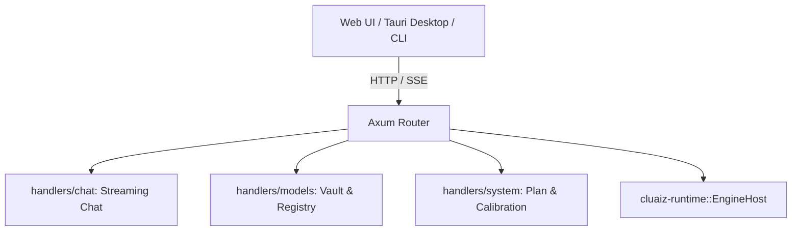

# 🌐 Cluaiz API Gateway (`api/`)

Direct Axum HTTP and Server-Sent Events (SSE) server for Cluaiz.

## 📐 Architecture

## 📦 Components

| Module | Responsibility |
|---|---|
| [`handlers/`](src/handlers/) | REST endpoints for chat, models, vault, and plan inspection. |
| [`utils/`](src/utils/) | HTTP response wrappers, error encoders, and SSE streamers. |
