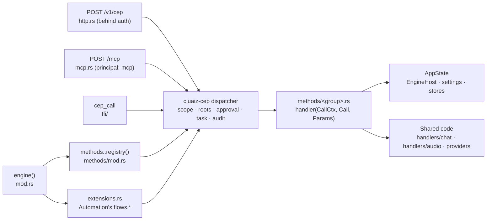

# Component: `api/src/cep/`

## Technical Specification

- **Purpose:** The Engine side of CEP (Cluaiz Engine Protocol, JSON-RPC 2.0): the context every
  method gets, every method of the Engine (one file per group in `methods/`), the HTTP door
  `POST /v1/cep`, the MCP door `POST /mcp`, and the hook that lets layers outside the Engine
  (Automation) add their own methods. The protocol itself (envelope, registry, dispatcher,
  principals and scopes, approvals, tasks, discovery, audit) is the `cluaiz-cep` crate
  ([`cep/`](../../../cep/)); this folder only registers methods and serves them.
- **Platform Support:** Windows, Linux, macOS.
- **Reusability Level:** Global gateway for Engine control. The App, the website, the C library
  (`cep_call`, `ffi/`) and MCP clients all reach the Engine through it.
- **Reference:** [docs/api/cep/](../../../docs/api/cep/README.md), one page per method; the
  front matter of each page and `openrpc.json` are generated from this registry by
  `api/tests/cep_docs.rs`.

## Architectural Flow

## API Contract (Interface)

- **`mod.rs`:** `CallCtx { state: Arc<AppState> }` (what a method gets besides its params),
  `CepEngine`, `engine()` (registry + extensions + approval store with a 5-minute answer time +
  task store: 8 running per caller, kept 1 hour by default, 24 hours at most + audit file),
  `error_from_response` (a route's error as a CEP error: 400/422 → invalid params, 401, 403,
  404, 409, 413, else unavailable).
- **Registering a method:** `registry.add(name, Meta::new(Scope, description).error(..)
  .example(params, result) …, handler)`. `Scope` is `Read`, `Write`, `Exec` or `Admin`; `Meta`
  also marks `destructive`, `idempotent` and `no_mcp`. The examples become the docs pages.
- **Principals** (`cluaiz-cep`): `owner` (all scopes, no roots), `token:<name>`,
  `extension:<id>`, `mcp` (read-only methods). Past its roots a principal gets `forbidden` or an
  approval request, by its `on_denied`.
- **Export Type:** Rust inside `cluaiz-api`; JSON-RPC over HTTP, MCP over HTTP, C through `ffi/`.
- **Dependencies:** `cluaiz-cep`, `axum`, `serde_json`, `cluaiz_security` (audit, tokens,
  permission.json), and the Engine crates each group calls.

## Deep File Breakdown

- `http.rs`: `POST /v1/cep`, a request or a batch. Behind the auth middleware like every route,
  so the owner's `api_auth.required` decides who gets here; whoever does is the owner.
- `mcp.rs`: `POST /mcp`, the Engine as an MCP server (Streamable HTTP, JSON responses). A tool
  is a CEP method of the same name with its params schema as `inputSchema`; a call goes through
  the same dispatcher. Methods marked `no_mcp` are not offered. Extensions may add tools.
- `extensions.rs`: layers outside the Engine that serve their own methods at `/v1/cep`. The
  program that starts the server installs them (Automation's `flows.*`); they reach the Engine
  only through its public doors.
- `roots.rs`: canonical filesystem paths shared by `fs.*` and attachments; authorization is
  `Call::check_path`.
- `methods/mod.rs`: `registry()`, every group registered once. `rpc.discover` and `tasks.*`
  come from `cluaiz-cep`.
- `methods/` groups:

  | File | Methods | What it does |
  |---|---|---|
  | `approvals.rs` | `approvals.list`, `approve`, `reject` | The owner's answers for every approval: a chat tool call, `system.exec`, a call outside its caller's roots |
  | `audio.rs` | `audio.voices`, `languages`, `run` | Voices and languages of installed speech models; speech and transcription as a task (shares the `/v1/audio/*` dispatch) |
  | `audit.rs` | `system.audit` | Newest lines of the CEP audit log (write, exec, admin calls and denials; params only as a hash) |
  | `config.rs` | `config.get`, `config.set` | `settings.json` by section; `set` changes only the given fields and answers the section as saved |
  | `context.rs` | `context.preview`, `report`, `reports`, `jobs` | Dry-run plan of a chat request, a chat's context reports, the idle-time job queue |
  | `fs.rs`, `fs_picker.rs` | `fs.list`, `read`, `write`, `copy`, `rename`, `mkdir`, `delete`, `pick_folder` | Files inside the caller's roots; the native folder picker in the foreground |
  | `kv.rs` | `kv.status`, `delete`, `clear` | Saved KV cache per chat (`session_id`) |
  | `memory.rs` | `memory.events`, `index`, `item`, `search`, `export`, `import`, `delete`, `grants`, `revoke_grants` | A chat's event log, its Chat Map, search, export/import, deleting a chat with everything derived from it |
  | `models.rs` | `models.list`, `inspect`, `load`, `remove`, `download`, `discard`, `embedding_room` | Installed models; download as a task (pause and continue); `discard` deletes what a stopped download left |
  | `notes.rs` | `notes.list`, `create`, `confirm`, `pin`, `move`, `invalidate` | Durable notes that outlive a chat |
  | `prompts.rs` | `prompts.list`, `get`, `set`, `reset`, `history` | The instructions the Engine itself sends to a model, each with an id and a default |
  | `providers.rs` | `providers.list`, `set`, `remove`, `models`, `test` | providers.json; replies never hold a key, only where it comes from; a `warning` when auth is off and keys are set |
  | `storage.rs` | `storage.status`, `clean` | Temporary media |
  | `system.rs` | `system.info`, `live`, `plan`, `ps`, `update_check` | The Engine and the machine |
  | `system_exec.rs` | `system.exec` | Runs a program on the host: admin scope, never an MCP tool, the owner's approval on every call; a shell line and no-approval are the owner's choices in permission.json |
  | `tokens.rs` | `tokens.list`, `create`, `revoke` | API keys in permission.json; never turns auth on or off |
  | `tools.rs` (+ `tools/`) | `tools.list`, `discover`, `install`, `remove`, `get_settings`, `set_settings`, `call`, `files`, `read_file`, `write_file`, `open_file`, `cache`, `clear_cache` | Skills, plugins and MCP servers by `kind` + `name` (see [`tools/README.md`](methods/tools/README.md)) |
  | `workspace.rs` | `workspace.get`, `set`, `index`, `item`, `memory`, `remember`, `forget` | The workspace folder and a project's agent files (`AGENTS.md`, `.agents/`) |
  | `chat/` | `chat.cancel`, `skip_reasoning`, `tools`, `set_tools`, `telemetry`, `import_app` | Control of running chats (`ACTIVE_STREAMS`), their tools and telemetry; `app_import.rs`: read-only import of the App's existing chats into the Engine's event logs (opt-in, never writes to the App's folders) |

## Failure & Recovery Logic

- **Bad params:** `-32602 invalid_params` with the field; each method lists its own errors in its
  `Meta`, and they appear on its docs page.
- **Scope or roots:** `forbidden`, or an approval request the owner answers within 5 minutes.
- **Long work** (`models.download`, `audio.run`): a task; the caller polls `tasks.get` or
  cancels with `tasks.cancel`. At most 8 run at once per caller.
- **A route's error inside a method:** `error_from_response` keeps its message and type.
- **Audit:** write, exec and admin calls and every denial go to the audit file, params only as a
  hash.
- **Adding a method:** register it in its group, add the group to `CATEGORIES` in
  `api/tests/cep_docs.rs` if new, write the page body, then
  `CEP_DOCS_WRITE=1 cargo test --release -p cluaiz-api --test cep_docs` regenerates the front
  matter and `openrpc.json`; without it the test fails while the docs are stale.
