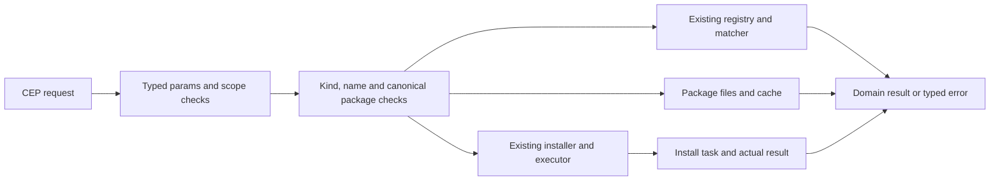

# Component: CEP tool controls

## Technical specification

- **Purpose:** P3.6 moves skill/plugin/MCP and component controls to thirteen typed CEP methods. This is an API cutover using the existing tool system.
- **Entry:** `../tools.rs::register`; the parent registry already includes this group. HTTP, native and MCP frontends share that registry.
- **Dependencies:** existing `ToolsEngine`, `ToolsInstaller`, tool registry, matcher, cached function discovery, CEP tasks and canonical path resolver.
- **Ownership:** Wave B owns these adapters. CEP core, the MCP frontend and native ABI remain separate Wave A work.

## Modules and flow

- **`common.rs`:** allowed kinds and the protocol's lowercase 1–64-byte ID rule; existing component resolution; one roots decision per authorized package; relative assets stay in that package, including through symlinks. Blocking registry/file work leaves the async executor thread.
- **`catalog.rs`:** existing registry/matcher output and known function schemas, with no server startup during listing. Validate a settings patch before modifying one registry snapshot and saving once. Disabling MCP also stops its retained server.
- **`files.rs`:** package-specific flat tree, UTF-8 reads, fixed main-file writes and OS editor requests. Iteration avoids recursive stack growth, skips symlinks, reports partial results, and caps returned entries. Cache counts use actual immediate `.cache` files.
- **`lifecycle.rs`:** reuses installer/uninstaller/cache clearer/unified executor. A plain skill must have its actual instruction file, preventing the executor's old missing-skill fallback text from becoming a successful result here.
- **`../tools.rs`:** names/scopes/examples and export policy. Settings and file-write methods are not MCP tools. Opening an editor is owner-only. Execution requires exec scope; installation, mutation, removal and cache cleanup require write scope.

## Lifetime and errors

- **Install:** return a CEP task, then expose the installer's real final outcome through `tasks.result`, with installing/installed events. Client disconnection does not own the task lifetime.
- **Cancellation:** check before/after installation. The existing installer has no mid-download rollback/cancel API; cancellation does not promise an in-progress install was undone. Listing reflects actual installed state afterwards.
- **Paths:** package asset reads/writes cannot leave the selected package. Installer actions use its primary category directory. All-kind cache operations authorize the common category root, then precheck every selected cache before invoking the existing clearer. These checks do not eliminate filesystem replacement races.
- **Errors:** invalid params, missing packages and real filesystem/registry/installer/executor errors propagate as typed errors. Inaccessible data is not returned as an empty successful result.
- **Editor:** fixed OS program and separate canonical file argument, without shell interpolation. `opened` means the editor process was started; it does not certify GUI rendering. The child is reaped without waiting on the request thread.
- **Limits:** no new sandbox, package format or extension runtime. Existing cache clearing is shallow; failure after some deletions is not transactional. Native plugin/MCP execution retains the existing engine's behavior.

## Verification

- Evidence is recorded in `test/cep/wave_b/README.md` and ignored local reports. The implementation itself does not certify runtime behavior.
- Acceptance uses a locally served registry/archive and a fresh home: task success/failure, installed listing, files/settings/cache/execution/removal, invalid names, escaping paths/symlinks, scope denial and retired routes.
- Native third-party plugins, retained MCP process execution, cancellation races, positive editor UI and other operating systems need separate appropriate runs. No such proof is implied by metadata fixtures.
