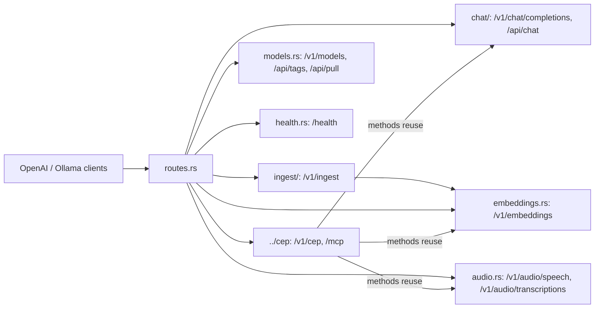

# Direct HTTP route handlers (`api/src/handlers/`)

This folder holds direct inference, document extraction and compatibility routes. Engine control operations are CEP methods in [`../cep/`](../cep/) (`POST /v1/cep`, `/mcp`, `cep_call`).

| File | Routes | Shared with CEP |
|---|---|---|
| `chat/` | `/v1/chat/completions`, `/api/chat` | The whole chat pipeline. `chat.*`, `memory.*`, `context.*` and `approvals.*` call into `chat/recall.rs`, `chat/authorize.rs`, `chat/context_plan.rs` and `chat/background.rs`. |
| `ingest/` (`mod.rs`, `model.rs`) | `/v1/ingest` | Shared document extraction/source resolution and existing embedding/native model owners; direct final JSON, not a CEP task |
| `embeddings.rs` | `/v1/embeddings` | `EmbeddingExecutor` is reused by `/v1/ingest` with a model |
| `audio.rs` (+ `audio_types.rs`, `audio_tests.rs`) | `/v1/audio/speech`, `/v1/audio/transcriptions` | One dispatch for the standard routes and `audio.run`; `audio.voices` / `audio.languages` use its model selection |
| `models.rs` | `/v1/models`, `/api/tags`, `/api/pull` | The registry listing used by `models.list` lives in `cluaiz_models`. `/api/pull` and CEP `models.download` share `pull()` here, which runs `cluaiz_models::fetcher::pull` (the resolver `cluaiz pull` uses). |
| `health.rs` | `/health` | — |

Rules for this folder:
- Ingest stays a direct inference route; new Engine control operations are CEP methods (`../cep/methods/`).
- A function needed by both a route and a method lives in one place, and both call it.
