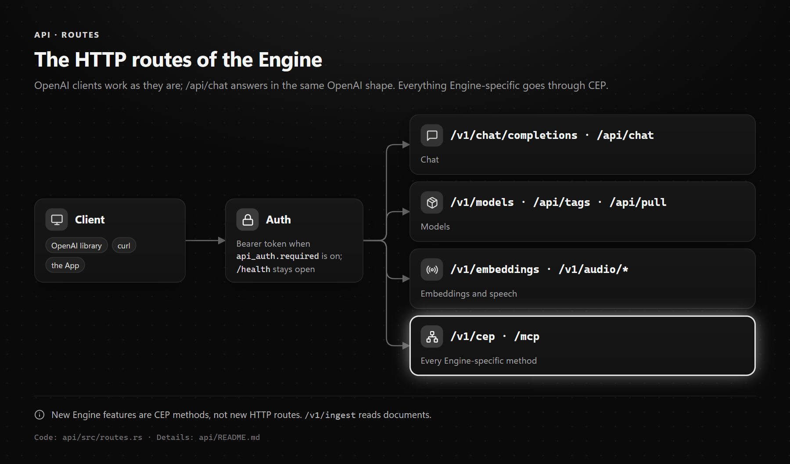

<!-- name: api/src/handlers
description: Direct HTTP route handlers: inference, document extraction and compatibility routes; Engine control lives in CEP. -->

# Direct HTTP route handlers (`api/src/handlers/`)

This folder holds direct inference, document extraction and compatibility routes. Engine control operations are CEP methods in [`../cep/`](../cep/) (`POST /v1/cep`, `/mcp`, `cep_call`).

| File | Routes | Shared with CEP |
|---|---|---|
| `ollama.rs` | `/api/chat`, `/api/generate`, `/api/embed`, `/api/ps`, `/api/version` | Ollama's request turned into the OpenAI request of `chat/` or `embeddings.rs`, and the answer turned back: one object, or one JSON object per line when streaming (Ollama's default). Ollama's `keep_alive` number is seconds; it is turned into the Engine's minutes. Unit tests in the file; the Ollama Python library 0.6.1 against it in run 36. `/api/generate` sets `plain_prompt` on the chat request (a field the JSON body cannot set): only the system text and the prompt reach the model template, with no tools, no workspace agent files and no notes, as Ollama's own `GenerateHandler` renders it with an empty tool list (`ollama/server/routes.go`, read 2026-11-24). Its `tools` field is not passed on. `/api/chat` sets `plain_prompt` too (since run 62): the client's messages and the client's own `tools` reach the template and nothing the Engine adds, as Ollama's `ChatHandler` renders the request's messages with `req.Tools` (`ollama/server/routes.go`, commit `b8db8d5`, read 2026-11-24); before, a "hi" took 921 prompt tokens (the Engine's functions, the project's skill index and a `<tools_hint>`), after 13. Why: in run 53 the Engine put about 3,700 tokens of agent files and its tool list in front of "The capital of France is" and the 0.8B model described Cluaiz instead of answering; run 57 has the before/after. Alternative not taken: sending `tool_choice: "none"` and `context_policy.project_files: "off"` from the adapter; notes have no such switch, so a pinned note would still reach a generate request. |
| `chat/` | `/v1/chat/completions` (and `/api/chat` through `ollama.rs`) | The whole chat pipeline. `chat.*`, `memory.*`, `context.*` and `approvals.*` call into `chat/recall.rs`, `chat/authorize.rs`, `chat/context_plan.rs` and `chat/background.rs`. |
| `ingest/` (`mod.rs`, `model.rs`) | `/v1/ingest` | Shared document extraction/source resolution and existing embedding/native model owners; direct final JSON, not a CEP task |
| `embeddings.rs` | `/v1/embeddings` | `EmbeddingExecutor` is reused by `/v1/ingest` with a model |
| `audio.rs` (+ `audio_types.rs`, `audio_tests.rs`) | `/v1/audio/speech`, `/v1/audio/transcriptions` | One dispatch for the standard routes and `audio.run`; `audio.voices` / `audio.languages` use its model selection |
| `models.rs` | `/v1/models`, `/api/tags`, `/api/show`, `/api/pull`, `DELETE /api/delete` | `DELETE /api/delete` (`{"model"}` or the older `{"name"}`) calls `remove_installed` in `cep/methods/models.rs`, the one delete path CEP `models.remove` uses too (unload the model if loaded, forget its VRAM record and vectors, delete the folder and the registry entry, as `cluaiz rm` does): 200 with an empty body, 404 `{"error":"model 'x' not found"}`, 400 for an empty or path-like name. Contract test `api/tests/ollama_delete_contract.rs`. `/api/tags` sends the main file's change time as `modified_at` (run 35). `/api/show` reads the GGUF header CEP `models.inspect` reads (`GgufProber::read_header`, no load) and answers in Ollama's `ShowResponse` shape: `details`, `model_info` (header keys, numbers typed back, long arrays `[]`, `general.name` and `tokenizer.chat_template` left out as Ollama does), `template`, `modified_at`; `parameter_size()` (also used by `/api/tags` and `/api/ps`) is the registry's value, or when the registry says `Unknown`, the GGUF tensor element count (Ollama counts the same way, `fs/gguf/metadata.go`), read from the cached header without a load; the registry is not changed. `/api/tags` runs in `spawn_blocking` for these file reads (5 models, first call 0.19 s, second 0.01 s from the header cache, 2026-11-22). Unknown model: 404 `{"error":"model 'x' not found"}`, Ollama's text. Checked with curl on 2026-11-22 (OLMoE-1B-7B: `parameter_size` `6.9B`; unknown model 404; empty body 400). The registry listing used by `models.list` lives in `cluaiz_models`. `/api/pull` and CEP `models.download` share `pull()` here, which runs `cluaiz_models::fetcher::pull` (the resolver `cluaiz pull` uses). |
| `health.rs` | `/health` | - |

Rules for this folder:
- Ingest stays a direct inference route; new Engine control operations are CEP methods (`../cep/methods/`).
- A function needed by both a route and a method lives in one place, and both call it.

## Tests

23 unit tests in this folder and below (chat 20, `audio_tests.rs` and others 3); route tests in
`api/tests/`. `api` builds both native backends, so none of these tests were run on 2026-11-21 (see `api/README.md`, Tests).

## Pending

| Item | Why it matters | Needs |
|---|---|---|
| `/api/generate` does not read `raw`, `suffix`, `template` or `context` | raw completions and fill-in-the-middle through Ollama's route are not there | a raw-prompt path in the chat pipeline |
| `/api/show` sends no tensor list (`verbose`) and no `capabilities` | Ollama clients that read capabilities (tools, vision) see none | ggml tensor type names; a mapping from the package capabilities |
| ONNX models still show `parameter_size: Unknown` | no size class for speech models in Ollama clients | a count from the ONNX initializers |
| OpenAI fields not supported on installed models (`n` > 1, `logprobs`): refused with HTTP 400 since 2026-11-22, no longer ignored (`logit_bias` works on GGUF models since 2026-11-23) | clients that need them get an error | pass them to llama.cpp (`chat/README.md`, Pending) |
