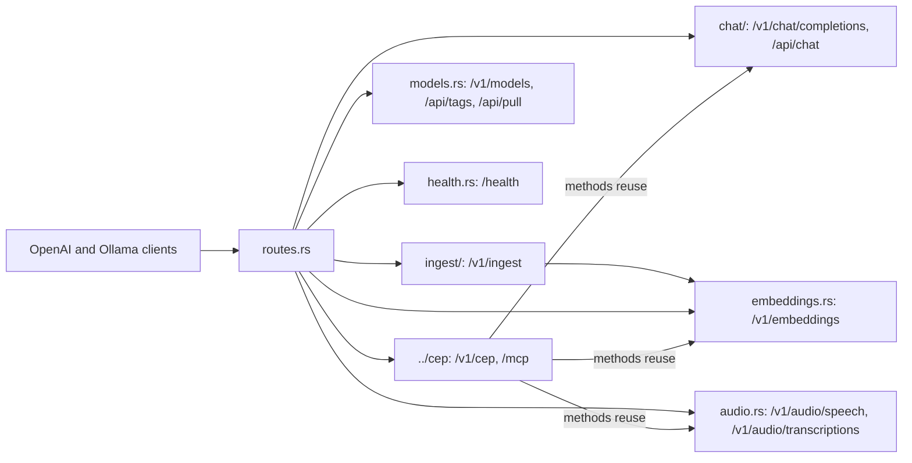

# Direct HTTP route handlers (`api/src/handlers/`)

This folder holds direct inference, document extraction and compatibility routes. Engine control operations are CEP methods in [`../cep/`](../cep/) (`POST /v1/cep`, `/mcp`, `cep_call`).

| File | Routes | Shared with CEP |
|---|---|---|
| `ollama.rs` | `/api/chat`, `/api/generate`, `/api/embed`, `/api/ps`, `/api/version` | Ollama's request turned into the OpenAI request of `chat/` or `embeddings.rs`, and the answer turned back: one object, or one JSON object per line when streaming (Ollama's default). Ollama's `keep_alive` number is seconds; it is turned into the Engine's minutes. Unit tests in the file; the Ollama Python library 0.6.1 against it in run 36. |
| `chat/` | `/v1/chat/completions` (and `/api/chat` through `ollama.rs`) | The whole chat pipeline. `chat.*`, `memory.*`, `context.*` and `approvals.*` call into `chat/recall.rs`, `chat/authorize.rs`, `chat/context_plan.rs` and `chat/background.rs`. |
| `ingest/` (`mod.rs`, `model.rs`) | `/v1/ingest` | Shared document extraction/source resolution and existing embedding/native model owners; direct final JSON, not a CEP task |
| `embeddings.rs` | `/v1/embeddings` | `EmbeddingExecutor` is reused by `/v1/ingest` with a model |
| `audio.rs` (+ `audio_types.rs`, `audio_tests.rs`) | `/v1/audio/speech`, `/v1/audio/transcriptions` | One dispatch for the standard routes and `audio.run`; `audio.voices` / `audio.languages` use its model selection |
| `models.rs` | `/v1/models`, `/api/tags`, `/api/pull` | `/api/tags` sends the main file's change time as `modified_at` (run 35). The registry listing used by `models.list` lives in `cluaiz_models`. `/api/pull` and CEP `models.download` share `pull()` here, which runs `cluaiz_models::fetcher::pull` (the resolver `cluaiz pull` uses). |
| `health.rs` | `/health` | - |

Rules for this folder:
- Ingest stays a direct inference route; new Engine control operations are CEP methods (`../cep/methods/`).
- A function needed by both a route and a method lives in one place, and both call it.

## Tests

23 unit tests in this folder and below (chat 20, `audio_tests.rs` and others 3); route tests in
`api/tests/`. `api` builds both native backends, so none of these tests were run on 2026-11-21 (see `api/README.md`, Tests).

## Pending

| Item | Why it matters | Needs |
|---|---|---|
| `/api/show` is not there | Ollama tools that call it get 404 | map it to `models.inspect` |
| `/api/tags` `parameter_size: Unknown` when the registry has no count | an empty size class in Ollama clients | the GGUF parameter count in the registry |
| OpenAI fields ignored on installed models (`n`, `logprobs`, `logit_bias`) | clients get a different result without an error (run 32) | read them in `chat/types.rs` and pass them to llama.cpp |
