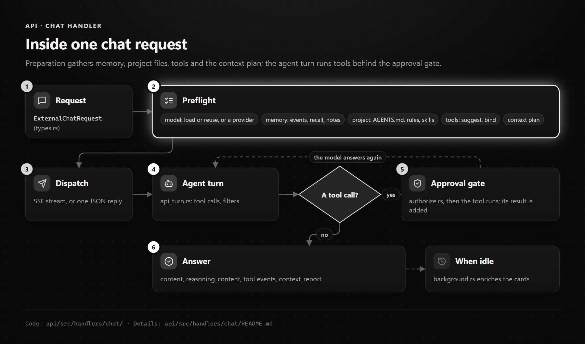

<!-- name: api/src/handlers/chat
description: The chat pipeline behind POST /v1/chat/completions and the CEP chat, memory, context and approvals methods: memory, project files, tools, context plan, the model, the agent loop with approvals, and the answer. -->

# Chat pipeline (`api/src/handlers/chat/`)

Every chat request to the Engine goes through this folder: `POST /v1/chat/completions` (OpenAI-compatible,
streaming or not) and the CEP `chat.*`, `memory.*`, `context.*` and `approvals.*` methods. It prepares the
prompt, runs the model and its tool steps, and returns the answer with thinking kept apart.

User-facing reference: [chat_completions.md](../../../../docs/api/inference/chat_completions.md).

## How one request flows

1. `mod.rs` applies `storage` and `history`, rejects empty `messages`.
2. `preflight.rs` does everything before the first token (model, memory, project files, tools, context plan).
3. `agent_loop.rs` (stream) or `non_streaming.rs` (one JSON) runs the turn through `api_turn.rs`.
4. Each tool call passes the approval gate (`authorize.rs`); `tool_turns.rs` adds the step and generation goes on.
5. The answer: `content`, `reasoning_content`, tool events, `context_report`. When idle, `background.rs`
   enriches the chat's cards.

## Files

| File | What it does |
|---|---|
| `mod.rs` | entry `chat_completions` (registered in `routes.rs`); `engine_history` applies `storage` (`engine`, `external`, `none`) and `history` (`client`, `engine`) |
| `types.rs` | the request (`ExternalChatRequest`, OpenAI fields plus the Engine's own), field checks, the live stream registry `ACTIVE_STREAMS` |
| `processing.rs` | with `stream` and `return_progress`: progress events from before preflight, so file decoding and model load are visible |
| `preflight.rs` | `PreparedChatContext::prepare` (everything before the first token) and `dispatch`; `TurnMemory`; `context_report`. 1,696 lines, over the 800-line limit (Pending) |
| `agent_loop.rs` | the SSE stream: content and `reasoning_content` deltas, tool events, permission requests, the context report, `[DONE]` |
| `non_streaming.rs` | the same turn as one JSON; `separate_reasoning`; `finish_reason` |
| `api_turn.rs` | the API side of an agent turn (`cluaiz_agents::turn`): thinking filter, calls found only in the answer, tools run through the approval gate |
| `tool_parser.rs` | `extract_tool_call`: a `<tool_call>` block, also inside markdown fences or with nested JSON |
| `tool_turns.rs` | each tool step adds one assistant and one tool message and re-renders, so the unchanged start keeps its KV cache; `final_answer` |
| `authorize.rs` | `assess`, `request`, `wait`: the approval gate under the request's `approval_mode` |
| `flows.rs` | saved Automation flows (`flow.<name>`) offered like tools when they fit |
| `project.rs` | `~/.cluaiz/AGENTS.md`, the project's `AGENTS.md` and `.agents/` rules, skills and facts, within a share of the context |
| `ingest_events.rs` | the chat's event log (messages, tool steps, loads, compaction, the answer); temporary chats log nothing |
| `recall.rs` | auto-recall of earlier messages left out of the prompt; the Chat Map of up to 4 chats in RAM |
| `semantic.rs` | notes and project facts matched by meaning (embedding model); word matching when it is missing or busy |
| `context_plan.rs` | how earlier turns are rendered, ledger compaction, the context report plan; `media_first` |
| `live_ledger.rs` | the ledger of a chat without a session id, in memory, so earlier turns render the same and the KV cache is reused (`preflight.rs:493`) |
| `background.rs` | idle-time card enrichment (title, motive, summary, at most 80 tokens, thinking off); stops when a request arrives |

Used by CEP methods: `recall.rs` (`memory.*`), `authorize.rs` (`approvals.*`), `context_plan.rs`
(`context.*`), `background.rs`, `ACTIVE_STREAMS` (`chat.cancel`, `chat.skip_reasoning`). Usage JSON and SSE
payload: `turn_end.rs` (with `usage.mtp` when the engine drafted).

## Decisions

| Decision | Why (evidence) | Alternative not taken |
|---|---|---|
| Every budget is decided once in preflight, with real token counts, before generation | the context llama.cpp really created is known only after load | estimating before load |
| Function schemas go into the `ChatEnvelope` struct (`tools`), not patched into the prompt JSON | an image or audio request is built from the struct; until 2026-11-24 it had no schemas (run 64: 0 / 10 calls with the image, 10 / 10 without) | patching the JSON after the struct is built |
| At the step or repeat limit, ask once more with no tools and return that as the answer | run 70 (Qwen3.5-0.8B): 0 / 10 answers before, 8 / 10 after; `max_steps: 2` 0 / 5 to 5 / 5; streaming 0 / 3 to 3 / 3 | keep the tools and send `tool_choice: "none"` (keeps the KV cache, but the model still sees the functions it looped on); the owner chose removing them |
| A call cut by the token limit is not sent; the reply is the text before it with `finish_reason: "length"` | run 70: 2 / 10 replies were half calls shown as text; fixed in run 73 (`engine/llama/README.md`) | sending the half call |
| `max_completion_tokens` (else `max_tokens`) is one budget for the whole turn; `max_completion_tokens` wins when both are sent | before, every tool step got the full limit again (run 78); OpenAI treats `max_tokens` as deprecated | a limit per step |
| Media parts of a user message go in front of its text (`media_first`, each group in the client's order) | run 76, Qwen3.5-0.8B with Engine tools, text then image: 0 / 10 answers about the image before, 10 / 10 after | the client's order |
| `response_format` with callable client tools is not grammar-enforced | one grammar for both let small models write JSON instead of a call (run 73: 0 / 10 calls before, 8 / 10 after); llama-server cannot hold both either | one grammar for schema and calls (run 68's way) |
| `tool_choice` named function keeps only that client function and leaves the Engine's own out | OpenAI's meaning of a named choice; run 68: 10 / 10 `get_time` calls (0 / 10 before) | llama-server's way (an object falls back to auto) |
| `required` holds only for the first answer | otherwise every step is forced to call until `max_steps` | required on every step |
| At the limit, only the text before `<tool_call>` is the answer | before run 57 the whole text went to `separate_reasoning`, and its generic fallback took the call as thinking (run 52 `long_input`) | changing the generic fallback in `cluaiz_models::StructuralDNA`, which every reasoning split uses |
| The system prompt stays the same; per-message hints go into the user turn | keeps the KV cache valid across turns | hints in the system prompt |

## Request fields checked here

| Field | Rule | Proof |
|---|---|---|
| `n` > 1, `logprobs: true`, `top_logprobs` > 0 on an installed model | 400 `unsupported_parameter`, `param` = the field, before any model load (SSE error chunk + `[DONE]` when streaming); not checked or forwarded for a provider's model | live 2026-11-22, OLMoE-1B-7B, port 8013 |
| `logit_bias` | token id string -> -100..100, into llama.cpp's logit-bias sampler; a non-id key, a value out of range, an id past the vocabulary, or any map on a non-GGUF model: 400 `invalid_value`. A provider gets the map unchanged | live 2026-11-23, Qwen3.5-0.8B: `{"57590":-100,"11751":-100}` -> `Lyon`; `{"10025":100}` -> `Blue` 12 times; bad maps -> 400 |
| `tool_choice` | `"auto"`, `"none"`, `"required"`, `{"type":"function","function":{"name":X}}`; else 400. Image and audio steps drop it after the first answer; with `"none"` a call written anyway comes back as `content` | runs 68, 73 |
| `response_format` without client tools | the Engine's own functions are left out (`schema_alone`), so the schema holds and thinking is kept | run 73 |
| `grammar` with client tools | 400 "Cannot use custom grammar constraints with tools." (llama-server's message, `server-common.cpp:1543-1546`); without client tools the Engine's own functions are left out | run 68: 10 / 10 inside the grammar after, 0 / 10 before |
| `plain_prompt` (only Ollama's `/api/generate`, `/api/chat`; no JSON body can set it) | no notes, no project files, none of the Engine's tools; the client's own functions still go in | run 62 |

## Tested

- 24 unit tests in this folder; route tests in `api/tests/` (`reasoning_contract.rs`, `media_contract.rs`,
  `processing_contract.rs`, `mtp_contract.rs`). None run since 2026-11-21: the `api` suite builds both
  native backends (`api/README.md`, Tests).
- Live runs, each with raw files in `test/cloud/runs/`: thinking budget (runs 30, 31), KV reuse across turns
  (run 21, `multiturn_cache.py`), tools and schemas (runs 64, 68, 73), final answer at the limit (run 70),
  token budget (run 78), media first (run 76).
- Not proved: the final no-tools answer with client `tools` at a limit, on an image request, or with inline
  (non-native) tools (Pending).

## Failure and recovery

| Failure | What happens |
|---|---|
| Empty `messages`, unknown model | 400 before any work (also while another request is busy) |
| Model load fails or does not fit | `error_response` with the planner's reason; nothing generated |
| Provider error | the provider's message (`api/src/providers/errors.rs`); in a stream, the last chunk |
| Context full | ledger compacted, recall instead of repeating, last resort the engine drops the oldest turns; the context report says what was dropped |
| Tool call needs approval | the turn waits; rejected or timed-out calls go back to the model as a refused result |
| Unreadable call, or answer only in thinking | corrected and asked again, not run (`cluaiz_agents::turn`) |
| Step or repeat limit | one more answer without tools (`prepare_final_answer`, `agents/src/turn.rs`); a call in it is not run, the text before it is the answer |
| Cancel | `chat.cancel` sets the stream's flag; generation and tool waits stop |
| Embedding model missing | word matching for notes |

Cost of the final answer at the limit: the tool schemas leave the prompt, so it is processed again (run 70:
3,784 to 11,339 tokens, 0 from cache; 1.0 to 2.9 s on an RTX 3050 laptop).

## Pending

| Item | Why it matters | Needs |
|---|---|---|
| `preflight.rs` is 1,696 lines (limit 800) | hard to change safely | a split |
| Route and unit tests not run since October and not in CI (`logit_bias_takes_token_ids_and_openai_range`, `approval_mode_tightens_and_names_the_field`, `tool_choice_takes_openai_forms`) | the api suite builds both native backends | a CI job with the CPU backend |
| `logit_bias` on an ONNX chat model is refused | no ONNX chat sampler takes a bias | an ONNX logit hook |
| `approval_mode` can only tighten the global mode | loosening per chat needs an owner decision (auth on: one token is every caller) | owner decision, then a rule in `cluaiz_security::chat_security_mode` |
| `approval_mode` `sandboxed` under global `full_access` does not re-check flows | a chat reads only the flow's precomputed `confirm` | the flow's `changes` in `OfferedTool` |
| `logprobs` / `top_logprobs` and `n` > 1 on installed models (400 today) | evaluation clients ask for them | logprobs from `llama_get_logits_ith`; one sequence per answer for `n` |
| `tool_choice`, `n`, `logprobs` not forwarded to providers | a provider could answer them | `api/src/providers/request.rs`, provider `extra` in `preflight.rs` |
| Final no-tools answer not checked with client `tools` at a limit, on an image request, or with inline tools | run 70 covered native tools on one model | a script for each case; a vision model run |
| Thinking in the first step is not counted in the `max_tokens` budget | a thinking model can use more than the client's limit | count thinking tokens of every step |
