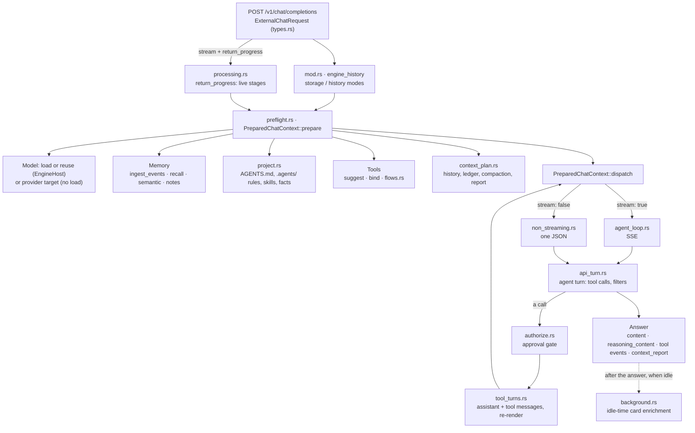

# Component: `api/src/handlers/chat/`

## Technical Specification

- **Purpose:** The Engine's chat pipeline behind `POST /v1/chat/completions` (OpenAI-compatible,
  streaming and not) and the CEP `chat.*`, `memory.*`, `context.*` and `approvals.*` methods
  that reuse it. One request goes through: the chat's memory (event log, ledger, notes, recall),
  the project's agent files, tool suggestion and loading, context planning, the model (an
  installed model through `EngineHost`, or a provider's model through `api/src/providers`), the
  agent loop that runs the Engine's tools with the approval gate, and the answer with thinking
  apart and a context report.
- **Platform Support:** Windows, Linux, macOS (whatever `EngineHost` runs on).
- **Reusability Level:** Core of the API server. Parts are called by CEP methods
  (`recall.rs`, `authorize.rs`, `context_plan.rs`, `background.rs`).
- **Request reference:** [docs/api/inference/chat_completions.md](../../../../docs/api/inference/chat_completions.md).

## Architectural Flow

## API Contract (Interface)

- **Entry:** `chat_completions(State<Arc<AppState>>, Json<ExternalChatRequest>) -> Response`
  (`mod.rs`), registered in `routes.rs`.
- **Public types:** `ExternalChatRequest`, `ExternalMessage`, `MessageContent`,
  `TemporaryChatMode`, `DEFAULT_MAX_TOKENS` (2048), `StreamSignals`, `ACTIVE_STREAMS`
  (`types.rs`); `PreparedChatContext`, `TurnMemory`, `context_report`, `tool_event`,
  `record_turn` (`preflight.rs`); `extract_tool_call`, `ExtractedToolCall` (`tool_parser.rs`).
- **Used by CEP methods:** `recall.rs` (`memory.*`), `authorize.rs` (`approvals.*`),
  `context_plan.rs` (`context.*`), `background.rs`, `ACTIVE_STREAMS` (`chat.cancel`,
  `chat.skip_reasoning`).
- **Usage:** `turn_end.rs` builds the shared JSON and SSE usage payload. The optional
  `usage.mtp` reports guesses and acceptance from the last generation when the engine drafted.
- **Export Type:** Rust, inside `cluaiz-api`. HTTP/SSE outward.
- **Dependencies:** `axum`, `tokio`, `async-stream`, `cluaiz_runtime` (`EngineHost`,
  `HostResponse`), `cluaiz_agents` (tools, turn, memory, workspace), `cluaiz_context` (planner),
  `cluaiz_models` (`StreamingReasoningFilter`, `StructuralDNA`), `crate::providers`.

## Deep File Breakdown

- `mod.rs`:
  - **Logic:** `engine_history` applies `storage` (`engine`, `external`, `none`) and `history`
    (`client`, `engine`: the logged transcript goes in front of the new messages).
    `chat_completions` rejects empty `messages`, prepares, dispatches once, then hands off to the
    streaming or non-streaming loop.
- `types.rs`:
  - **Logic:** The request (`ExternalChatRequest` with OpenAI fields and the Engine's own:
    `session_id`, `think_mode`, `reasoning_effort`, `temporary_chat`, `max_steps`,
    `return_progress`, `history`, `storage`…), and the live stream registry
    (`ACTIVE_STREAMS`, keyed by `chatcmpl-…`, holding cancel and skip-reasoning flags).
    `unsupported_on_installed_model` names the first OpenAI field an installed model cannot
    honour: `n` above 1, `logprobs: true`, `top_logprobs` above 0. `logit_bias_pairs` turns
    OpenAI `logit_bias` (token id string -> bias) into sorted (id, bias) pairs and refuses a key
    that is not a token id or a value outside -100..100; `check_vocabulary` refuses an id the
    model does not have. Values are kept as raw JSON so a wrong one is a 400 naming the field, not
    a body parse error. `plain_prompt` is set only by Ollama's `/api/generate` and `/api/chat`
    (`#[serde(skip)]`, like `preview`, so no JSON body can set it): preflight then adds no notes,
    no project agent files and none of the Engine's tools (`tools_allowed` false: no suggestions,
    no `load_tool` / `read_item` / memory functions, no saved flows). The client's own function
    tools (`client_schemas`) are not gated by `tools_allowed` and still go in, so the model gets
    the client's messages and the client's tools in its template and nothing else (run 62).
    `/v1/chat/completions` never has it set.
- `processing.rs`:
  - **Logic:** With `stream` and `return_progress`, progress events start before preflight so
    file decoding and model load are visible; token strings never carry events.
- `preflight.rs` (1,696 lines, above the 800-line limit; a split is due):
  - **Logic:** `PreparedChatContext::prepare` does everything before the first token, in order:
    stop idle jobs; check the model (a provider's model loads nothing); load or reuse the
    installed model so budgets use the context llama.cpp really created; read the chat template
    and the thinking tags (`<think>` for providers); the chat's ledger and earlier turns as the
    model saw them; pinned notes; the project's agent files; the event log; client functions;
    tool room from the context left after the answer's reserve; tool suggestions (cards and
    titles), bound tools whole or left out, flows that fit; the hint in the user turn (the system
    prompt stays the same for the KV cache); the context plan; auto-recall, the open task's
    checkpoint, notes and project items that fit this message; sampling and the envelope.
  - **Function schemas in the envelope:** the template's function list (`template_tools`: bound
    tools, the Engine's own functions, the client's functions) is set in the `ChatEnvelope` struct
    (`tools`), not patched into the prompt JSON afterwards. Why: an image or audio request is
    built from that struct (`prepared_media`); until 2026-11-24 it was cloned before the patch,
    so an image request reached the model with no function schemas (run 64: 0 / 10 calls with
    the image, 10 / 10 without). See `engine/llama/README.md`, "Tools on image and audio requests".
  - **Flow:** `dispatch` sends the prepared envelope to `EngineHost` or `ProviderRun`.
    `TurnMemory` saves the chat's KV after the turn (also on drop). `context_report` builds the
    report sent at the end.
  - **Why:** Every budget decision is made once, with real token counts, before generation.
- `agent_loop.rs`:
  - **Logic:** `execute_streaming_loop` turns the dispatch into SSE: content and
    `reasoning_content` deltas, tool events, permission requests, the context report, `[DONE]`.
    Registers the stream in `ACTIVE_STREAMS` so it can be cancelled or its thinking skipped.
- `non_streaming.rs`:
  - **Logic:** `execute_non_streaming` runs the same turn and answers one JSON;
    `separate_reasoning` splits thinking from the answer with the model's tags. When the turn
    still ends at the step or repeat limit (`Ended::StepLimit`: the client sent its own functions,
    or the final no-tools answer of `api_turn::run` made a call anyway), the last generation is a
    call that was not answered: only the text before `<tool_call>` is the answer, as for a client call. Before
    run 57 the whole text went to `separate_reasoning`, whose generic fallback takes any leading
    `<tag>…</tag>` as thinking, so the call came back as `reasoning_content` with an empty answer
    (run 52 `long_input`). Alternative not taken: changing the generic fallback in
    `cluaiz_models::StructuralDNA`, which every reasoning split uses.
- `api_turn.rs`:
  - **Logic:** The API side of an agent turn (`cluaiz_agents::turn`) for both modes: reads the
    tokens through a `StreamingReasoningFilter` (thinking apart; with thinking off the tags are
    still read when the model has them, so thinking that comes anyway is not mixed into the
    answer), finds calls only in the answer part, runs meta tools, skills, plugins and MCP tools
    through the approval gate, and continues generation with the tool steps.
  - **Final answer at the limit (`api_turn::run`, since 2026-11-24, run 70):** both modes run the
    turn through `api_turn::run`, not `cluaiz_agents::turn::run` directly. When the turn ends at
    the step limit (`max_steps`, default 100) or the repeat limit (`REPEAT_STOP_THRESHOLD` = 4
    identical calls in a row, `agents/src/turn.rs`), the model is asked one more time with
    `ToolTurns::final_answer`: the same conversation with every tool result so far, no `tools`,
    `tool_choice: "none"`, and the managed prompt `agent.final_answer` as the last user message
    (joined to the last user message when there is one, for templates that refuse two user
    messages in a row). That reply is returned as normal `content` (`Ended::Answered`). The log
    line is `stopped at step/repeat limit (max_steps=N): asking once more for a final answer
    without tools`. Why: a small model with a long prompt kept calling tools until the limit and
    the reply had no answer. Run 70 (Qwen3.5-0.8B, run 52's `long_input` prompt and 9 variants,
    filesystem MCP and math plugin installed): before, 0 / 10 answers, 8 turns ended at a limit
    with content `"\n"`; after, the same 8 turns each ended with a final answer (8 / 10 answers,
    6 / 10 with the right marker); `max_steps: 2` 0 / 5 to 5 / 5; streaming 0 / 3 to 3 / 3; a
    request with its own `tools` 3 / 3 client `tool_calls` both before and after. The other 2 / 10
    were not at a limit: their last call was cut by `max_tokens` (48) and comes back as text.
    Not done when the client sent its own functions (`client_tools`): that
    client runs calls itself and gets them as before. Not done when the request was cancelled.
    If the final reply still writes a call, it is not run; the turn stays `Ended::StepLimit` and
    only the text before the call is returned (log: `the final answer without tools still made
    a call`). The extra generation is one more than `max_steps`. Cost: the tool schemas leave the
    prompt, so its start changes and the whole prompt is processed again (run 70: 3,784 to 11,339
    tokens with 0 from the cache; the final answer took 1.0 to 2.9 s from the log line to its end
    on the laptop's RTX 3050). Alternative not taken: keep the tools and send only
    `tool_choice: "none"` (llama.cpp still renders the tools, so the KV cache would be reused, but
    the model still sees the functions it was looping on); the owner chose removing them. The
    terminal agent (`cmd`) has its own front end of `cluaiz_agents::turn` and does not do this.
- `tool_parser.rs`:
  - **Logic:** `extract_tool_call` finds a `<tool_call>` block in text, also inside markdown
    fences or with nested JSON.
- `tool_turns.rs`:
  - **Logic:** Each tool step adds one assistant message (the call) and one tool message (the
    result); the conversation is rendered again through the template. The unchanged beginning
    keeps its KV cache, so only the new step is processed. `final_answer` builds the prompt of
    the last no-tools answer at the step or repeat limit (see `api_turn.rs`); for an image or
    audio prompt it adds `agent.final_answer` to the pivot text. Tools written into the system
    text (inline tools, templates without native tools) stay there, since the system prompt is
    the request's own; a call written anyway is cut off.
- `authorize.rs`:
  - **Logic:** `assess` (does this call need approval, under the request's approval mode:
    `approval_mode`, never looser than the global mode, resolved once in preflight and kept only in
    that request's context), `request` (register it in the CEP
    approval store; the SSE `permission_request` chunk when streaming), `wait` (until
    `approvals.approve` / `approvals.reject` or the time runs out).
- `flows.rs`:
  - **Logic:** Saved Automation flows (`flow.<name>`) matched to the message like installed
    tools; only fitting ones are offered. A call asks on the chat's approval card when the flow
    says so, then runs in the Automation extension.
- `project.rs`:
  - **Logic:** `~/.cluaiz/AGENTS.md`, the project's `AGENTS.md` files and its `.agents/` rules,
    workflows, skills and memory facts in the system prompt, within a share of the context
    (`budget_for`). No cache: the same files give the same text, so the KV cache stays valid.
- `ingest_events.rs`:
  - **Logic:** Writes the chat's event log from requests (new, edited, retracted messages in
    client mode; tool steps, loads, compaction and the answer after each turn). Temporary chats
    log nothing.
- `recall.rs`:
  - **Logic:** Auto-recall: when the prompt leaves part of the chat out, earlier messages that fit
    the current one come back as a short record. The Chat Map (cards and index) of up to 4 chats
    is kept in RAM and rebuilt from the event log when it grew.
- `semantic.rs`:
  - **Logic:** Notes and project facts matched by meaning with the installed embedding model
    (`notes_match`); each note embedded once (`cluaiz_agents::memory::vectors`). Missing, busy or
    failing model: callers fall back to word matching.
- `context_plan.rs`:
  - **Logic:** How earlier turns are rendered, when the ledger is compacted, and the plan behind
    the context report. Decisions come from the pure `cluaiz-context` planner; this file does the
    I/O. Dropping the oldest turns as the last resort stays in the engine.
- `background.rs`:
  - **Logic:** Idle-time card enrichment: a title, motive and summary per turn (at most 80 tokens,
    thinking off), on the chat's KV right after an answer. Stops at once when a request arrives;
    never loads a model; the event log is the job list, so a restart loses nothing.

- `live_ledger.rs`: the ledger of a conversation sent without a session id (any OpenAI-style
  client), in memory only. The Engine puts a block before the current user message (tool hints,
  notes, project items); a chat with a session id gets it back from its ledger on disk, and this file
  does the same for a chat without one, so earlier turns render identically and the KV cache is
  reused (`preflight.rs:493`). Checked in cloud run 21 (`multiturn_cache.py`: later turns reuse the
  whole earlier prompt).

## Failure & Recovery Logic

- **Empty `messages`:** 400 `invalid_request_error`.
- **Unknown model:** 400 from preflight, also while another request is busy.
- **OpenAI field an installed model cannot honour** (`n` > 1, `logprobs: true`, `top_logprobs` > 0):
  400 `invalid_request_error`, code `unsupported_parameter`, `param` = the field, before any model
  load (as an SSE error chunk + `[DONE]` when streaming). `n: 1`, `logprobs: false` and absent
  fields work as before. A provider's model is not checked; `n` and `logprobs` are not forwarded
  to it (they were not before either). Checked live on 2026-11-22 with OLMoE-1B-7B on an isolated
  server (port 8013): each refused field returned HTTP 400 naming it.
- **`logit_bias` on an installed model** (since 2026-11-23): the pairs go into the envelope
  (`ChatEnvelope::logit_bias`, also into a media turn's tool steps) and llama.cpp's own logit-bias
  sampler applies them (`engine/llama/src/native/sampler.rs`). Refused with 400
  `invalid_request_error`, code `invalid_value`, `param: "logit_bias"`: a key that is not a token
  id (`"Paris"`, `"-1"`, `"1.5"`), a value that is not a number or is outside -100..100, an id at
  or past the model's vocabulary (`tokenizer.ggml.tokens` length, read from the cached GGUF
  header), and any non-empty map on a model that is not GGUF. `{}` or no field: no bias, as before.
  If the header cannot be read, the request goes on and the sampler drops ids past the vocabulary.
  A provider's model gets the request's own map unchanged (`preflight.rs`, provider `extra`).
  Checked live on 2026-11-23 with Qwen3.5-0.8B Q4_K_M on an isolated server (port 8013,
  `temperature: 0`, "What is the capital of France? Answer with one word."): no bias -> `Paris`;
  `{"57590":-100}` -> still `Paris` (the model then picks token 11751, the same word with a
  leading space, so a word can need more than one id); `{"57590":-100,"11751":-100}` -> `Lyon`
  (also with `temperature: 0.7`, and as `L`,`yon` chunks when streaming); `{"10025":100}` -> `Blue`
  12 times (the whole answer limit); `{"Paris":-100}`, `{"248320":5}` (vocabulary 248,320),
  `{"57590":-150}`, `{"57590":"x"}` -> HTTP 400 naming `logit_bias`; `{}` -> `Paris`, HTTP 200.
- **`tool_choice`** (since 2026-11-24, run 68): `tool_choice_mode` (`types.rs`) reads `"auto"` (also missing or null), `"none"`, `"required"` and `{"type": "function", "function": {"name": X}}`; anything else is 400 `invalid_value`, `param: "tool_choice"` (llama-server also refuses an unknown string). The mode travels in `ChatEnvelope.tool_choice` to llama.cpp (`inputs.tool_choice`). A named function keeps only the client's function X (X not in `tools`: 400) and, like `"none"`, leaves the Engine's own functions out, so the call is forced to X. Not taken from llama-server: it reads only the three strings and treats an object as auto; the narrowing is OpenAI's meaning of a named choice. `required` holds for the request's first answer: `ToolTurns::continuation` removes it after the Engine ran one of its own functions, else every step would be forced to call again until `max_steps`. Run 68: named `get_time` on a weather question 10 / 10 `get_time` calls (0 / 10 before, it called `get_weather`); an unknown name 400 (200 before).
- **`grammar` with tools** (since 2026-11-24, run 68): with the client's `tools` and `tool_choice` not `"none"`: 400 `invalid_value`, `param: "grammar"`, "Cannot use custom grammar constraints with tools." (llama-server's message, `server-common.cpp:1543-1546`). With no client tools the Engine's own functions are left out of that request (`tools_allowed` false, as `"none"`), logged as `A custom grammar: the Engine's own functions are left out of this request`. Before, the grammar was dropped silently whenever a tool was in the prompt: run 68, yes/no grammar + client tool 10 / 10 answered `Yes.` (outside the grammar) before, 400 after; yes/no grammar with only the Engine's functions 0 / 10 inside the grammar before, 10 / 10 after.
- **Model load fails / does not fit:** `error_response` with the planner's reason; nothing is
  generated.
- **Provider error:** the provider's own message (see `api/src/providers/errors.rs`); stream
  errors arrive as the last chunk.
- **Context full:** the planner compacts the ledger, recalls instead of repeating, and as the
  last resort the engine drops the oldest turns; the context report says what was dropped.
- **Tool call needs approval:** the turn waits; rejected or timed out calls go back to the model
  as a refused result.
- **Unreadable call or answer only in thinking:** corrected and asked again, not run
  (`cluaiz_agents::turn`).
- **Step or repeat limit reached:** one more answer without tools (`api_turn::run`); when that
  answer still writes a call, the text before the call is the answer.
- **Cancel:** `chat.cancel` sets the stream's flag; generation and tool waits stop.
- **Embedding model missing for notes:** word matching instead.

## Tests

24 unit tests in this folder; route-level tests in `api/tests/` (`reasoning_contract.rs`,
`media_contract.rs`, `processing_contract.rs`, `mtp_contract.rs`). `api` builds both native backends, so none of these tests were run on 2026-11-21 (see `api/README.md`, Tests). Thinking budget
behaviour was checked live in runs 30 and 31 (`test/cloud/runs/`).

## Pending

| Item | Why it matters | Needs |
|---|---|---|
| Route tests not run since October and not in CI | see `api/README.md` | a CI job with the CPU backend |
| `logit_bias` unit tests (`logit_bias_takes_token_ids_and_openai_range`) not run | the api suite builds both native backends | a CI job with the CPU backend |
| `logit_bias` on an ONNX chat model is refused | no ONNX chat sampler takes a bias | an ONNX logit hook |
| `approval_mode` can only tighten the global mode | a chat cannot get more than the global setting; letting one loosen needs an owner decision on who may (auth on: one token is every caller) | owner decision, then a rule in `cluaiz_security::chat_security_mode` |
| `approval_mode` `sandboxed` under a global `full_access` does not re-check flows | a chat reads only the flow's precomputed `confirm`; only `strict` makes every flow ask | the flow's `changes` in `OfferedTool` |
| `approval_mode_tightens_and_names_the_field` unit test not run | the api suite builds both native backends | a CI job with the CPU backend |
| `logprobs` / `top_logprobs` and `n` > 1 on installed models (refused with 400 today) | evaluation clients ask for token probabilities; `n` asks for several answers | logprobs: read `llama_get_logits_ith` after each sample and add them to the chunk; `n`: one sequence per answer |
| `tool_choice_takes_openai_forms` unit test not run | the api suite builds both native backends; the forms were checked live in run 68 | a CI job with the CPU backend |
| `tool_choice` is not forwarded to providers (a named choice only narrows `tools` there) | a provider could force the call itself | add it to `api/src/providers/request.rs` |
| `n` and `logprobs` not forwarded to providers | a provider could answer them | forward in `preflight.rs` provider `extra` and handle several `choices` in the reply |
| A tool call cut by `max_tokens` comes back as text in `content` (run 70: 2 / 10, `<tool_call>{"arguments":"{\"content\":...`) | the turn is not at a limit, so the final no-tools answer does not run; the user sees half a call | treat a half call at `finish_reason: "length"` as unusable (`turn::Unusable`) or cut it, then decide whether to ask once more |
| Final no-tools answer not checked for a request with client `tools` that reached a limit, nor for an image request or inline (non-native) tools | run 70 covered native tools on one model; with client tools the model called the client function first (3 / 3) | a script that makes the Engine's own tools loop while client tools are present; a vision model run; a template without native tools |
| The terminal agent (`cmd`) still ends at the step limit without a final answer | it runs its own front end of `cluaiz_agents::turn` | the same step in `cmd/src/agent` if wanted |
