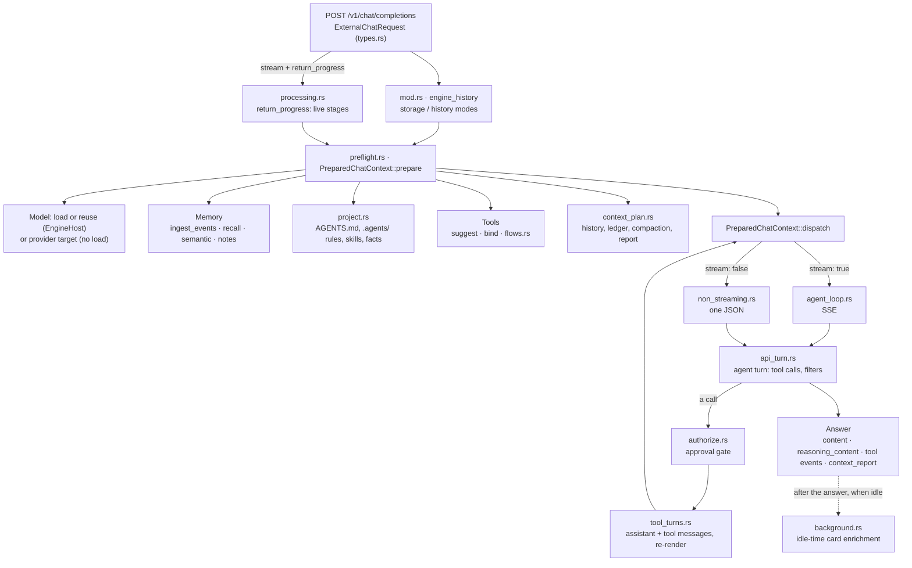

# Component: `api/src/handlers/chat/`

## Technical Specification

- **Purpose:** The Engine's chat pipeline behind `POST /v1/chat/completions` (OpenAI-compatible,
  streaming and not) and the CEP `chat.*`, `memory.*`, `context.*` and `approvals.*` methods
  that reuse it. One request goes through: the chat's memory (event log, ledger, notes, recall),
  the project's agent files, tool suggestion and loading, context planning, the model (an
  installed model through `EngineHost`, or a provider's model through `api/src/providers`), the
  agent loop that runs the Engine's tools with the approval gate, and the answer with thinking
  apart and a context report.
- **Platform Support:** Windows, Linux, macOS (whatever `EngineHost` runs on).
- **Reusability Level:** Core of the API server. Parts are called by CEP methods
  (`recall.rs`, `authorize.rs`, `context_plan.rs`, `background.rs`).
- **Request reference:** [docs/api/inference/chat_completions.md](../../../../docs/api/inference/chat_completions.md).

## Architectural Flow

## API Contract (Interface)

- **Entry:** `chat_completions(State<Arc<AppState>>, Json<ExternalChatRequest>) -> Response`
  (`mod.rs`), registered in `routes.rs`.
- **Public types:** `ExternalChatRequest`, `ExternalMessage`, `MessageContent`,
  `TemporaryChatMode`, `DEFAULT_MAX_TOKENS` (2048), `StreamSignals`, `ACTIVE_STREAMS`
  (`types.rs`); `PreparedChatContext`, `TurnMemory`, `context_report`, `tool_event`,
  `record_turn` (`preflight.rs`); `extract_tool_call`, `ExtractedToolCall` (`tool_parser.rs`).
- **Used by CEP methods:** `recall.rs` (`memory.*`), `authorize.rs` (`approvals.*`),
  `context_plan.rs` (`context.*`), `background.rs`, `ACTIVE_STREAMS` (`chat.cancel`,
  `chat.skip_reasoning`).
- **Export Type:** Rust, inside `cluaiz-api`. HTTP/SSE outward.
- **Dependencies:** `axum`, `tokio`, `async-stream`, `cluaiz_runtime` (`EngineHost`,
  `HostResponse`), `cluaiz_agents` (tools, turn, memory, workspace), `cluaiz_context` (planner),
  `cluaiz_models` (`StreamingReasoningFilter`, `StructuralDNA`), `crate::providers`.

## Deep File Breakdown

- `mod.rs`:
  - **Logic:** `engine_history` applies `storage` (`engine`, `external`, `none`) and `history`
    (`client`, `engine`: the logged transcript goes in front of the new messages).
    `chat_completions` rejects empty `messages`, prepares, dispatches once, then hands off to the
    streaming or non-streaming loop.
- `types.rs`:
  - **Logic:** The request (`ExternalChatRequest` with OpenAI fields and the Engine's own:
    `session_id`, `think_mode`, `reasoning_effort`, `temporary_chat`, `max_steps`,
    `return_progress`, `history`, `storage`…), and the live stream registry
    (`ACTIVE_STREAMS`, keyed by `chatcmpl-…`, holding cancel and skip-reasoning flags).
- `processing.rs`:
  - **Logic:** With `stream` and `return_progress`, progress events start before preflight so
    file decoding and model load are visible; token strings never carry events.
- `preflight.rs` (1,586 lines, above the 800-line limit; a split is due):
  - **Logic:** `PreparedChatContext::prepare` does everything before the first token, in order:
    stop idle jobs; check the model (a provider's model loads nothing); load or reuse the
    installed model so budgets use the context llama.cpp really created; read the chat template
    and the thinking tags (`<think>` for providers); the chat's ledger and earlier turns as the
    model saw them; pinned notes; the project's agent files; the event log; client functions;
    tool room from the context left after the answer's reserve; tool suggestions (cards and
    titles), bound tools whole or left out, flows that fit; the hint in the user turn (the system
    prompt stays the same for the KV cache); the context plan; auto-recall, the open task's
    checkpoint, notes and project items that fit this message; sampling and the envelope.
  - **Flow:** `dispatch` sends the prepared envelope to `EngineHost` or `ProviderRun`.
    `TurnMemory` saves the chat's KV after the turn (also on drop). `context_report` builds the
    report sent at the end.
  - **Why:** Every budget decision is made once, with real token counts, before generation.
- `agent_loop.rs`:
  - **Logic:** `execute_streaming_loop` turns the dispatch into SSE: content and
    `reasoning_content` deltas, tool events, permission requests, the context report, `[DONE]`.
    Registers the stream in `ACTIVE_STREAMS` so it can be cancelled or its thinking skipped.
- `non_streaming.rs`:
  - **Logic:** `execute_non_streaming` runs the same turn and answers one JSON;
    `separate_reasoning` splits thinking from the answer with the model's tags.
- `api_turn.rs`:
  - **Logic:** The API side of an agent turn (`cluaiz_agents::turn`) for both modes: reads the
    tokens through a `StreamingReasoningFilter` (thinking apart; with thinking off the tags are
    still read when the model has them, so thinking that comes anyway is not mixed into the
    answer), finds calls only in the answer part, runs meta tools, skills, plugins and MCP tools
    through the approval gate, and continues generation with the tool steps.
- `tool_parser.rs`:
  - **Logic:** `extract_tool_call` finds a `<tool_call>` block in text, also inside markdown
    fences or with nested JSON.
- `tool_turns.rs`:
  - **Logic:** Each tool step adds one assistant message (the call) and one tool message (the
    result); the conversation is rendered again through the template. The unchanged beginning
    keeps its KV cache, so only the new step is processed.
- `authorize.rs`:
  - **Logic:** `assess` (does this call need approval), `request` (register it in the CEP
    approval store; the SSE `permission_request` chunk when streaming), `wait` (until
    `approvals.approve` / `approvals.reject` or the time runs out).
- `flows.rs`:
  - **Logic:** Saved Automation flows (`flow.<name>`) matched to the message like installed
    tools; only fitting ones are offered. A call asks on the chat's approval card when the flow
    says so, then runs in the Automation extension.
- `project.rs`:
  - **Logic:** `~/.cluaiz/AGENTS.md`, the project's `AGENTS.md` files and its `.agents/` rules,
    workflows, skills and memory facts in the system prompt, within a share of the context
    (`budget_for`). No cache: the same files give the same text, so the KV cache stays valid.
- `ingest_events.rs`:
  - **Logic:** Writes the chat's event log from requests (new, edited, retracted messages in
    client mode; tool steps, loads, compaction and the answer after each turn). Temporary chats
    log nothing.
- `recall.rs`:
  - **Logic:** Auto-recall: when the prompt leaves part of the chat out, earlier messages that fit
    the current one come back as a short record. The Chat Map (cards and index) of up to 4 chats
    is kept in RAM and rebuilt from the event log when it grew.
- `semantic.rs`:
  - **Logic:** Notes and project facts matched by meaning with the installed embedding model
    (`notes_match`); each note embedded once (`cluaiz_agents::memory::vectors`). Missing, busy or
    failing model: callers fall back to word matching.
- `context_plan.rs`:
  - **Logic:** How earlier turns are rendered, when the ledger is compacted, and the plan behind
    the context report. Decisions come from the pure `cluaiz-context` planner; this file does the
    I/O. Dropping the oldest turns as the last resort stays in the engine.
- `background.rs`:
  - **Logic:** Idle-time card enrichment: a title, motive and summary per turn (at most 80 tokens,
    thinking off), on the chat's KV right after an answer. Stops at once when a request arrives;
    never loads a model; the event log is the job list, so a restart loses nothing.

## Failure & Recovery Logic

- **Empty `messages`:** 400 `invalid_request_error`.
- **Unknown model:** 400 from preflight, also while another request is busy.
- **Model load fails / does not fit:** `error_response` with the planner's reason; nothing is
  generated.
- **Provider error:** the provider's own message (see `api/src/providers/errors.rs`); stream
  errors arrive as the last chunk.
- **Context full:** the planner compacts the ledger, recalls instead of repeating, and as the
  last resort the engine drops the oldest turns; the context report says what was dropped.
- **Tool call needs approval:** the turn waits; rejected or timed out calls go back to the model
  as a refused result.
- **Unreadable call or answer only in thinking:** corrected and asked again, not run
  (`cluaiz_agents::turn`).
- **Cancel:** `chat.cancel` sets the stream's flag; generation and tool waits stop.
- **Embedding model missing for notes:** word matching instead.
