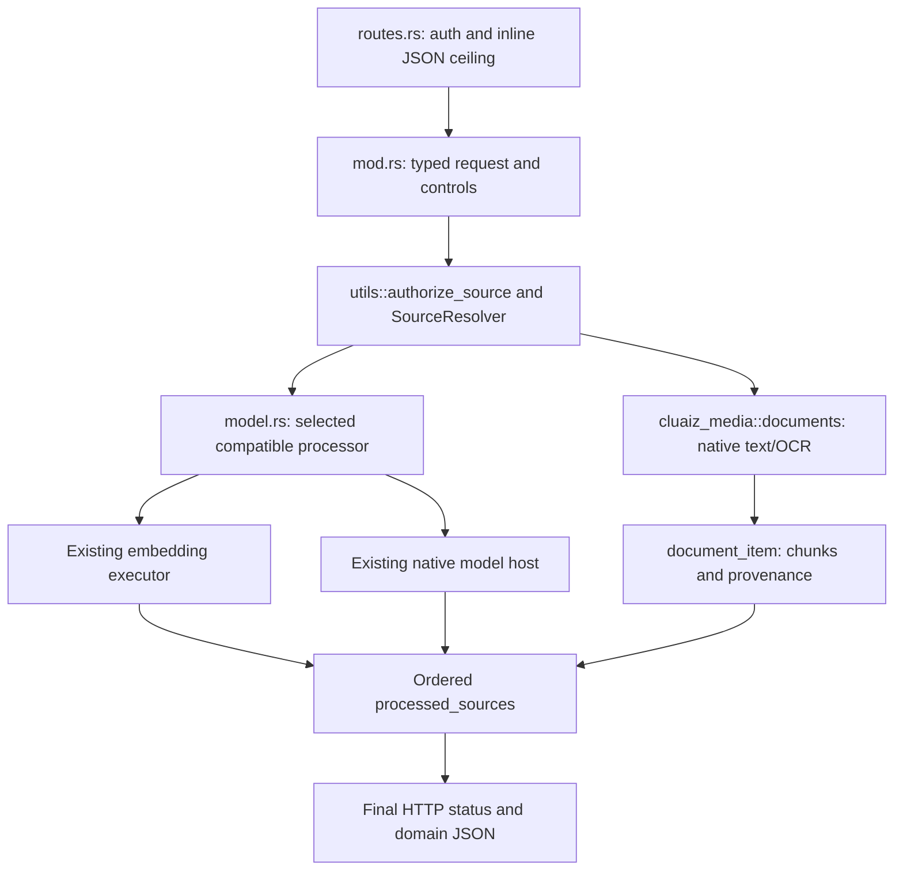

# Component: Direct document ingestion

## Technical specification

- **Purpose:** Serve `POST /v1/ingest` as a plain JSON request with one final JSON response. Native extraction and optional model processing share the same source and media owners used elsewhere in the Engine.
- **Boundary:** No CEP registration, task creation, persistent chat session or vector database. The HTTP authentication middleware identifies the owner; local paths use the shared canonicalizer. CEP extension roots are a different boundary.
- **Platform:** Portable Rust orchestration; PDF/OCR and selected-model execution depend on the packaged native assets and runtime backend. This transport change is exercised on Windows; it is not new cross-platform model certification.
- **Reusability:** Document parsing stays in `cluaiz_media`; vectors stay in `EmbeddingExecutor`; generative model execution stays in the existing runtime host.

## Architectural flow

## Interface and files

- **`mod.rs`:** Defines `IngestPayload`, source alternatives, output controls, byte chunking and vision options. `file_ingest` validates the request, resolves each source, checks aggregate input/output limits and collects ordered results. Parsing runs on a blocking worker rather than directly on the async executor.
- **`model.rs`:** `Processor::select` checks the installed entry and real ONNX input signatures. Text embedding uses native extraction first; image embedding decodes images or renders PDF pages; generative GGUF processing supplies pixels or native-first text to the existing model owner. `document_item` retains actual omissions/warnings and never fabricates missing text.
- **Shared resource:** The default generative instruction is loaded from `api/data/ingest.json`. It is not a second local prompt definition.
- **Export:** Only `file_ingest` is registered as a direct handler. These structs do not create another CEP method or executor.

## Lifecycle, failures and recovery

- Sources and their resolved temporary data use the existing resolver lifecycle. There is no ingest-specific permanent file cache or model resident. Selected models use their existing owners and admission settings; ingest has no request `keep_alive` override.
- Empty inputs and incompatible controls return HTTP 400. Missing selected models return 404. JSON schema/type/unknown-field rejections return 422. The route's inline transport ceiling returns 413 before extraction.
- Native parse/decode errors inside the source loop become per-source results. Mixed outcomes return HTTP 200 with `status:partial`. All-error batches return an error HTTP status and preserve every recorded source result; nested model status/body are retained when available.
- Local locator authorization/resolution errors can abort the request rather than become a batch item. Owner authorization permits owner-accessible files outside the current workspace; it does not grant an extension a CEP root.
- Output limits, context admission, helper availability, model compatibility and live machine memory remain independent checks. There is no model substitution or placeholder OCR/vector output.

## Reference and checks

- [Public request/response reference](../../../../docs/api/inference/ingest.md): field defaults, fifteen payload variants, code examples, diagrams and errors.
- `api/tests/ingest_http_contract.rs`: direct results, metadata-only output, ordered partial results and HTTP error distinctions.
- `api/tests/document_contract.rs`: actual native PDF/DOCX/DOC/text extraction and authentication.
- `api/tests/media_resource_contract.rs`: declared and streamed oversized inline bodies.
- `api/tests/ingest_models.rs`: opt-in installed-model acceptance; requires explicit disposable fixture configuration.
