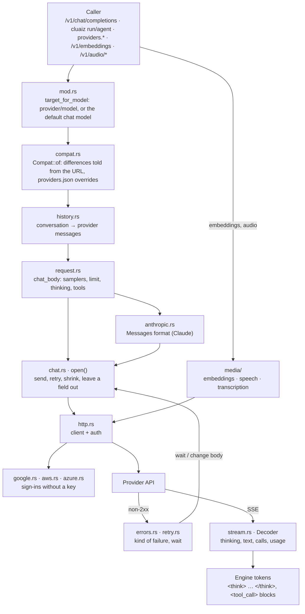

# Component: `api/src/providers/`

## Technical Specification

- **Purpose:** Every call the Engine makes to a model provider listed in `config/providers.json`
  (OpenAI-compatible services, Claude, Gemini, Vertex AI, Amazon Bedrock, Azure, NVIDIA,
  OpenRouter, a local server). It writes the Engine's conversation in the provider's format,
  signs the request the way the provider takes a key, reads the streamed answer back into the
  Engine's own form (thinking apart, calls as `<tool_call>` blocks), and turns failures into
  plain messages and retries. The server's chat (`/v1/chat/completions`), the terminal
  (`cmd/src/chat/provider.rs`, `cluaiz agent`), the CEP `providers.*` methods and the media
  routes all go through this folder, so they send and read the same.
- **Platform Support:** Windows, Linux, macOS. Network only (`reqwest` with rustls). Sign-ins
  that call a CLI (`gcloud`, `aws`, `az`) need that CLI installed.
- **Reusability Level:** Shared gateway inside `cluaiz-api`; the public items are re-exported
  in `mod.rs` and used by `cmd`.
- **User guide:** [docs/engine/providers.md](../../../docs/engine/providers.md).

## Architectural Flow

## API Contract (Interface)

- **Re-exported from `mod.rs`:**
  - Chat: `open`, `Opened`, `Opening`, `Room`, `ProviderRun` (`chat.rs`); `chat_body`,
    `ChatParts`, `Sampling`, `Thinking`, `ThinkMode`, `Effort` (`request.rs`).
  - Format: `Compat`, `ThinkingFormat`, `Wire`, `IdForm`, `chat_url` (`compat.rs`);
    `openai_conversation`, `openai_conversation_with_parts`, `drop_oldest_turn` (`history.rs`).
  - Stream: `Decoder`, `Read`, `Finished`, `StreamedCalls`, `sse_lines`, `data_of`,
    `delta_reasoning`, `event_usage`, `THINK_START`, `THINK_END` (`stream.rs`).
  - Errors: `Failure`, `classify`, `error_message`, `send_error`, `CONTEXT_FULL` (`errors.rs`).
  - HTTP: `client`, `request`, `Auth`, `ANTHROPIC_VERSION` (`http.rs`).
  - Other: `models`, `test`, `OfferedModel` (`models.rs`); `forward_embeddings`,
    `forward_speech`, `forward_transcription` (`media/`).
  - Helpers in `mod.rs`: `target_for_model`, `target_of`, `named_target`,
    `refuse_provider_model`, `open_server_warning`.
- **Export Type:** Public Rust API of `cluaiz-api`. No C-FFI.
- **Dependencies:** `reqwest`, `serde_json`, `tokio`, `axum` (media responses),
  `cluaiz_core::providers` (providers.json, `Target`, `redact`), `cluaiz_runtime`
  (`HostResponse`, `ContextReport`), `cluaiz_security` (default chat model), `cluaiz_models`
  (installed registry, so an installed model of the same name wins).

## Deep File Breakdown

- `mod.rs`:
  - **Logic:** Declares the files, re-exports the API, picks the provider target a request names.
  - **Flow:** `target_for_model` reads providers.json; no model or `auto` means the default chat
    model when that is a provider's; an installed model with the same name wins.
  - **Why:** One place decides whether a request goes to a provider, for every route.
- `compat.rs`:
  - **Logic:** `Compat` holds one field per difference from the OpenAI format: thinking format
    (`ThinkingFormat`: OpenAI, Gemini, Qwen, QwenTemplate, Nvidia, Zai, DeepSeek, OpenRouter,
    Together, Anthropic, None), `reasoning_effort`, the answer-limit field name, usage in the
    stream, call id form (`IdForm`), `reasoning_content` on calls, wire format (`Wire`).
  - **Flow:** `Compat::of(target)` detects from the base URL, then applies `compat` from
    providers.json field by field.
  - **Why:** A provider the Engine does not know still gets the plain OpenAI format; each quirk
    is read in exactly one place (`request.rs`, `history.rs` or `stream.rs`).
- `history.rs`:
  - **Logic:** The Engine's conversation (with `<tool_call>` text) as OpenAI `messages` with
    `tool_calls`.
  - **Flow:** Calls a provider made keep the ids and extra fields it sent (Gemini's thought
    signature); calls another model made keep only names and arguments; then the provider's id
    form, `reasoning_content` on call messages (DeepSeek), no null `content`.
    `drop_oldest_turn` removes the oldest whole turn when a request does not fit.
  - **Why:** Models reject call histories they did not write in their own form.
- `request.rs`:
  - **Logic:** `chat_body` writes samplers, the answer limit, tools, the answer schema and
    thinking. `Thinking::of(mode, budget)` maps `on`/`off`/`auto` and a budget to a mode and an
    effort level. `add_thinking` writes thinking in the provider's own field;
    `drop_thinking_off` removes every "do not think" field again.
  - **Flow:** Same function for the server and the terminal.
  - **Why:** One request builder, so both paths send identical requests.
- `anthropic.rs`:
  - **Logic:** The Anthropic Messages request and its stream (Claude API, Bedrock, Vertex AI).
  - **Flow:** System prompt as its own field; calls as `tool_use`, results as `tool_result` in one
    user message; `max_tokens` always set; thinking as `adaptive` with `output_config.effort`;
    thinking blocks go back with their `signature` before that answer's calls.
  - **Why:** The format differs from OpenAI in every part; it is kept apart.
- `http.rs`:
  - **Logic:** One shared `reqwest` client; `Auth` decides how the key is sent (Bearer,
    `api-key`, `x-api-key`, Google token, Entra token, AWS signature, none).
  - **Flow:** `request` builds a request for a target with its auth; `send` sends it with the
    provider's timeouts.
  - **Why:** The key goes only to the provider's own URL in its auth header, never into a log.
- `google.rs`, `aws.rs`, `azure.rs`:
  - **Logic:** Sign-ins without a key: Google Application Default Credentials (service account
    JWT, user login refresh, `gcloud`), AWS Signature Version 4 (env, credentials file,
    `aws configure export-credentials`), Microsoft Entra (service principal, `az`).
  - **Flow:** Tokens are kept and renewed five minutes before they end; AWS signs each request
    with its method, URL, headers and body, region and service told from the host.
  - **Why:** Vertex AI, Bedrock and Azure are used with the person's cloud login, not a pasted key.
- `chat.rs`:
  - **Logic:** `open` sends a chat request until it is answered or cannot be. `ProviderRun` is a
    provider model as the model of the Engine's own chat (`dispatch`, `dispatch_prepared`).
  - **Flow:** On a non-2xx answer, in order: drop the oldest turn when the context is full
    (`room.drop_turns`); pass on a refused call to a function not in `tools`, or send once more
    with a reminder; lower `max_tokens` for Claude; send again without thinking off when the
    model cannot stop thinking; leave out an optional field the provider refuses; wait and retry
    rate limits and busy answers. The stream is read on a spawned task; thinking is passed on as
    it comes (also with thinking off), and an answer with nothing in it is asked for once more.
  - **Why:** The caller gets either a stream or one clear error; every wait ends when the person
    cancels.
- `stream.rs`:
  - **Logic:** `Decoder::read` turns one SSE `data:` line into `Read::Piece` (thinking, text, a
    call being written), `Read::Done`, `Read::Error` or `Read::Nothing`; `finish` gives the calls
    as `<tool_call>` blocks, usage and the stop reason.
  - **Flow:** Thinking from `reasoning_content`, `reasoning`, `reasoning_text`, `<think>` /
    `<thought>` text or Claude thinking blocks; calls in pieces (OpenAI, Groq) or whole (Gemini);
    usage in the last event, every event (Gemini) or `x_groq`. `sse_lines` keeps a character
    split across chunks whole.
  - **Why:** Every provider's stream ends up in one form the Engine already handles.
- `errors.rs`:
  - **Logic:** `classify(status, body)` gives a `Failure` (Key, NoModel, RateLimited, Quota,
    ContextFull, Busy, Other); `error_message` and `send_error` write one sentence that names the
    provider and what to do; `refused_field`, `tool_call_refused`, `refused_calls`,
    `thinking_required` recognise refusals that `open` can fix.
  - **Why:** The kind decides between retry, change and giving up; the text never holds the key
    (`redact`).
- `retry.rs`:
  - **Logic:** `wait_after`: a rate limit waits the provider's `Retry-After` (else 4 s, then 8 s),
    never more than 20 s; a busy provider waits 1 s, then 3 s; at most 2 more tries.
    `wait_after_send_error`: a connection that did not open, or timed out, once more after 1 s.
    `EMPTY_ANSWER_TRIES` (1). `pause` ends early on cancel.
- `models.rs`:
  - **Logic:** `models` lists what `GET {base_url}/models` offers (a `data` or a `models` list);
    `test` sends one short request of the model's kind for `cluaiz provider test` /
    `providers.test`: chat, embedding (sent again with `input_type: "query"` when the model asks
    for it) or speech; a speech-to-text model is not sent anything, the answer says to test it with
    audio at `/v1/audio/transcriptions`.
- `media/` (`mod.rs`, `embeddings.rs`, `speech.rs`, `transcription.rs`):
  - **Logic:** `forward_embeddings`, `forward_speech`, `forward_transcription` send the OpenAI
    request to the provider and answer in the shape of the Engine's own route
    (`/v1/embeddings`, `/v1/audio/speech`, `/v1/audio/transcriptions`); streamed WAV gets its real
    sizes in the header.
- `tests/`:
  - **Logic:** Recorded SSE streams (`tests/fixtures/*.sse`: OpenAI, Groq, Gemini, Mistral,
    DeepSeek, OpenRouter, Claude, errors, empty answers) replayed through `Decoder`, plus request
    and history checks.

## Failure & Recovery Logic

- **Key refused (401/403):** not retried; the message names the provider and the key's source.
- **Model not served to this key (404):** not retried; the message says the list may show it
  anyway and points to `cluaiz provider models`.
- **Rate limit (429):** waited for (the provider's `Retry-After`, at most 20 s), up to 2 more tries.
- **Quota or billing limit:** not retried; waiting does not help.
- **Busy (5xx, 529, "overloaded"):** up to 2 more tries, after 1 s and 3 s.
- **Connection not opened or timed out:** one more try after 1 s.
- **Timeout:** the message says the model may be busy or slow at that provider.
- **Context full:** the oldest turns are dropped (server chat) or the agent makes room itself.
- **Optional field refused, thinking off refused, `max_tokens` too high, call to an unlisted
  function:** the request is changed and sent again (see `chat.rs`).
- **Error inside the stream:** `[ERROR: …]` is sent as the last token; a stream that ends with
  nothing is asked for once more.
- **Cancel:** every wait and every stream read checks the cancel flag; dropping the response ends
  the request at the provider.
