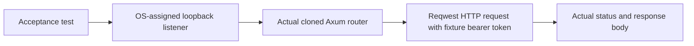

# Component: API acceptance transport support

## Technical Specification
- **Purpose:** One real authenticated loopback HTTP request helper shared by native/audio and embedding acceptance tests.
- **Platform Support:** OS TCP loopback and Tokio/Reqwest; actual model/platform acceptance is defined by each caller.
- **Reusability Level:** Test-only; not compiled into production API/CLI paths.

## Architectural Flow

## API Contract
- **Function:** `post(router, route, body, caller)` returns HTTP status and text body or the actual transport error.
- **Dependencies:** Axum, Tokio, Reqwest, serde_json, anyhow. The caller supplies model assets, isolated home, expected outcomes and fixture configuration.

## File Breakdown and Lifecycle
- **mod.rs:** Starts the test router on an OS-assigned port, sends one request and reads its full response. A local RAII server guard aborts its listener task on return/error. Model owners belong to the supplied router state and remain inspectable between requests.

## Failure and Recovery
- **Errors:** Listener, request and response failures propagate; no mocked HTTP/model output replaces them. The fixed bearer token is isolated fixture auth data, never a production default.
- **Boundaries:** Does not make a missing model/download succeed, bypass permission gates or establish App UI behavior.
