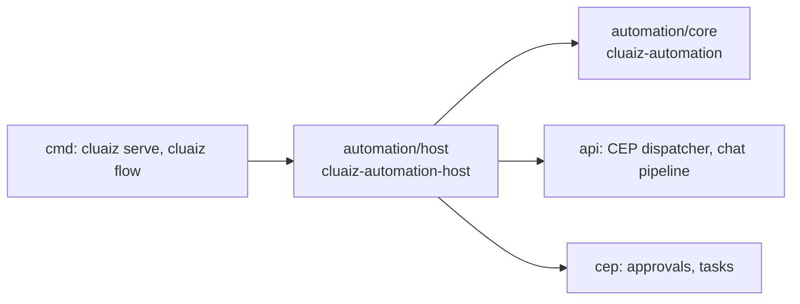

# `automation/`: Cluaiz Automation

Automation runs **flows**: files of steps that use the Engine's tools, methods and models. It is
a separate layer, not part of the Engine and not part of the API. The user docs are in
[docs/automation](../docs/automation/README.md).

| Folder | Crate | Job | Depends on |
| --- | --- | --- | --- |
| [core/](core/) | `cluaiz-automation` | The flow format and its checks, expressions, the runner, run records, flow files | Nothing of the Engine |
| [host/](host/) | `cluaiz-automation-host` | The `flows.*` methods, and the `StepHost` that reaches the Engine | `core`, `cluaiz-api`, `cluaiz-cep` |

## Rules

1. **The Engine never depends on Automation.** `cmd` installs it before `cluaiz serve` starts
   (`cluaiz_automation_host::install()`); the API offers one extension point for that
   (`api/src/cep/extensions.rs`).
2. **Steps reach the Engine only through its public doors.** `call` and `tool` steps go through
   `CepEngine::invoke` as the principal `flow:<name>`, so scopes, folder roots, approvals and the
   audit log are the Engine's own. `ask` steps go through the chat pipeline. There is no other way
   in.
3. **`core` has no Engine code**, so its tests run without a model or a server
   (`cargo test --release -p cluaiz-automation`).
4. **The format is described once**: `core/src/format/tables.rs`. The checker, the JSON Schema of
   `flows.schema` and the step list all read it. Operators are described once in
   `core/src/expr/mod.rs` (`OPS`).

## `core/src`

| File | Job |
| --- | --- |
| `format/tables.rs` | Every field of the file, every step kind and trigger |
| `format/parse.rs` | JSON or YAML 1.2 text to one JSON model |
| `format/check.rs` | Structure: unknown and missing fields, types, kinds, expressions, cron, timezones |
| `format/json_schema.rs` | The JSON Schema made from the tables |
| `format/mod.rs` | A step's kind, generated ids, inner step lists, walking every step |
| `validate/mod.rs` | Meaning checks in order, with the problems they report |
| `validate/graph.rs` | Ids, `needs` and references: which step can read which, cycles, a step read before it can have run |
| `validate/uses.rs` | What each step uses: tools and methods that must exist (`parse_tool`), the permissions the flow needs, and warnings (outside content reaching tools: `untrusted_with_tools`) |
| `validate/tests.rs` | Validation tests |
| `problem.rs` | A problem of `flows.validate`: `code`, `path`, `message`, `severity` (error / warning), an optional `fix` and line / column |
| `error.rs` | The error of a failed step or run: `{ kind, message, step, details }`; 19 kinds; which are retried by default, and `cancelled`, `permission`, `approval_rejected`, which are never retried |
| `expr/mod.rs` | Expressions: JSON objects with one operator. The operator table (`OPS`, read by the evaluator, validation and `flows.schema`) and the evaluator; limits: depth 64, 1,000,000 operations, 100,000 list items, 10 MiB of text, 1,000-character patterns. They only compute: no tools, files, network or endless loops |
| `expr/values.rs` | Rules every operator shares: equality, ordering, numbers, types, times |
| `expr/ops_data.rs` | Logic (`not`), comparison, types and conversion, numbers, encoding |
| `expr/ops_text.rs` | Text operators; `null` text is `""`; patterns run in linear time (no look-around or back-references) |
| `expr/ops_list.rs` | List and object operators on plain values (`some`, `every`, `filter`, `map`, `find_item`, `count` are in the evaluator, since they work out a condition per item) |
| `expr/ops_time.rs` | Time operators on RFC 3339 text; day of week and time of day in the flow's timezone |
| `expr/tests.rs` | Expression tests |
| `refs.rs` | Paths and `${{ }}` references |
| `schema.rs` | The part of JSON Schema used for inputs, `output_schema` and tool inputs |
| `permissions.rs` | Permission patterns, read the same at save and at every step |
| `limits.rs`, `units.rs` | Run limits, step timeouts, durations and sizes |
| `run/context.rs` | What references and expressions read: inputs, trigger, run, previous values, steps; steps are kept per list, so a step inside a branch or a loop item is seen only there |
| `run/mod.rs` | One run: the state its branches share, the run clock (waiting is not running), finish, `rerun` |
| `run/step.rs` | One step (when, approvals, retry, timeout, on_error, output), and a list's steps by `needs` |
| `run/kinds.rs` | `tool`, `call`, `ask`, `if`, `switch`, `each`, `set`, `return`, `fail` |
| `run/flowing.rs` | `parallel`, `repeat`, and branches that run together (`each` with `parallel` too) |
| `run/waiting.rs` | `wait`, `approve`, and questions to the owner, with deadlines that survive a restart |
| `run/reaching.rs` | `emit`, `run`, `code` |
| `run/agent.rs` | `agent`: rounds of tool calls run as the flow, and the outside-content rule |
| `journal.rs` | Run folders: `run.json`, `journal.jsonl`, `flow.json`, `files/` |
| `run/state.rs` | Values kept between runs: `changed`/`previous`, idempotency keys |
| `store.rs` | Flow files in the project and user folders, and the owner's decisions |
| `trigger/mod.rs` | A flow's triggers, and the checks every event passes: `filter`, `dedupe`, `inputs` |
| `trigger/cron.rs`, `trigger/timing.rs` | Cron lines in a timezone (daylight saving too), `every`, missed times and `catch_up` |
| `trigger/poll.rs` | One poll as the flow, and whether its answer is new |
| `trigger/files.rs` | Which files count, and when a touched file settles into an event |
| `trigger/webhook.rs` | Secrets and HMAC signatures, and a request as `trigger` |
| `trigger/tests.rs`, `format/check/tests.rs` | Trigger and structure-check tests |
| `trigger/state.rs` | What triggers keep: last planned times, counters, errors, poll answers, `dedupe` values |
| `host.rs` | `StepHost` and `Catalog`: what a run asks of the Engine |
| `ease/mod.rs` | The palette of `flows.nodes`: step kinds, triggers, operators, from the format's tables |
| `ease/explain.rs` | A flow in plain words, with no model: triggers (cron lines too), steps, conditions, what it touches |
| `ease/draft.rs` | What `flows.draft` and `flows.fix` give a model and read back: the format in short, the nodes, corrections, changes as JSON Pointers, sample data for a test |

## `host/src`

| File | Job |
| --- | --- |
| `lib.rs` | `install()`: the extension the API serves |
| `service.rs` | Runs as CEP tasks, `concurrency`, runs that go on after a restart |
| `engine.rs` | The `StepHost`: CEP calls as the flow's principal, `ask` through the chat pipeline, questions to the owner as approvals |
| `catalog.rs` | What is installed and callable, read through `tools.list`, `models.list` and the method registry; the nodes of `flows.nodes` |
| `methods/` | `flows.schema`, `validate`, `save`, `get`, `list`, `remove`, `enable`, `disable`, `run`, `rerun_from`, `runs`, `run_get`, `nodes`, `explain`, `draft`, `fix` |
| `methods/common.rs` | What the methods share: scopes (project / user), reading a flow from params, summaries, typed errors, the owner's confirmation of permissions |
| `methods/switch.rs` | `flows.enable` / `flows.disable`: a flow's triggers on or off; a disabled flow can still be run by hand |
| `methods/drafting.rs` | `flows.draft` / `flows.fix` as CEP tasks: a model writes or corrects a flow (`Talk` keeps the conversation, with an answer schema when the model takes one), Automation checks it and gives the problems back, up to `rounds` correction rounds (default 3, at most 5); nothing is saved |
| `tools.rs` | The `tool` trigger: flows listed as `flow.<name>` for MCP clients, chats and the coding agent, and a call that runs one |
| `triggers/` | What listens for enabled flows: clocks, polls, folders (`notify`), Engine events; `fire` starts every triggered run |
| `triggers/clock.rs` | `schedule` and `every`: wait for the next planned time, start a run, run missed times as `catch_up` says (Automation off, flow disabled, computer asleep) |
| `triggers/poller.rs` | `poll`: every N minutes run the tool or method as the flow; a run starts when the answer has something new; a failing poll is recorded and tried next time |
| `triggers/watcher.rs` | `file`: the system tells which paths were touched; a file still for `debounce` becomes `created`, `changed` or `removed`; files already there are not new |
| `webhook.rs` | `POST /v1/hooks/<flow>[/<trigger>]`, served without the API token, proved by the flow's secret |
| `reach.rs` | Events for `emit` and `wait`, run addresses (`/v1/hooks/runs/...`), other flows, WebAssembly modules |

## Built and not built

Built: the format and every check, all operators, all seventeen step kinds, the common step fields
(`when`, `needs`, `retry`, `timeout`, `on_error`, `approve_before`, `idempotency_key`,
`on_unknown`, `secret_output`, `output`), steps that run together (`needs`, `parallel`, `each`
with `parallel`, within `limits.max_parallel`), run records with resuming after a restart (waits
keep their deadline), secrets masked in records, every trigger (`manual`, `schedule`, `every`,
`webhook`, `poll`, `file`, `engine`, `event`, `tool` for MCP clients, chats and the coding agent, `startup`) with `filter`,
`dedupe`, `inputs`, `catch_up` and `jitter`, the sixteen methods above (drafting, explaining and
fixing flows among them), and `cluaiz flow`.

The Engine side has small, additive pieces for this: Engine events (`cep/src/events.rs`), extension
routes (`Extension::routes` in `api/src/cep/extensions.rs`, outside the API token check), extension
tools (`Extension::tools` and `call_tool`, listed by `api/src/cep/mcp.rs` and offered in chats by
`api/src/handlers/chat/flows.rs` with the `chat.flow_hint` prompt; the terminal agent reads them in
`cmd/src/agent/flows.rs`), an
approval open for longer than the usual five minutes (`ApprovalStore::request_for`), and a module's
own function, fuel and hosts in the WebAssembly runner (`wasm::run_module`, `NetAccess::for_hosts`).

Not built yet (read and checked, and a run says so): flow templates as a registry kind, `tools`/`attachments`/`session` on `ask`,
`tool_search`/`attachments`/`session` on `agent`, `settings` on `tool`, `call` to Engine routes,
registry suggestions in `flows.draft`'s `missing`, `step.output_delta` streaming, multipart and
binary webhook bodies, and WebAssembly components (WIT). Project flows listen for the workspace
that was current when the server started.
