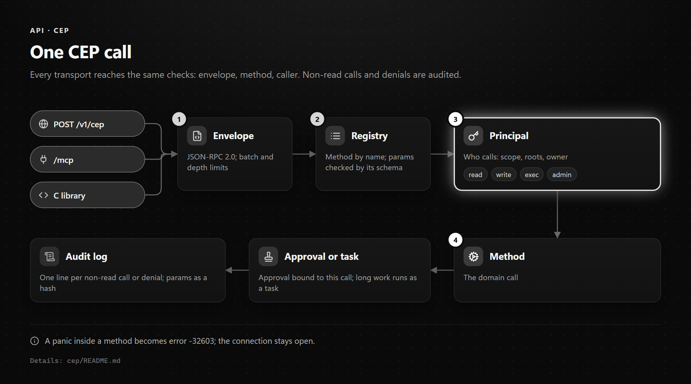

<!-- name: cep
description: The CEP protocol core (crate cluaiz-cep): JSON-RPC 2.0 envelope, method registry and dispatcher, reachable over HTTP, MCP and native calls. -->

# CEP protocol core (`cep/`, crate `cluaiz-cep`)

CEP, the Cluaiz Engine Protocol, carries every Engine-specific operation as a JSON-RPC 2.0 method. The same methods are reachable three ways:

- `POST /v1/cep`
- the C functions `cep_call` / `cep_free`
- `/mcp`

This crate is only the protocol. It knows nothing about HTTP, models or the Engine's state, so its tests run without the CUDA build:

```bash
cargo test --release -p cluaiz-cep
```

Reference for every method (parameters, errors, examples): [`docs/api/cep/`](../docs/api/cep/README.md);
the same list as OpenRPC: [`docs/api/cep/openrpc.json`](../docs/api/cep/openrpc.json).



| File | Owns |
|---|---|
| `envelope.rs` | JSON-RPC 2.0 parsing and responses: by-name params only, the `params._meta` split, batch and depth limits |
| `error.rs` | `CepError`, the standard codes, server codes -32001..-32010 with a stable `data.type` |
| `registry.rs` | `Registry<Ctx>`, `Meta`, `Call`. A method's params type is its schema (schemars). Bad names, duplicates and missing examples panic at start. |
| `principal.rs` | `Principal`, `Scope` (read / write / exec / admin), roots, the owner |
| `approval.rs` | Approvals bound to principal + method + params hash, used once, with expiry; waiters for the chat agent loop |
| `task.rs` | Tasks for long work: working / completed / failed / cancelled, progress, an events cursor, per-principal limit |
| `discover.rs` | The OpenRPC document, filtered to what the caller may call |
| `protocol.rs` | The crate's own methods: `rpc.discover`, `tasks.get` / `result` / `cancel` / `list` |
| `dispatch.rs` | `Engine::call` (bytes in, bytes out) and `Engine::invoke` (one call, used by MCP). A panic in a method becomes `-32603`. |

Adding an Engine method (from `api/src/cep/methods/<group>.rs`):

```rust
registry.add(
    "notes.pin",
    Meta::new(Scope::Write, "Pins or unpins a note").example(json!({"id": "n7", "pinned": true}), json!({"id": "n7", "pinned": true})),
    |ctx: CallCtx, call: Call, p: PinParams| async move { /* domain call */ },
);
```

Rules for every method:

- The params struct has `#[serde(deny_unknown_fields)]`.
- The method has one scope and a real example.
- If it is not built yet, it returns `CepError::not_implemented`, never a fake success.

## Engine events

[`src/events.rs`](src/events.rs): short notices that something happened (a task ended, an approval was asked or answered, a model was downloaded, a model load moved a step, a tool was installed). `publish(name, data)` sends one. Events carry ids and names, never content (no chat text, no file data). Two ways to read them:

- `subscribe()`: a live receiver inside the process (Automation starts flows on it). With nobody subscribed, no live notice is sent.
- `read_since(after, limit)` / `wait_since(after, limit, wait_ms)`: every notice also goes into a ring of the newest `RING_CAPACITY` (1024) with a sequence number `seq` (from 1 for each Engine run). CEP `system.events` (`api/src/cep/methods/system.rs`) reads it by cursor and long-polls up to `MAX_WAIT_MS` (30000 ms), so a client outside the process sees loads it did not start. Reference: [`system.events`](../docs/api/cep/system/system/system.events.md).

## Decisions
| Decision | Why | Alternative not taken |
|---|---|---|
| The protocol crate knows nothing about HTTP, models or Engine state | one method set serves HTTP, the C ABI and MCP; the crate's tests need no CUDA build | protocol code inside `api` |
| A method's params type is its schema (schemars), with `deny_unknown_fields` | the schema in `rpc.discover` cannot drift from the code, and a misspelled field is an error, not ignored | hand-written schemas |
| Approvals bound to principal + method + params hash, used once, with expiry | an approval for one call cannot be replayed for another (`test_an_approval_fits_one_call_once`) | approve a method for a time |
| Bad names, duplicates and missing examples panic at start | a broken registry is found when the Engine starts, not by a client | warn and continue |
| A panic inside a method becomes error `-32603` | one broken method must not drop the connection (`dispatch.rs`) | let it propagate |
| Events also go into a bounded ring with a `seq`, read by cursor (`system.events`) | a client outside the process (the App) sees a load the CLI or a chat started; the cursor lets it page and long-poll without missing what came in between | a server-sent event stream per client (a second transport beside JSON-RPC, and it loses what came while the client was away) |
| The ring keeps 1024 events, the long poll waits at most 30 s | a load sends about 110 notices (`engine/runtime/src/load_events.rs`), so 1024 holds about 9 loads in well under 1 MB; 30 s stays under common proxy and client timeouts | an unbounded log (memory grows with every load); a file on disk (`models.load_history` already keeps finished loads) |

## Tested

`cargo test --release -p cluaiz-cep` on 2026-11-22 (Windows 11): unit tests 22 passed, integration tests 5
passed. The event tests: `cursor_pages_in_order_and_limit_caps_the_page`,
`a_full_ring_drops_the_oldest_and_seq_keeps_counting`, `wait_returns_early_when_a_notice_arrives`,
`wait_times_out_empty_and_zero_wait_does_not_wait`, `wait_returns_at_once_when_something_is_already_newer`,
`publish_keeps_the_notice_in_the_engine_ring_even_with_nobody_subscribed`,
`subscribers_get_what_is_published_after_they_subscribe` (now looks for its own event name, so events
of parallel tests no longer break it).

Tests: `test_an_approval_fits_one_call_once`, `test_one_approval_may_stay_open_longer`,
`test_expiry_rejection_and_key_order`, `test_a_waiter_gets_the_decision`, `test_spec_requests_and_notifications`,
`test_spec_errors`, `test_meta_is_split_out_and_checked`, `test_limits`, `test_scopes_roots_and_owner_only`,
`test_names`, `test_suggestions_and_schema`, `test_task_lifecycle_and_owner`, `test_cancel_failure_and_limit`,
`test_single_notification_and_batch`, `test_params_errors_show_the_path_and_example`,
`test_scope_roots_and_approval_round_trip`, `test_tasks_panics_and_discovery_document`,
`test_one_approval_covers_every_path_of_the_call`, and the event tests above.

End to end over HTTP, MCP and the C ABI: `test/cep/` (see [`test/README.md`](../test/README.md)).

## Pending

| Item | Why it matters | Needs |
|---|---|---|
| The event ring is lost when the Engine stops | a client that was away across a restart cannot read the events of the old run; `latest_seq` below its cursor tells it to start again from 0 | only if a client needs older events: finished loads are already on disk in `models.load_history` |
