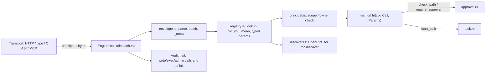

# CEP protocol core (`cep/`, crate `cluaiz-cep`)

CEP, the Cluaiz Engine Protocol, carries every Engine-specific operation as a JSON-RPC 2.0 method. The same methods are reachable three ways:

- `POST /v1/cep`
- the C functions `cep_call` / `cep_free`
- `/mcp`

This crate is only the protocol. It knows nothing about HTTP, models or the Engine's state, so its tests run without the CUDA build:

```bash
cargo test --release -p cluaiz-cep
```

Design: `.agent/plans/CEP/01-architecture.md`. Method list: `03-method-catalog.md`.



| File | Owns |
|---|---|
| `envelope.rs` | JSON-RPC 2.0 parsing and responses: by-name params only, the `params._meta` split, batch and depth limits |
| `error.rs` | `CepError`, the standard codes, server codes -32001..-32010 with a stable `data.type` |
| `registry.rs` | `Registry<Ctx>`, `Meta`, `Call`. A method's params type is its schema (schemars). Bad names, duplicates and missing examples panic at start. |
| `principal.rs` | `Principal`, `Scope` (read / write / exec / admin), roots, the owner |
| `approval.rs` | Approvals bound to principal + method + params hash, used once, with expiry; waiters for the chat agent loop |
| `task.rs` | Tasks for long work: working / completed / failed / cancelled, progress, an events cursor, per-principal limit |
| `discover.rs` | The OpenRPC document, filtered to what the caller may call |
| `protocol.rs` | The crate's own methods: `rpc.discover`, `tasks.get` / `result` / `cancel` / `list` |
| `dispatch.rs` | `Engine::call` (bytes in, bytes out) and `Engine::invoke` (one call, used by MCP). A panic in a method becomes `-32603`. |

Adding an Engine method (from `api/src/cep/methods/<group>.rs`):

```rust
registry.add(
    "notes.pin",
    Meta::new(Scope::Write, "Pins or unpins a note").example(json!({"id": "n7", "pinned": true}), json!({"id": "n7", "pinned": true})),
    |ctx: CallCtx, call: Call, p: PinParams| async move { /* domain call */ },
);
```

Rules for every method:

- The params struct has `#[serde(deny_unknown_fields)]`.
- The method has one scope and a real example.
- If it is not built yet, it returns `CepError::not_implemented`, never a fake success.

## Engine events

[`src/events.rs`](src/events.rs): short notices that something happened (a task ended, an approval was asked or answered, a model was downloaded, a tool was installed). `publish(name, data)` sends one; `subscribe()` gives a receiver. Layers outside the Engine subscribe (Automation starts flows on them). Events carry ids and names, never content (no chat text, no file data); with nobody listening a notice is dropped.

## Decisions and why

| Decision | Why | Alternative not taken |
|---|---|---|
| The protocol crate knows nothing about HTTP, models or Engine state | one method set serves HTTP, the C ABI and MCP; the crate's tests need no CUDA build | protocol code inside `api` |
| A method's params type is its schema (schemars), with `deny_unknown_fields` | the schema in `rpc.discover` cannot drift from the code, and a misspelled field is an error, not ignored | hand-written schemas |
| Approvals bound to principal + method + params hash, used once, with expiry | an approval for one call cannot be replayed for another (`test_an_approval_fits_one_call_once`) | approve a method for a time |
| Bad names, duplicates and missing examples panic at start | a broken registry is found when the Engine starts, not by a client | warn and continue |
| A panic inside a method becomes error `-32603` | one broken method must not drop the connection (`dispatch.rs`) | let it propagate |

## Tested

`cargo test -p cluaiz-cep` on 2026-11-21 (Windows 11): unit tests 15 passed, 1 failed in the first full
run (`events::tests::subscribers_get_what_is_published_after_they_subscribe`); the same test passed
three times alone and the full unit run passed on the rerun (16 passed). Integration tests: 5 passed.

Tests: `test_an_approval_fits_one_call_once`, `test_one_approval_may_stay_open_longer`,
`test_expiry_rejection_and_key_order`, `test_a_waiter_gets_the_decision`, `test_spec_requests_and_notifications`,
`test_spec_errors`, `test_meta_is_split_out_and_checked`, `test_limits`, `test_scopes_roots_and_owner_only`,
`test_names`, `test_suggestions_and_schema`, `test_task_lifecycle_and_owner`, `test_cancel_failure_and_limit`,
`test_single_notification_and_batch`, `test_params_errors_show_the_path_and_example`,
`test_scope_roots_and_approval_round_trip`, `test_tasks_panics_and_discovery_document`,
`test_one_approval_covers_every_path_of_the_call`, `subscribers_get_what_is_published_after_they_subscribe`.

End to end over HTTP, MCP and the C ABI: `test/cep/` (see [`test/README.md`](../test/README.md)).

## Pending

| Item | Why it matters | Needs |
|---|---|---|
| `subscribers_get_what_is_published_after_they_subscribe` fails sometimes when run with the other tests | the event bus is one process-wide channel (`events.rs:22-23`); events from parallel tests reach this test's subscriber | a bus per test, or filter by a test-unique event name |
| Design and catalogue links point to the git-ignored `.agent/plans/CEP/` | a reader of the repository cannot open them | the generated reference in `docs/api/cep/` is the public copy; link it instead |
