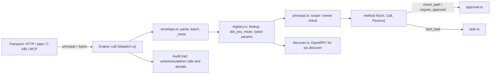

# CEP protocol core (`cep/`, crate `cluaiz-cep`)

CEP, the Cluaiz Engine Protocol, carries every Engine-specific operation as a JSON-RPC 2.0 method. The same methods are reachable three ways:

- `POST /v1/cep`
- the C functions `cep_call` / `cep_free`
- `/mcp`

This crate is only the protocol. It knows nothing about HTTP, models or the Engine's state, so its tests run without the CUDA build:

```bash
cargo test --release -p cluaiz-cep
```

Design: `.agent/plans/CEP/01-architecture.md`. Method list: `03-method-catalog.md`.



| File | Owns |
|---|---|
| `envelope.rs` | JSON-RPC 2.0 parsing and responses: by-name params only, the `params._meta` split, batch and depth limits |
| `error.rs` | `CepError`, the standard codes, server codes -32001..-32010 with a stable `data.type` |
| `registry.rs` | `Registry<Ctx>`, `Meta`, `Call`. A method's params type is its schema (schemars). Bad names, duplicates and missing examples panic at start. |
| `principal.rs` | `Principal`, `Scope` (read / write / exec / admin), roots, the owner |
| `approval.rs` | Approvals bound to principal + method + params hash, used once, with expiry; waiters for the chat agent loop |
| `task.rs` | Tasks for long work: working / completed / failed / cancelled, progress, an events cursor, per-principal limit |
| `discover.rs` | The OpenRPC document, filtered to what the caller may call |
| `protocol.rs` | The crate's own methods: `rpc.discover`, `tasks.get` / `result` / `cancel` / `list` |
| `dispatch.rs` | `Engine::call` (bytes in, bytes out) and `Engine::invoke` (one call, used by MCP). A panic in a method becomes `-32603`. |

Adding an Engine method (from `api/src/cep/methods/<group>.rs`):

```rust
registry.add(
    "notes.pin",
    Meta::new(Scope::Write, "Pins or unpins a note").example(json!({"id": "n7", "pinned": true}), json!({"id": "n7", "pinned": true})),
    |ctx: CallCtx, call: Call, p: PinParams| async move { /* domain call */ },
);
```

Rules for every method:

- The params struct has `#[serde(deny_unknown_fields)]`.
- The method has one scope and a real example.
- If it is not built yet, it returns `CepError::not_implemented`, never a fake success.
