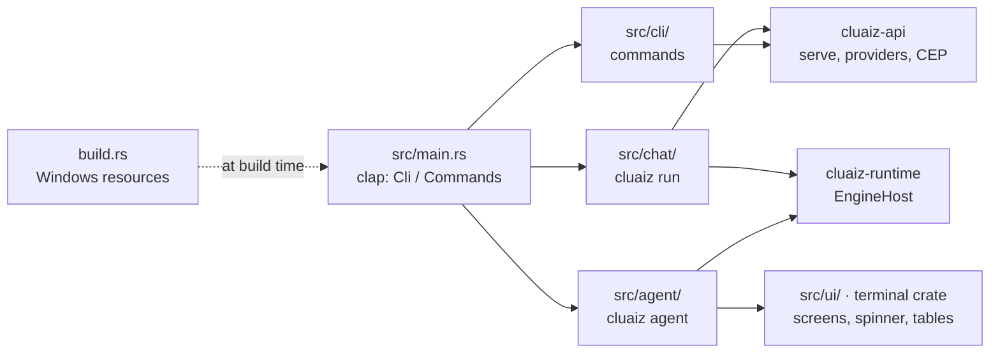

# The `cluaiz` program (`cmd/`)

The command line of the Engine. `cluaiz --help` lists every command; `cluaiz <command> -h` explains one.
The full references are [docs/cmd/commands_reference.md](../docs/cmd/commands_reference.md) (commands),
[docs/cmd/agent.md](../docs/cmd/agent.md) (coding agent) and [docs/cmd/chat.md](../docs/cmd/chat.md) (chat).

| Commands | What they do |
|---|---|
| `agent`, `run` | Coding agent in the current folder; chat with a model or answer one prompt |
| `pull`, `list`, `show`, `rm`, `model`, `ps` | Download, list, inspect and remove models; choose the defaults; see what the server has loaded |
| `serve`, `mcp-server`, `token`, `permission` | HTTP server, MCP over stdio, API tokens, `permission.json` |
| `provider` | Model providers in `providers.json` |
| `status`, `calibrate`, `bench` | The hardware the planner sees, a new hardware scan, speed measurements |
| `skill`, `plugin`, `mcp` | Installed tools |
| `flow` | Automation flows, through the running server |
| `ingest`, `storage` | Document ingest; temporary storage of the running server |
| `config`, `self`, `dev-sync` | `settings.json`; update or uninstall; copy development artifacts |

## Architectural Flow

## Code

| Folder | Contents |
|---|---|
| [`src/agent/`](src/agent/) | The coding agent: tools, permissions, sessions, checkpoints, its terminal screen ([README](src/agent/README.md)) |
| [`src/chat/`](src/chat/) | The `cluaiz run` chat, a provider's model, a running server as the model |
| [`src/cli/`](src/cli/) | One file per command, argument parsing and help ([README](src/cli/README.md)) |
| [`src/core/`](src/core/) | Code shared by the commands |
| [`src/ui/`](src/ui/) | Terminal output helpers |

More detail: [src/README.md](src/README.md).

## Build

Build it with `cargo build --release -p cmd` (only this package; building the whole workspace
rebuilds the GPU backends). The package is `cmd`; its binary is `cluaiz` (`src/main.rs`). The
ggml / llama libraries are loaded from the program's folder at run time (core and GPU packs).

[`build.rs`](build.rs), on Windows, compiles the program's resources: the icon
(`../assets/logo.ico`), file and product names, the version in Windows' four-number form
(`0.1.0-rc.1` becomes `0.1.0.0`), and a manifest that runs as the invoking user (`asInvoker`, no
elevation). It reruns when the icon, `build.rs` or `Cargo.toml` change; the icon lies outside the
package, so without that a new icon would need a clean build. If the resources fail to compile,
the build prints the error and goes on; the program works without its icon.
