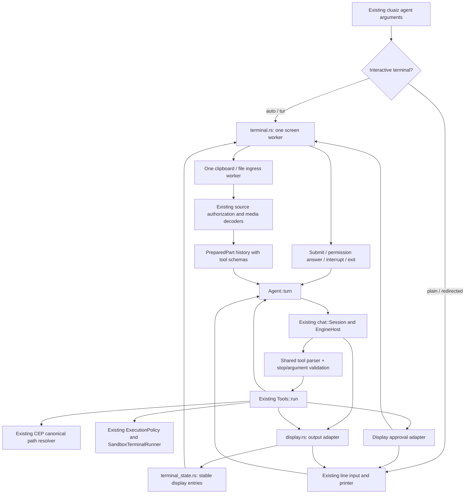

# Component: terminal agent frontend

`cluaiz agent` loads the existing local `chat::Session`, presents its six built-in file/command
tools and repeats generation until the model answers without a tool call. The interactive UI and
plain output both call that same CLI controller. This folder is not a second executable.

## Flow and ownership



The CLI still has its original controller. Moving it and the API controller into one neutral agent
core is pending. This frontend does not imply installed MCP/plugin/skill or daemon-attach support.

## Files

| File | Responsibility |
| --- | --- |
| `mod.rs` | Existing arguments, model loading, prompt/history, command dispatch and CLI turn loop. |
| `tools.rs` | Existing six tools; canonical path integration, approvals and command exit results. |
| `display.rs` | Plain/screen output adapters, bounded event messages and permission response bridge. |
| `terminal.rs` | Same-tab screen worker, bounded queues, asynchronous filename lookup and input actions. |
| `attachments.rs` | Clipboard/file ingress and typed input; shared format registry, source resolver and decoders perform preparation. |
| `terminal_state.rs` | Updates actual model/tool entries without manufacturing answers or executing tools. |
| `commands.rs` | One command name/description list for help and slash suggestions. |
| `completion.rs` | Bounded passive filename suggestions inside the canonical workspace. No file-content reads. |
| `validation.rs` | Rejects incomplete/invalid calls before canonical history or execution. |

Presentation primitives belong to `terminal/`; model loading stays in `chat/` and the Engine.
No HTTP request is needed for the local CLI path. There is one EngineHost for this process.

## Input, permissions and failures

- `--ui auto` chooses rich mode for interactive sessions. One-shot/redirected tasks keep plain
  output; `--ui plain` selects it explicitly. `--ui tui` refuses redirected/dumb terminals.
- The screen worker is the sole UI writer. Generation publishes coalesced text and measured phase
  facts through a bounded queue. File discovery runs off the screen thread with one active lookup.
- Header: the mascot (`cluaiz_terminal::mascot::ART`, 15 rows) above the title, folder and status;
  the three-row `WORDMARK` (">_ CLUAIZ") when the mascot does not fit, text only in tiny windows. Clicking the
  art blinks it. `/play` (idle only) hands the screen to the mascot playground and repaints after. Empty-input `?` opens compact shortcut columns; Esc/Backspace close, typing closes
  and retains that character. Typed user/error events and
  separate answer/reasoning/tool events keep presentation roles independent of message text.
  Answers have no repeated assistant label. Running reasoning is expanded; its answer, tool, error
  or end-of-generation transition collapses the completed step. Ctrl+O expands retained completed
  reasoning when it was enabled during generation. This cannot recover `--hide-thinking` output.
- Completed tools collapse to their real result/error summary. Clicking that header reopens retained
  details; running tools remain open. The existing spinner supplies frames to the screen writer.
- Cog/model/workspace/starting settings form one scrollable intro, not a fixed header. Actual
  Reasoning events animate that thinking entry. A typed tool-preparation event starts one tool row;
  ToolStart reuses it and ToolEnd replaces it with the retained result. Generic preparation/writing
  rows disappear at completion. Reasoning is flushed before content to retain conversation order.
  Live work never overwrites the starting metadata to display progress at the top of the screen.
- Alt+T or `/think on/off/auto` changes actual request settings for the next generation. Shift+Tab
  toggles Ask/Strict approvals; `/strict` clears previous grants and asks for workspace reads too.
  This is an approval policy, not OS process isolation. `/permissions` explains the boundary.
- Alt+V (Ctrl+V when delivered), file drops and `/attach <path>` in rich mode add removable labels.
  Clipboard reads run in one bounded worker; ordinary text remains editor text. Raw recognized media
  Base64 becomes an attachment source. Files are canonicalized and authorized before content reads.
  The same SourceResolver/registered decoders produce typed PreparedPart history, dispatched through
  the existing EngineHost with tool schemas retained. Unsupported selected-model modalities fail.
  Pending paste blocks Enter; slash commands preserve pending files. No attachment is shell-executed.
- `@` inserts a reference. The model must call the existing read tool to access its contents.
  Canonical paths prevent a symlink from being mistaken for an inside-workspace target.
- Changes require approval unless the caller explicitly enabled a session grant. The prompt names
  the actual operation; instructions preserve case. `/ask` clears earlier tool grants.
- Incomplete calls and token-limit tool answers return errors without executing them. A failed
  shell command stays a failed tool result with its real exit code. Cancellation cannot undo an
  already completed external action.
- A closed UI denies a pending approval. Screen setup/draw failures restore modes through the
  existing terminal guard. Console tracing is suppressed for rich mode; file logging remains.

## Validation and boundaries

```sh
cargo build --release -p cmd
cargo test --release -p cmd --bin cluaiz -- agent:: --test-threads=1
cargo test --release -p cluaiz-terminal
```

These commands do not establish all-platform behavior. Live model checks need an installed
tool-capable model and a test-owned workspace/home. Developer fixtures stay in test targets.
The screen uses the existing Markdown inline/table formatter without terminal writes or ANSI.
Native clipboard format availability varies by OS/host. Decoding a format does not prove that every
model can understand it; package capabilities and installed companions still apply.
Durable sessions, checkpoints, installed tools, task views and the API
controller migration remain later plan stages. Shell output currently appears after completion;
there is no live subprocess stdout view or interactive child PTY in this frontend yet.
