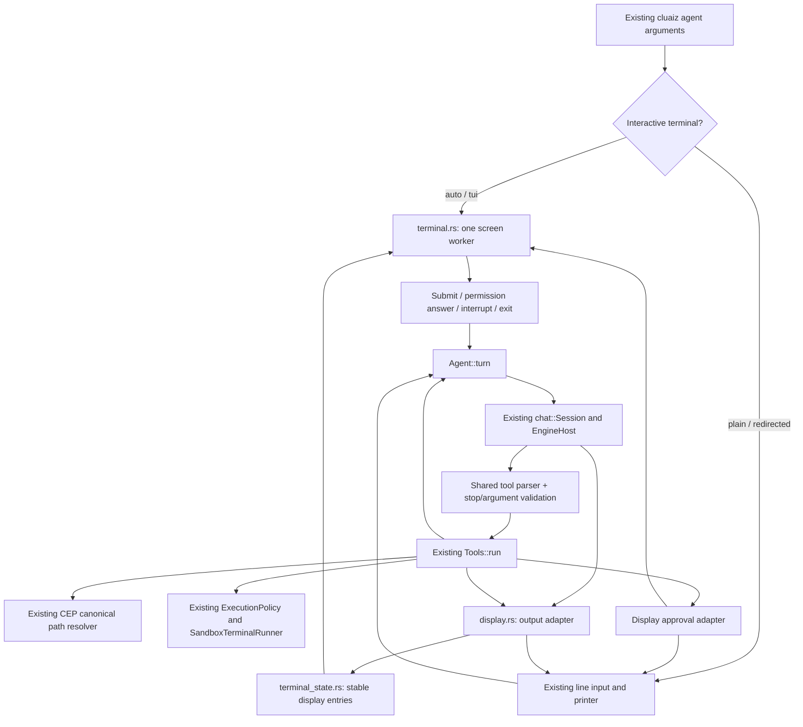

# Component: terminal agent frontend

`cluaiz agent` loads the existing local `chat::Session`, presents its six built-in file/command
tools and repeats generation until the model answers without a tool call. The interactive UI and
plain output both call that same CLI controller. This folder is not a second executable.

## Flow and ownership



The CLI still has its original controller. Moving it and the API controller into one neutral agent
core is pending. This frontend does not imply installed MCP/plugin/skill or daemon-attach support.

## Files

| File | Responsibility |
| --- | --- |
| `mod.rs` | Existing arguments, model loading, prompt/history, command dispatch and CLI turn loop. |
| `tools.rs` | Existing six tools; canonical path integration, approvals and command exit results. |
| `display.rs` | Plain/screen output adapters, bounded event messages and permission response bridge. |
| `terminal.rs` | Same-tab screen worker, bounded queues, asynchronous filename lookup and input actions. |
| `terminal_state.rs` | Updates actual model/tool entries without manufacturing answers or executing tools. |
| `commands.rs` | One command name/description list for help and slash suggestions. |
| `completion.rs` | Bounded passive filename suggestions inside the canonical workspace. No file-content reads. |
| `validation.rs` | Rejects incomplete/invalid calls before canonical history or execution. |

Presentation primitives belong to `terminal/`; model loading stays in `chat/` and the Engine.
No HTTP request is needed for the local CLI path. There is one EngineHost for this process.

## Input, permissions and failures

- `--ui auto` chooses rich mode for interactive sessions. One-shot/redirected tasks keep plain
  output; `--ui plain` selects it explicitly. `--ui tui` refuses redirected/dumb terminals.
- The screen worker is the sole UI writer. Generation publishes coalesced text and measured phase
  facts through a bounded queue. File discovery runs off the screen thread with one active lookup.
- `@` inserts a reference. The model must call the existing read tool to access its contents.
  Canonical paths prevent a symlink from being mistaken for an inside-workspace target.
- Changes require approval unless the caller explicitly enabled a session grant. The prompt names
  the actual operation; instructions preserve case. `/ask` clears earlier tool grants.
- Incomplete calls and token-limit tool answers return errors without executing them. A failed
  shell command stays a failed tool result with its real exit code. Cancellation cannot undo an
  already completed external action.
- A closed UI denies a pending approval. Screen setup/draw failures restore modes through the
  existing terminal guard. Console tracing is suppressed for rich mode; file logging remains.

## Validation and boundaries

```sh
cargo build --release -p cmd
cargo test --release -p cmd --bin cluaiz -- agent:: --test-threads=1
cargo test --release -p cluaiz-terminal
```

These commands do not establish all-platform behavior. Live model checks need an installed
tool-capable model and a test-owned workspace/home. Developer fixtures stay in test targets.
Shared Markdown styling, durable sessions, checkpoints, installed tools, task views and the API
controller migration remain later plan stages. Shell output currently appears after completion;
there is no live subprocess stdout view or interactive child PTY in this frontend yet.
