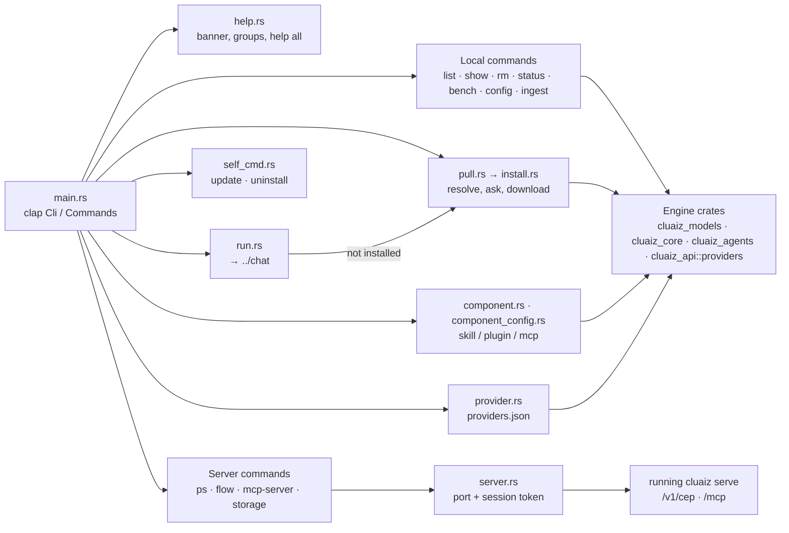

# Component: `cmd/src/cli/`

## Technical Specification

- **Purpose:** The handlers of the `cluaiz` subcommands other than the chat and the agent
  (those live in [`../chat/`](../chat/) and [`../agent/`](../agent/)). `main.rs` parses the
  command line with clap and calls one `execute` / `handle_*` function here. Each file owns one
  command or one piece shared by several (load flags, dotted keys, talking to a running server).
  The commands reuse the same code the API uses (model resolution, settings merge, the download
  flow, providers, CEP methods), so the terminal and the API behave the same.
- **Platform Support:** Windows, Linux, macOS. `self update` runs `install.ps1` on Windows and
  `install.sh` elsewhere.
- **Reusability Level:** Terminal front end of the Engine; nothing here is used by the server.
- **User reference:** [docs/reference/terminal-commands.md](../../../docs/reference/terminal-commands.md),
  [docs/cmd/commands_reference.md](../../../docs/cmd/commands_reference.md).

## Architectural Flow

## API Contract (Interface)

- **Entry points** (called from `main.rs`): `run::execute(RunArgs, verbose)`,
  `pull::execute`, `list::execute`, `show::execute`, `rm::execute`, `status::execute`,
  `bench::execute`, `config_cmd::execute`, `ingest::execute(path)`,
  `component::execute(type, ComponentCommand)`, `provider::execute`, `flow::execute`,
  `mcp_server::run`, `ps::execute`, `storage::handle_storage_command(StorageCli)`,
  `self_cmd::execute`, `help::print` / `help::print_all::<Cli>(path)`.
- **Shared pieces:** `args.rs` (`LoadArgs`, `SampleArgs`, `ThinkArgs`, `GpuLayers`,
  `normalize_llama_flags`; load flags → `LlamaLoadParams`),
  `keys.rs` (dotted keys over JSON), `models.rs` (a name → a weight file), `server.rs`
  (requests to a running server: `base_url`, `request`, `request_with_timeout`, `cep`,
  `cep_reply`).
- **Export Type:** Private to the `cmd` binary.
- **Dependencies:** `clap`, `color_eyre`, `colored`, `reqwest`, `tokio`, `cluaiz_models`,
  `cluaiz_core`, `cluaiz_plan`, `cluaiz_agents`, `cluaiz_api::providers`, `cluaiz_security`.

## Deep File Breakdown

- `mod.rs`: declares the files.
- `help.rs`:
  - **Logic:** The banner and the commands in groups, with clap's own descriptions so they never
    drift from `<command> --help`. `print_all` walks `get_subcommands` to the full depth,
    leaving out hidden commands (`dev-sync`) and `help`; `usage` writes `<command>`,
    `[ARG]...`, required options and `[options]`.
- `args.rs`: flags shared by `run`, `bench` and `show`, named like llama.cpp's tools (`-c`,
  `--n-gpu-layers`, `--cache-type-k`, `--temp`, `--think`, `--reasoning-effort`…). Load flags
  become the same `LlamaLoadParams` an API request's `llama` object becomes.
- `run.rs`: `RunArgs` and `execute`. A model that is not installed is downloaded first
  (`install.rs`); a repository whose variant is installed runs that variant; a
  `<provider>/<model>` goes to the provider. With `cluaiz serve` running, the chat goes through
  the server unless `--local`.
- `pull.rs` + `install.rs`:
  - **Logic:** The download flow shared by `pull` and `run`: `cluaiz_models::resolve` (shared
    with the API), what will be downloaded, the variant prompt, the `--all` file picker, then
    `ModelDownloader::install`. Ends with the command to run the model.
  - **Why:** No questions when `CLUAIZ_NONINTERACTIVE` is set or stdin is not a terminal.
- `list.rs`, `show.rs`, `rm.rs`, `models.rs`: installed models from the registry; `show` reads
  the GGUF and prints the plan the model would get now (nothing is loaded; `-v` adds every key
  and the planner banner); `rm` deletes the folder and the registry entry; `models.rs` maps a
  name to a weight file (path or installed id, the API's lookup); `bench`, `show` and the chat
  commands also take the repository name `pull` takes (`owner/repo`, `owner/repo:QUANT`), read
  from the registry.
- `status.rs`: the hardware the planner sees, with live free memory.
- `bench.rs`: llama-bench's test on the Engine: `pp N` and `tg N`, repeated, mean ± standard
  deviation; speeds are kept per placement (`cluaiz_plan::speed`), and `--placements` tests every
  placement so the planner then loads the fastest.
- `config_cmd.rs` + `keys.rs`: `config list|get|set|reset|path` on `settings.json` with the same
  merge rules as the API (`OptimizationControl::merged_with`); `set` takes `auto`/`null` for the
  automatic value; `reset` backs the file up first.
- `ingest.rs`: reads a document or an image with the shared document service and prints its
  chunks; with an embedding model set, also makes vectors. Nothing is stored.
- `component.rs`:
  - **Logic:** `skill|plugin|mcp install|list|remove|cache|permission`. `planned_install` builds
    the install plan (`cluaiz_agents::installer::plan`), shows it, asks what the user's mode
    leaves open (`--yes` answers yes; no terminal: no), then installs. `permission_command`
    lists a tool's permissions or switches one (`cluaiz_agents::permissions::set`).
- `component_config.rs`: `<type> config <id> [key] [value]`: the settings a component's manifest
  declares, asking for missing values; values the tool names in `env` are saved for it, never
  printed.
- `provider.rs`: `provider add|list|models|test|remove` on providers.json; keys from an env var,
  stdin or the file; `test` sends one short request of the model's kind
  (`cluaiz_api::providers::test`).
- `flow.rs`: `cluaiz flow …` through the running server's `flows.*` methods (Automation runs in
  the server).
- `server.rs`: requests to a running `cluaiz serve`: the server's port rule and the session token
  the server writes for local clients.
- `ps.rs`: the model a running server has loaded.
- `mcp_server.rs`: `cluaiz mcp-server`: stdin lines → the running Engine's `/mcp`, replies →
  stdout; logs only on stderr (the MCP stdio transport needs a clean stdout).
- `storage.rs`: `storage temp-status|temp-clean` (temporary media of the server).
- `self_cmd.rs`: `self update` runs the release's own installer from its tag (picks the GPU pack,
  checks every file; models and settings stay); `self uninstall` removes the Cluaiz home, the
  program folder and the PATH entry (`--keep-models`, `-y`).

## Failure & Recovery Logic

- **No server running** for `ps`, `flow`, `mcp-server`, `storage`: the request fails with
  `<method> at <url> failed: …` (`server.rs`); a CEP error comes back as
  `<method>: <message> (code N)`. Nothing is changed.
- **Model not found:** `run` offers to download it; `show`/`rm` fail with the id.
- **Download interrupted:** the next `pull` resumes from the `.part` files.
- **No terminal:** every question counts as no (installs, downloads), unless `--yes` or
  `CLUAIZ_NONINTERACTIVE`.
- **Bad config key or value:** `config set` names the key and leaves the file unchanged.
- **Install plan refused:** a required dependency not approved stops the install before
  anything is downloaded.
- **Self update fails:** the installer's own checks stop it; the installed version stays.
