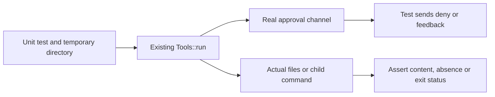

# Component: agent tool regression tests

## Technical specification

- **Purpose:** Exercise actual file/search/edit/command and approval behavior with temporary files.
- **Ownership:** `tools.rs` is included by `cmd/src/agent/tools.rs` only under `cfg(test)` through a
  path module. It is not a second executable, CLI command or production transcript fixture.
- **Dependencies:** Existing tool executor, tempfile, Tokio and the display permission channel.
- **Platform:** The command-failure case uses the executor's platform shell; other cases use Rust I/O.

## Architectural flow

## File and failure contract

- `tools.rs`: Existing tests relocated out of the production module to keep it under the line
  limit. Additional Strict-read regression denies the prompt and asserts file content is absent.
- Invalid arguments must not create a file; denied write/feedback must leave the destination absent;
  nonzero child exit must remain an error. Temp directories hold test data, not user project files.
- Run from repository root: `cargo test --release --offline -p cmd --bin cluaiz -- agent::tools:: --test-threads=1`.
- These are executor regressions, not model inference, full terminal acceptance or OS sandbox proof.
