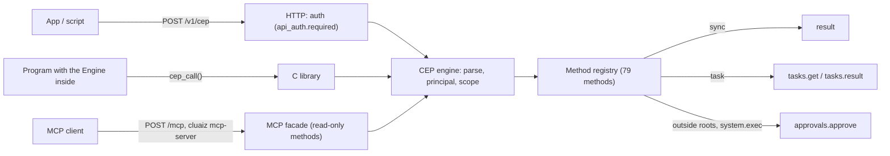
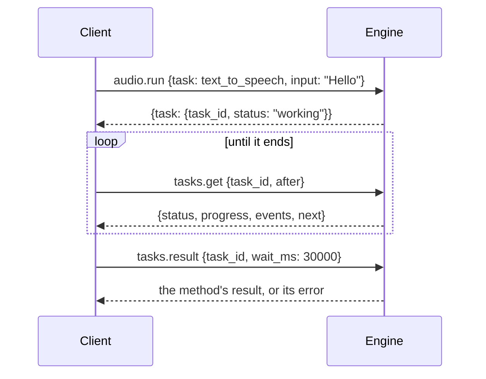

# CEP: Cluaiz Engine Protocol

## Documentation and API Explorer data

Each method has one page below the five categories. Its leading `---` block is
generated from the Rust method registry; the explanation below that block is
written documentation. Generate blocks with
`CEP_DOCS_WRITE=1 cargo test --release -p cluaiz-api --test cep_docs` and check
them with the same test without `CEP_DOCS_WRITE`.

The App's `npm run sync:api` reads these Markdown pages and the API navigation in
`docs/registry.json`. It derives the Explorer's parameters, default request,
response, documentation and request-shaped JSON examples. PDF, DOCX, image and
embedding examples stay in their method pages, rather than a second handwritten
App JSON list. App dev/build hooks regenerate the catalog. Supply the Engine
checkout beside the App or set `CLUAIZ_ENGINE_SOURCE` when building separately.

Method examples describe payload shapes. They do not create sample local files,
install model IDs, or prove that a given package can run inference.

CEP carries Engine control operations in one message shape, [JSON-RPC 2.0](https://www.jsonrpc.org/specification). The market-standard routes (`/v1/chat/completions`, `/v1/embeddings`, `/v1/audio/speech`, `/v1/audio/transcriptions`, `/v1/models`) are documented in [the API overview](../README.md); document extraction uses the separate direct [Ingest API](../inference/ingest.md). Controls and discovery use the CEP methods listed here.



| Reach it through | Who it is for |
|---|---|
| `POST /v1/cep` | The App, scripts and other programs |
| `cep_call` / `cep_free` | Programs that load the Engine as a library (`cluaiz_cep.dll`, `libcluaiz_cep.so`, `libcluaiz_cep.dylib`) |
| `POST /mcp` and `cluaiz mcp-server` | MCP clients such as Claude Desktop and Cursor |

## The methods

Every method has its own page, grouped like the App's API sidebar:

| Category | Groups | Index |
|---|---|---|
| AI & Inference Core | `chat`, `audio`, `ingest`, `memory`, `notes`, `context`, `kv` | [ai-inference/](ai-inference/README.md) |
| Agents, MCP & Tools | `tools`, `approvals` | [agents-tools/](agents-tools/README.md) |
| Filesystem & Security Jail | `fs`, `workspace` | [filesystem/](filesystem/README.md) |
| Models & Engine Vault | `models` | [models/](models/README.md) |
| System & Infrastructure | `system`, `config`, `storage`, `tokens`, `tasks`, `rpc` | [system/](system/README.md) |

The machine-readable list of every method is [openrpc.json](openrpc.json), the same document `rpc.discover` returns.

### How a method page is built

A page such as [`filesystem/fs/fs.read.md`](filesystem/fs/fs.read.md) has two parts:

1. **The block between the two `---` lines** is generated from the Engine's method registry, so it is always what the running Engine accepts. An app reads it to build its request forms and examples:

| Key | Meaning |
|---|---|
| `method`, `transport` | The method name, and how to call it (`POST /v1/cep`) |
| `category`, `category_title`, `group` | Where it belongs |
| `summary` | One line |
| `scope` | What the caller needs: `read`, `write`, `exec` or `admin` |
| `execution` | `sync` (the answer is the result) or `task` (the answer is a task handle) |
| `mcp`, `owner_only`, `destructive`, `idempotent` | Whether MCP clients see it; whether only the owner may call it; whether it deletes or overwrites; whether calling it twice changes nothing more |
| `params[]` | `name`, `type`, `req`, `desc`, `example`; an object param lists its own `fields[]` |
| `request_payload` | A complete request body |
| `response` | The answer to that request |
| `errors[]` | `code`, `type` (`data.type`) and `when`, for this method's own errors |

2. **The text under it** explains the method: what it does step by step, its limits, each error, and examples.

The pages are written and checked by `api/tests/cep_docs.rs`. A change to a method's params, example or errors that is not written to its page fails that test.

## A call

```json
→ {"jsonrpc":"2.0","id":1,"method":"fs.read","params":{"path":"notes.txt"}}
← {"jsonrpc":"2.0","id":1,"result":{"path":"D:/work/notes.txt","size":5,"binary":false,"text":"hello"}}
```

- **`method`** is `group.verb`: `fs.read`, `memory.events`, `tools.clear_cache`.
- **`params`** is always an object, by name. An unknown or misspelt field is an error, never silently ignored.
- **`params._meta`** carries protocol data: `approval` (an approval id) and `trace` (your own id for logs).
- **`result`** is the data itself, with no `status` / `success` / `message` wrapper. Success is the presence of `result`.
- **A notification** is a request with no `id`. It runs, and nothing is answered.
- **A batch** is a JSON array of up to 32 requests. They run in order, and the answers come back in order. Notifications in a batch get no answer; an all-notification batch gets HTTP 202 with no body.

HTTP:
- `Content-Type: application/json` is required (415 otherwise).
- Authentication follows the owner's `api_auth.required` setting, like every route except `/health`. When it is on, send `Authorization: Bearer <token>`: the token in `<home>/session.token` (default home `~/.cluaiz`), or an API key from `tokens.create`.
- Every JSON-RPC answer is HTTP 200, errors included. 401 and 413 come from authentication and the body size limit.

## Who may call what

| Caller | Principal | Scopes | Paths |
|---|---|---|---|
| `POST /v1/cep`, `cep_call` | `owner` | read, write, exec, admin | any canonical path |
| `/mcp`, `cluaiz mcp-server` | `mcp` | read; methods with `mcp: false` are not listed | any canonical path (read methods only) |

A method's `scope` must be one of the caller's scopes, and an `owner_only` method needs the owner; otherwise the answer is `-32002` with `data.needs`. Paths are canonicalized (links and `..` resolved) before they are checked. `fs.delete` and `fs.rename` act on a link itself, never on its target. See [Security & Auth Architecture](../../architecture/security-and-auth-architecture.md).

## Errors

Every method can answer the protocol's errors below; each method page lists its own errors in `errors[]`.

| Code | `data.type` | When |
|---|---|---|
| -32700 | — | The body is not JSON (or not UTF-8) |
| -32600 | `invalid_request` | Not a request; empty batch; batch over 32; nesting over 64 |
| -32601 | — | Method not found: `data.did_you_mean` lists close names, `data.group_methods` the group's methods |
| -32602 | `invalid_params` (or a more exact type) | `data.errors[]` has `path` and `message`; `data.example` has the method's example params |
| -32603 | — | Internal error: `data.trace_id` points into the Engine log |
| -32001 | `unauthenticated` | No valid token while authentication is required |
| -32002 | `forbidden` | `data.needs`: the missing scope, `roots`, `owner` or `cross_chat` |
| -32003 | `approval_required` | `data.approval_id`, `action`, `target`, `expires_at`: see [Approvals](#approvals) |
| -32004 | `*_not_found` | A chat, file, model, note, task, tool, report… |
| -32005 | conflict types | Busy or wrong state (`pull_running`, `reasoning_unavailable`, `approval_decided`…) |
| -32006 | `too_large` | `data.limit`, `data.got` |
| -32007 | `not_implemented` | Declared, not built yet (never a fake success) |
| -32008 | `cancelled` | A task was cancelled |
| -32009 | `timeout` | `tasks.result` waited `wait_ms` and the task still runs |
| -32010 | unavailable types | A backend is missing or failed; `data.type` names it |

## Long work: tasks

Methods with `execution: task` answer at once with `{"task": {"task_id", "method", "status": "working", "created_at", "last_updated_at", "ttl_ms", "poll_ms"}}`: `audio.run`, `tools.install`, `chat.import_app`, `models.download`.



| Method | Does |
|---|---|
| [`tasks.get`](system/tasks/tasks.get.md) | Status, `progress`, and the `events` after cursor `after` |
| [`tasks.result`](system/tasks/tasks.result.md) | The final result or error, exactly what a direct call would give; waits up to `wait_ms` (at most 30 000) |
| [`tasks.cancel`](system/tasks/tasks.cancel.md) | Stops it (`cancelled`) |
| [`tasks.list`](system/tasks/tasks.list.md) | Your tasks that have not expired |

The statuses match MCP tasks: `working`, `completed`, `failed`, `cancelled`. A task belongs to its caller and lives in memory for an hour; a restart forgets it.

## Approvals

A call that needs the owner's yes fails with `-32003` and `data.approval_id`. Today that is every `system.exec` call, and a call outside the caller's roots when its principal asks instead of refusing. The chat agent's tool approvals use the same store; their stream's `permission_request.request_id` is the same id.

1. The owner answers with [`approvals.approve`](agents-tools/approvals/approvals.approve.md) `{approval_id}` or [`approvals.reject`](agents-tools/approvals/approvals.reject.md) `{approval_id, feedback?}`.
2. The caller sends the **same** call again with `"_meta": {"approval": "<id>"}` in its params.

An approval covers exactly that caller, method and params, is used once, and expires after 5 minutes. One approval covers every path the same call checks (both paths of `fs.copy`).

## Examples

**curl**

```bash
TOKEN=$(cat ~/.cluaiz/session.token)
curl -s http://127.0.0.1:8000/v1/cep -H "Authorization: Bearer $TOKEN" -H "Content-Type: application/json" \
  -d '{"jsonrpc":"2.0","id":1,"method":"system.info","params":{}}'
```

**JavaScript (Node.js or a web app)**

```js
async function cep(method, params = {}, token) {
  const reply = await fetch("http://127.0.0.1:8000/v1/cep", {
    method: "POST",
    headers: { "content-type": "application/json", ...(token && { authorization: `Bearer ${token}` }) },
    body: JSON.stringify({ jsonrpc: "2.0", id: 1, method, params }),
  }).then((r) => r.json());
  if (reply.error) throw Object.assign(new Error(reply.error.message), reply.error);
  return reply.result;
}

const { task } = await cep("audio.run", { task: "text_to_speech", input: "Hello" }, process.env.CLUAIZ_TOKEN);
console.log(await cep("tasks.result", { task_id: task.task_id, wait_ms: 30000 }));
```

## The Engine inside your program: `cep_call` / `cep_free`

```c
char *cep_call(const char *request_json);  /* the reply JSON, or NULL for notifications only */
void  cep_free(char *reply);
```

- **Library:** `cluaiz_cep.dll` / `libcluaiz_cep.so` / `libcluaiz_cep.dylib`; header `ffi/include/cep.h`.
- **Messages:** the same JSON as `/v1/cep`.
- **Start-up:** the first call starts the Engine with `CLUAIZ_HOME` (or the default home). It does not touch `session.token`, so a `cluaiz serve` on the same home keeps working.
- **Caller:** the owner (the calls come from your process).
- **Windows, CUDA build:** the loader must find the CUDA DLLs (`CUDA_PATH\bin` on the DLL search path).
- **More:** `ffi/README.md`.

## MCP

- **`POST /mcp`** is an MCP server (Streamable HTTP, JSON answers, protocol 2025-11-25; 2025-06-18 and 2025-03-26 also accepted).
  - Its tools are the CEP methods with the same names, and `inputSchema` is the params schema.
  - MCP clients get the methods with `scope: read` and `mcp: true` only.
  - An error from the method comes back as a tool result with `isError: true`, so the model can correct its call.
- **`cluaiz mcp-server`** is the same server over stdio, for clients that start one. Claude Desktop config: `{"command": "cluaiz", "args": ["mcp-server"]}`. It talks to the running `cluaiz serve`.
