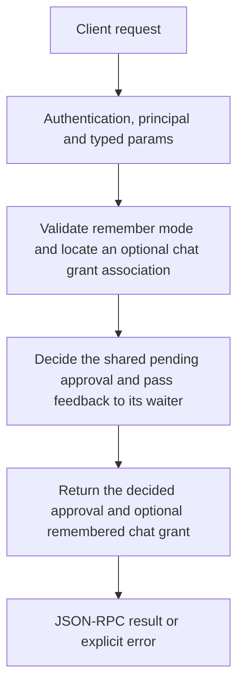

# approvals.approve

Approve one pending owner decision. For supported chat-tool requests, optionally remember the tool permission for that chat. Approving a generic CEP request does not silently replay its original operation.

## Endpoint, execution and permissions

| Property | Contract |
|---|---|
| Wire endpoint | `POST /v1/cep`; logical method `approvals.approve` |
| Execution | Synchronous domain result in the JSON-RPC result field |
| Required scope | `admin`; owner principal required |
| MCP facade | Not exposed by the current read-only MCP facade |
| Side effects | Updates the state described below |

Send a Bearer token when API authentication is enabled. Authentication failures are HTTP 401; ordinary CEP method errors are JSON-RPC error objects, normally with HTTP 200. A successful HTTP status alone does not prove the operation succeeded. See [the common CEP contract](../../README.md).

## How it works

1. Validate remember mode and locate an optional chat grant association
2. Decide the shared pending approval and pass feedback to its waiter
3. Return the decided approval and optional remembered chat grant



## Parameters, defaults and value effects

| Parameter | Type | Required | Meaning, default and constraints |
|---|---|---|---|
| `approval_id` | string | Yes | The `id` from `approvals.list`, the `-32003` error's `data.approval_id`, or the chat stream's `permission_request.request_id` Required exact pending id from approvals.list or error.data.approval_id / stream permission request. |
| `feedback` | string \| null | No | Passed to the waiting call Optional text passed to the waiting call. |
| `minutes` | integer \| null | No | How long a "chat" grant lasts (default 60, at most 1440) Remembered chat grant lifetime: default60, capped1440. It does not extend the five-minute pending-decision TTL. |
| `remember` | string \| null | No | "chat": also allow this tool in this chat without asking again, for `minutes` Omitted: decide just this request. Only "chat" is accepted for remembering; a generic CEP approval may have no chat/tool association. |

Unknown top-level method parameters are rejected. `params._meta` is protocol metadata, not a domain option; approval retries must preserve the same method and domain parameters. Where a parameter is optional, omission follows the method-specific rules above rather than implying a universal zero or empty-string default.

## Request examples

Examples describe contracts, not measured execution. Replace IDs, paths and installed-package names with real values from your Engine. Do not execute write/delete/process examples against valuable data merely to read the documentation.

### 1. Basic request

This request uses the documented selection. Read the result semantics below before acting on it.

```json
{
  "jsonrpc": "2.0",
  "id": 1,
  "method": "approvals.approve",
  "params": {
    "approval_id": "ap_41c2…",
    "minutes": 60,
    "remember": "chat"
  }
}
```

### 2. Approve only once

After the decision, a CEP client retries its original operation with the approval metadata.

```json
{
  "jsonrpc": "2.0",
  "id": 2,
  "method": "approvals.approve",
  "params": {
    "approval_id": "<pending-id>"
  }
}
```

### 3. Remember a supported chat-tool permission

Only an associated chat/tool request can produce grant; do not assume system.exec receives remembered authorization.

```json
{
  "jsonrpc": "2.0",
  "id": 3,
  "method": "approvals.approve",
  "params": {
    "approval_id": "<pending-chat-tool-id>",
    "remember": "chat",
    "minutes": 30
  }
}
```

## Response and field meanings

approval is the decided shared record. grant is null when no associated remembered chat grant exists, otherwise {chat_id,tool,minutes}. The shape/status must be read as returned, not copied from an illustrative pending example.

The following response is an illustrative shape. IDs, byte counts, timings and array contents depend on the actual request and machine; shortened nested objects are not a second schema or a measured result.

```json
{
  "id": 1,
  "jsonrpc": "2.0",
  "result": {
    "approval": {
      "created_at": "2026-10-25T10:30:00Z",
      "expires_at": "2026-10-25T10:35:00Z",
      "id": "ap_41c2…",
      "method": "mcp:web-search",
      "principal": "agent",
      "status": "pending",
      "target": "{\"query\":\"news\"}"
    },
    "grant": {
      "chat_id": "c1",
      "minutes": 60,
      "tool": "web-search"
    }
  }
}
```

## Errors and recovery

| Code / boundary | Meaning | Recovery |
|---|---|---|
| HTTP 401 | Missing/invalid token while authentication is enabled | Supply the configured token; a CEP params change cannot repair authentication |
| `-32602` / typed params | Missing required fields, wrong JSON types or unknown fields | Correct the request against this page; do not retry the same invalid payload |
| `-32002` / principal | Required scope/owner/root authorization is absent | Inspect `error.data.needs`; use an authorized caller or permitted target |
| `-32004` / `approval_not_found` | No pending approval with this id, or it expired (5 minutes) | Refresh the relevant inventory/IDs and check whether the resource expired |
| `-32005` / `approval_decided` | The approval was already approved or rejected | Inspect current state before retrying; avoid a tight retry loop |
| `-32602` / `invalid_params` | `remember` is something other than "chat" | Correct the option/value combination; install required assets where relevant |

### Invalid-field example

This is deliberately invalid. The extra field must be removed; it is not an alternate feature toggle.

```text
{
  "jsonrpc": "2.0",
  "id": 90,
  "method": "approvals.approve",
  "params": {
    "approval_id": "ap_41c2…",
    "minutes": 60,
    "remember": "chat",
    "__unknown_option": true
  }
}
```

The error envelope is `{"jsonrpc":"2.0","id":90,"error":{"code":-32602,"message":"...","data":{"type":"invalid_params", "errors":[...]}}}`. Exact message and field diagnostics are generated by typed deserialization; callers should use codes and structured data, not match a sentence.

## cURL

Save one valid request above as `request.json`:

```bash
curl --fail-with-body http://127.0.0.1:8000/v1/cep \
  -H "Content-Type: application/json" \
  -H "Authorization: Bearer $CLUAIZ_TOKEN" \
  --data-binary @request.json
```

## Python

Install `requests` in your client environment. This executes the basic request; edit `params` for a different valid case.

```python
import json
import os
import requests

payload = json.loads(r'''{
  "id": 1,
  "jsonrpc": "2.0",
  "method": "approvals.approve",
  "params": {
    "approval_id": "ap_41c2…",
    "minutes": 60,
    "remember": "chat"
  }
}''')
response = requests.post(
    "http://127.0.0.1:8000/v1/cep",
    headers={"Authorization": "Bearer " + os.environ["CLUAIZ_TOKEN"]},
    json=payload, timeout=60,
)
response.raise_for_status()
reply = response.json()
if "error" in reply:
    raise RuntimeError(json.dumps(reply["error"], ensure_ascii=False))
print(reply["result"])
```

## JavaScript / Node.js

Use an owner token only in a trusted client. Do not ship it inside a public web page.

```javascript
const payload = {
  "id": 1,
  "jsonrpc": "2.0",
  "method": "approvals.approve",
  "params": {
    "approval_id": "ap_41c2…",
    "minutes": 60,
    "remember": "chat"
  }
};
const response = await fetch("http://127.0.0.1:8000/v1/cep", {
  method: "POST",
  headers: { "content-type": "application/json", authorization: `Bearer ${process.env.CLUAIZ_TOKEN}` },
  body: JSON.stringify(payload),
});
const raw = await response.text();
if (!response.ok) throw new Error(`HTTP ${response.status}: ${raw}`);
const reply = JSON.parse(raw);
if (reply.error) throw new Error(JSON.stringify(reply.error));
console.log(reply.result);
```

## Limits, state and related operations

Only the owner can decide. An expired/unknown id or an already-decided record fails. For a CEP -32003 flow, retry the SAME original method and params with params._meta.approval set to the approved id; it is single-use and request-bound. This is not a permanent root grant.

- [`approvals.list`](approvals.list.md): use its separate documented contract.
- [`approvals.reject`](approvals.reject.md): use its separate documented contract.
- [`memory.grants`](../../ai-inference/memory/memory.grants.md): use its separate documented contract.
- [`system.exec`](../../system/system/system.exec.md): use its separate documented contract.

## Implementation reference

- [api/src/cep/methods/approvals.rs](../../../../../api/src/cep/methods/approvals.rs)
