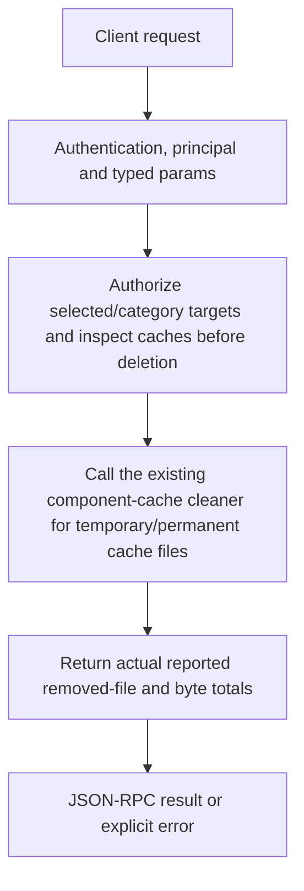

# tools.clear_cache

Clear recognized cached files without uninstalling installed tools. Select one name or all packages of one kind deliberately; omission is broader than a single-tool cleanup.

## Endpoint, execution and permissions

| Property | Contract |
|---|---|
| Wire endpoint | `POST /v1/cep`; logical method `tools.clear_cache` |
| Execution | Synchronous domain result in the JSON-RPC result field |
| Required scope | `write` |
| MCP facade | Not exposed by the current read-only MCP facade |
| Side effects | Destructive; review the target before calling |

Send a Bearer token when API authentication is enabled. Authentication failures are HTTP 401; ordinary CEP method errors are JSON-RPC error objects, normally with HTTP 200. A successful HTTP status alone does not prove the operation succeeded. See [the common CEP contract](../../README.md).

## How it works

1. Authorize selected/category targets and inspect caches before deletion
2. Call the existing component-cache cleaner for temporary/permanent cache files
3. Return actual reported removed-file and byte totals



## Parameters, defaults and value effects

| Parameter | Type | Required | Meaning, default and constraints |
|---|---|---|---|
| `kind` | "skill" \| "plugin" \| "mcp" | Yes | skill, plugin or mcp Required enum: skill (instructions), plugin (WASM/native package), mcp (server package). Kind and name must identify the same installed entry. |
| `name` | string \| null | No | One tool; every tool of `kind` when absent Optional selected installed name; omit only when cleaning all installed packages of this kind intentionally. |

Unknown top-level method parameters are rejected. `params._meta` is protocol metadata, not a domain option; approval retries must preserve the same method and domain parameters. Where a parameter is optional, omission follows the method-specific rules above rather than implying a universal zero or empty-string default.

## Request examples

Examples describe contracts, not measured execution. Replace IDs, paths and installed-package names with real values from your Engine. Do not execute write/delete/process examples against valuable data merely to read the documentation.

### 1. Basic request

This request uses the documented selection. Read the result semantics below before acting on it.

```json
{
  "jsonrpc": "2.0",
  "id": 1,
  "method": "tools.clear_cache",
  "params": {
    "kind": "skill"
  }
}
```

### 2. Clear only one package cache

Use tools.cache first to inspect the intended target.

```json
{
  "jsonrpc": "2.0",
  "id": 2,
  "method": "tools.clear_cache",
  "params": {
    "kind": "skill",
    "name": "installed-tool"
  }
}
```

## Response and field meanings

removed and freed_bytes come from the existing cleanup report. They are file/byte counts, not package uninstall counts. Zero is a valid empty cleanup result.

The following response is an illustrative shape. IDs, byte counts, timings and array contents depend on the actual request and machine; shortened nested objects are not a second schema or a measured result.

```json
{
  "id": 1,
  "jsonrpc": "2.0",
  "result": {
    "freed_bytes": 0,
    "removed": 0
  }
}
```

## Errors and recovery

| Code / boundary | Meaning | Recovery |
|---|---|---|
| HTTP 401 | Missing/invalid token while authentication is enabled | Supply the configured token; a CEP params change cannot repair authentication |
| `-32602` / typed params | Missing required fields, wrong JSON types or unknown fields | Correct the request against this page; do not retry the same invalid payload |
| `-32002` / principal | Required scope/owner/root authorization is absent | Inspect `error.data.needs`; use an authorized caller or permitted target |
| `-32004` / `tool_not_found` | No installed tool of this kind and name | Refresh the relevant inventory/IDs and check whether the resource expired |
| `-32602` / `invalid_params` | `name` is not 1–64 lowercase letters, digits, dots, underscores or hyphens | Correct the option/value combination; install required assets where relevant |
| `-32002` / `forbidden` | The tool folder is outside the caller's roots (`data.needs: "roots"`) | Read the error message, correct the backend/filesystem/configuration condition, then retry deliberately |
| `-32010` / `filesystem_error` | A cached file could not be removed | Read the error message, correct the backend/filesystem/configuration condition, then retry deliberately |

### Invalid-field example

This is deliberately invalid. The extra field must be removed; it is not an alternate feature toggle.

```text
{
  "jsonrpc": "2.0",
  "id": 90,
  "method": "tools.clear_cache",
  "params": {
    "kind": "skill",
    "__unknown_option": true
  }
}
```

The error envelope is `{"jsonrpc":"2.0","id":90,"error":{"code":-32602,"message":"...","data":{"type":"invalid_params", "errors":[...]}}}`. Exact message and field diagnostics are generated by typed deserialization; callers should use codes and structured data, not match a sentence.

## cURL

Save one valid request above as `request.json`:

```bash
curl --fail-with-body http://127.0.0.1:8000/v1/cep \
  -H "Content-Type: application/json" \
  -H "Authorization: Bearer $CLUAIZ_TOKEN" \
  --data-binary @request.json
```

## Python

Install `requests` in your client environment. This executes the basic request; edit `params` for a different valid case.

```python
import json
import os
import requests

payload = json.loads(r'''{
  "id": 1,
  "jsonrpc": "2.0",
  "method": "tools.clear_cache",
  "params": {
    "kind": "skill"
  }
}''')
response = requests.post(
    "http://127.0.0.1:8000/v1/cep",
    headers={"Authorization": "Bearer " + os.environ["CLUAIZ_TOKEN"]},
    json=payload, timeout=60,
)
response.raise_for_status()
reply = response.json()
if "error" in reply:
    raise RuntimeError(json.dumps(reply["error"], ensure_ascii=False))
print(reply["result"])
```

## JavaScript / Node.js

Use an owner token only in a trusted client. Do not ship it inside a public web page.

```javascript
const payload = {
  "id": 1,
  "jsonrpc": "2.0",
  "method": "tools.clear_cache",
  "params": {
    "kind": "skill"
  }
};
const response = await fetch("http://127.0.0.1:8000/v1/cep", {
  method: "POST",
  headers: { "content-type": "application/json", authorization: `Bearer ${process.env.CLUAIZ_TOKEN}` },
  body: JSON.stringify(payload),
});
const raw = await response.text();
if (!response.ok) throw new Error(`HTTP ${response.status}: ${raw}`);
const reply = JSON.parse(raw);
if (reply.error) throw new Error(JSON.stringify(reply.error));
console.log(reply.result);
```

## Limits, state and related operations

No dry_run flag or arbitrary cache path is accepted. Running tools can hold/use cache files; cleanup is not a transaction/rollback promise. Installed settings/manifests stay separate from cache. Package locations come from the existing registry/installer and pass caller roots. Relative file operations stay inside that package even for the unrestricted owner; absolute paths, .. and escaping symlinks are not accepted as assets.

- [`tools.cache`](tools.cache.md): use its separate documented contract.
- [`tools.remove`](tools.remove.md): use its separate documented contract.
- [`storage.clean`](../../system/storage/storage.clean.md): use its separate documented contract.

## Implementation reference

- [api/src/cep/methods/tools/lifecycle.rs](../../../../../api/src/cep/methods/tools/lifecycle.rs)
