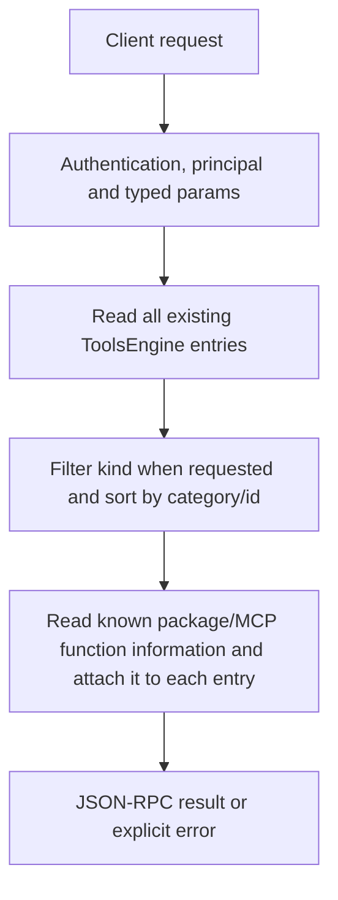

# tools.list

Read the installed tool registry with current settings and known function schemas. This is the inventory used to construct useful developer controls, not an online marketplace list or a request to execute every server.

## Endpoint, execution and permissions

| Property | Contract |
|---|---|
| Wire endpoint | `POST /v1/cep`; logical method `tools.list` |
| Execution | Synchronous domain result in the JSON-RPC result field |
| Required scope | `read` |
| MCP facade | Eligible for the current read-only MCP facade |
| Side effects | Read/control behavior described below; this scope alone is not a promise of zero side effects |

Send a Bearer token when API authentication is enabled. Authentication failures are HTTP 401; ordinary CEP method errors are JSON-RPC error objects, normally with HTTP 200. A successful HTTP status alone does not prove the operation succeeded. See [the common CEP contract](../../README.md).

## How it works

1. Read all existing ToolsEngine entries
2. Filter kind when requested and sort by category/id
3. Read known package/MCP function information and attach it to each entry



## Parameters, defaults and value effects

| Parameter | Type | Required | Meaning, default and constraints |
|---|---|---|---|
| `kind` | "skill" \| "plugin" \| "mcp" \| null | No | Only tools of this kind; all when absent Optional skill, plugin or mcp. Omitted: every installed kind. |

Unknown top-level method parameters are rejected. `params._meta` is protocol metadata, not a domain option; approval retries must preserve the same method and domain parameters. Where a parameter is optional, omission follows the method-specific rules above rather than implying a universal zero or empty-string default.

## Request examples

Examples describe contracts, not measured execution. Replace IDs, paths and installed-package names with real values from your Engine. Do not execute write/delete/process examples against valuable data merely to read the documentation.

### 1. Basic request

This request uses the documented selection. Read the result semantics below before acting on it.

```json
{
  "jsonrpc": "2.0",
  "id": 1,
  "method": "tools.list",
  "params": {
    "kind": "mcp"
  }
}
```

### 2. List all tool kinds

Use category values in the response to distinguish packages.

```json
{
  "jsonrpc": "2.0",
  "id": 2,
  "method": "tools.list",
  "params": {}
}
```

### 3. List plugins only

This is not the extension mini-application lifecycle API.

```json
{
  "jsonrpc": "2.0",
  "id": 3,
  "method": "tools.list",
  "params": {
    "kind": "plugin"
  }
}
```

## Response and field meanings

result is an array of installed entries, including id/category/enabled/execution_mode/security_mode/default_turns and functions. Function schemas come from the existing manifest/known owner; absence of a schema is not a substitute executable contract.

The following response is an illustrative shape. IDs, byte counts, timings and array contents depend on the actual request and machine; shortened nested objects are not a second schema or a measured result.

```json
{
  "id": 1,
  "jsonrpc": "2.0",
  "result": [
    {
      "category": "mcp",
      "default_turns": 3,
      "description": "Official Model Context Protocol secure file system bridge",
      "enabled": true,
      "execution_mode": "manual",
      "functions": [
        {
          "annotations": {
            "openWorldHint": false,
            "readOnlyHint": true
          },
          "description": "Read the complete contents of a file from the file system as text.",
          "inputSchema": {
            "properties": {
              "path": {
                "type": "string"
              }
            },
            "required": [
              "path"
            ],
            "type": "object"
          },
          "name": "read_text_file"
        }
      ],
      "id": "filesystem",
      "security_mode": "inherit"
    }
  ]
}
```

## Errors and recovery

| Code / boundary | Meaning | Recovery |
|---|---|---|
| HTTP 401 | Missing/invalid token while authentication is enabled | Supply the configured token; a CEP params change cannot repair authentication |
| `-32602` / typed params | Missing required fields, wrong JSON types or unknown fields | Correct the request against this page; do not retry the same invalid payload |
| `-32002` / principal | Required scope/owner/root authorization is absent | Inspect `error.data.needs`; use an authorized caller or permitted target |

### Invalid-field example

This is deliberately invalid. The extra field must be removed; it is not an alternate feature toggle.

```text
{
  "jsonrpc": "2.0",
  "id": 90,
  "method": "tools.list",
  "params": {
    "kind": "mcp",
    "__unknown_option": true
  }
}
```

The error envelope is `{"jsonrpc":"2.0","id":90,"error":{"code":-32602,"message":"...","data":{"type":"invalid_params", "errors":[...]}}}`. Exact message and field diagnostics are generated by typed deserialization; callers should use codes and structured data, not match a sentence.

## cURL

Save one valid request above as `request.json`:

```bash
curl --fail-with-body http://127.0.0.1:8000/v1/cep \
  -H "Content-Type: application/json" \
  -H "Authorization: Bearer $CLUAIZ_TOKEN" \
  --data-binary @request.json
```

## Python

Install `requests` in your client environment. This executes the basic request; edit `params` for a different valid case.

```python
import json
import os
import requests

payload = json.loads(r'''{
  "id": 1,
  "jsonrpc": "2.0",
  "method": "tools.list",
  "params": {
    "kind": "mcp"
  }
}''')
response = requests.post(
    "http://127.0.0.1:8000/v1/cep",
    headers={"Authorization": "Bearer " + os.environ["CLUAIZ_TOKEN"]},
    json=payload, timeout=60,
)
response.raise_for_status()
reply = response.json()
if "error" in reply:
    raise RuntimeError(json.dumps(reply["error"], ensure_ascii=False))
print(reply["result"])
```

## JavaScript / Node.js

Use an owner token only in a trusted client. Do not ship it inside a public web page.

```javascript
const payload = {
  "id": 1,
  "jsonrpc": "2.0",
  "method": "tools.list",
  "params": {
    "kind": "mcp"
  }
};
const response = await fetch("http://127.0.0.1:8000/v1/cep", {
  method: "POST",
  headers: { "content-type": "application/json", authorization: `Bearer ${process.env.CLUAIZ_TOKEN}` },
  body: JSON.stringify(payload),
});
const raw = await response.text();
if (!response.ok) throw new Error(`HTTP ${response.status}: ${raw}`);
const reply = JSON.parse(raw);
if (reply.error) throw new Error(JSON.stringify(reply.error));
console.log(reply.result);
```

## Limits, state and related operations

Listing does not prove a tool’s environment/runtime can start successfully. It does not grant approval or attach a tool to a chat. A package read can have incomplete function information; handle an empty functions list.

- [`tools.get_settings`](tools.get_settings.md): use its separate documented contract.
- [`tools.call`](tools.call.md): use its separate documented contract.
- [`chat.set_tools`](../../ai-inference/chat/chat.set_tools.md): use its separate documented contract.

## Implementation reference

- [api/src/cep/methods/tools/catalog.rs](../../../../../api/src/cep/methods/tools/catalog.rs)
- [api/src/cep/methods/tools/common.rs](../../../../../api/src/cep/methods/tools/common.rs)
