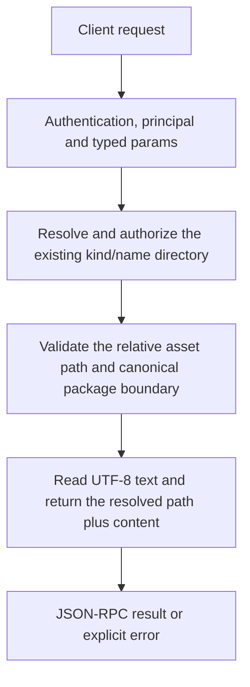

# tools.read_file

Read a UTF-8 file inside an installed package. Use it for SKILL.md, package.json and supported text assets, rather than expecting binary image/audio decoding or a whole tree response.

## Endpoint, execution and permissions

| Property | Contract |
|---|---|
| Wire endpoint | `POST /v1/cep`; logical method `tools.read_file` |
| Execution | Synchronous domain result in the JSON-RPC result field |
| Required scope | `read` |
| MCP facade | Eligible for the current read-only MCP facade |
| Side effects | Read/control behavior described below; this scope alone is not a promise of zero side effects |

Send a Bearer token when API authentication is enabled. Authentication failures are HTTP 401; ordinary CEP method errors are JSON-RPC error objects, normally with HTTP 200. A successful HTTP status alone does not prove the operation succeeded. See [the common CEP contract](../../README.md).

## How it works

1. Resolve and authorize the existing kind/name directory
2. Validate the relative asset path and canonical package boundary
3. Read UTF-8 text and return the resolved path plus content



## Parameters, defaults and value effects

| Parameter | Type | Required | Meaning, default and constraints |
|---|---|---|---|
| `kind` | "skill" \| "plugin" \| "mcp" | Yes | skill, plugin or mcp Required enum: skill (instructions), plugin (WASM/native package), mcp (server package). Kind and name must identify the same installed entry. |
| `name` | string | Yes | The tool's folder name: 1–64 lowercase letters, digits, dots, underscores or hyphens Required package/registry name, 1–64 ASCII lowercase letters/digits/dots/underscores/hyphens; first character must be a letter or digit. Not a path or arbitrary repository URL. |
| `path` | string | Yes | A file inside the tool's folder, relative to it Required relative file path inside the package. Absolute paths, .. components, empty values and escaping symlinks are rejected. |

Unknown top-level method parameters are rejected. `params._meta` is protocol metadata, not a domain option; approval retries must preserve the same method and domain parameters. Where a parameter is optional, omission follows the method-specific rules above rather than implying a universal zero or empty-string default.

## Request examples

Examples describe contracts, not measured execution. Replace IDs, paths and installed-package names with real values from your Engine. Do not execute write/delete/process examples against valuable data merely to read the documentation.

### 1. Basic request

This request uses the documented selection. Read the result semantics below before acting on it.

```json
{
  "jsonrpc": "2.0",
  "id": 1,
  "method": "tools.read_file",
  "params": {
    "kind": "skill",
    "name": "installed-tool",
    "path": "SKILL.md"
  }
}
```

### 2. Read a plugin manifest

Read-only; this does not launch its declared execution block.

```json
{
  "jsonrpc": "2.0",
  "id": 2,
  "method": "tools.read_file",
  "params": {
    "kind": "plugin",
    "name": "installed-plugin",
    "path": "package.json"
  }
}
```

## Response and field meanings

path is the shared canonical/display path and text is the complete UTF-8 content. This is not Base64 fallback; unreadable/non-UTF8 content can fail.

The following response is an illustrative shape. IDs, byte counts, timings and array contents depend on the actual request and machine; shortened nested objects are not a second schema or a measured result.

```json
{
  "id": 1,
  "jsonrpc": "2.0",
  "result": {
    "path": "SKILL.md",
    "text": "Tool instructions"
  }
}
```

## Errors and recovery

| Code / boundary | Meaning | Recovery |
|---|---|---|
| HTTP 401 | Missing/invalid token while authentication is enabled | Supply the configured token; a CEP params change cannot repair authentication |
| `-32602` / typed params | Missing required fields, wrong JSON types or unknown fields | Correct the request against this page; do not retry the same invalid payload |
| `-32002` / principal | Required scope/owner/root authorization is absent | Inspect `error.data.needs`; use an authorized caller or permitted target |
| `-32004` / `tool_not_found` | No installed tool of this kind and name | Refresh the relevant inventory/IDs and check whether the resource expired |
| `-32602` / `invalid_params` | `path` leaves the tool folder | Correct the option/value combination; install required assets where relevant |
| `-32004` / `file_not_found` | No such file in the tool folder | Refresh the relevant inventory/IDs and check whether the resource expired |

### Invalid-field example

This is deliberately invalid. The extra field must be removed; it is not an alternate feature toggle.

```text
{
  "jsonrpc": "2.0",
  "id": 90,
  "method": "tools.read_file",
  "params": {
    "kind": "skill",
    "name": "installed-tool",
    "path": "SKILL.md",
    "__unknown_option": true
  }
}
```

The error envelope is `{"jsonrpc":"2.0","id":90,"error":{"code":-32602,"message":"...","data":{"type":"invalid_params", "errors":[...]}}}`. Exact message and field diagnostics are generated by typed deserialization; callers should use codes and structured data, not match a sentence.

## cURL

Save one valid request above as `request.json`:

```bash
curl --fail-with-body http://127.0.0.1:8000/v1/cep \
  -H "Content-Type: application/json" \
  -H "Authorization: Bearer $CLUAIZ_TOKEN" \
  --data-binary @request.json
```

## Python

Install `requests` in your client environment. This executes the basic request; edit `params` for a different valid case.

```python
import json
import os
import requests

payload = json.loads(r'''{
  "id": 1,
  "jsonrpc": "2.0",
  "method": "tools.read_file",
  "params": {
    "kind": "skill",
    "name": "installed-tool",
    "path": "SKILL.md"
  }
}''')
response = requests.post(
    "http://127.0.0.1:8000/v1/cep",
    headers={"Authorization": "Bearer " + os.environ["CLUAIZ_TOKEN"]},
    json=payload, timeout=60,
)
response.raise_for_status()
reply = response.json()
if "error" in reply:
    raise RuntimeError(json.dumps(reply["error"], ensure_ascii=False))
print(reply["result"])
```

## JavaScript / Node.js

Use an owner token only in a trusted client. Do not ship it inside a public web page.

```javascript
const payload = {
  "id": 1,
  "jsonrpc": "2.0",
  "method": "tools.read_file",
  "params": {
    "kind": "skill",
    "name": "installed-tool",
    "path": "SKILL.md"
  }
};
const response = await fetch("http://127.0.0.1:8000/v1/cep", {
  method: "POST",
  headers: { "content-type": "application/json", authorization: `Bearer ${process.env.CLUAIZ_TOKEN}` },
  body: JSON.stringify(payload),
});
const raw = await response.text();
if (!response.ok) throw new Error(`HTTP ${response.status}: ${raw}`);
const reply = JSON.parse(raw);
if (reply.error) throw new Error(JSON.stringify(reply.error));
console.log(reply.result);
```

## Limits, state and related operations

There is no byte range, encoding conversion or binary flag here. The entire file is read; use appropriate package/text assets. Owner roots do not override package-relative asset confinement. Package locations come from the existing registry/installer and pass caller roots. Relative file operations stay inside that package even for the unrestricted owner; absolute paths, .. and escaping symlinks are not accepted as assets.

- [`tools.files`](tools.files.md): use its separate documented contract.
- [`tools.write_file`](tools.write_file.md): use its separate documented contract.
- [`fs.read`](../../filesystem/fs/fs.read.md): use its separate documented contract.

## Implementation reference

- [api/src/cep/methods/tools/files.rs](../../../../../api/src/cep/methods/tools/files.rs)
