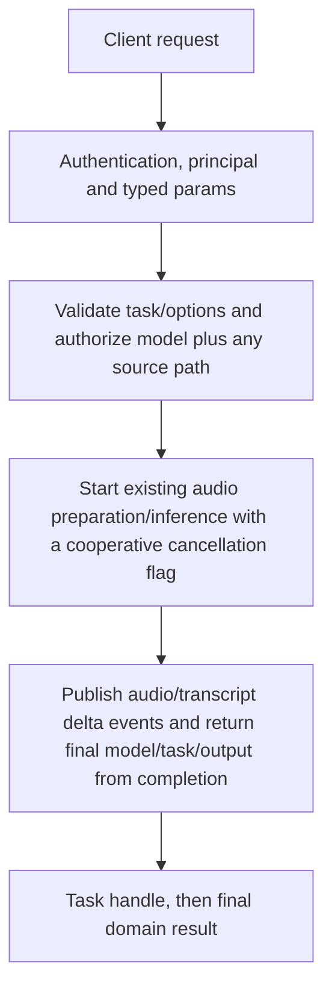

# audio.run

Run speech generation, transcription or declared speech translation through the existing audio dispatch as a CEP task. Direct TTS/STT HTTP endpoints remain available; this method changes the task envelope, not the underlying model family support.

## Endpoint, execution and permissions

| Property | Contract |
|---|---|
| Wire endpoint | `POST /v1/cep`; logical method `audio.run` |
| Execution | Task: the first result is a handle; use tasks.get / tasks.result for output |
| Required scope | `read` |
| MCP facade | Eligible for the current read-only MCP facade |
| Side effects | Read/control behavior described below; this scope alone is not a promise of zero side effects |

Send a Bearer token when API authentication is enabled. Authentication failures are HTTP 401; ordinary CEP method errors are JSON-RPC error objects, normally with HTTP 200. A successful HTTP status alone does not prove the operation succeeded. See [the common CEP contract](../../README.md).

## How it works

1. Validate task/options and authorize model plus any source path
2. Start existing audio preparation/inference with a cooperative cancellation flag
3. Publish audio/transcript delta events and return final model/task/output from completion



## Parameters, defaults and value effects

| Parameter | Type | Required | Meaning, default and constraints |
|---|---|---|---|
| `input_source` | object | Yes | Input descriptor: text for speech generation, or a local/remote/inline audio source for transcription |
| `input_source.data` | string | Yes | The text; a file path; an http(s) URL; or a `data:audio/...;base64,` URI Actual text for speech, otherwise an authorized path, allowed URL or complete audio data URI. Bare Base64 is not a URI. |
| `input_source.type` | string | Yes | text (speech), or file / url / audio / base64 (transcription) text for synthesis; file/url/audio/base64 for an actual audio source. Strict nested fields; this is not the direct speech endpoint’s input field. |
| `instruction` | string \| null | No | Not supported: a non-empty value is refused Nonempty instruction is unsupported and rejected. |
| `keep_alive` | integer \| null | No | Minutes the model stays loaded after the task: -1 = until replaced, 0 = unload now, N = N minutes Minutes: -1 retain, 0 unload after execution, positive expiry. Not seconds. |
| `model` | string \| null | No | An installed speech or transcription model id (default: the active slot, else the first installed model for the task) Exact installed compatible package; omitted selection uses the existing task-aware slot/candidate rules. |
| `parameters` | object \| null | No | Task options Task options; controls unsupported by the selected family/task return errors. |
| `parameters.beam_size` | integer \| null | No | Only 1 is supported Only 1. |
| `parameters.language` | string \| null | No | Speech: the text's language ("cs", "hi", "en-US"). Transcription: the spoken language, or "auto" |
| `parameters.languages` | string[] | No | The speaker's languages (ISO 639-1): without `language`, speech is detected among only these Candidate language codes for detection when appropriate; not a voice list. |
| `parameters.speaker_labels` | boolean \| null | No | Only false is supported Only false. |
| `parameters.speed` | number \| null | No | Speech rate, 0.25 to 4.0 (speech only) Speech only, 0.25–4.0 where supported. |
| `parameters.temperature` | number \| null | No | Transcription sampling temperature; only 0 (greedy) is supported Transcription: only 0 supported. |
| `parameters.timestamps` | boolean \| null | No | Only false is supported Only false. |
| `parameters.translate_to` | string \| null | No | "en" with a model that declares speech_translation; other targets are refused Only en with a model declaring speech_translation. |
| `parameters.vad_filter` | boolean \| null | No | Only false is supported Only false. |
| `parameters.voice_id` | string \| null | No | A voice id from `audio.voices`; "default" / "auto" picks one for the text's language (speech only) Speech only: use package inventory or supported reference-audio behavior. |
| `task` | string \| null | No | text_to_speech, speech_to_text or speech_translation (default: from `input_source.type`, text = speech) Defaults from input_source.type: text selects speech; audio/file/url/base64 selects transcription. Explicit text_to_speech, speech_to_text or declared speech_translation only. |

Unknown top-level method parameters are rejected. `params._meta` is protocol metadata, not a domain option; approval retries must preserve the same method and domain parameters. Where a parameter is optional, omission follows the method-specific rules above rather than implying a universal zero or empty-string default.

## Request examples

Examples describe contracts, not measured execution. Replace IDs, paths and installed-package names with real values from your Engine. Do not execute write/delete/process examples against valuable data merely to read the documentation.

### 1. Basic request

This request uses the documented selection. Read the result semantics below before acting on it.

```json
{
  "jsonrpc": "2.0",
  "id": 1,
  "method": "audio.run",
  "params": {
    "input_source": {
      "data": "Speech input",
      "type": "text"
    }
  }
}
```

### 2. Generate speech with bounded residency

Select a supported TTS package; read tasks.get events or tasks.result.

```json
{
  "jsonrpc": "2.0",
  "id": 2,
  "method": "audio.run",
  "params": {
    "task": "text_to_speech",
    "input_source": {
      "type": "text",
      "data": "Hello from the local engine."
    },
    "model": "<installed-tts-id>",
    "parameters": {
      "speed": 1
    },
    "keep_alive": 0
  }
}
```

### 3. Transcribe an existing host recording

The path must exist on the Engine host. Browser uploads must provide actual data-URI bytes.

```json
{
  "jsonrpc": "2.0",
  "id": 3,
  "method": "audio.run",
  "params": {
    "task": "speech_to_text",
    "input_source": {
      "type": "file",
      "data": "recordings/sample.wav"
    },
    "model": "<installed-stt-id>",
    "parameters": {
      "language": "auto",
      "temperature": 0,
      "timestamps": false
    }
  }
}
```

## Response and field meanings

Initial result is a task handle. Speech events use type speech.audio.delta with index/format/audio; transcription events use transcript.delta with text. Final tasks.result returns model, task and output (text/audio_data/segments as applicable), without the direct HTTP status/info wrapper.

The following response is an illustrative shape. IDs, byte counts, timings and array contents depend on the actual request and machine; shortened nested objects are not a second schema or a measured result.

```json
{
  "id": 1,
  "jsonrpc": "2.0",
  "result": {
    "task": {
      "status": "working",
      "task_id": "t_example"
    }
  }
}
```

### Read the task result

Copy the returned `result.task.task_id`. Task state is in memory and is caller-owned; it is not a durable job queue. Poll for events with the returned cursor, or wait for the final result. A timeout means the task is still running, not that it failed. Cancellation is cooperative and does not undo completed writes/downloads.

```json
{
  "jsonrpc": "2.0",
  "id": 20,
  "method": "tasks.get",
  "params": {
    "task_id": "<returned-task-id>",
    "after": 0
  }
}
```

```json
{
  "jsonrpc": "2.0",
  "id": 21,
  "method": "tasks.result",
  "params": {
    "task_id": "<returned-task-id>",
    "wait_ms": 30000
  }
}
```

Final result: {model,task,output:{text,audio_data,segments}}. Decode a returned WAV data URI rather than treating it as a local filename. Error/busy/resource failures can arrive only when tasks.result is read.

## Errors and recovery

| Code / boundary | Meaning | Recovery |
|---|---|---|
| HTTP 401 | Missing/invalid token while authentication is enabled | Supply the configured token; a CEP params change cannot repair authentication |
| `-32602` / typed params | Missing required fields, wrong JSON types or unknown fields | Correct the request against this page; do not retry the same invalid payload |
| `-32002` / principal | Required scope/owner/root authorization is absent | Inspect `error.data.needs`; use an authorized caller or permitted target |
| `-32602` / `unsupported_parameter` | An option the model does not support: timestamps, VAD, speaker labels, beam size above 1, temperature above 0, voice / speed for transcription | Correct the option/value combination; install required assets where relevant |
| `-32602` / `unsupported_language` | The speech model does not support `language` | Correct the option/value combination; install required assets where relevant |
| `-32602` / `unsupported_task` | `task` is not text_to_speech, speech_to_text or speech_translation, or the model does not declare it | Correct the option/value combination; install required assets where relevant |
| `-32602` / `invalid_input` | An unreadable source: a bare base64 string, a missing file, a non-audio file | Correct the option/value combination; install required assets where relevant |
| `-32004` / `model_not_found` | No installed model with this id, or no installed model for the task | Refresh the relevant inventory/IDs and check whether the resource expired |
| `-32602` / `model_contract_error` | The model's package does not match its declared task (missing voices, config or assets) | Correct the option/value combination; install required assets where relevant |
| `-32002` / `forbidden` | The model or the source file is outside the caller's roots (`data.needs: "roots"`) | Read the error message, correct the backend/filesystem/configuration condition, then retry deliberately |
| `-32010` / `speech_busy` | Another speech request is running (from the task's result) | Read the error message, correct the backend/filesystem/configuration condition, then retry deliberately |
| `-32010` / `engine_error` | The model failed while running (from the task's result) | Read the error message, correct the backend/filesystem/configuration condition, then retry deliberately |
| `-32008` / `cancelled` | `tasks.cancel` stopped it (from the task's result) | Treat as cancelled; review partial side effects before starting new work |

### Invalid-field example

This is deliberately invalid. The extra field must be removed; it is not an alternate feature toggle.

```text
{
  "jsonrpc": "2.0",
  "id": 90,
  "method": "audio.run",
  "params": {
    "input_source": {
      "data": "Speech input",
      "type": "text"
    },
    "__unknown_option": true
  }
}
```

The error envelope is `{"jsonrpc":"2.0","id":90,"error":{"code":-32602,"message":"...","data":{"type":"invalid_params", "errors":[...]}}}`. Exact message and field diagnostics are generated by typed deserialization; callers should use codes and structured data, not match a sentence.

## cURL

Save one valid request above as `request.json`:

```bash
curl --fail-with-body http://127.0.0.1:8000/v1/cep \
  -H "Content-Type: application/json" \
  -H "Authorization: Bearer $CLUAIZ_TOKEN" \
  --data-binary @request.json
```

## Python

Install `requests` in your client environment. This executes the basic request; edit `params` for a different valid case.

```python
import json
import os
import requests

payload = json.loads(r'''{
  "id": 1,
  "jsonrpc": "2.0",
  "method": "audio.run",
  "params": {
    "input_source": {
      "data": "Speech input",
      "type": "text"
    }
  }
}''')
response = requests.post(
    "http://127.0.0.1:8000/v1/cep",
    headers={"Authorization": "Bearer " + os.environ["CLUAIZ_TOKEN"]},
    json=payload, timeout=60,
)
response.raise_for_status()
reply = response.json()
if "error" in reply:
    raise RuntimeError(json.dumps(reply["error"], ensure_ascii=False))
print(reply["result"])
```

## JavaScript / Node.js

Use an owner token only in a trusted client. Do not ship it inside a public web page.

```javascript
const payload = {
  "id": 1,
  "jsonrpc": "2.0",
  "method": "audio.run",
  "params": {
    "input_source": {
      "data": "Speech input",
      "type": "text"
    }
  }
};
const response = await fetch("http://127.0.0.1:8000/v1/cep", {
  method: "POST",
  headers: { "content-type": "application/json", authorization: `Bearer ${process.env.CLUAIZ_TOKEN}` },
  body: JSON.stringify(payload),
});
const raw = await response.text();
if (!response.ok) throw new Error(`HTTP ${response.status}: ${raw}`);
const reply = JSON.parse(raw);
if (reply.error) throw new Error(JSON.stringify(reply.error));
console.log(reply.result);
```

## Limits, state and related operations

Cancellation closes the adapter receiver and signals the shared cancellation flag; native work stops cooperatively, not by a universal hard preemption promise. A worker ending without completion is an error. Package/model resource admission remains independent of task acceptance. No VAD/diarization/timestamps are silently fabricated.

- [`audio.voices`](audio.voices.md): use its separate documented contract.
- [`audio.languages`](audio.languages.md): use its separate documented contract.
- [`tasks.get`](../../system/tasks/tasks.get.md): use its separate documented contract.
- [`tasks.result`](../../system/tasks/tasks.result.md): use its separate documented contract.

## Implementation reference

- [api/src/cep/methods/audio.rs](../../../../../api/src/cep/methods/audio.rs)
- [api/src/handlers/audio_types.rs](../../../../../api/src/handlers/audio_types.rs)
- [api/src/handlers/audio.rs](../../../../../api/src/handlers/audio.rs)
