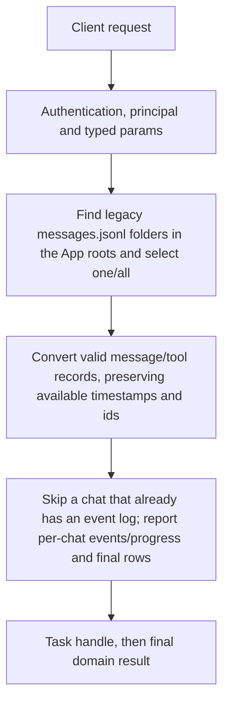

# chat.import_app

Opt in to importing legacy App chat files into Engine event logs. Source App directories are read-only to this importer; Engine event logs are the destination. This is migration, not a continuously mirrored second store.

## Endpoint, execution and permissions

| Property | Contract |
|---|---|
| Wire endpoint | `POST /v1/cep`; logical method `chat.import_app` |
| Execution | Task: the first result is a handle; use tasks.get / tasks.result for output |
| Required scope | `write` |
| MCP facade | Not exposed by the current read-only MCP facade |
| Side effects | Updates the state described below |

Send a Bearer token when API authentication is enabled. Authentication failures are HTTP 401; ordinary CEP method errors are JSON-RPC error objects, normally with HTTP 200. A successful HTTP status alone does not prove the operation succeeded. See [the common CEP contract](../../README.md).

## How it works

1. Find legacy messages.jsonl folders in the App roots and select one/all
2. Convert valid message/tool records, preserving available timestamps and ids
3. Skip a chat that already has an event log; report per-chat events/progress and final rows



## Parameters, defaults and value effects

| Parameter | Type | Required | Meaning, default and constraints |
|---|---|---|---|
| `all` | boolean | No | Import every App chat that has no Engine event log yet Defaults to false. true allows selecting all discovered legacy chats without chat_id. |
| `chat_id` | string \| null | No | One App chat id (its folder name); leave out with `all: true` for every chat Optional exact legacy chat folder name. Required unless all:true. If supplied, selection is by this id. |
| `dry_run` | boolean | No | Count what would be imported, write nothing Defaults to false. true counts/reports would-be events without appending Engine logs. |

Unknown top-level method parameters are rejected. `params._meta` is protocol metadata, not a domain option; approval retries must preserve the same method and domain parameters. Where a parameter is optional, omission follows the method-specific rules above rather than implying a universal zero or empty-string default.

## Request examples

Examples describe contracts, not measured execution. Replace IDs, paths and installed-package names with real values from your Engine. Do not execute write/delete/process examples against valuable data merely to read the documentation.

### 1. Basic request

This request uses the documented selection. Read the result semantics below before acting on it.

```json
{
  "jsonrpc": "2.0",
  "id": 1,
  "method": "chat.import_app",
  "params": {
    "all": true,
    "dry_run": true
  }
}
```

### 2. Preview every eligible legacy chat

Read all row statuses before running a non-dry migration.

```json
{
  "jsonrpc": "2.0",
  "id": 2,
  "method": "chat.import_app",
  "params": {
    "all": true,
    "dry_run": true
  }
}
```

### 3. Import one legacy conversation

Performs Engine writes for that selection; existing logs are skipped.

```json
{
  "jsonrpc": "2.0",
  "id": 3,
  "method": "chat.import_app",
  "params": {
    "chat_id": "<legacy-chat-folder-id>",
    "dry_run": false
  }
}
```

## Response and field meanings

Initial result is a task handle. Final result contains roots and chats[] rows with chat_id, from, messages, tool_calls, events and status. A final completed task can include rows marked failed/skipped; inspect every row rather than inferring all rows imported.

The following response is an illustrative shape. IDs, byte counts, timings and array contents depend on the actual request and machine; shortened nested objects are not a second schema or a measured result.

```json
{
  "id": 1,
  "jsonrpc": "2.0",
  "result": {
    "task": {
      "status": "working",
      "task_id": "t_5f0c…"
    }
  }
}
```

### Read the task result

Copy the returned `result.task.task_id`. Task state is in memory and is caller-owned; it is not a durable job queue. Poll for events with the returned cursor, or wait for the final result. A timeout means the task is still running, not that it failed. Cancellation is cooperative and does not undo completed writes/downloads.

```json
{
  "jsonrpc": "2.0",
  "id": 20,
  "method": "tasks.get",
  "params": {
    "task_id": "<returned-task-id>",
    "after": 0
  }
}
```

```json
{
  "jsonrpc": "2.0",
  "id": 21,
  "method": "tasks.result",
  "params": {
    "task_id": "<returned-task-id>",
    "wait_ms": 30000
  }
}
```

Final shape is {roots:[...], chats:[{chat_id,from,messages,tool_calls,events,status},...]}. Progress unit is chats. Re-run dry_run to inspect source candidates; task completion alone does not imply every row succeeded.

## Errors and recovery

| Code / boundary | Meaning | Recovery |
|---|---|---|
| HTTP 401 | Missing/invalid token while authentication is enabled | Supply the configured token; a CEP params change cannot repair authentication |
| `-32602` / typed params | Missing required fields, wrong JSON types or unknown fields | Correct the request against this page; do not retry the same invalid payload |
| `-32002` / principal | Required scope/owner/root authorization is absent | Inspect `error.data.needs`; use an authorized caller or permitted target |
| `-32602` / `invalid_params` | Neither `chat_id` nor `all: true` was sent | Correct the option/value combination; install required assets where relevant |

### Invalid-field example

This is deliberately invalid. The extra field must be removed; it is not an alternate feature toggle.

```text
{
  "jsonrpc": "2.0",
  "id": 90,
  "method": "chat.import_app",
  "params": {
    "all": true,
    "dry_run": true,
    "__unknown_option": true
  }
}
```

The error envelope is `{"jsonrpc":"2.0","id":90,"error":{"code":-32602,"message":"...","data":{"type":"invalid_params", "errors":[...]}}}`. Exact message and field diagnostics are generated by typed deserialization; callers should use codes and structured data, not match a sentence.

## cURL

Save one valid request above as `request.json`:

```bash
curl --fail-with-body http://127.0.0.1:8000/v1/cep \
  -H "Content-Type: application/json" \
  -H "Authorization: Bearer $CLUAIZ_TOKEN" \
  --data-binary @request.json
```

## Python

Install `requests` in your client environment. This executes the basic request; edit `params` for a different valid case.

```python
import json
import os
import requests

payload = json.loads(r'''{
  "id": 1,
  "jsonrpc": "2.0",
  "method": "chat.import_app",
  "params": {
    "all": true,
    "dry_run": true
  }
}''')
response = requests.post(
    "http://127.0.0.1:8000/v1/cep",
    headers={"Authorization": "Bearer " + os.environ["CLUAIZ_TOKEN"]},
    json=payload, timeout=60,
)
response.raise_for_status()
reply = response.json()
if "error" in reply:
    raise RuntimeError(json.dumps(reply["error"], ensure_ascii=False))
print(reply["result"])
```

## JavaScript / Node.js

Use an owner token only in a trusted client. Do not ship it inside a public web page.

```javascript
const payload = {
  "id": 1,
  "jsonrpc": "2.0",
  "method": "chat.import_app",
  "params": {
    "all": true,
    "dry_run": true
  }
};
const response = await fetch("http://127.0.0.1:8000/v1/cep", {
  method: "POST",
  headers: { "content-type": "application/json", authorization: `Bearer ${process.env.CLUAIZ_TOKEN}` },
  body: JSON.stringify(payload),
});
const raw = await response.text();
if (!response.ok) throw new Error(`HTTP ${response.status}: ${raw}`);
const reply = JSON.parse(raw);
if (reply.error) throw new Error(JSON.stringify(reply.error));
console.log(reply.result);
```

## Limits, state and related operations

The importer only understands the legacy folder/message format. Invalid lines are skipped by the parser; existing nonempty Engine logs are not merged or overwritten. Cancel checks occur per chat and cannot undo imports already performed. It does not delete or rewrite App source files.

- [`memory.events`](../memory/memory.events.md): use its separate documented contract.
- [`memory.export`](../memory/memory.export.md): use its separate documented contract.
- [`tasks.get`](../../system/tasks/tasks.get.md): use its separate documented contract.

## Implementation reference

- [api/src/cep/methods/chat/mod.rs](../../../../../api/src/cep/methods/chat/mod.rs)
- [api/src/cep/methods/chat/app_import.rs](../../../../../api/src/cep/methods/chat/app_import.rs)
