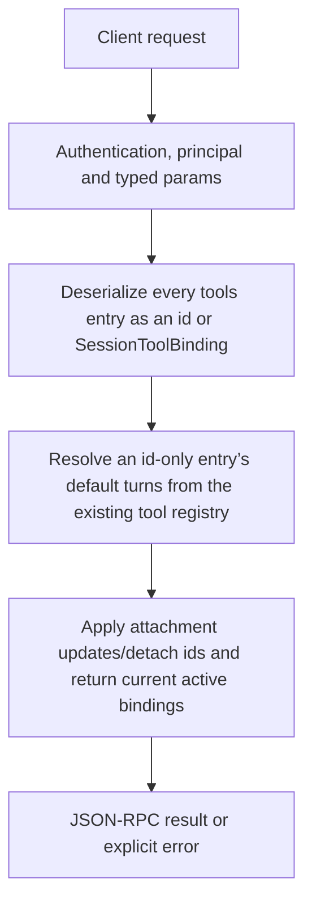

# chat.set_tools

Attach/update/detach tools for an existing conversation’s session state. It reuses ToolsEngine binding management rather than installing packages or inventing another tool registry.

## Endpoint, execution and permissions

| Property | Contract |
|---|---|
| Wire endpoint | `POST /v1/cep`; logical method `chat.set_tools` |
| Execution | Synchronous domain result in the JSON-RPC result field |
| Required scope | `write` |
| MCP facade | Not exposed by the current read-only MCP facade |
| Side effects | Updates the state described below |

Send a Bearer token when API authentication is enabled. Authentication failures are HTTP 401; ordinary CEP method errors are JSON-RPC error objects, normally with HTTP 200. A successful HTTP status alone does not prove the operation succeeded. See [the common CEP contract](../../README.md).

## How it works

1. Deserialize every tools entry as an id or SessionToolBinding
2. Resolve an id-only entry’s default turns from the existing tool registry
3. Apply attachment updates/detach ids and return current active bindings



## Parameters, defaults and value effects

| Parameter | Type | Required | Meaning, default and constraints |
|---|---|---|---|
| `chat_id` | string | Yes | The chat (`session_id` of its chat requests) Required session_id whose bindings change. |
| `detach` | string[] | No | Tool ids to detach Defaults to []. Exact tool ids to detach; omission does not mean clear every tool. |
| `tools` | any[] | No | Tools to attach or update: a tool id (its default turns), or `{"id", "turns"}` Defaults to []. Entries may be a tool id or a binding object such as {id,turns}. Id-only form uses that tool’s default turns (fallback -1 when unavailable). |

Unknown top-level method parameters are rejected. `params._meta` is protocol metadata, not a domain option; approval retries must preserve the same method and domain parameters. Where a parameter is optional, omission follows the method-specific rules above rather than implying a universal zero or empty-string default.

## Request examples

Examples describe contracts, not measured execution. Replace IDs, paths and installed-package names with real values from your Engine. Do not execute write/delete/process examples against valuable data merely to read the documentation.

### 1. Basic request

This request uses the documented selection. Read the result semantics below before acting on it.

```json
{
  "jsonrpc": "2.0",
  "id": 1,
  "method": "chat.set_tools",
  "params": {
    "chat_id": "c1",
    "detach": [
      "old-tool"
    ],
    "tools": [
      "web-search",
      {
        "id": "calc",
        "turns": 2
      }
    ]
  }
}
```

### 2. Detach a tool without adding one

Other bindings remain managed by the existing update rules.

```json
{
  "jsonrpc": "2.0",
  "id": 2,
  "method": "chat.set_tools",
  "params": {
    "chat_id": "c1",
    "detach": [
      "web-search"
    ]
  }
}
```

### 3. Attach with an explicit turn budget

Use a real installed id; this is not a download instruction.

```json
{
  "jsonrpc": "2.0",
  "id": 3,
  "method": "chat.set_tools",
  "params": {
    "chat_id": "c1",
    "tools": [
      {
        "id": "web-search",
        "turns": 2
      }
    ]
  }
}
```

## Response and field meanings

active_tools is the post-update binding list. turns is a conversation-use budget, not seconds/minutes or security approval lifetime. An empty tools array with detach ids is a valid detach-only request.

The following response is an illustrative shape. IDs, byte counts, timings and array contents depend on the actual request and machine; shortened nested objects are not a second schema or a measured result.

```json
{
  "id": 1,
  "jsonrpc": "2.0",
  "result": {
    "active_tools": [
      {
        "id": "web-search",
        "turns": 3
      }
    ],
    "chat_id": "c1"
  }
}
```

## Errors and recovery

| Code / boundary | Meaning | Recovery |
|---|---|---|
| HTTP 401 | Missing/invalid token while authentication is enabled | Supply the configured token; a CEP params change cannot repair authentication |
| `-32602` / typed params | Missing required fields, wrong JSON types or unknown fields | Correct the request against this page; do not retry the same invalid payload |
| `-32002` / principal | Required scope/owner/root authorization is absent | Inspect `error.data.needs`; use an authorized caller or permitted target |
| `-32602` / `invalid_params` | An entry of `tools` is neither a tool id nor `{"id", "turns"}` | Correct the option/value combination; install required assets where relevant |

### Invalid-field example

This is deliberately invalid. The extra field must be removed; it is not an alternate feature toggle.

```text
{
  "jsonrpc": "2.0",
  "id": 90,
  "method": "chat.set_tools",
  "params": {
    "chat_id": "c1",
    "detach": [
      "old-tool"
    ],
    "tools": [
      "web-search",
      {
        "id": "calc",
        "turns": 2
      }
    ],
    "__unknown_option": true
  }
}
```

The error envelope is `{"jsonrpc":"2.0","id":90,"error":{"code":-32602,"message":"...","data":{"type":"invalid_params", "errors":[...]}}}`. Exact message and field diagnostics are generated by typed deserialization; callers should use codes and structured data, not match a sentence.

## cURL

Save one valid request above as `request.json`:

```bash
curl --fail-with-body http://127.0.0.1:8000/v1/cep \
  -H "Content-Type: application/json" \
  -H "Authorization: Bearer $CLUAIZ_TOKEN" \
  --data-binary @request.json
```

## Python

Install `requests` in your client environment. This executes the basic request; edit `params` for a different valid case.

```python
import json
import os
import requests

payload = json.loads(r'''{
  "id": 1,
  "jsonrpc": "2.0",
  "method": "chat.set_tools",
  "params": {
    "chat_id": "c1",
    "detach": [
      "old-tool"
    ],
    "tools": [
      "web-search",
      {
        "id": "calc",
        "turns": 2
      }
    ]
  }
}''')
response = requests.post(
    "http://127.0.0.1:8000/v1/cep",
    headers={"Authorization": "Bearer " + os.environ["CLUAIZ_TOKEN"]},
    json=payload, timeout=60,
)
response.raise_for_status()
reply = response.json()
if "error" in reply:
    raise RuntimeError(json.dumps(reply["error"], ensure_ascii=False))
print(reply["result"])
```

## JavaScript / Node.js

Use an owner token only in a trusted client. Do not ship it inside a public web page.

```javascript
const payload = {
  "id": 1,
  "jsonrpc": "2.0",
  "method": "chat.set_tools",
  "params": {
    "chat_id": "c1",
    "detach": [
      "old-tool"
    ],
    "tools": [
      "web-search",
      {
        "id": "calc",
        "turns": 2
      }
    ]
  }
};
const response = await fetch("http://127.0.0.1:8000/v1/cep", {
  method: "POST",
  headers: { "content-type": "application/json", authorization: `Bearer ${process.env.CLUAIZ_TOKEN}` },
  body: JSON.stringify(payload),
});
const raw = await response.text();
if (!response.ok) throw new Error(`HTTP ${response.status}: ${raw}`);
const reply = JSON.parse(raw);
if (reply.error) throw new Error(JSON.stringify(reply.error));
console.log(reply.result);
```

## Limits, state and related operations

This does not install packages, grant unrestricted execution, confirm an approval or replace chat history. Invalid entry shapes fail before binding mutation. Full binding fields follow SessionToolBinding rather than arbitrary options.

- [`chat.tools`](chat.tools.md): use its separate documented contract.
- [`tools.install`](../../agents-tools/tools/tools.install.md): use its separate documented contract.
- [`approvals.list`](../../agents-tools/approvals/approvals.list.md): use its separate documented contract.

## Implementation reference

- [api/src/cep/methods/chat/mod.rs](../../../../../api/src/cep/methods/chat/mod.rs)
