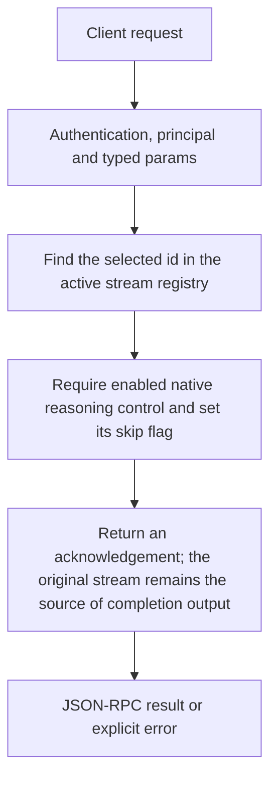

# chat.skip_reasoning

Request that an active model leave reasoning and continue the same answer stream. These controls target the running completion id, not its saved session_id or a CEP task id.

## Endpoint, execution and permissions

| Property | Contract |
|---|---|
| Wire endpoint | `POST /v1/cep`; logical method `chat.skip_reasoning` |
| Execution | Synchronous domain result in the JSON-RPC result field |
| Required scope | `write` |
| MCP facade | Not exposed by the current read-only MCP facade |
| Side effects | Updates the state described below |

Send a Bearer token when API authentication is enabled. Authentication failures are HTTP 401; ordinary CEP method errors are JSON-RPC error objects, normally with HTTP 200. A successful HTTP status alone does not prove the operation succeeded. See [the common CEP contract](../../README.md).

## How it works

1. Find the selected id in the active stream registry
2. Require enabled native reasoning control and set its skip flag
3. Return an acknowledgement; the original stream remains the source of completion output



## Parameters, defaults and value effects

| Parameter | Type | Required | Meaning, default and constraints |
|---|---|---|---|
| `reason` | string \| null | No | Written to the Engine log with the cancel (optional) Optional diagnostic text. Cancellation logs it; skip_reasoning currently does not use this field to steer generation. |
| `stream_id` | string | Yes | The `id` of the running chat stream (from its SSE chunks) Required id from the running chat completion/SSE chunks. Completed or unknown ids return stream_not_found. |

Unknown top-level method parameters are rejected. `params._meta` is protocol metadata, not a domain option; approval retries must preserve the same method and domain parameters. Where a parameter is optional, omission follows the method-specific rules above rather than implying a universal zero or empty-string default.

## Request examples

Examples describe contracts, not measured execution. Replace IDs, paths and installed-package names with real values from your Engine. Do not execute write/delete/process examples against valuable data merely to read the documentation.

### 1. Basic request

This request uses the documented selection. Read the result semantics below before acting on it.

```json
{
  "jsonrpc": "2.0",
  "id": 1,
  "method": "chat.skip_reasoning",
  "params": {
    "stream_id": "chatcmpl-1a2b"
  }
}
```

### 2. Control a currently active completion

Replace with a live completion id; saved chat ids cannot be substituted.

```json
{
  "jsonrpc": "2.0",
  "id": 2,
  "method": "chat.skip_reasoning",
  "params": {
    "stream_id": "<id-from-active-SSE-stream>",
    "reason": "User selected the stream control."
  }
}
```

## Response and field meanings

status:"skip_requested" acknowledges the control request. It is not the generated answer and does not mean a native operation was preempted at an arbitrary machine instruction. Continue handling termination/content on the original stream.

The following response is an illustrative shape. IDs, byte counts, timings and array contents depend on the actual request and machine; shortened nested objects are not a second schema or a measured result.

```json
{
  "id": 1,
  "jsonrpc": "2.0",
  "result": {
    "status": "skip_requested",
    "stream_id": "chatcmpl-1a2b"
  }
}
```

## Errors and recovery

| Code / boundary | Meaning | Recovery |
|---|---|---|
| HTTP 401 | Missing/invalid token while authentication is enabled | Supply the configured token; a CEP params change cannot repair authentication |
| `-32602` / typed params | Missing required fields, wrong JSON types or unknown fields | Correct the request against this page; do not retry the same invalid payload |
| `-32002` / principal | Required scope/owner/root authorization is absent | Inspect `error.data.needs`; use an authorized caller or permitted target |
| `-32004` / `stream_not_found` | No running stream with this id (it ended, or never started) | Refresh the relevant inventory/IDs and check whether the resource expired |
| `-32005` / `reasoning_unavailable` | The stream's model has no native reasoning control, or thinking is off | Inspect current state before retrying; avoid a tight retry loop |

### Invalid-field example

This is deliberately invalid. The extra field must be removed; it is not an alternate feature toggle.

```text
{
  "jsonrpc": "2.0",
  "id": 90,
  "method": "chat.skip_reasoning",
  "params": {
    "stream_id": "chatcmpl-1a2b",
    "__unknown_option": true
  }
}
```

The error envelope is `{"jsonrpc":"2.0","id":90,"error":{"code":-32602,"message":"...","data":{"type":"invalid_params", "errors":[...]}}}`. Exact message and field diagnostics are generated by typed deserialization; callers should use codes and structured data, not match a sentence.

## cURL

Save one valid request above as `request.json`:

```bash
curl --fail-with-body http://127.0.0.1:8000/v1/cep \
  -H "Content-Type: application/json" \
  -H "Authorization: Bearer $CLUAIZ_TOKEN" \
  --data-binary @request.json
```

## Python

Install `requests` in your client environment. This executes the basic request; edit `params` for a different valid case.

```python
import json
import os
import requests

payload = json.loads(r'''{
  "id": 1,
  "jsonrpc": "2.0",
  "method": "chat.skip_reasoning",
  "params": {
    "stream_id": "chatcmpl-1a2b"
  }
}''')
response = requests.post(
    "http://127.0.0.1:8000/v1/cep",
    headers={"Authorization": "Bearer " + os.environ["CLUAIZ_TOKEN"]},
    json=payload, timeout=60,
)
response.raise_for_status()
reply = response.json()
if "error" in reply:
    raise RuntimeError(json.dumps(reply["error"], ensure_ascii=False))
print(reply["result"])
```

## JavaScript / Node.js

Use an owner token only in a trusted client. Do not ship it inside a public web page.

```javascript
const payload = {
  "id": 1,
  "jsonrpc": "2.0",
  "method": "chat.skip_reasoning",
  "params": {
    "stream_id": "chatcmpl-1a2b"
  }
};
const response = await fetch("http://127.0.0.1:8000/v1/cep", {
  method: "POST",
  headers: { "content-type": "application/json", authorization: `Bearer ${process.env.CLUAIZ_TOKEN}` },
  body: JSON.stringify(payload),
});
const raw = await response.text();
if (!response.ok) throw new Error(`HTTP ${response.status}: ${raw}`);
const reply = JSON.parse(raw);
if (reply.error) throw new Error(JSON.stringify(reply.error));
console.log(reply.result);
```

## Limits, state and related operations

A model with thinking disabled or without native reasoning support returns reasoning_unavailable. This is not a request to cancel the answer or to edit the model’s private reasoning text. Do not retry the same unavailable control indefinitely.

- [`chat.tools`](chat.tools.md): use its separate documented contract.
- [`memory.events`](../memory/memory.events.md): use its separate documented contract.

## Implementation reference

- [api/src/cep/methods/chat/mod.rs](../../../../../api/src/cep/methods/chat/mod.rs)
