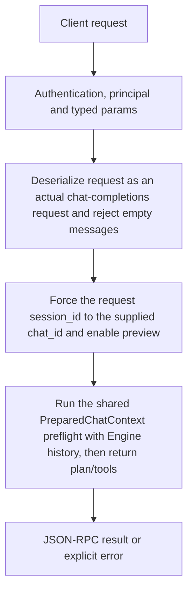

# context.preview

Inspect the preflight context plan and tool choices for a chat request without generating an assistant answer. This is a planner preview, but not a no-load or zero-resource operation: preparing its tokenizer may load the selected model.

## Endpoint, execution and permissions

| Property | Contract |
|---|---|
| Wire endpoint | `POST /v1/cep`; logical method `context.preview` |
| Execution | Synchronous domain result in the JSON-RPC result field |
| Required scope | `read` |
| MCP facade | Eligible for the current read-only MCP facade |
| Side effects | Read/control behavior described below; this scope alone is not a promise of zero side effects |

Send a Bearer token when API authentication is enabled. Authentication failures are HTTP 401; ordinary CEP method errors are JSON-RPC error objects, normally with HTTP 200. A successful HTTP status alone does not prove the operation succeeded. See [the common CEP contract](../../README.md).

## How it works

1. Deserialize request as an actual chat-completions request and reject empty messages
2. Force the request session_id to the supplied chat_id and enable preview
3. Run the shared PreparedChatContext preflight with Engine history, then return plan/tools



## Parameters, defaults and value effects

| Parameter | Type | Required | Meaning, default and constraints |
|---|---|---|---|
| `chat_id` | string | Yes | The chat the request belongs to (its event log, ledger and loaded tools are used) Required target conversation; overrides request.session_id so history/tool state comes from this chat. |
| `request` | any | Yes | A chat completions request (model, messages, tools…); its `session_id` becomes `chat_id` Required object in the chat-completions contract. Supply a compatible installed model and non-empty messages; normal attachment/context checks can apply. |

Unknown top-level method parameters are rejected. `params._meta` is protocol metadata, not a domain option; approval retries must preserve the same method and domain parameters. Where a parameter is optional, omission follows the method-specific rules above rather than implying a universal zero or empty-string default.

## Request examples

Examples describe contracts, not measured execution. Replace IDs, paths and installed-package names with real values from your Engine. Do not execute write/delete/process examples against valuable data merely to read the documentation.

### 1. Basic request

This request uses the documented selection. Read the result semantics below before acting on it.

```json
{
  "jsonrpc": "2.0",
  "id": 1,
  "method": "context.preview",
  "params": {
    "chat_id": "c1",
    "request": {
      "messages": [
        {
          "content": "Hi",
          "role": "user"
        }
      ],
      "model": "qwen3-4b-gguf-Q4_K_M"
    }
  }
}
```

### 2. Preview a bounded answer

Use a real installed id; max_tokens is an answer reserve/input to preflight rather than permission to exceed context.

```json
{
  "jsonrpc": "2.0",
  "id": 2,
  "method": "context.preview",
  "params": {
    "chat_id": "c1",
    "request": {
      "model": "<installed-chat-model>",
      "messages": [
        {
          "role": "user",
          "content": "Explain the project layout."
        }
      ],
      "max_tokens": 128
    }
  }
}
```

## Response and field meanings

plan is the context budget/selection report, not generated message text. tools describes suggested/available tool preparation. It does not carry a completed chat answer or promise the next request gets identical live admission.

The following response is an illustrative shape. IDs, byte counts, timings and array contents depend on the actual request and machine; shortened nested objects are not a second schema or a measured result.

```json
{
  "id": 1,
  "jsonrpc": "2.0",
  "result": {
    "plan": {
      "n_ctx": 8192,
      "prompt_tokens": 412
    },
    "tools": {
      "cards": []
    }
  }
}
```

## Errors and recovery

| Code / boundary | Meaning | Recovery |
|---|---|---|
| HTTP 401 | Missing/invalid token while authentication is enabled | Supply the configured token; a CEP params change cannot repair authentication |
| `-32602` / typed params | Missing required fields, wrong JSON types or unknown fields | Correct the request against this page; do not retry the same invalid payload |
| `-32002` / principal | Required scope/owner/root authorization is absent | Inspect `error.data.needs`; use an authorized caller or permitted target |
| `-32602` / `invalid_params` | `request` is not a chat request, or its `messages` is empty | Correct the option/value combination; install required assets where relevant |
| `-32004` / `model_not_found` | The request's model is not installed | Refresh the relevant inventory/IDs and check whether the resource expired |

### Invalid-field example

This is deliberately invalid. The extra field must be removed; it is not an alternate feature toggle.

```text
{
  "jsonrpc": "2.0",
  "id": 90,
  "method": "context.preview",
  "params": {
    "chat_id": "c1",
    "request": {
      "messages": [
        {
          "content": "Hi",
          "role": "user"
        }
      ],
      "model": "qwen3-4b-gguf-Q4_K_M"
    },
    "__unknown_option": true
  }
}
```

The error envelope is `{"jsonrpc":"2.0","id":90,"error":{"code":-32602,"message":"...","data":{"type":"invalid_params", "errors":[...]}}}`. Exact message and field diagnostics are generated by typed deserialization; callers should use codes and structured data, not match a sentence.

## cURL

Save one valid request above as `request.json`:

```bash
curl --fail-with-body http://127.0.0.1:8000/v1/cep \
  -H "Content-Type: application/json" \
  -H "Authorization: Bearer $CLUAIZ_TOKEN" \
  --data-binary @request.json
```

## Python

Install `requests` in your client environment. This executes the basic request; edit `params` for a different valid case.

```python
import json
import os
import requests

payload = json.loads(r'''{
  "id": 1,
  "jsonrpc": "2.0",
  "method": "context.preview",
  "params": {
    "chat_id": "c1",
    "request": {
      "messages": [
        {
          "content": "Hi",
          "role": "user"
        }
      ],
      "model": "qwen3-4b-gguf-Q4_K_M"
    }
  }
}''')
response = requests.post(
    "http://127.0.0.1:8000/v1/cep",
    headers={"Authorization": "Bearer " + os.environ["CLUAIZ_TOKEN"]},
    json=payload, timeout=60,
)
response.raise_for_status()
reply = response.json()
if "error" in reply:
    raise RuntimeError(json.dumps(reply["error"], ensure_ascii=False))
print(reply["result"])
```

## JavaScript / Node.js

Use an owner token only in a trusted client. Do not ship it inside a public web page.

```javascript
const payload = {
  "id": 1,
  "jsonrpc": "2.0",
  "method": "context.preview",
  "params": {
    "chat_id": "c1",
    "request": {
      "messages": [
        {
          "content": "Hi",
          "role": "user"
        }
      ],
      "model": "qwen3-4b-gguf-Q4_K_M"
    }
  }
};
const response = await fetch("http://127.0.0.1:8000/v1/cep", {
  method: "POST",
  headers: { "content-type": "application/json", authorization: `Bearer ${process.env.CLUAIZ_TOKEN}` },
  body: JSON.stringify(payload),
});
const raw = await response.text();
if (!response.ok) throw new Error(`HTTP ${response.status}: ${raw}`);
const reply = JSON.parse(raw);
if (reply.error) throw new Error(JSON.stringify(reply.error));
console.log(reply.result);
```

## Limits, state and related operations

The call can load tokenizer/model resources and prepare attachments even though it generates no answer. Model/attachment/backend failures are converted from shared preflight. No durable report id is promised for this preview. Saved settings remain separate from request overrides.

- [`context.reports`](context.reports.md): use its separate documented contract.
- [`system.plan`](../../system/system/system.plan.md): use its separate documented contract.
- [`chat.telemetry`](../chat/chat.telemetry.md): use its separate documented contract.

## Implementation reference

- [api/src/cep/methods/context.rs](../../../../../api/src/cep/methods/context.rs)
