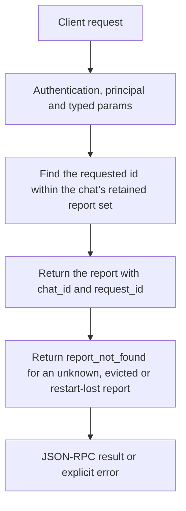

# context.report

Read one retained context report for a specific chat request. Use this to explain prompt/context decisions or timings after a completion, not to recover the whole conversation.

## Endpoint, execution and permissions

| Property | Contract |
|---|---|
| Wire endpoint | `POST /v1/cep`; logical method `context.report` |
| Execution | Synchronous domain result in the JSON-RPC result field |
| Required scope | `read` |
| MCP facade | Eligible for the current read-only MCP facade |
| Side effects | Read/control behavior described below; this scope alone is not a promise of zero side effects |

Send a Bearer token when API authentication is enabled. Authentication failures are HTTP 401; ordinary CEP method errors are JSON-RPC error objects, normally with HTTP 200. A successful HTTP status alone does not prove the operation succeeded. See [the common CEP contract](../../README.md).

## How it works

1. Find the requested id within the chat’s retained report set
2. Return the report with chat_id and request_id
3. Return report_not_found for an unknown, evicted or restart-lost report



## Parameters, defaults and value effects

| Parameter | Type | Required | Meaning, default and constraints |
|---|---|---|---|
| `chat_id` | string | Yes | The chat (`session_id` of its chat requests) Use the same chat_id that the client sends as session_id to chat completions. A stream id, note id or title is not a chat id. |
| `request_id` | string | Yes | One id from `context.reports` (the chat completion's `id`) Required exact id from context.reports (or its completion). A task_id is not interchangeable. |

Unknown top-level method parameters are rejected. `params._meta` is protocol metadata, not a domain option; approval retries must preserve the same method and domain parameters. Where a parameter is optional, omission follows the method-specific rules above rather than implying a universal zero or empty-string default.

## Request examples

Examples describe contracts, not measured execution. Replace IDs, paths and installed-package names with real values from your Engine. Do not execute write/delete/process examples against valuable data merely to read the documentation.

### 1. Basic request

This request uses the documented selection. Read the result semantics below before acting on it.

```json
{
  "jsonrpc": "2.0",
  "id": 1,
  "method": "context.report",
  "params": {
    "chat_id": "c1",
    "request_id": "chatcmpl-1a2b"
  }
}
```

### 2. Read a discovered report

Use a real retained request id; retrying an evicted id will not restore it.

```json
{
  "jsonrpc": "2.0",
  "id": 2,
  "method": "context.report",
  "params": {
    "chat_id": "c1",
    "request_id": "<id-from-context.reports>"
  }
}
```

## Response and field meanings

context_report is the actual retained record; its nested plan/tools/timing information depends on the original request. chat_id/request_id preserve identity for the client.

The following response is an illustrative shape. IDs, byte counts, timings and array contents depend on the actual request and machine; shortened nested objects are not a second schema or a measured result.

```json
{
  "id": 1,
  "jsonrpc": "2.0",
  "result": {
    "chat_id": "c1",
    "context_report": {
      "timing": {
        "preflight_ms": 23
      }
    },
    "request_id": "chatcmpl-1a2b"
  }
}
```

## Errors and recovery

| Code / boundary | Meaning | Recovery |
|---|---|---|
| HTTP 401 | Missing/invalid token while authentication is enabled | Supply the configured token; a CEP params change cannot repair authentication |
| `-32602` / typed params | Missing required fields, wrong JSON types or unknown fields | Correct the request against this page; do not retry the same invalid payload |
| `-32002` / principal | Required scope/owner/root authorization is absent | Inspect `error.data.needs`; use an authorized caller or permitted target |
| `-32004` / `report_not_found` | No such report: only the newest 20 per chat are kept, in memory, until a restart | Refresh the relevant inventory/IDs and check whether the resource expired |

### Invalid-field example

This is deliberately invalid. The extra field must be removed; it is not an alternate feature toggle.

```text
{
  "jsonrpc": "2.0",
  "id": 90,
  "method": "context.report",
  "params": {
    "chat_id": "c1",
    "request_id": "chatcmpl-1a2b",
    "__unknown_option": true
  }
}
```

The error envelope is `{"jsonrpc":"2.0","id":90,"error":{"code":-32602,"message":"...","data":{"type":"invalid_params", "errors":[...]}}}`. Exact message and field diagnostics are generated by typed deserialization; callers should use codes and structured data, not match a sentence.

## cURL

Save one valid request above as `request.json`:

```bash
curl --fail-with-body http://127.0.0.1:8000/v1/cep \
  -H "Content-Type: application/json" \
  -H "Authorization: Bearer $CLUAIZ_TOKEN" \
  --data-binary @request.json
```

## Python

Install `requests` in your client environment. This executes the basic request; edit `params` for a different valid case.

```python
import json
import os
import requests

payload = json.loads(r'''{
  "id": 1,
  "jsonrpc": "2.0",
  "method": "context.report",
  "params": {
    "chat_id": "c1",
    "request_id": "chatcmpl-1a2b"
  }
}''')
response = requests.post(
    "http://127.0.0.1:8000/v1/cep",
    headers={"Authorization": "Bearer " + os.environ["CLUAIZ_TOKEN"]},
    json=payload, timeout=60,
)
response.raise_for_status()
reply = response.json()
if "error" in reply:
    raise RuntimeError(json.dumps(reply["error"], ensure_ascii=False))
print(reply["result"])
```

## JavaScript / Node.js

Use an owner token only in a trusted client. Do not ship it inside a public web page.

```javascript
const payload = {
  "id": 1,
  "jsonrpc": "2.0",
  "method": "context.report",
  "params": {
    "chat_id": "c1",
    "request_id": "chatcmpl-1a2b"
  }
};
const response = await fetch("http://127.0.0.1:8000/v1/cep", {
  method: "POST",
  headers: { "content-type": "application/json", authorization: `Bearer ${process.env.CLUAIZ_TOKEN}` },
  body: JSON.stringify(payload),
});
const raw = await response.text();
if (!response.ok) throw new Error(`HTTP ${response.status}: ${raw}`);
const reply = JSON.parse(raw);
if (reply.error) throw new Error(JSON.stringify(reply.error));
console.log(reply.result);
```

## Limits, state and related operations

Newest20 per chat, RAM only. Reading a report does not rerun the planner, so it is historical information rather than the machine’s current available RAM/VRAM. The method does not create an archive or guarantee reports survive restart.

- [`context.reports`](context.reports.md): use its separate documented contract.
- [`context.preview`](context.preview.md): use its separate documented contract.
- [`system.live`](../../system/system/system.live.md): use its separate documented contract.

## Implementation reference

- [api/src/cep/methods/context.rs](../../../../../api/src/cep/methods/context.rs)
