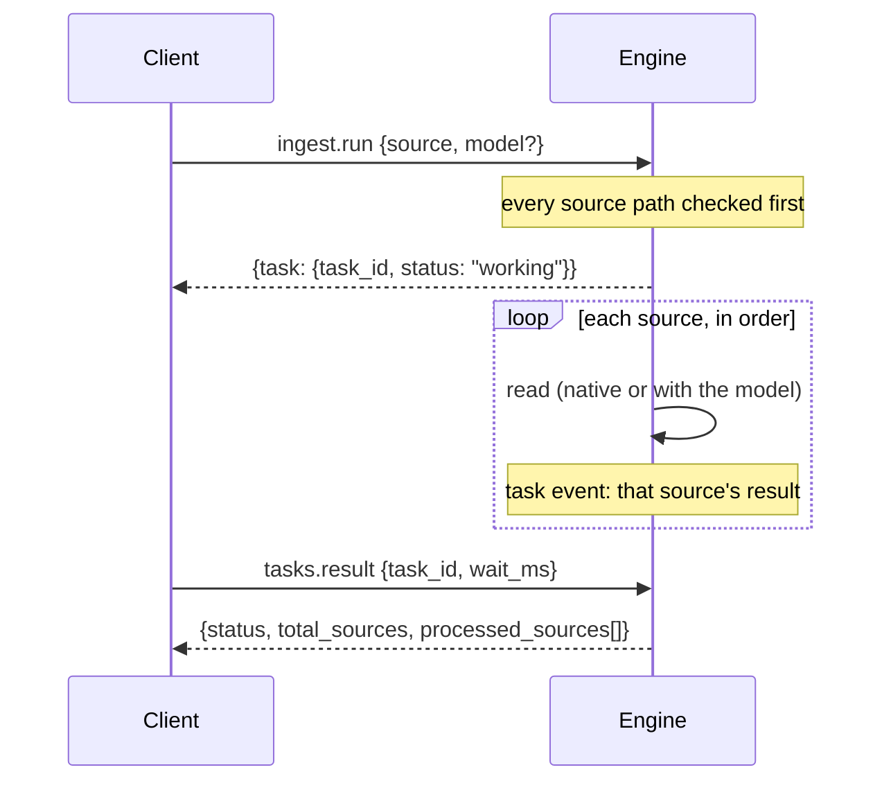

# ingest.run

Turns documents and media into text, chunks, or vectors, as a task. **Model selection is optional.** Without `model` the Engine uses its native document and OCR readers and loads no model. With `model` it also runs that installed model on each source.

Paths are paths on the Engine's machine and must be inside the caller's roots; http(s) sources follow the remote-source policy; a data URI must hold the real bytes.

## Processing modes

| Selection | Image | PDF | DOCX / DOC / text | Output |
|:---|:---|:---|:---|:---|
| Native extraction (no `model`, or `auto`) | Native OCR | Native text, automatic OCR where needed | Native extraction | Text/chunks and provenance |
| Text embedding package, ONNX or GGUF | Native OCR, then text vectors | Native extraction/OCR, then chunk vectors | Native extraction, then chunk vectors | Text vectors; optional extracted text |
| ONNX image embedding graph | Real image pixels | Each rendered page's real pixels | Unsupported by an image-only graph; choose a text embedding model | Image/page vectors |
| Generative GGUF vision package | Model reads pixels | Model reads rendered page pixels in order | Native text extraction, then selected model processing | Model-generated text/chunks |

A folder named `ingest` is an installation category, not proof of an OCR decoder. FashionCLIP-style feature graphs return vectors. A generative vision package returns text. The engine does not turn an embedding vector into invented OCR text, and does not silently substitute a different model.

## The task



1. Every source is checked before anything starts, so one bad path fails the whole call at once.
2. The answer is a task handle. Each finished source is a task event; `progress` counts sources.
3. [`tasks.result`](../../system/tasks/tasks.result.md) gives the result below. When every source failed, the task fails with `ingest_failed`: its code follows the first failure, and `data.result` still holds every source.

## Field details

| Field | Type | Default | Meaning |
|:---|:---|:---|:---|
| `source` | string or string[] | Required | Authorized server-local path/file URI, allowed HTTP(S) URL, or actual data URI. Arrays preserve source order. |
| `model` | string | Native extraction | Exact installed ID from `models.list`. Omit/`auto` for native processing. Explicit missing/unsupported models error. |
| `output_controls.return_text` | boolean | `true` | Return available text/chunks. False removes raw text while retaining metadata. Image-only vectors do not produce text. |
| `output_controls.return_embeddings` | boolean | Implied by an embedding model | True requires a selected embedding model. False conflicts with selecting an embedding model. Vision text models do not produce vectors. |
| `chunking_strategy.type` | string | `semantic` | Only semantic chunking is supported. |
| `chunking_strategy.max_chunk_size` | positive integer | `512` | Maximum UTF-8 bytes per returned chunk, not tokenizer tokens. Must fit media limits. |
| `chunking_strategy.overlap` | integer | `0` | Only zero overlap is supported. |
| `vision_settings.use_vision` | boolean | `true` for selected vision model | Images/PDF pages go to the selected vision encoder. False uses native extraction first, then the selected model reads that text. |
| `vision_settings.system_instruction` | string | Packaged extraction instruction | Overrides the selected generative model's extraction instruction; for example request dates/amounts present in the document. Not an embedding control. |
| `vision_settings.max_tokens` | positive integer | Chat's default generation cap | Output-token cap for each image/page/model text generation. A cap can leave partial text. |
| `vision_settings.detail_level` | — | — | Not implemented; rejected rather than ignored. |

Unknown fields are refused. There is no per-request `keep_alive` or `device`; a selected model uses the Engine's settings and stays loaded until it is replaced or unloaded. Ingest runs no chat tools and saves no vector index.

## Params by file type

Example IDs must be replaced with your exact installed IDs when different. Sources such as `C:/documents/report.pdf` are examples, not files shipped with the engine. Shortened Base64 placeholders are not executable fixtures.

### 1. Plain text: native, no model

```json
{
  "source": "data:text/plain;base64,SGVsbG8gQ2x1YWl6IQ==",
  "output_controls": {"return_text": true}
}
```

This complete data URI contains `Hello Cluaiz!`. A UTF-8/recognized text file path is also accepted. Supported native text decoding includes the extractor's BOM handling; unknown binary files are not accepted as text.

### 2. Digital PDF: native, no model

```json
{
  "source": "C:/documents/report.pdf",
  "output_controls": {"return_text": true},
  "chunking_strategy": {"type": "semantic", "max_chunk_size": 512, "overlap": 0}
}
```

The native provider extracts page text. Image-only/empty PDF regions use packaged OCR where available; inspect page omissions/warnings.

### 3. Scanned PDF: actual inline bytes

```json
{
  "source": "data:application/pdf;base64,<actual-base64-pdf-bytes>",
  "output_controls": {"return_text": true}
}
```

Do not set a model merely to enable native OCR. Packaged renderer/OCR assets must be available; an unavailable provider is reported.

### 4. Receipt/image: native OCR

```json
{
  "source": "C:/images/receipt.png",
  "output_controls": {"return_text": true}
}
```

An allowed image URL or actual `data:image/png;base64,...` is an alternative. Native OCR reads text; it does not describe image meaning.

### 5. Word DOCX: native, no model

```json
{
  "source": "C:/documents/report.docx",
  "output_controls": {"return_text": true}
}
```

The OOXML provider reads supported main-body text/table content. It is not a screenshot interpretation model; headers/footers or unsupported objects can appear as omissions.

### 6. Legacy Word DOC: supported native text

```json
{
  "source": "C:/documents/report.doc",
  "output_controls": {"return_text": true}
}
```

A real supported compound Word document is required. Legacy DOC and DOCX use different parsers. Native text extraction does not promise full layout/image reconstruction.

### 7. Mixed native batch

```json
{
  "source": ["C:/documents/report.pdf", "C:/documents/report.docx", "C:/documents/notes.txt"],
  "output_controls": {"return_text": true}
}
```

Results keep source order. Inspect each source status; a successful source does not make every other source successful.

### 8. Metadata only

```json
{
  "source": "C:/documents/report.pdf",
  "output_controls": {"return_text": false}
}
```

Extraction still occurs. Raw text and chunks are omitted; counts, methods, pages, warnings, omissions and available recognition confidence remain.

### 9. PDF/DOCX/text directly to selected text vectors

```json
{
  "model": "embeddinggemma-2-GGUF",
  "source": "C:/documents/report.pdf",
  "output_controls": {"return_text": true, "return_embeddings": true},
  "chunking_strategy": {"type": "semantic", "max_chunk_size": 512, "overlap": 0}
}
```

Choose a compatible installed ONNX or GGUF **text** embedding package. The engine extracts chunks and sends their actual text to that package's shared embedding executor. Replace the source with a DOCX/DOC/text file to use the same pipeline. Chunk bytes are not tokenizer counts; oversized model sequences error instead of being silently truncated.

### 10. Image to selected ONNX image vectors

```json
{
  "model": "fashion_clip-unknown-onnx-fp32",
  "source": "C:/images/jacket.png",
  "output_controls": {"return_text": false, "return_embeddings": true}
}
```

Returns an image vector, not OCR prose. Graph inputs/signatures determine whether the selected ONNX package accepts pixels. No fake text vector or caption is generated.

### 11. PDF page vectors with selected ONNX image graph

```json
{
  "model": "fashion_clip-unknown-onnx-fp32",
  "source": "C:/documents/catalog.pdf",
  "output_controls": {"return_text": false, "return_embeddings": true}
}
```

Requires packaged PDF rendering. Each page is rendered and processed in order, retaining one page image at a time. `embeddings[].page` identifies the physical page. An image-only graph cannot embed raw DOCX/text; choose a text embedding package for those sources.

### 12. Image with selected generative vision model

```json
{
  "model": "MiniCPM-V-4.6-gguf-Q4_K_M",
  "source": "C:/images/receipt.png",
  "output_controls": {"return_text": true},
  "vision_settings": {"use_vision": true, "max_tokens": 512}
}
```

The selected GGUF and matching projector process actual pixels through the existing native media host. `parts[].method` is `model_text`; generated recognition may be inaccurate.

### 13. Scanned PDF with selected vision model

```json
{
  "model": "MiniCPM-V-4.6-gguf-Q4_K_M",
  "source": "C:/documents/scanned_report.pdf",
  "output_controls": {"return_text": true},
  "vision_settings": {"use_vision": true, "max_tokens": 512}
}
```

Each page is rendered and inferred separately. The output cap applies per page. Large documents can take time; page rendering and selected-model inference are distinct from native PDF text extraction.

### 14. DOCX native read, then selected model processing

```json
{
  "model": "MiniCPM-V-4.6-gguf-Q4_K_M",
  "source": "C:/documents/report.docx",
  "output_controls": {"return_text": true},
  "vision_settings": {
    "system_instruction": "Extract dates and amounts present in this document. Do not invent missing values.",
    "max_tokens": 256
  }
}
```

DOCX/DOC/text is first extracted natively. The selected model processes the extracted text; it does not see a Word page screenshot. Incomplete native extraction is not promoted to complete model context. For image/PDF input, `use_vision:false` explicitly chooses native extraction first.

### 15. PDF native read, then selected model text (without visual pixels)

```json
{
  "model": "MiniCPM-V-4.6-gguf-Q4_K_M",
  "source": "C:/documents/report.pdf",
  "output_controls": {"return_text": true},
  "vision_settings": {
    "use_vision": false,
    "system_instruction": "Extract dates and amounts present in this document. Do not invent missing values.",
    "max_tokens": 256
  }
}
```

Native PDF/OCR provides text; the selected backbone reads that text. This mode does not require a visual projector for the model. It still requires native extraction/OCR to complete. In contrast, image/PDF pixel mode requires the matching projector: an installed backbone file alone cannot see images, and an incomplete package is rejected before loading its weights for a visual request.

## Result

The task's result for one native text source (text is illustrative):

```json
{
  "status": "success",
  "total_sources": 1,
  "processed_sources": [{
    "source": "C:/documents/notes.txt",
    "status": "ingested",
    "mime_type": "text/plain",
    "chunk_size": 512,
    "chunks_count": 1,
    "chunks": ["Hello from the document."],
    "parts": [{"page":null,"method":"utf8","text":"Hello from the document.","omissions":[],"warnings":[]}]
  }]
}
```

Selected-model items add `model` and `processing` (`text_embeddings`, `image_embeddings`, or `model_text`). Vector items add `embeddings`: an ordered array of standard embedding responses with `data[].embedding`, `data[].index`, `usage`, `model`, and a `page` for rendered PDF/image work. Text vectors map to native chunks; page vectors map to physical PDF pages. Vector-only items have no OCR text.

Model text appears in `parts[].text` and returned `chunks`. Page numbers are one-based for PDFs, otherwise null. Native recognition confidence is not a model confidence score; generated text has no invented numeric confidence.

## Partial results and errors

- A source that partly worked (some pages, a warning) is `status: "partial"`; the task still completes. Check every source's `status`, `omissions` and `warnings`.
- Renderer, projector, helper and admission failures are reported, never hidden. The Engine does not pick another model on its own and never answers hashes as vectors.
- A `/v1/cep` body over `4 * ceil(media.limits.max_input_bytes / 3) + 2 MiB` (large inline data URIs) is refused with HTTP 413.
- Saving, indexing and searching vectors is the caller's job.

## Example

```bash
call() { curl -s http://127.0.0.1:8000/v1/cep -H "Authorization: Bearer $TOKEN" \
  -H "Content-Type: application/json" -d "{\"jsonrpc\":\"2.0\",\"id\":1,\"method\":\"$1\",\"params\":$2}"; }
task=$(call ingest.run '{"source":"C:/documents/report.pdf"}' | jq -r .result.task.task_id)
call tasks.result "{\"task_id\":\"$task\",\"wait_ms\":30000}"
```

Leave out the `Authorization` header when API authentication is off.
