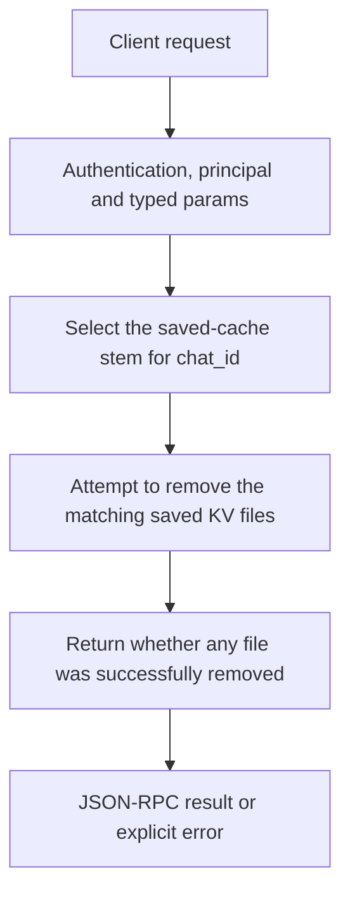

# kv.delete

Remove the saved KV files of one conversation without deleting its messages or notes. Use it to force a future prompt rebuild or free that chat’s cache space.

## Endpoint, execution and permissions

| Property | Contract |
|---|---|
| Wire endpoint | `POST /v1/cep`; logical method `kv.delete` |
| Execution | Synchronous domain result in the JSON-RPC result field |
| Required scope | `write` |
| MCP facade | Not exposed by the current read-only MCP facade |
| Side effects | Destructive; review the target before calling |

Send a Bearer token when API authentication is enabled. Authentication failures are HTTP 401; ordinary CEP method errors are JSON-RPC error objects, normally with HTTP 200. A successful HTTP status alone does not prove the operation succeeded. See [the common CEP contract](../../README.md).

## How it works

1. Select the saved-cache stem for chat_id
2. Attempt to remove the matching saved KV files
3. Return whether any file was successfully removed



## Parameters, defaults and value effects

| Parameter | Type | Required | Meaning, default and constraints |
|---|---|---|---|
| `chat_id` | string | Yes | The chat: the `session_id` its chat requests send Use the same chat_id that the client sends as session_id to chat completions. A stream id, note id or title is not a chat id. |

Unknown top-level method parameters are rejected. `params._meta` is protocol metadata, not a domain option; approval retries must preserve the same method and domain parameters. Where a parameter is optional, omission follows the method-specific rules above rather than implying a universal zero or empty-string default.

## Request examples

Examples describe contracts, not measured execution. Replace IDs, paths and installed-package names with real values from your Engine. Do not execute write/delete/process examples against valuable data merely to read the documentation.

### 1. Basic request

This request uses the documented selection. Read the result semantics below before acting on it.

```json
{
  "jsonrpc": "2.0",
  "id": 1,
  "method": "kv.delete",
  "params": {
    "chat_id": "c1"
  }
}
```

### 2. Drop one saved cache

Read kv.status first if you need to choose from actual saved cache entries.

```json
{
  "jsonrpc": "2.0",
  "id": 2,
  "method": "kv.delete",
  "params": {
    "chat_id": "conversation-to-rebuild"
  }
}
```

## Response and field meanings

deleted is boolean: true if at least one matching file was removed, false when none were removed. It is not an exact byte count or a guarantee that every matching file could be deleted. Check kv.status afterward when reclaiming disk space.

The following response is an illustrative shape. IDs, byte counts, timings and array contents depend on the actual request and machine; shortened nested objects are not a second schema or a measured result.

```json
{
  "id": 1,
  "jsonrpc": "2.0",
  "result": {
    "chat_id": "c1",
    "deleted": true
  }
}
```

## Errors and recovery

| Code / boundary | Meaning | Recovery |
|---|---|---|
| HTTP 401 | Missing/invalid token while authentication is enabled | Supply the configured token; a CEP params change cannot repair authentication |
| `-32602` / typed params | Missing required fields, wrong JSON types or unknown fields | Correct the request against this page; do not retry the same invalid payload |
| `-32002` / principal | Required scope/owner/root authorization is absent | Inspect `error.data.needs`; use an authorized caller or permitted target |

### Invalid-field example

This is deliberately invalid. The extra field must be removed; it is not an alternate feature toggle.

```text
{
  "jsonrpc": "2.0",
  "id": 90,
  "method": "kv.delete",
  "params": {
    "chat_id": "c1",
    "__unknown_option": true
  }
}
```

The error envelope is `{"jsonrpc":"2.0","id":90,"error":{"code":-32602,"message":"...","data":{"type":"invalid_params", "errors":[...]}}}`. Exact message and field diagnostics are generated by typed deserialization; callers should use codes and structured data, not match a sentence.

## cURL

Save one valid request above as `request.json`:

```bash
curl --fail-with-body http://127.0.0.1:8000/v1/cep \
  -H "Content-Type: application/json" \
  -H "Authorization: Bearer $CLUAIZ_TOKEN" \
  --data-binary @request.json
```

## Python

Install `requests` in your client environment. This executes the basic request; edit `params` for a different valid case.

```python
import json
import os
import requests

payload = json.loads(r'''{
  "id": 1,
  "jsonrpc": "2.0",
  "method": "kv.delete",
  "params": {
    "chat_id": "c1"
  }
}''')
response = requests.post(
    "http://127.0.0.1:8000/v1/cep",
    headers={"Authorization": "Bearer " + os.environ["CLUAIZ_TOKEN"]},
    json=payload, timeout=60,
)
response.raise_for_status()
reply = response.json()
if "error" in reply:
    raise RuntimeError(json.dumps(reply["error"], ensure_ascii=False))
print(reply["result"])
```

## JavaScript / Node.js

Use an owner token only in a trusted client. Do not ship it inside a public web page.

```javascript
const payload = {
  "id": 1,
  "jsonrpc": "2.0",
  "method": "kv.delete",
  "params": {
    "chat_id": "c1"
  }
};
const response = await fetch("http://127.0.0.1:8000/v1/cep", {
  method: "POST",
  headers: { "content-type": "application/json", authorization: `Bearer ${process.env.CLUAIZ_TOKEN}` },
  body: JSON.stringify(payload),
});
const raw = await response.text();
if (!response.ok) throw new Error(`HTTP ${response.status}: ${raw}`);
const reply = JSON.parse(raw);
if (reply.error) throw new Error(JSON.stringify(reply.error));
console.log(reply.result);
```

## Limits, state and related operations

The cache helper records successful file removals and can return false for missing or unremovable files without a dedicated exception. This is not chat.cancel and does not promise to erase a currently active in-memory KV state. Event logs, Chat Map and notes are separate.

- [`kv.status`](kv.status.md): use its separate documented contract.
- [`memory.delete`](../memory/memory.delete.md): use its separate documented contract.
- [`kv.clear`](kv.clear.md): use its separate documented contract.

## Implementation reference

- [api/src/cep/methods/kv.rs](../../../../../api/src/cep/methods/kv.rs)
