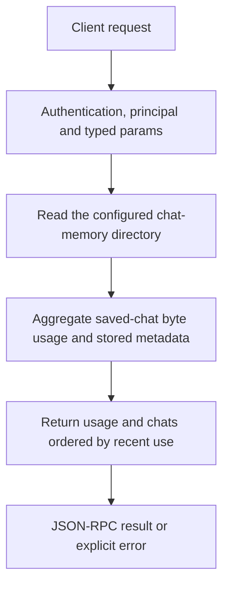

# kv.status

Inspect saved per-chat prompt/KV caches on disk. KV is an inference acceleration artifact, separate from durable event history, notes and the chat’s visible transcript.

## Endpoint, execution and permissions

| Property | Contract |
|---|---|
| Wire endpoint | `POST /v1/cep`; logical method `kv.status` |
| Execution | Synchronous domain result in the JSON-RPC result field |
| Required scope | `read` |
| MCP facade | Eligible for the current read-only MCP facade |
| Side effects | Read/control behavior described below; this scope alone is not a promise of zero side effects |

Send a Bearer token when API authentication is enabled. Authentication failures are HTTP 401; ordinary CEP method errors are JSON-RPC error objects, normally with HTTP 200. A successful HTTP status alone does not prove the operation succeeded. See [the common CEP contract](../../README.md).

## How it works

1. Read the configured chat-memory directory
2. Aggregate saved-chat byte usage and stored metadata
3. Return usage and chats ordered by recent use



## Parameters, defaults and value effects

| Parameter | Type | Required | Meaning, default and constraints |
|---|---|---|---|
| `params` | object | No fields | Use `{}`. Unknown fields are rejected; do not invent filters or target identifiers. |

Unknown top-level method parameters are rejected. `params._meta` is protocol metadata, not a domain option; approval retries must preserve the same method and domain parameters. Where a parameter is optional, omission follows the method-specific rules above rather than implying a universal zero or empty-string default.

## Request examples

Examples describe contracts, not measured execution. Replace IDs, paths and installed-package names with real values from your Engine. Do not execute write/delete/process examples against valuable data merely to read the documentation.

### 1. Basic request

This request uses the documented selection. Read the result semantics below before acting on it.

```json
{
  "jsonrpc": "2.0",
  "id": 1,
  "method": "kv.status",
  "params": {}
}
```

## Response and field meanings

directory is the Engine’s saved-KV root; bytes is its reported disk usage. chats[] can include chat_id, bytes, tokens, positions, model, cache key, saved_at and last_used. Model/path/context fingerprints matter: an old cache is not automatically reusable with another package or load setting.

The following response is an illustrative shape. IDs, byte counts, timings and array contents depend on the actual request and machine; shortened nested objects are not a second schema or a measured result.

```json
{
  "id": 1,
  "jsonrpc": "2.0",
  "result": {
    "bytes": 28774640,
    "chats": [
      {
        "bytes": 28774640,
        "chat_id": "c1",
        "key": "C:/Users/me/.cluaiz/models/chat/gemma-4-e4b/gemma-4-E4B-it-Q4_K_M.gguf|ctx=Auto|ngl=None",
        "last_used": 1792951094,
        "model": "C:/Users/me/.cluaiz/models/chat/gemma-4-e4b/gemma-4-E4B-it-Q4_K_M.gguf",
        "positions": 743,
        "saved_at": 1792951094,
        "tokens": 743
      }
    ],
    "directory": "C:/Users/me/.cluaiz/kv_cache/chats"
  }
}
```

## Errors and recovery

| Code / boundary | Meaning | Recovery |
|---|---|---|
| HTTP 401 | Missing/invalid token while authentication is enabled | Supply the configured token; a CEP params change cannot repair authentication |
| `-32602` / typed params | Missing required fields, wrong JSON types or unknown fields | Correct the request against this page; do not retry the same invalid payload |
| `-32002` / principal | Required scope/owner/root authorization is absent | Inspect `error.data.needs`; use an authorized caller or permitted target |

### Invalid-field example

This is deliberately invalid. The extra field must be removed; it is not an alternate feature toggle.

```text
{
  "jsonrpc": "2.0",
  "id": 90,
  "method": "kv.status",
  "params": {
    "__unknown_option": true
  }
}
```

The error envelope is `{"jsonrpc":"2.0","id":90,"error":{"code":-32602,"message":"...","data":{"type":"invalid_params", "errors":[...]}}}`. Exact message and field diagnostics are generated by typed deserialization; callers should use codes and structured data, not match a sentence.

## cURL

Save one valid request above as `request.json`:

```bash
curl --fail-with-body http://127.0.0.1:8000/v1/cep \
  -H "Content-Type: application/json" \
  -H "Authorization: Bearer $CLUAIZ_TOKEN" \
  --data-binary @request.json
```

## Python

Install `requests` in your client environment. This executes the basic request; edit `params` for a different valid case.

```python
import json
import os
import requests

payload = json.loads(r'''{
  "id": 1,
  "jsonrpc": "2.0",
  "method": "kv.status",
  "params": {}
}''')
response = requests.post(
    "http://127.0.0.1:8000/v1/cep",
    headers={"Authorization": "Bearer " + os.environ["CLUAIZ_TOKEN"]},
    json=payload, timeout=60,
)
response.raise_for_status()
reply = response.json()
if "error" in reply:
    raise RuntimeError(json.dumps(reply["error"], ensure_ascii=False))
print(reply["result"])
```

## JavaScript / Node.js

Use an owner token only in a trusted client. Do not ship it inside a public web page.

```javascript
const payload = {
  "id": 1,
  "jsonrpc": "2.0",
  "method": "kv.status",
  "params": {}
};
const response = await fetch("http://127.0.0.1:8000/v1/cep", {
  method: "POST",
  headers: { "content-type": "application/json", authorization: `Bearer ${process.env.CLUAIZ_TOKEN}` },
  body: JSON.stringify(payload),
});
const raw = await response.text();
if (!response.ok) throw new Error(`HTTP ${response.status}: ${raw}`);
const reply = JSON.parse(raw);
if (reply.error) throw new Error(JSON.stringify(reply.error));
console.log(reply.result);
```

## Limits, state and related operations

No chat_id or model filter is accepted. This is a storage snapshot, not current GPU KV usage or all loaded model sessions. Deleting these files should make later execution rebuild prompt state from history; do not delete history merely to free KV.

- [`kv.delete`](kv.delete.md): use its separate documented contract.
- [`kv.clear`](kv.clear.md): use its separate documented contract.
- [`config.get`](../../system/config/config.get.md): use its separate documented contract.

## Implementation reference

- [api/src/cep/methods/kv.rs](../../../../../api/src/cep/methods/kv.rs)
